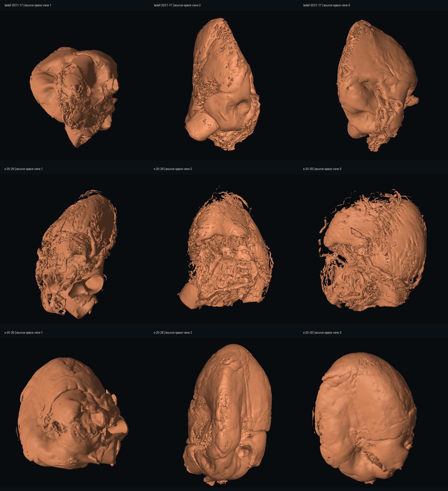

# Heart Explorer

**Explore measured heart anatomy in 3D, connect a section to its imaging plane, and practice moving an illustrative echocardiography probe.**

[Open the live demo](https://human-heart-scan-explorer.zhuou557737.chatgpt.site)

The public source repository is [o-zhu/human-heart-scan-explorer](https://github.com/o-zhu/human-heart-scan-explorer).

Heart Explorer is an independent educational project by **Oliver Zhu**. Its core viewer uses three preserved-heart HiP-CT datasets from the ESRF Human Organ Atlas. The hosted demonstration also includes separately acquired clinical examples and external echocardiography references. Each source keeps its own geometry, units, provenance, and licensing.

The project’s original work includes the browser renderer, linked section controls, source-aware streaming and caching, reversible display cleanup, interactive TTE/TEE labs, and the preparation and review tools retained in this repository. The underlying scans, reference anatomy, published guidelines, and recordings belong to their credited creators.

This source includes the feature set through website version **89**: a Reference Views gallery, labelled TTE/TEE illustrations, two-point measurements, compact workspace controls, and sequential Ultra loading. Scientific assets remain separately versioned; the website version does not change their licensing or make every hosted dataset available in a clean checkout.

## What you can explore

| Workspace | What it does |
| --- | --- |
| **3D Reconstruction** | Orbit a whole heart, move linked orthogonal cutaways, inspect measured cut faces, switch display styles, and compare prepared detail levels. Measure a straight-line distance between two visible surface points in source-calibrated millimeters. Regional colors and cleanup are qualified display aids. |
| **Reference Views** | Open a labelled gallery with **Advanced** selected initially: 28 TTE or 28 TEE views. **Basic** selects 10 introductory TTE views or the 11 ASE/SCA basic perioperative TEE views. Search or filter by imaging window, then open a card to compare its donor-specific CT reformat and 3D plane with independently acquired echocardiography teaching media. |
| **TTE Lab** | Place, slide, and steer an illustrative probe on the reference skin while a measured CT section and a CT-derived ultrasound appearance follow the accepted pose. Chest Orientation shows the complete prepared donor heart with an independently controllable camera. |
| **TEE Lab** | Adjust insertion, shaft rotation, electronic multiplane angle, and tip/side flexion. The probe, sector, CT cut face, and simulated image use the same accepted pose. |
| **Native detail and motion studies** | Optional inspectors compare selected native source regions, prepared surfaces, and explicitly illustrative deformation. These have separate asset requirements. |

The gallery uses 56 original flat teaching schematics with large chamber labels, each supplied as a full image and thumbnail. The [fresh v60 review](docs/reference-views-v60/README.md) covers every image, with per-view findings, boundary and valve checks, generation attempts, exact export hashes, and stated review limits. **All Reference Views** returns from a comparison to the same filters. The Basic TTE selection is a project navigation aid, not a claim to define a complete ASE examination. The [original gallery documentation](docs/reference-views-v54/README.md) records the initial artwork and navigation design.

The live site additionally exposes cMAC MRI/4D ultrasound and a SlicerHeart 4D CT example. **Their data are not part of the cleared public redistribution package:** permission for this project to redistribute those images and derivatives has not been established. Source adapters and acquisition instructions remain available. The older guideline-derived TEE art-v2 files and noncommercial recordings are also omitted; current original reference schematics and retained original vector diagrams remain available. Published guideline figures used to guide the new artwork are not redistributed. See [assets and availability](docs/open-source/assets.md) and [third-party notices](THIRD_PARTY_NOTICES.md).

## Prepared whole-heart models



**Native rendered compact whole-heart models.** Rows show LADAF-2021-17, S-20-29, and S-20-28 from three fixed source-space directions. This offline geometry review is not a browser screenshot or a performance measurement. The compact models support orientation; filtering and simplification can remove fine structures or alter topology, and these are not the complete finalized Ultra models. See the [preparation methods and measured limitations](docs/probe-heart-v44/README.md). The image and meshes derive from the credited Human Organ Atlas datasets under **CC BY 4.0**; retain the dataset credits in the [model manifest](public/assets/probe-heart-v44/manifest.json) and [third-party notices](THIRD_PARTY_NOTICES.md).

## Run locally

The core viewer is plain JavaScript, CSS, and HTML. **Python 3.9 or newer** is sufficient to serve it; Node packages and cloud credentials are unnecessary for this route.

1. Extract or clone the source, preserving the directory structure.
2. Restore the permitted asset archives to their documented paths, or use the checked downloader described in [asset setup](docs/open-source/assets.md). A source-only checkout does not contain every large scan bank.
3. From the repository root, run:

   ```sh
   python3 scripts/serve-local.py
   ```

   On Windows, use `py -3 scripts\serve-local.py`.

4. Open [http://127.0.0.1:8000/](http://127.0.0.1:8000/). Stop the server with **Ctrl+C**.

For another port, run `python3 scripts/serve-local.py --port 8001`. Do not open `page.html` directly with a `file://` URL: workers, requests, and checksum verification require an HTTP secure context such as localhost.

### What a source-only checkout can do

It can serve the interface and run the dependency-free checks below. Actual heart rendering requires the corresponding display volume; prepared surfaces, exact fine sections, full free-plane detail, and optional native studies require their own assets. Missing assets must be reported as missing, not relabeled as full fidelity. A resident-volume preview can keep a working lower-detail view when an optional finer source is unavailable; it cannot replace a missing initial display volume.

The supplied server serves only `page.html`, files under `public/`, and manifest-listed local data routes. It is a read-only loopback development server, not a public web host. Large gzip payloads are served as stored bytes because the application decompresses them. See [development](docs/open-source/development.md) for the precise routes and limitations.

### Loading and recovery

Where fine-surface rendering is supported, normal sessions show a cleaned intermediate before attempting **Ultra-high Fidelity**, including on mobile devices. Explicit detail choices are retained, and recovery sessions remain conservative. The working model stays visible until the complete Ultra candidate passes its integrity, cleanup, and first-presentation checks.

When temporary browser storage is available, Ultra downloads and verifies its compact parts sequentially before preparing the surface. Otherwise it uses bounded verified streaming. The progress card reports the current phase; stalled network or preparation work has finite recovery limits. A failed candidate retains the cleaned model and offers Retry where possible. These controls do not establish that every device can render Ultra, and they cannot supply assets that have not been restored locally. See [the loading contract](docs/sequential-loading-v53/README.md).

## Controls

| Area | Controls |
| --- | --- |
| 3D camera | Drag to orbit; pan with the available gesture and scroll/pinch to zoom. Two-finger gestures pan and zoom on touch devices. Fullscreen expands the active workspace. |
| Measure | In Whole Organ or Cutaway, choose **Measure**, use the orange surface preview, and select two endpoints. A dashed line shows their straight-line distance in millimeters. **Clear Measurements** removes a completed line; **Escape** or **Cancel** abandons unfinished placement. |
| Sections | Scroll or swipe over a section, use its slider/step controls, or focus it and use the arrow keys. The most recently changed section controls the linked cutaway. |
| Reference Views | Choose TTE/TEE and Basic/Advanced, then search or filter the gallery. Select a card for its comparison; **All Reference Views** restores the gallery and filters. Existing shared comparison links still open their selected view. |
| Dataset information | Hover or keyboard-focus a dataset to read its source and comparison details; source citations are also available in the page footer. |
| TTE placement | Turn on **Place Probe** in Chest Orientation, then select or drag over visible reference skin. Turn it off to orbit the chest camera. The probe and scan plane use the same accepted position in both scenes. |
| TTE steering | **W/S** and **A/D** slide; **Q/E** rotate; **I/K** tilt; **J/L** fan; **Shift** makes smaller movements. **R/F** move out of plane in free-position mode. |
| TEE steering | **W/S** advance/withdraw; **A/D** turn the shaft; **Q/E** change multiplane angle; **I/K** flex the tip; **J/L** flex sideways; **Shift** makes smaller movements. |

Lab keyboard controls work while that lab is active; text fields and browser shortcuts keep their usual behavior. The optional captured TTE mouse mode requires a click and releases with Escape. Camera changes in Chest Orientation do not steer the probe.

Compact lab layouts provide pane selectors and a **Steer** dock with touch controls. Phones can show one large visual; paired layouts adapt to the available space. Control relocation preserves the accepted probe pose and the existing renderer and media elements.

Measurements are educational annotations on the three HOA donor reconstructions. Their units use the scan calibration, but endpoint selection, display cleanup, surface preparation, and preserved-specimen anatomy limit interpretation. A line is not automatically perpendicular to a wall, a path along tissue, or a validated wall-thickness measurement. Displaying one decimal millimeter does not establish that accuracy. Measurements are not included in Share View or canvas-only snapshot exports. See [measurement behavior and limits](docs/measurement-v50/README.md).

## Develop and verify

Save a change to `page.html` or `public/`, then reload the local page. Start with the file map below and the [architecture guide](docs/open-source/architecture.md).

With **Node.js 22.13 or newer**, this small regression suite needs no package installation:

```sh
node --test tests/device-resources.mjs tests/mesh-draw-batching-v37.mjs tests/echo-angle-placement-v41.mjs tests/volume-picking-cap.mjs
```

It checks device resource policy, complete indexed-mesh submission, reference-angle placement, and cut-face picking. It does **not** establish anatomical accuracy, actual browser rendering, or device performance. Additional controller, asset, numerical, and native-render tests are retained under `tests/`; many require licensed assets or separate scientific dependencies. [Development and validation](docs/open-source/development.md) explains how to choose them.

### Optional framework build

The repository retains the Vinext/Cloudflare hosting wrapper and its lockfile. For framework development, use the pinned package manager:

```sh
npx --yes pnpm@11.25.0 install --frozen-lockfile
npx --yes pnpm@11.25.0 dev
```

To build:

```sh
npx --yes pnpm@11.25.0 build
```

These commands require network access for dependency installation. A successful build produces code; it does not populate external object storage or recover omitted datasets. Production staging scripts target the existing hosted asset arrangement and need its matching assets. See [deployment](docs/open-source/deployment.md) before publishing a fork. GitHub Pages is not configured or automatically deployed.

## File organization and common changes

| Path | Purpose |
| --- | --- |
| `page.html` | Main page, shared settings, source controls, and help text. |
| `public/app.js`, `public/workbench-modules.js` | Application state, source changes, and workspace lifecycle. |
| `public/renderer.js`, `public/cpu-renderer.js` | WebGL renderer and software fallback. Shaders are retained in editable source. |
| `public/probe-*.js`, `public/tee-*.js`, `public/echo*.js`, `public/reference-gallery.js` | Probe geometry, labs, accepted imaging planes, anatomy context, and Reference Views. |
| `public/measurement-*.js` | Calibrated two-point geometry, visible-surface picking, annotations, and interaction lifecycle. |
| `public/*volume*.js`, `public/*worker.js` | Loading, codecs, bounded caches, measured reformats, and asynchronous computation. |
| `public/donors.js`, `public/clinical-sources.js`, `public/dataset-citations.js` | Dataset catalog, adapters, and source citations. |
| `public/assets/` | Small catalogs plus restored licensed runtime assets; per-family manifests carry scientific identity. |
| `data/` | Restored large local scan banks, kept outside ordinary Git. |
| `scripts/`, `configs/` | Asset preparation, display cleanup, reconstruction, compression, audits, and local serving. |
| `server/`, `worker/`, `app/` | Indexed data-serving routes and the optional hosting wrapper. |
| `tests/`, `docs/` | Regression checks, processing records, limitations, and reproducibility notes. |

For a UI change, edit the owning module and its CSS. For an added dataset, create an independent source definition and manifest, retain original physical metadata, add citations and rights information, and verify its full loading path. For a processing change, produce a new versioned derivative with new hashes; do not silently replace immutable source arrays or existing asset identities. [Methods](docs/open-source/methods.md) lists the relevant pipelines and invariants.

## Scientific interpretation

The preserved-heart scans are fixed specimens, not beating patient hearts. Acquisition spacing, derived volume sampling, mesh detail, and displayed raster resolution are different quantities. Prepared HiP-CT grayscale arrays are windowed display derivatives, **not calibrated Hounsfield units**. Raising a display threshold does not establish fat, vessel identity, or biological confidence.

Regional annotations and manual cleanup selections are not expert ground-truth segmentations. BodyParts3D context, fitted skeletons, probe trajectories, and skin contacts are illustrative and are not registered patient anatomy. Standard echo names describe teaching targets; some named structures are uncertain or outside the acquired specimen. Independent reference movies are not synchronized or registered to the scans. The ultrasound display is a CT-derived model, without calibrated acoustic impedance or clinical validation.

Use this project for education, visualization, and software development. It is not intended for diagnosis, clinical measurement, procedural planning, or clinical training certification. Detailed limits and units are recorded in [methods](docs/open-source/methods.md) and the source-specific records they link.

## Cite and reuse

Use [CITATION.cff](CITATION.cff) to cite this software. Cite datasets, publications, and reference media separately; [references](docs/open-source/references.md) maps the principal sources to their roles.

Original project code and original documentation are provided under the [MIT License](LICENSE). That license does not relicense upstream code, data, reference anatomy, images, recordings, or their derivatives. Included HOA/BodyParts3D assets retain their attribution requirements, and share-alike media retain their own terms. See [THIRD_PARTY_NOTICES.md](THIRD_PARTY_NOTICES.md) and the asset inventory before redistributing an asset or a screenshot containing it.

Contributions are welcome. Read [CONTRIBUTING.md](CONTRIBUTING.md) for focused changes, source integrity, and review expectations; maintainers can use the [maintenance procedure](docs/open-source/maintenance.md) to keep source and deployments aligned.
