# Heart Explorer TTE and TEE illustration audit — revision 58

> **Targeted follow-up:** the v58 PLAX mitral (`tte:plax_mv`) pass was superseded after residual atrial-wall and outflow ambiguity was identified. See [revision 59](../reference-views-v59/README.md). The v58 manifest and pixels remain historical evidence; the other 55 entries are unchanged by this follow-up.


**Review date:** November 12, 2026 (America/Chicago).

**Scope:** Source-based AI visual QC of educational schematics. No independent clinician sign-off has been obtained or is implied.

All **56 illustrations** have an individual record: 28 TTE and 28 TEE. **49 retained; 7 replaced.** The replacements comprise 5 anatomical corrections and 2 clarity improvements.

The RV-focused TTE and transgastric RV inflow–outflow TEE changes improve framing or outlet clarity. The report does not diagnose pathology from the old artwork. Thin coapting valves and structures leaving the imaging plane are not automatically faults. Reconsidered concerns and retained-view limitations remain explicit in the records.

All embedded/referenced artwork is this project’s own work. Published anatomy and ultrasound references are linked, not reproduced. Exact prompts record instructions to the generator, not evidence that those instructions were satisfied. The previous manifest’s approval text is historical and does not establish the outcome of this review.

## Decision index

| Modality | View | ASE table / view | Decision |
| --- | --- | --- | --- |
| TTE | Parasternal long axis — increased depth (`plax_deep`) | 2 / 2.1 | Retained |
| TTE | Parasternal long axis — left ventricle (`plax`) | 2 / 2.2 | Retained |
| TTE | Parasternal long axis — aortic valve zoom (`plax_av`) | 2 / 2.3 | Retained |
| TTE | Parasternal long axis — mitral valve zoom (`plax_mv`) | 2 / 2.4 | Anatomical correction |
| TTE | Parasternal long axis — RV outflow (`plax_rvot`) | 2 / 2.5 | Retained |
| TTE | Parasternal long axis — RV inflow (`plax_rvin`) | 2 / 2.6 | Retained |
| TTE | Parasternal short axis — great vessels, pulmonary focus (`psax_great`) | 2 / 2.7 | Retained |
| TTE | Parasternal short axis — aortic valve level (`psax_av`) | 2 / 2.8 | Anatomical correction |
| TTE | Parasternal short axis — aortic valve zoom (`psax_av_zoom`) | 2 / 2.9 | Retained |
| TTE | Parasternal short axis — tricuspid valve focus (`psax_tv`) | 2 / 2.10a | Retained |
| TTE | Parasternal short axis — pulmonary valve and artery focus (`psax_pv`) | 2 / 2.10b | Retained |
| TTE | Parasternal short axis — mitral valve level (`psax_mitral`) | 2 / 2.11 | Retained |
| TTE | Parasternal short axis — papillary muscle level (`psax_papillary`) | 2 / 2.12 | Retained |
| TTE | Parasternal short axis — apical level (`psax_apical`) | 2 / 2.13 | Retained |
| TTE | Apical four-chamber (`a4c`) | 2 / 2.14 | Retained |
| TTE | Apical four-chamber — LV zoom (`a4c_lv`) | 2 / 2.15 | Retained |
| TTE | Apical four-chamber — RV focus (`a4c_rv`) | 2 / 2.16 | Clarity improvement |
| TTE | Apical five-chamber (`a5c`) | 2 / 2.17 | Retained |
| TTE | Apical four-chamber — posterior angulation (`a4c_cs`) | 2 / 2.18 | Retained |
| TTE | Apical two-chamber (`a2c`) | 2 / 2.19 | Retained |
| TTE | Apical two-chamber — LV zoom (`a2c_lv`) | 2 / 2.20 | Retained |
| TTE | Apical long axis — three-chamber (`a3c`) | 2 / 2.21 | Retained |
| TTE | Apical long axis — LV zoom (`a3c_lv`) | 2 / 2.22 | Retained |
| TTE | Apical four-chamber — left atrial and pulmonary vein focus (`a4c_la_pv`) | 2 / 2.23 | Anatomical correction |
| TTE | Subcostal four-chamber (`subcostal`) | 2 / 2.24 | Retained |
| TTE | Subcostal long axis — inferior vena cava (`subcostal_ivc`) | 2 / 2.25 | Retained |
| TTE | Subcostal hepatic veins (`subcostal_hepatic`) | 2 / 2.26 | Retained |
| TTE | Suprasternal notch — aortic arch (`ssn_arch`) | 2 / 2.27 | Retained |
| TEE | Midesophageal five-chamber (`me5c`) | 10 / 1 | Retained |
| TEE | Midesophageal four-chamber (`me4c`) | 10 / 2 | Retained |
| TEE | Midesophageal mitral commissural (`mecommissural`) | 10 / 3 | Retained |
| TEE | Midesophageal two-chamber (`me2c`) | 10 / 4 | Retained |
| TEE | Midesophageal long-axis (`melax`) | 10 / 5 | Anatomical correction |
| TEE | Midesophageal aortic valve long-axis (`meavlax`) | 10 / 6 | Anatomical correction |
| TEE | Midesophageal ascending aorta long-axis (`meaaolax`) | 10 / 7 | Retained |
| TEE | Midesophageal ascending aorta short-axis (`meaaosax`) | 10 / 8 | Retained |
| TEE | Midesophageal right pulmonary vein (`merpv`) | 10 / 9 | Retained |
| TEE | Midesophageal aortic valve short-axis (`meavsax`) | 10 / 10 | Retained |
| TEE | Midesophageal RV inflow-outflow (`mervinout`) | 10 / 11 | Retained |
| TEE | Midesophageal modified bicaval tricuspid valve (`memodbicaval`) | 10 / 12 | Retained |
| TEE | Midesophageal bicaval (`bicaval`) | 10 / 13 | Retained |
| TEE | Midesophageal right and left pulmonary veins (`mepv`) | 10 / 14 | Retained |
| TEE | Midesophageal left atrial appendage (`melaa`) | 10 / 15 | Retained |
| TEE | Transgastric basal short-axis (`tgbasalsax`) | 10 / 16 | Retained |
| TEE | Transgastric midpapillary short-axis (`tgpapillary`) | 10 / 17 | Retained |
| TEE | Transgastric apical short-axis (`tgapicalsax`) | 10 / 18 | Retained |
| TEE | Transgastric RV basal (`tgrvbasal`) | 10 / 19 | Retained |
| TEE | Transgastric RV inflow-outflow (`tgrvinout`) | 10 / 20 | Clarity improvement |
| TEE | Deep transgastric five-chamber (`deeptg5c`) | 10 / 21 | Retained |
| TEE | Transgastric two-chamber (`tg2c`) | 10 / 22 | Retained |
| TEE | Transgastric RV inflow (`tgrvin`) | 10 / 23 | Retained |
| TEE | Transgastric long-axis (`tglax`) | 10 / 24 | Retained |
| TEE | Descending aorta short-axis (`daosax`) | 10 / 25 | Retained |
| TEE | Descending aorta long-axis (`daolax`) | 10 / 26 | Retained |
| TEE | Upper esophageal aortic arch long-axis (`uearchlax`) | 10 / 27 | Retained |
| TEE | Upper esophageal aortic arch short-axis (`uearchsax`) | 10 / 28 | Retained |

## Per-view audit

### TTE · Parasternal long axis — increased depth

**ID:** `tte:plax_deep` · **Decision:** Retained · **ASE table/view:** 2 / 2.1

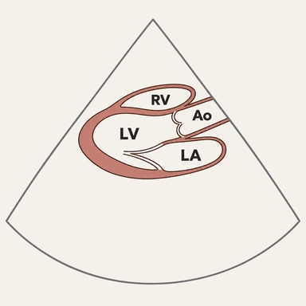

The full illustration and thumbnail are retained byte-for-byte from v54.

**Production checks:** Topology — pass; View identity — pass; Orientation — pass; Labels — pass; Phase — pass; Readability — pass.

#### Original artwork assessment

- Correct deep PLAX identity: compact LV/near-field RV/aortic root/LA with generous far-field space. MV represented by thin leaflets rather than muscle; LVOT is continuous with aorta.

#### Final assessment

Correct deep PLAX identity: compact LV/near-field RV/aortic root/LA with generous far-field space. MV represented by thin leaflets rather than muscle; LVOT is continuous with aorta.

#### Phase and limits

- **Phase:**

  Static schematic with thin valve profiles near coaptation; an exact cardiac phase or ECG interval is not established by the pixels.

- **Limits:**

  - Closed-looking thin AV coaptation is acceptable; diagram is not a quantitative depiction of the true LV apex. Do not demand posterior pericardial effusion in a normal schematic.

  - Schematic proportions are not calibrated dimensions and cannot establish normality, pathology or function.

  - Static image review does not validate acquisition technique, motion, Doppler, ECG timing or patient diagnosis.

#### Source and exact view

- **Catalogue table:**

  2

- **Catalogue view:**

  2.1

- **Catalogue source:**

  <https://www.asecho.org/wp-content/uploads/2019/01/2019_Comprehensive-TTE.pdf>

- **Sources used in this review:**

  - Record

    - **Url:**

      <https://www.asecho.org/wp-content/uploads/2025/07/Guidelines-for-Performing-a-Comprehensive-Transthoracic-Echocardiographic-Examination-in-Adults.pdf>

    - **Title:**

      Guidelines for Performing a Comprehensive Transthoracic Echocardiographic Examination in Adults

    - **Publication:**

      Mitchell et al.; JASE 2019;32:1–64

    - **Table:**

      2

    - **Row:**

      2.1

    - **Pdf page:**

      19

    - **Role:**

      Exact-plane anatomy drawing and corresponding real echocardiographic frame; visually compared.

    - **Date note:**

      The 2025/07 URL is the rehost location, not the guideline publication year.

#### Review scope and evidence

- **Independent review:**

  TTE reviewer independently compared the original 960px asset with the exact ASE row and inspected its full-size pixels and static thumbnails. A complementary root review inspected original assets/contact sheets. The TTE reviewer rechecked this retained asset in a fresh 200px final contact sheet; no claim is made that root separately reviewed every retained image full-size. These are independent AI-assisted source comparisons, not clinical certification by an echocardiographer.

- **Full size reviewed:**

  Yes

- **Thumbnail reviewed:**

  Yes

- **Inspection:**

  - **Original full size:**

    960×960 WebP individually inspected against source before disposition.

  - **Final full size:**

    Original 960×960 WebP retained without pixel changes.

  - **Final static thumbnail sizes px:**

    - 200

  - **Final 200px contact sheet:**

    tte-final-200px-contact.png

  - **Final 384px replacement contact sheet:**

    Not specified.

  - **Actual browser render review:**

    Separate integration responsibility; this record asserts full-size and static resampled-image review only.

- **Gate findings:**

  - **Topology:**

    LV cavity leads into LVOT/aortic root; thin mitral leaflets mark the LA-LV junction. Near-field RV remains separate. No thick atrioventricular seal was found.

  - **View identity:**

    Compact PLAX anatomy with substantial far-field space preserves the increased-depth identity of ASE 2.1.

  - **Orientation:**

    RV anterior/near field; LV extends toward display left; aortic root and posterior LA toward display right.

  - **Labels:**

    RV, LV, Ao and LA lie within their corresponding lumens and remain distinguishable.

  - **Phase:**

    Static schematic with thin valve profiles near coaptation; an exact cardiac phase or ECG interval is not established by the pixels.

  - **Readability:**

    All primary labels and major cavity boundaries remain recognizable at 200px. Anatomy is intentionally smaller than the standard-depth PLAX, so detailed valve inspection uses the full-size image.

- **Hard failures:**

  None recorded.

#### Preservation and correction constraints

- Preserve the additional imaging depth below the compact heart.

- Maintain LV-to-aorta continuity and distinguish thin MV coaptation from myocardium.

- Do not add an effusion or enlarge the drawing until it duplicates standard-depth PLAX.

#### Reconsidered concerns

- Compact scale is a defining acquisition difference, not a missing-anatomy failure.

- Thin valve coaptation was not misclassified as a muscular partition.

#### Additional review metadata

- **Original asset:**

  - **Path:**

    `public/assets/reference-views-v54/tte-plax_deep.webp`

  - **Sha256:**

    `1965e6c34b9832d63633f2d00b812310f3f6c853ce88eab5ab427fc57acf82ab`

- **Source facts and operational criteria:**

  - **Source facts:**

    Imaging-plane anatomy, visible landmarks and conventional orientation are anchored to the cited exact ASE table row; additional sources are identified separately.

  - **Operational criteria:**

    Patent lumen tracing, no false muscular seals, attached leaflet profiles, legible labels at 200px/384px and absence of invented structures are artwork acceptance checks applied by the reviewers, not numerical clinical thresholds.

- **Export review:**

  - **Stage:**

    Retained production thumbnail pairing

  - **Status:**

    pass

  - **Files inspected:**

    Actual 384px thumbnail path in the current manifest, displayed at 200px

  - **Reviewer:**

    TTE review agent

  - **Findings:**

    Matched the previously reviewed full-size view identity; no swapped image, corrupted label, unexpected crop or gallery-size label blocker.

<details>
<summary>Exact prompts and authoring history</summary>

Prompts describe requested changes. Historical authoring records do not supersede this review’s findings.

##### Original artwork: provenance location

- **Historical manifest:**

  docs/reference-views-v54/asset-manifest.json

- **Historical master sha256:**

  `b545d1f906f3e88d19768c485e5fae72be76270f2acfb621baeb72fb081014a9`

- **Note:**

  The immutable historical manifest preserves the original authoring prompts. This report reproduces the exact prompts for this revision’s seven replacements; all current QC findings and retained-view decisions are included above.

</details>

#### Asset identity

| Asset | Path / identity | Pixels | Bytes | SHA-256 |
| --- | --- | --- | --- | --- |
| Original illustration | `public/assets/reference-views-v54/tte-plax_deep.webp` | 960 × 960 | 36,592 | `1965e6c34b9832d63633f2d00b812310f3f6c853ce88eab5ab427fc57acf82ab` |
| Current illustration | `public/assets/reference-views-v54/tte-plax_deep.webp` | 960 × 960 | 36,592 | `1965e6c34b9832d63633f2d00b812310f3f6c853ce88eab5ab427fc57acf82ab` |
| Original thumbnail | `public/assets/reference-views-v54/thumbs/tte-plax_deep.webp` | 384 × 384 | 10,818 | `d2dd367205fe94df68bc3d30a9ed2cff6b158f3a0a0a94ca2cde332fd4bd9354` |
| Current thumbnail | `public/assets/reference-views-v54/thumbs/tte-plax_deep.webp` | 384 × 384 | 10,818 | `d2dd367205fe94df68bc3d30a9ed2cff6b158f3a0a0a94ca2cde332fd4bd9354` |
| Historical generation master | `Original master PNG hash` | — | — | `b545d1f906f3e88d19768c485e5fae72be76270f2acfb621baeb72fb081014a9` |

---

### TTE · Parasternal long axis — left ventricle

**ID:** `tte:plax` · **Decision:** Retained · **ASE table/view:** 2 / 2.2

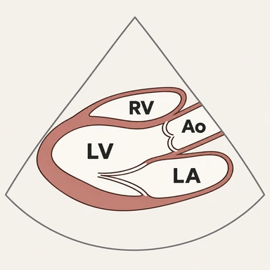

The full illustration and thumbnail are retained byte-for-byte from v54.

**Production checks:** Topology — pass; View identity — pass; Orientation — pass; Labels — pass; Phase — pass; Readability — pass.

#### Original artwork assessment

- Expected PLAX chamber arrangement and aorto-mitral continuity; thin MV leaflets communicate across LA-LV annulus, unlike failed MV zoom. Aorta arises from LV, not LA.

#### Final assessment

Expected PLAX chamber arrangement and aorto-mitral continuity; thin MV leaflets communicate across LA-LV annulus, unlike failed MV zoom. Aorta arises from LV, not LA.

#### Phase and limits

- **Phase:**

  The static mitral and aortic profiles are near coaptation; no exact cardiac phase is assigned.

- **Limits:**

  - Rounded leftward LV profile follows reference schematic; no claim that true apical myocardium is visualized or dimensions are metric.

  - Schematic proportions are not calibrated dimensions and cannot establish normality, pathology or function.

  - Static image review does not validate acquisition technique, motion, Doppler, ECG timing or patient diagnosis.

#### Source and exact view

- **Catalogue table:**

  2

- **Catalogue view:**

  2.2

- **Catalogue source:**

  <https://www.asecho.org/wp-content/uploads/2019/01/2019_Comprehensive-TTE.pdf>

- **Sources used in this review:**

  - Record

    - **Url:**

      <https://www.asecho.org/wp-content/uploads/2025/07/Guidelines-for-Performing-a-Comprehensive-Transthoracic-Echocardiographic-Examination-in-Adults.pdf>

    - **Title:**

      Guidelines for Performing a Comprehensive Transthoracic Echocardiographic Examination in Adults

    - **Publication:**

      Mitchell et al.; JASE 2019;32:1–64

    - **Table:**

      2

    - **Row:**

      2.2

    - **Pdf page:**

      19

    - **Role:**

      Exact-plane anatomy drawing and corresponding real echocardiographic frame; visually compared.

    - **Date note:**

      The 2025/07 URL is the rehost location, not the guideline publication year.

#### Review scope and evidence

- **Independent review:**

  TTE reviewer independently compared the original 960px asset with the exact ASE row and inspected its full-size pixels and static thumbnails. A complementary root review inspected original assets/contact sheets. The TTE reviewer rechecked this retained asset in a fresh 200px final contact sheet; no claim is made that root separately reviewed every retained image full-size. These are independent AI-assisted source comparisons, not clinical certification by an echocardiographer.

- **Full size reviewed:**

  Yes

- **Thumbnail reviewed:**

  Yes

- **Inspection:**

  - **Original full size:**

    960×960 WebP individually inspected against source before disposition.

  - **Final full size:**

    Original 960×960 WebP retained without pixel changes.

  - **Final static thumbnail sizes px:**

    - 200

  - **Final 200px contact sheet:**

    tte-final-200px-contact.png

  - **Final 384px replacement contact sheet:**

    Not specified.

  - **Actual browser render review:**

    Separate integration responsibility; this record asserts full-size and static resampled-image review only.

- **Gate findings:**

  - **Topology:**

    LA-LV junction is represented by thin attached MV leaflets; LVOT continues into Ao. Aorto-mitral continuity is preserved, without direct Ao-LA communication.

  - **View identity:**

    Standard-depth LV PLAX with near-field RV and posterior LA matches ASE 2.2.

  - **Orientation:**

    Anterior RV above LV; LV extends leftward; Ao at upper right and LA behind/below it.

  - **Labels:**

    RV, LV, Ao and LA labels occupy the intended structures.

  - **Phase:**

    The static mitral and aortic profiles are near coaptation; no exact cardiac phase is assigned.

  - **Readability:**

    Main labels and LVOT/MV distinction survive 200px resampling; fine cusp detail is more apparent full-size.

- **Hard failures:**

  None recorded.

#### Preservation and correction constraints

- Preserve aortic origin from LV and the fibrous aorto-mitral relationship.

- Keep RV anterior and LA posterior to the root.

- Retain the reference schematic contour without treating it as a calibrated image of the true LV apex.

#### Reconsidered concerns

- Unlike the original MV-focus image, this image does not seal the LA behind thick muscle.

- Rounded leftward contour is accepted as source-consistent schematic drawing, not a claim of a true apical imaging plane.

#### Additional review metadata

- **Original asset:**

  - **Path:**

    `public/assets/reference-views-v54/tte-plax.webp`

  - **Sha256:**

    `f15c88ecc20796529d0a7a52c1d085ed63324c421f7fdab9a47c9e9876da8c9b`

- **Source facts and operational criteria:**

  - **Source facts:**

    Imaging-plane anatomy, visible landmarks and conventional orientation are anchored to the cited exact ASE table row; additional sources are identified separately.

  - **Operational criteria:**

    Patent lumen tracing, no false muscular seals, attached leaflet profiles, legible labels at 200px/384px and absence of invented structures are artwork acceptance checks applied by the reviewers, not numerical clinical thresholds.

- **Export review:**

  - **Stage:**

    Retained production thumbnail pairing

  - **Status:**

    pass

  - **Files inspected:**

    Actual 384px thumbnail path in the current manifest, displayed at 200px

  - **Reviewer:**

    TTE review agent

  - **Findings:**

    Matched the previously reviewed full-size view identity; no swapped image, corrupted label, unexpected crop or gallery-size label blocker.

<details>
<summary>Exact prompts and authoring history</summary>

Prompts describe requested changes. Historical authoring records do not supersede this review’s findings.

##### Original artwork: provenance location

- **Historical manifest:**

  docs/reference-views-v54/asset-manifest.json

- **Historical master sha256:**

  `d3a619f8a57b0b716abbfaa68fd8b1216a0c374aaa8d0c16c6b7a276ed4e7ce5`

- **Note:**

  The immutable historical manifest preserves the original authoring prompts. This report reproduces the exact prompts for this revision’s seven replacements; all current QC findings and retained-view decisions are included above.

</details>

#### Asset identity

| Asset | Path / identity | Pixels | Bytes | SHA-256 |
| --- | --- | --- | --- | --- |
| Original illustration | `public/assets/reference-views-v54/tte-plax.webp` | 960 × 960 | 47,712 | `f15c88ecc20796529d0a7a52c1d085ed63324c421f7fdab9a47c9e9876da8c9b` |
| Current illustration | `public/assets/reference-views-v54/tte-plax.webp` | 960 × 960 | 47,712 | `f15c88ecc20796529d0a7a52c1d085ed63324c421f7fdab9a47c9e9876da8c9b` |
| Original thumbnail | `public/assets/reference-views-v54/thumbs/tte-plax.webp` | 384 × 384 | 14,398 | `79ee5762f2d37ef5485d9e2ea0cb3ed0e37c8d2250b87d4e2a53591ddd6a6cb7` |
| Current thumbnail | `public/assets/reference-views-v54/thumbs/tte-plax.webp` | 384 × 384 | 14,398 | `79ee5762f2d37ef5485d9e2ea0cb3ed0e37c8d2250b87d4e2a53591ddd6a6cb7` |
| Historical generation master | `Original master PNG hash` | — | — | `d3a619f8a57b0b716abbfaa68fd8b1216a0c374aaa8d0c16c6b7a276ed4e7ce5` |

---

### TTE · Parasternal long axis — aortic valve zoom

**ID:** `tte:plax_av` · **Decision:** Retained · **ASE table/view:** 2 / 2.3

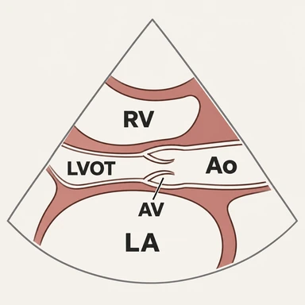

The full illustration and thumbnail are retained byte-for-byte from v54.

**Production checks:** Topology — pass; View identity — pass; Orientation — pass; Labels — pass; Phase — pass; Readability — pass.

#### Original artwork assessment

- AV focus depicts two thin semilunar leaflets at continuous LVOT-aortic lumen. Near-field RV and posterior LA orient the view correctly.

#### Final assessment

AV focus depicts two thin semilunar leaflets at continuous LVOT-aortic lumen. Near-field RV and posterior LA orient the view correctly.

#### Phase and limits

- **Phase:**

  Visible separated aortic leaflet profiles are compatible with systolic opening; no finer timing is implied.

- **Limits:**

  - Leaflets are open in this static schematic; exact sinus proportions and wall thickness are simplified. LA enlargement is framing, not quantitative anatomy.

  - Schematic proportions are not calibrated dimensions and cannot establish normality, pathology or function.

  - Static image review does not validate acquisition technique, motion, Doppler, ECG timing or patient diagnosis.

#### Source and exact view

- **Catalogue table:**

  2

- **Catalogue view:**

  2.3

- **Catalogue source:**

  <https://www.asecho.org/wp-content/uploads/2019/01/2019_Comprehensive-TTE.pdf>

- **Sources used in this review:**

  - Record

    - **Url:**

      <https://www.asecho.org/wp-content/uploads/2025/07/Guidelines-for-Performing-a-Comprehensive-Transthoracic-Echocardiographic-Examination-in-Adults.pdf>

    - **Title:**

      Guidelines for Performing a Comprehensive Transthoracic Echocardiographic Examination in Adults

    - **Publication:**

      Mitchell et al.; JASE 2019;32:1–64

    - **Table:**

      2

    - **Row:**

      2.3

    - **Pdf page:**

      19

    - **Role:**

      Exact-plane anatomy drawing and corresponding real echocardiographic frame; visually compared.

    - **Date note:**

      The 2025/07 URL is the rehost location, not the guideline publication year.

#### Review scope and evidence

- **Independent review:**

  TTE reviewer independently compared the original 960px asset with the exact ASE row and inspected its full-size pixels and static thumbnails. A complementary root review inspected original assets/contact sheets. The TTE reviewer rechecked this retained asset in a fresh 200px final contact sheet; no claim is made that root separately reviewed every retained image full-size. These are independent AI-assisted source comparisons, not clinical certification by an echocardiographer.

- **Full size reviewed:**

  Yes

- **Thumbnail reviewed:**

  Yes

- **Inspection:**

  - **Original full size:**

    960×960 WebP individually inspected against source before disposition.

  - **Final full size:**

    Original 960×960 WebP retained without pixel changes.

  - **Final static thumbnail sizes px:**

    - 200

  - **Final 200px contact sheet:**

    tte-final-200px-contact.png

  - **Final 384px replacement contact sheet:**

    Not specified.

  - **Actual browser render review:**

    Separate integration responsibility; this record asserts full-size and static resampled-image review only.

- **Gate findings:**

  - **Topology:**

    Continuous LVOT-to-Ao lumen with two thin opposing semilunar profiles; LA remains posterior and separate from Ao.

  - **View identity:**

    Aortic-root/LVOT magnification with RV and LA context identifies the valve-focused PLAX of ASE 2.3.

  - **Orientation:**

    RV is near field, LVOT to display left, Ao to right, and LA posterior/far field.

  - **Labels:**

    RV, LVOT, Ao, LA and AV identify the intended structures; the AV leader terminates at valve tissue.

  - **Phase:**

    Visible separated aortic leaflet profiles are compatible with systolic opening; no finer timing is implied.

  - **Readability:**

    Valve opening, LVOT, root and supporting chambers remain distinct at 200px; labels do not occlude their boundaries.

- **Hard failures:**

  None recorded.

#### Preservation and correction constraints

- Keep a wide continuous LVOT-Ao lumen with thin cusps.

- Keep the AV leader on a cusp rather than LA or root wall.

- Do not add a full LV apex or unrelated valve anatomy to this zoom.

#### Reconsidered concerns

- Large LA and cropped ventricular context are framing choices in the reference zoom.

- Leaflet separation is phase-compatible and does not represent a septal defect.

#### Additional review metadata

- **Original asset:**

  - **Path:**

    `public/assets/reference-views-v54/tte-plax_av.webp`

  - **Sha256:**

    `90172f0559d46361169140e6e2b5beff00632bbd9332494026c7d229738a7811`

- **Source facts and operational criteria:**

  - **Source facts:**

    Imaging-plane anatomy, visible landmarks and conventional orientation are anchored to the cited exact ASE table row; additional sources are identified separately.

  - **Operational criteria:**

    Patent lumen tracing, no false muscular seals, attached leaflet profiles, legible labels at 200px/384px and absence of invented structures are artwork acceptance checks applied by the reviewers, not numerical clinical thresholds.

- **Export review:**

  - **Stage:**

    Retained production thumbnail pairing

  - **Status:**

    pass

  - **Files inspected:**

    Actual 384px thumbnail path in the current manifest, displayed at 200px

  - **Reviewer:**

    TTE review agent

  - **Findings:**

    Matched the previously reviewed full-size view identity; no swapped image, corrupted label, unexpected crop or gallery-size label blocker.

<details>
<summary>Exact prompts and authoring history</summary>

Prompts describe requested changes. Historical authoring records do not supersede this review’s findings.

##### Original artwork: provenance location

- **Historical manifest:**

  docs/reference-views-v54/asset-manifest.json

- **Historical master sha256:**

  `411ca17a2081ad5ff4f0fb8cddc4c6c62a486800d7ddd862d5107ce62719ad9f`

- **Note:**

  The immutable historical manifest preserves the original authoring prompts. This report reproduces the exact prompts for this revision’s seven replacements; all current QC findings and retained-view decisions are included above.

</details>

#### Asset identity

| Asset | Path / identity | Pixels | Bytes | SHA-256 |
| --- | --- | --- | --- | --- |
| Original illustration | `public/assets/reference-views-v54/tte-plax_av.webp` | 960 × 960 | 50,214 | `90172f0559d46361169140e6e2b5beff00632bbd9332494026c7d229738a7811` |
| Current illustration | `public/assets/reference-views-v54/tte-plax_av.webp` | 960 × 960 | 50,214 | `90172f0559d46361169140e6e2b5beff00632bbd9332494026c7d229738a7811` |
| Original thumbnail | `public/assets/reference-views-v54/thumbs/tte-plax_av.webp` | 384 × 384 | 14,332 | `31419d92e252daef0847a940dcd1162cb5fedbf27480a98e6690e7f9d5c3e5d0` |
| Current thumbnail | `public/assets/reference-views-v54/thumbs/tte-plax_av.webp` | 384 × 384 | 14,332 | `31419d92e252daef0847a940dcd1162cb5fedbf27480a98e6690e7f9d5c3e5d0` |
| Historical generation master | `Original master PNG hash` | — | — | `411ca17a2081ad5ff4f0fb8cddc4c6c62a486800d7ddd862d5107ce62719ad9f` |

---

### TTE · Parasternal long axis — mitral valve zoom

**ID:** `tte:plax_mv` · **Decision:** Anatomical correction · **ASE table/view:** 2 / 2.4

| Before — superseded v54 artwork | After — accepted v58 artwork |
| --- | --- |
| 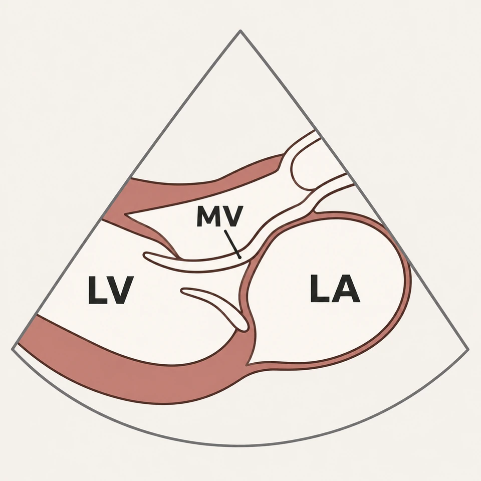 | 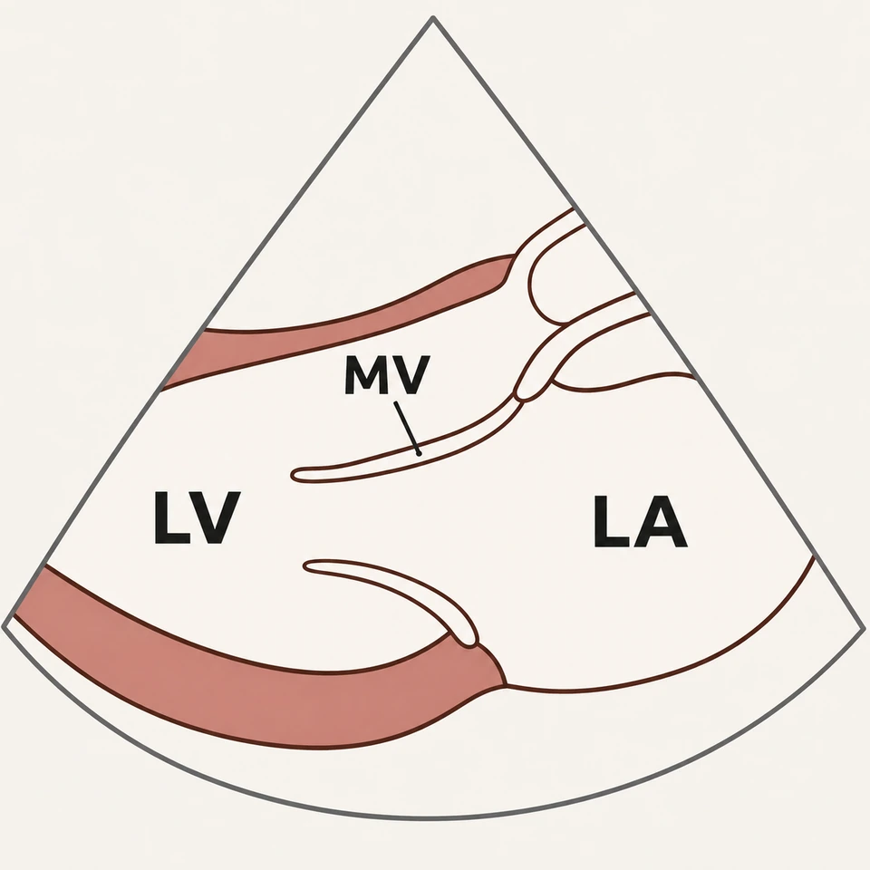 |

**Production checks:** Topology — pass; View identity — pass; Orientation — pass; Labels — pass; Phase — pass; Readability — pass.

#### Original artwork assessment

- Hard topology failure: a continuous terracotta muscular boundary seals the LA from the LV; the apparent mitral leaflets lie on its LV side. A pointed septal myocardial spur also projects into LV.

#### Final assessment

Corrected the original myocardial seal between LA and LV and removed the false pointed septal spur. The final image has a broad patent mitral opening, two thin hinged leaflets, a long anterior leaflet continuous with the aorto-mitral region, a shorter posterior leaflet, and a patent LVOT.

#### Phase and limits

- **Phase:**

  Open mitral leaflets with a broad LA-to-LV inflow opening are compatible with diastole. The aortic valve is not the focus and no exact diastolic subphase is assigned.

- **Limits:**

  - Cannot be excused as systolic closure: normal closure consists of paired thin coapting leaflet margins, not a muscle wall.

  - Leaflet lengths and wall thickness are schematic; no quantitative dimensions or individual scallop measurement are asserted.

  - Schematic proportions are not calibrated dimensions and cannot establish normality, pathology or function.

  - Static image review does not validate acquisition technique, motion, Doppler, ECG timing or patient diagnosis.

#### Source and exact view

- **Catalogue table:**

  2

- **Catalogue view:**

  2.4

- **Catalogue source:**

  <https://www.asecho.org/wp-content/uploads/2019/01/2019_Comprehensive-TTE.pdf>

- **Sources used in this review:**

  - Record

    - **Url:**

      <https://www.asecho.org/wp-content/uploads/2025/07/Guidelines-for-Performing-a-Comprehensive-Transthoracic-Echocardiographic-Examination-in-Adults.pdf>

    - **Title:**

      Guidelines for Performing a Comprehensive Transthoracic Echocardiographic Examination in Adults

    - **Publication:**

      Mitchell et al.; JASE 2019;32:1–64

    - **Table:**

      2

    - **Row:**

      2.4

    - **Pdf page:**

      19

    - **Role:**

      Exact-plane anatomy drawing and corresponding real echocardiographic frame; visually compared.

    - **Date note:**

      The 2025/07 URL is the rehost location, not the guideline publication year.

  - Record

    - **Url:**

      <https://pmc.ncbi.nlm.nih.gov/articles/PMC8495880/>

    - **Title:**

      The assessment of mitral valve disease: a guideline from the British Society of Echocardiography

    - **Publication year:**

      2021

    - **Section:**

      Mitral valve anatomy and echocardiographic assessment

    - **Role:**

      Supports atrioventricular location, long anterior leaflet, shorter posterior leaflet and aorto-mitral continuity; exact image plane is anchored to ASE Table 2 row 2.4.

#### Review scope and evidence

- **Independent review:**

  TTE reviewer independently compared the original 960px asset with the exact ASE row and inspected its full-size pixels and static thumbnails. A complementary root review inspected original assets/contact sheets. The final generated master was independently inspected at full size by both the TTE reviewer and root; the TTE reviewer then rechecked the final master and fresh 200px plus 384px resamples. These are independent AI-assisted source comparisons, not clinical certification by an echocardiographer.

- **Full size reviewed:**

  Yes

- **Thumbnail reviewed:**

  Yes

- **Inspection:**

  - **Original full size:**

    960×960 WebP individually inspected against source before disposition.

  - **Final full size:**

    Generated PNG master re-inspected full-size.

  - **Final static thumbnail sizes px:**

    - 200

    - 384

  - **Final 200px contact sheet:**

    tte-final-200px-contact.png

  - **Final 384px replacement contact sheet:**

    tte-final-replacements-384px-contact.png

  - **Actual browser render review:**

    Separate integration responsibility; this record asserts full-size and static resampled-image review only.

- **Gate findings:**

  - **Topology:**

    A broad unobstructed blood-space path can be traced from LA to LV between the leaflet free tips. The AML hinges at the aorto-mitral junction; PML hinges at the basal posterior/inferolateral wall. No myocardium caps the annulus. LVOT stays anterior to AML and communicates with aortic root.

  - **View identity:**

    Magnified PLAX mitral anatomy corresponding to ASE 2.4, with LV left, LA right and partial root context.

  - **Orientation:**

    LV display left, LA display right/posterior, anterior leaflet at the upper annulus and shorter posterior leaflet at lower annulus.

  - **Labels:**

    LV and LA lie in their respective lumens. MV leader meets the long anterior leaflet, without pointing into the aorta.

  - **Phase:**

    Open mitral leaflets with a broad LA-to-LV inflow opening are compatible with diastole. The aortic valve is not the focus and no exact diastolic subphase is assigned.

  - **Readability:**

    At both 384px and 200px, the broad LA-LV gap, separate leaflet tips and all three labels remain visible. No resampling-induced apparent atrial seal.

- **Hard failures:**

  None recorded.

#### Preservation and correction constraints

- Never draw a continuous muscle wall behind or between MV leaflets.

- Draw long AML from aorto-mitral junction and shorter PML from basal inferolateral annulus; each attaches at one hinge only.

- Keep leaflet tips separated for this diastolic illustration.

- Preserve smooth septal endocardium, thin atrial wall and patent LVOT.

- Keep LV, LA and MV labels clear at 200px; retain the established sector and palette.

#### Reconsidered concerns

- Original LA-LV muscular occlusion removed.

- Both leaflet hinge locations and intervening inflow opening made recognizable.

- First candidate residual triangular septal spur removed by the second generation.

- The final opening remains patent at 200px and 384px.

#### Additional review metadata

- **Original asset:**

  - **Path:**

    `public/assets/reference-views-v54/tte-plax_mv.webp`

  - **Sha256:**

    `f43c6f869af87998f2f013b70dad8da6d11df985710ac5b8ed851e66dd8be9e6`

- **Source facts and operational criteria:**

  - **Source facts:**

    Imaging-plane anatomy, visible landmarks and conventional orientation are anchored to the cited exact ASE table row; additional sources are identified separately.

  - **Operational criteria:**

    Patent lumen tracing, no false muscular seals, attached leaflet profiles, legible labels at 200px/384px and absence of invented structures are artwork acceptance checks applied by the reviewers, not numerical clinical thresholds.

- **Export review:**

  - **Stage:**

    Local production WebP files, before publication

  - **Status:**

    pass

  - **Files inspected:**

    Actual 960px image and actual 384px thumbnail; 200px rendition derived from the encoded thumbnail

  - **Reviewer:**

    TTE review agent; root also inspected all seven exported thumbnails at 240px

  - **Findings:**

    The broad LA–LV opening, separate leaflet tips and labels remain visible after WebP encoding and thumbnail reduction.

  - **Remaining display limit:**

    Fine leaflet and cusp interpretation requires the enlarged illustration.

<details>
<summary>Exact prompts and authoring history</summary>

Prompts describe requested changes. Historical authoring records do not supersede this review’s findings.

##### Accepted replacement: exact final prompt and preceding prompts

- **Tool:**

  image_gen

- **Prompt:**

  ```text
  Use case: scientific-educational precise-object-edit. Edit this original PLAX mitral-valve-focused reference image to fix ONE residual anatomical error while preserving its palette, labels, layout, sector, open LA–LV mitral orifice, two thin open leaflets, LA size, aortic root and everything else.
  REMOVE the large pointed terracotta triangular myocardial spur that projects from the upper-left ventricular septal wall into the LV (tip near x455 y637 in this 1254px image; base near x300 y540). This spike is a false intracavitary projection. Replace that local boundary with a single smooth gently rising endocardial contour running from display left toward the LV outflow tract at upper right. The upper septal tissue must be a continuous smooth band with NO downward-pointing hook, triangular beak, intraventricular septal spur, or free-floating tissue. Keep the LV blood pool open immediately beneath this smooth upper border. Do not confuse the long thin cream anterior mitral leaflet below this region with the spur: preserve that leaflet exactly. Preserve the separated posterior leaflet at bottom and broad patent LA↔LV white inflow opening. NO new labels, arrows, walls, structures or artifacts. Same minimal flat ivory/terracotta style, square composition.
  ```

- **Reference inputs:**

  - Record

    - **Role:**

      previous candidate or original style/edit target

    - **Url:**

      Not specified.

    - **Name:**

      image(20261113-011530).png

    - **Sha256:**

      `396e693ef467e3ada009a87fe4210d70cf5131c10b9a59748589e9ee0f4f1ac7`

  - Record

    - **Role:**

      authoritative exact-plane reference

    - **Url:**

      <https://www.asecho.org/wp-content/uploads/2025/07/Guidelines-for-Performing-a-Comprehensive-Transthoracic-Echocardiographic-Examination-in-Adults.pdf>

    - **Name:**

      ase-tte-19.png

    - **Sha256:**

      `e49f08b7c0a4f41594254e015f9d4a1aeeb7d946984d228650abdfa7d9efb260`

  - Record

    - **Role:**

      previous candidate or original style/edit target

    - **Url:**

      Not specified.

    - **Name:**

      exec-d05e3848-965e-440e-ae38-55ac3f4d6c88.png

    - **Sha256:**

      `ae1b7452dc0f654a84bbae503209b72b881555f14f802dcb3b42179cc899187b`

- **Earlier prompts in order:**

  - ```text
    Use case: scientific-educational. Create the corrected replacement for one cardiac echocardiography reference illustration: TTE parasternal long-axis, mitral valve focus, shown in diastole. Input 1 is the edit target and exact style reference. Input 2 is an anatomical reference sheet ONLY; use row 2.4 (PLAX zoomed MV) for topology and never reproduce the reference page.
    Keep the current pale warm ivory background, thin gray ultrasound sector outline, muted terracotta myocardium with thin dark-brown boundaries, white/ivory blood spaces and valve leaflets, bold black sans-serif short labels. Square image, clean flat medical diagram, no realism, shadows, texture, gradients, title, legend, or extra panels.
    CRITICAL CORRECTION: The target incorrectly makes the left atrium a closed bag behind a continuous thick salmon wall. DELETE that entire intervening muscular wall at the LA-to-LV mitral orifice. The LA on display right must communicate directly through a BROAD OPEN WHITE annular gap with the LV on display left. You must be able to trace a broad path from the middle of LA to the middle of LV without crossing ANY wall or leaflet. The LA must NOT have a closed oval outline on its left. The upper and lower margins of this broad opening are separate mitral annular hinge points.
    Draw only two THIN pale mitral valve leaflets, opened into the LV toward display left. The long anterior leaflet hinges at the UPPER annulus in fibrous continuity with the aortic root; the shorter posterior leaflet hinges at the LOWER annulus at the basal posterior LV wall. Their free tips point left, stay visibly separated, and cannot form a solid barrier. No tissue partition between or behind the leaflets. The anterior leaflet forms the LVOT lower border; LV cavity above it connects continuously into the aortic root in the upper right. LA lies behind/below the aortic root; aorta must not directly open into LA. Keep myocardium thicker around LV and thin around LA. Sector is only the imaging boundary, not anatomy.
    Keep bold labels 'LV' within the open LV cavity left and 'LA' within LA right. Label 'MV' above a short thin pointer ending directly on the anterior leaflet, not in LVOT or aortic valve. All text fully readable at thumbnail scale. No additional labels necessary. Make the anatomically corrected region look completely native to the original style.
    ```

##### Original artwork: provenance location

- **Historical manifest:**

  docs/reference-views-v54/asset-manifest.json

- **Historical master sha256:**

  `9a64f9a403fade3490da5f2b5db563fb6ac1652a150d203464ff3aac028cc1c4`

- **Note:**

  The immutable historical manifest preserves the original authoring prompts. This report reproduces the exact prompts for this revision’s seven replacements; all current QC findings and retained-view decisions are included above.

</details>

#### Asset identity

| Asset | Path / identity | Pixels | Bytes | SHA-256 |
| --- | --- | --- | --- | --- |
| Original illustration | `public/assets/reference-views-v54/tte-plax_mv.webp` | 960 × 960 | 49,806 | `f43c6f869af87998f2f013b70dad8da6d11df985710ac5b8ed851e66dd8be9e6` |
| Current illustration | `public/assets/reference-views-v58/tte-plax_mv.webp` | 960 × 960 | 47,328 | `6fc554c6d39f4b3e9ecb6dd8dd931958b8b1dac5006d3daf0b1f662748980530` |
| Original thumbnail | `public/assets/reference-views-v54/thumbs/tte-plax_mv.webp` | 384 × 384 | 14,218 | `e5b2e454178aaeb2a4e2f0b945dcf10c6a7b713413b1840b77ec6a3671f72f43` |
| Current thumbnail | `public/assets/reference-views-v58/thumbs/tte-plax_mv.webp` | 384 × 384 | 13,876 | `9a45dc5377e0f4117f354d38fe0faa86e77dbaa74b435ac89640e1a9d1f4f06d` |
| Accepted generation master | `Master PNG hash; no published source image embedded` | — | — | `ee795a24aaaf765fb76a8c39e0799669f206227b9700900faa78a2103efd551a` |
| Historical generation master | `Original master PNG hash` | — | — | `9a64f9a403fade3490da5f2b5db563fb6ac1652a150d203464ff3aac028cc1c4` |

---

### TTE · Parasternal long axis — RV outflow

**ID:** `tte:plax_rvot` · **Decision:** Retained · **ASE table/view:** 2 / 2.5

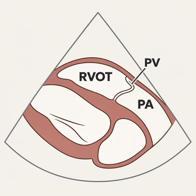

The full illustration and thumbnail are retained byte-for-byte from v54.

**Production checks:** Topology — pass; View identity — pass; Orientation — pass; Labels — pass; Phase — pass; Readability — pass.

#### Original artwork assessment

- RVOT near field continues through thin pulmonic valve into longitudinal PA; left-heart fragments remain unlabelled supporting context matching source plane.

#### Final assessment

RVOT near field continues through thin pulmonic valve into longitudinal PA; left-heart fragments remain unlabelled supporting context matching source plane.

#### Phase and limits

- **Phase:**

  Pulmonic profiles appear near coaptation; closure is compatible with a diastolic state, but exact timing is not specified.

- **Limits:**

  - Do not require an in-plane MV connection in supporting out-of-plane cavities of an RVOT-targeted image. Two fine supporting subvalvular strokes are simplified.

  - Schematic proportions are not calibrated dimensions and cannot establish normality, pathology or function.

  - Static image review does not validate acquisition technique, motion, Doppler, ECG timing or patient diagnosis.

#### Source and exact view

- **Catalogue table:**

  2

- **Catalogue view:**

  2.5

- **Catalogue source:**

  <https://www.asecho.org/wp-content/uploads/2019/01/2019_Comprehensive-TTE.pdf>

- **Sources used in this review:**

  - Record

    - **Url:**

      <https://www.asecho.org/wp-content/uploads/2025/07/Guidelines-for-Performing-a-Comprehensive-Transthoracic-Echocardiographic-Examination-in-Adults.pdf>

    - **Title:**

      Guidelines for Performing a Comprehensive Transthoracic Echocardiographic Examination in Adults

    - **Publication:**

      Mitchell et al.; JASE 2019;32:1–64

    - **Table:**

      2

    - **Row:**

      2.5

    - **Pdf page:**

      19

    - **Role:**

      Exact-plane anatomy drawing and corresponding real echocardiographic frame; visually compared.

    - **Date note:**

      The 2025/07 URL is the rehost location, not the guideline publication year.

#### Review scope and evidence

- **Independent review:**

  TTE reviewer independently compared the original 960px asset with the exact ASE row and inspected its full-size pixels and static thumbnails. A complementary root review inspected original assets/contact sheets. The TTE reviewer rechecked this retained asset in a fresh 200px final contact sheet; no claim is made that root separately reviewed every retained image full-size. These are independent AI-assisted source comparisons, not clinical certification by an echocardiographer.

- **Full size reviewed:**

  Yes

- **Thumbnail reviewed:**

  Yes

- **Inspection:**

  - **Original full size:**

    960×960 WebP individually inspected against source before disposition.

  - **Final full size:**

    Original 960×960 WebP retained without pixel changes.

  - **Final static thumbnail sizes px:**

    - 200

  - **Final 200px contact sheet:**

    tte-final-200px-contact.png

  - **Final 384px replacement contact sheet:**

    Not specified.

  - **Actual browser render review:**

    Separate integration responsibility; this record asserts full-size and static resampled-image review only.

- **Gate findings:**

  - **Topology:**

    RVOT leads through thin pulmonary cusps to longitudinal PA. Supporting left-heart fragments do not falsely connect to the pulmonary outflow.

  - **View identity:**

    RVOT-focused long axis, matching ASE 2.5 rather than standard LV PLAX.

  - **Orientation:**

    RVOT anterior/near field, pulmonary junction to display right and PA continuing inferiorly/rightward in this plane.

  - **Labels:**

    RVOT and PA are centered in their lumens; PV leader reaches the thin pulmonary valve.

  - **Phase:**

    Pulmonic profiles appear near coaptation; closure is compatible with a diastolic state, but exact timing is not specified.

  - **Readability:**

    RVOT/PV/PA path and labels remain distinguishable at 200px. Supporting fine strokes do not mimic a sealed outflow.

- **Hard failures:**

  None recorded.

#### Preservation and correction constraints

- Retain continuous RVOT-PV-PA sequence with thin valve tissue.

- Do not insert a full mitral connection into supporting structures that are cut out of that plane.

- Keep PV leader attached to the actual pulmonary junction.

#### Reconsidered concerns

- Closed-looking thin pulmonary cusps are a possible valve state, not a muscular occlusion.

- Absence of a full LA-LV junction in this RVOT-targeted slice is not a failure.

#### Additional review metadata

- **Original asset:**

  - **Path:**

    `public/assets/reference-views-v54/tte-plax_rvot.webp`

  - **Sha256:**

    `a664a946440341471b8ddb474323610b9ba1acd504283f05238764d309313cdc`

- **Source facts and operational criteria:**

  - **Source facts:**

    Imaging-plane anatomy, visible landmarks and conventional orientation are anchored to the cited exact ASE table row; additional sources are identified separately.

  - **Operational criteria:**

    Patent lumen tracing, no false muscular seals, attached leaflet profiles, legible labels at 200px/384px and absence of invented structures are artwork acceptance checks applied by the reviewers, not numerical clinical thresholds.

- **Export review:**

  - **Stage:**

    Retained production thumbnail pairing

  - **Status:**

    pass

  - **Files inspected:**

    Actual 384px thumbnail path in the current manifest, displayed at 200px

  - **Reviewer:**

    TTE review agent

  - **Findings:**

    Matched the previously reviewed full-size view identity; no swapped image, corrupted label, unexpected crop or gallery-size label blocker.

<details>
<summary>Exact prompts and authoring history</summary>

Prompts describe requested changes. Historical authoring records do not supersede this review’s findings.

##### Original artwork: provenance location

- **Historical manifest:**

  docs/reference-views-v54/asset-manifest.json

- **Historical master sha256:**

  `5d2f35ace27b0eba74cd12906df7859d46a82c93a428ec387685d7d7727c81c9`

- **Note:**

  The immutable historical manifest preserves the original authoring prompts. This report reproduces the exact prompts for this revision’s seven replacements; all current QC findings and retained-view decisions are included above.

</details>

#### Asset identity

| Asset | Path / identity | Pixels | Bytes | SHA-256 |
| --- | --- | --- | --- | --- |
| Original illustration | `public/assets/reference-views-v54/tte-plax_rvot.webp` | 960 × 960 | 49,960 | `a664a946440341471b8ddb474323610b9ba1acd504283f05238764d309313cdc` |
| Current illustration | `public/assets/reference-views-v54/tte-plax_rvot.webp` | 960 × 960 | 49,960 | `a664a946440341471b8ddb474323610b9ba1acd504283f05238764d309313cdc` |
| Original thumbnail | `public/assets/reference-views-v54/thumbs/tte-plax_rvot.webp` | 384 × 384 | 14,606 | `74bf7a46632feba4f06556d5db20f226ffbdead580bd4e6c26c1c53ed6364504` |
| Current thumbnail | `public/assets/reference-views-v54/thumbs/tte-plax_rvot.webp` | 384 × 384 | 14,606 | `74bf7a46632feba4f06556d5db20f226ffbdead580bd4e6c26c1c53ed6364504` |
| Historical generation master | `Original master PNG hash` | — | — | `5d2f35ace27b0eba74cd12906df7859d46a82c93a428ec387685d7d7727c81c9` |

---

### TTE · Parasternal long axis — RV inflow

**ID:** `tte:plax_rvin` · **Decision:** Retained · **ASE table/view:** 2 / 2.6

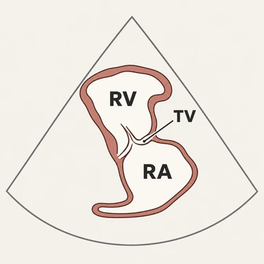

The full illustration and thumbnail are retained byte-for-byte from v54.

**Production checks:** Topology — pass; View identity — pass; Orientation — pass; Labels — pass; Phase — pass; Readability — pass.

#### Original artwork assessment

- RV occupies near field above RA; thin hinged TV is centered at the correct RA-RV junction; right-heart-only profile is distinct from full PLAX.

#### Final assessment

RV occupies near field above RA; thin hinged TV is centered at the correct RA-RV junction; right-heart-only profile is distinct from full PLAX.

#### Phase and limits

- **Phase:**

  Stylized TV profiles are near coaptation; no exact systolic or diastolic subphase is assigned.

- **Limits:**

  - Individual tricuspid leaflet names are intentionally omitted because exact leaflet identity depends on beam orientation.

  - Schematic proportions are not calibrated dimensions and cannot establish normality, pathology or function.

  - Static image review does not validate acquisition technique, motion, Doppler, ECG timing or patient diagnosis.

#### Source and exact view

- **Catalogue table:**

  2

- **Catalogue view:**

  2.6

- **Catalogue source:**

  <https://www.asecho.org/wp-content/uploads/2019/01/2019_Comprehensive-TTE.pdf>

- **Sources used in this review:**

  - Record

    - **Url:**

      <https://www.asecho.org/wp-content/uploads/2025/07/Guidelines-for-Performing-a-Comprehensive-Transthoracic-Echocardiographic-Examination-in-Adults.pdf>

    - **Title:**

      Guidelines for Performing a Comprehensive Transthoracic Echocardiographic Examination in Adults

    - **Publication:**

      Mitchell et al.; JASE 2019;32:1–64

    - **Table:**

      2

    - **Row:**

      2.6

    - **Pdf page:**

      20

    - **Role:**

      Exact-plane anatomy drawing and corresponding real echocardiographic frame; visually compared.

    - **Date note:**

      The 2025/07 URL is the rehost location, not the guideline publication year.

#### Review scope and evidence

- **Independent review:**

  TTE reviewer independently compared the original 960px asset with the exact ASE row and inspected its full-size pixels and static thumbnails. A complementary root review inspected original assets/contact sheets. The TTE reviewer rechecked this retained asset in a fresh 200px final contact sheet; no claim is made that root separately reviewed every retained image full-size. These are independent AI-assisted source comparisons, not clinical certification by an echocardiographer.

- **Full size reviewed:**

  Yes

- **Thumbnail reviewed:**

  Yes

- **Inspection:**

  - **Original full size:**

    960×960 WebP individually inspected against source before disposition.

  - **Final full size:**

    Original 960×960 WebP retained without pixel changes.

  - **Final static thumbnail sizes px:**

    - 200

  - **Final 200px contact sheet:**

    tte-final-200px-contact.png

  - **Final 384px replacement contact sheet:**

    Not specified.

  - **Actual browser render review:**

    Separate integration responsibility; this record asserts full-size and static resampled-image review only.

- **Gate findings:**

  - **Topology:**

    RA and RV meet at thin hinged tricuspid leaflet profiles. No muscular cap spans their junction.

  - **View identity:**

    Isolated right-heart inflow profile corresponds to ASE 2.6.

  - **Orientation:**

    RV lies nearer the sector vertex above RA; the TV separates their inflow junction.

  - **Labels:**

    RV and RA are placed within their cavities; TV leader ends at the valve profile.

  - **Phase:**

    Stylized TV profiles are near coaptation; no exact systolic or diastolic subphase is assigned.

  - **Readability:**

    At 200px the right-heart silhouette, two chamber labels and TV leader are clear.

- **Hard failures:**

  None recorded.

#### Preservation and correction constraints

- Preserve RA-to-RV inflow across thin valve tissue.

- Keep the complete RV/RA inflow profile distinct from RVOT view.

- Avoid naming individual TV leaflets without a more specific imaging plane.

#### Reconsidered concerns

- Omitted individual leaflet names avoid unsupported certainty about TV leaflet identity.

- Thin coaptation is not mistaken for a muscle wall.

#### Additional review metadata

- **Original asset:**

  - **Path:**

    `public/assets/reference-views-v54/tte-plax_rvin.webp`

  - **Sha256:**

    `1acb8c4812004ced4a7e547255d818939a5a15810685977e82ea22b42d13e8bd`

- **Source facts and operational criteria:**

  - **Source facts:**

    Imaging-plane anatomy, visible landmarks and conventional orientation are anchored to the cited exact ASE table row; additional sources are identified separately.

  - **Operational criteria:**

    Patent lumen tracing, no false muscular seals, attached leaflet profiles, legible labels at 200px/384px and absence of invented structures are artwork acceptance checks applied by the reviewers, not numerical clinical thresholds.

- **Export review:**

  - **Stage:**

    Retained production thumbnail pairing

  - **Status:**

    pass

  - **Files inspected:**

    Actual 384px thumbnail path in the current manifest, displayed at 200px

  - **Reviewer:**

    TTE review agent

  - **Findings:**

    Matched the previously reviewed full-size view identity; no swapped image, corrupted label, unexpected crop or gallery-size label blocker.

<details>
<summary>Exact prompts and authoring history</summary>

Prompts describe requested changes. Historical authoring records do not supersede this review’s findings.

##### Original artwork: provenance location

- **Historical manifest:**

  docs/reference-views-v54/asset-manifest.json

- **Historical master sha256:**

  `5014b66e6decf5a1fdc54584db3126656f55278bff237fd4293c48dafb9cc3dd`

- **Note:**

  The immutable historical manifest preserves the original authoring prompts. This report reproduces the exact prompts for this revision’s seven replacements; all current QC findings and retained-view decisions are included above.

</details>

#### Asset identity

| Asset | Path / identity | Pixels | Bytes | SHA-256 |
| --- | --- | --- | --- | --- |
| Original illustration | `public/assets/reference-views-v54/tte-plax_rvin.webp` | 960 × 960 | 44,422 | `1acb8c4812004ced4a7e547255d818939a5a15810685977e82ea22b42d13e8bd` |
| Current illustration | `public/assets/reference-views-v54/tte-plax_rvin.webp` | 960 × 960 | 44,422 | `1acb8c4812004ced4a7e547255d818939a5a15810685977e82ea22b42d13e8bd` |
| Original thumbnail | `public/assets/reference-views-v54/thumbs/tte-plax_rvin.webp` | 384 × 384 | 12,836 | `6d6b4d1c398862c3ee859fda6bdb9cb922749763623cd1ec3d3e459e39b04bbf` |
| Current thumbnail | `public/assets/reference-views-v54/thumbs/tte-plax_rvin.webp` | 384 × 384 | 12,836 | `6d6b4d1c398862c3ee859fda6bdb9cb922749763623cd1ec3d3e459e39b04bbf` |
| Historical generation master | `Original master PNG hash` | — | — | `5014b66e6decf5a1fdc54584db3126656f55278bff237fd4293c48dafb9cc3dd` |

---

### TTE · Parasternal short axis — great vessels, pulmonary focus

**ID:** `tte:psax_great` · **Decision:** Retained · **ASE table/view:** 2 / 2.7

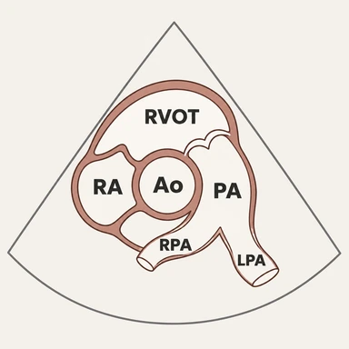

The full illustration and thumbnail are retained byte-for-byte from v54.

**Production checks:** Topology — pass; View identity — pass; Orientation — pass; Labels — pass; Phase — pass; Readability — pass.

#### Original artwork assessment

- High short-axis great-vessel plane: central circular Ao, anterior RVOT, pulmonic junction and continuous PA bifurcation; RPA extends behind Ao toward display left and LPA toward right.

#### Final assessment

High short-axis great-vessel plane: central circular Ao, anterior RVOT, pulmonic junction and continuous PA bifurcation; RPA extends behind Ao toward display left and LPA toward right.

#### Phase and limits

- **Phase:**

  The pulmonary cusp profile is near coaptation. Ao is imaged above the valve level and supplies no aortic valve timing information.

- **Limits:**

  - Small elliptical cropped branch endings are a diagram convention, not a claim of a 3D perspective or stenosis. No AV cusps required above valve level.

  - Schematic proportions are not calibrated dimensions and cannot establish normality, pathology or function.

  - Static image review does not validate acquisition technique, motion, Doppler, ECG timing or patient diagnosis.

#### Source and exact view

- **Catalogue table:**

  2

- **Catalogue view:**

  2.7

- **Catalogue source:**

  <https://www.asecho.org/wp-content/uploads/2019/01/2019_Comprehensive-TTE.pdf>

- **Sources used in this review:**

  - Record

    - **Url:**

      <https://www.asecho.org/wp-content/uploads/2025/07/Guidelines-for-Performing-a-Comprehensive-Transthoracic-Echocardiographic-Examination-in-Adults.pdf>

    - **Title:**

      Guidelines for Performing a Comprehensive Transthoracic Echocardiographic Examination in Adults

    - **Publication:**

      Mitchell et al.; JASE 2019;32:1–64

    - **Table:**

      2

    - **Row:**

      2.7

    - **Pdf page:**

      20

    - **Role:**

      Exact-plane anatomy drawing and corresponding real echocardiographic frame; visually compared.

    - **Date note:**

      The 2025/07 URL is the rehost location, not the guideline publication year.

#### Review scope and evidence

- **Independent review:**

  TTE reviewer independently compared the original 960px asset with the exact ASE row and inspected its full-size pixels and static thumbnails. A complementary root review inspected original assets/contact sheets. The TTE reviewer rechecked this retained asset in a fresh 200px final contact sheet; no claim is made that root separately reviewed every retained image full-size. These are independent AI-assisted source comparisons, not clinical certification by an echocardiographer.

- **Full size reviewed:**

  Yes

- **Thumbnail reviewed:**

  Yes

- **Inspection:**

  - **Original full size:**

    960×960 WebP individually inspected against source before disposition.

  - **Final full size:**

    Original 960×960 WebP retained without pixel changes.

  - **Final static thumbnail sizes px:**

    - 200

  - **Final 200px contact sheet:**

    tte-final-200px-contact.png

  - **Final 384px replacement contact sheet:**

    Not specified.

  - **Actual browser render review:**

    Separate integration responsibility; this record asserts full-size and static resampled-image review only.

- **Gate findings:**

  - **Topology:**

    RVOT leads to PA, then distinct RPA and LPA branches. Ao remains a separate circular lumen and does not join PA.

  - **View identity:**

    High short-axis great-vessel/pulmonary focus matches ASE 2.7; absence of aortic cusps is appropriate above the valve.

  - **Orientation:**

    RVOT anterior/near field, Ao central, PA at display right; RPA crosses behind Ao toward left and LPA continues rightward.

  - **Labels:**

    RVOT, RA, Ao, PA, RPA and LPA identify the intended lumens and branches.

  - **Phase:**

    The pulmonary cusp profile is near coaptation. Ao is imaged above the valve level and supplies no aortic valve timing information.

  - **Readability:**

    Primary vessel labels and bifurcation remain clear at 200px. RPA/LPA are the smallest secondary labels but still distinguishable; full-size inspection resolves branch endpoints.

- **Hard failures:**

  None recorded.

#### Preservation and correction constraints

- Keep PA bifurcation and the RPA path posterior to Ao.

- Do not add a closed trileaflet aortic valve at an above-valve cross-section.

- Retain separate aortic and pulmonary lumens.

#### Reconsidered concerns

- No valve-level aortic cusp requirement is imposed on this higher slice.

- Short elliptical branch endings are cut-plane conventions, not stenotic or sealed vessels.

#### Additional review metadata

- **Original asset:**

  - **Path:**

    `public/assets/reference-views-v54/tte-psax_great.webp`

  - **Sha256:**

    `885cb99cfa9d64c3d1a067b4796b2b62acb05c79139169fe9c12bfb44b505058`

- **Source facts and operational criteria:**

  - **Source facts:**

    Imaging-plane anatomy, visible landmarks and conventional orientation are anchored to the cited exact ASE table row; additional sources are identified separately.

  - **Operational criteria:**

    Patent lumen tracing, no false muscular seals, attached leaflet profiles, legible labels at 200px/384px and absence of invented structures are artwork acceptance checks applied by the reviewers, not numerical clinical thresholds.

- **Export review:**

  - **Stage:**

    Retained production thumbnail pairing

  - **Status:**

    pass

  - **Files inspected:**

    Actual 384px thumbnail path in the current manifest, displayed at 200px

  - **Reviewer:**

    TTE review agent

  - **Findings:**

    Matched the previously reviewed full-size view identity; no swapped image, corrupted label, unexpected crop or gallery-size label blocker.

<details>
<summary>Exact prompts and authoring history</summary>

Prompts describe requested changes. Historical authoring records do not supersede this review’s findings.

##### Original artwork: provenance location

- **Historical manifest:**

  docs/reference-views-v54/asset-manifest.json

- **Historical master sha256:**

  `40f0664e3afbbd72f30b09f64091b4710f014377485565b4ebed35f1b5ced085`

- **Note:**

  The immutable historical manifest preserves the original authoring prompts. This report reproduces the exact prompts for this revision’s seven replacements; all current QC findings and retained-view decisions are included above.

</details>

#### Asset identity

| Asset | Path / identity | Pixels | Bytes | SHA-256 |
| --- | --- | --- | --- | --- |
| Original illustration | `public/assets/reference-views-v54/tte-psax_great.webp` | 960 × 960 | 50,940 | `885cb99cfa9d64c3d1a067b4796b2b62acb05c79139169fe9c12bfb44b505058` |
| Current illustration | `public/assets/reference-views-v54/tte-psax_great.webp` | 960 × 960 | 50,940 | `885cb99cfa9d64c3d1a067b4796b2b62acb05c79139169fe9c12bfb44b505058` |
| Original thumbnail | `public/assets/reference-views-v54/thumbs/tte-psax_great.webp` | 384 × 384 | 15,522 | `19492db11d1b199e0c51b8981f30a2be09e30547dec32d352e1782354c5b3d57` |
| Current thumbnail | `public/assets/reference-views-v54/thumbs/tte-psax_great.webp` | 384 × 384 | 15,522 | `19492db11d1b199e0c51b8981f30a2be09e30547dec32d352e1782354c5b3d57` |
| Historical generation master | `Original master PNG hash` | — | — | `40f0664e3afbbd72f30b09f64091b4710f014377485565b4ebed35f1b5ced085` |

---

### TTE · Parasternal short axis — aortic valve level

**ID:** `tte:psax_av` · **Decision:** Anatomical correction · **ASE table/view:** 2 / 2.8

| Before — superseded v54 artwork | After — accepted v58 artwork |
| --- | --- |
| 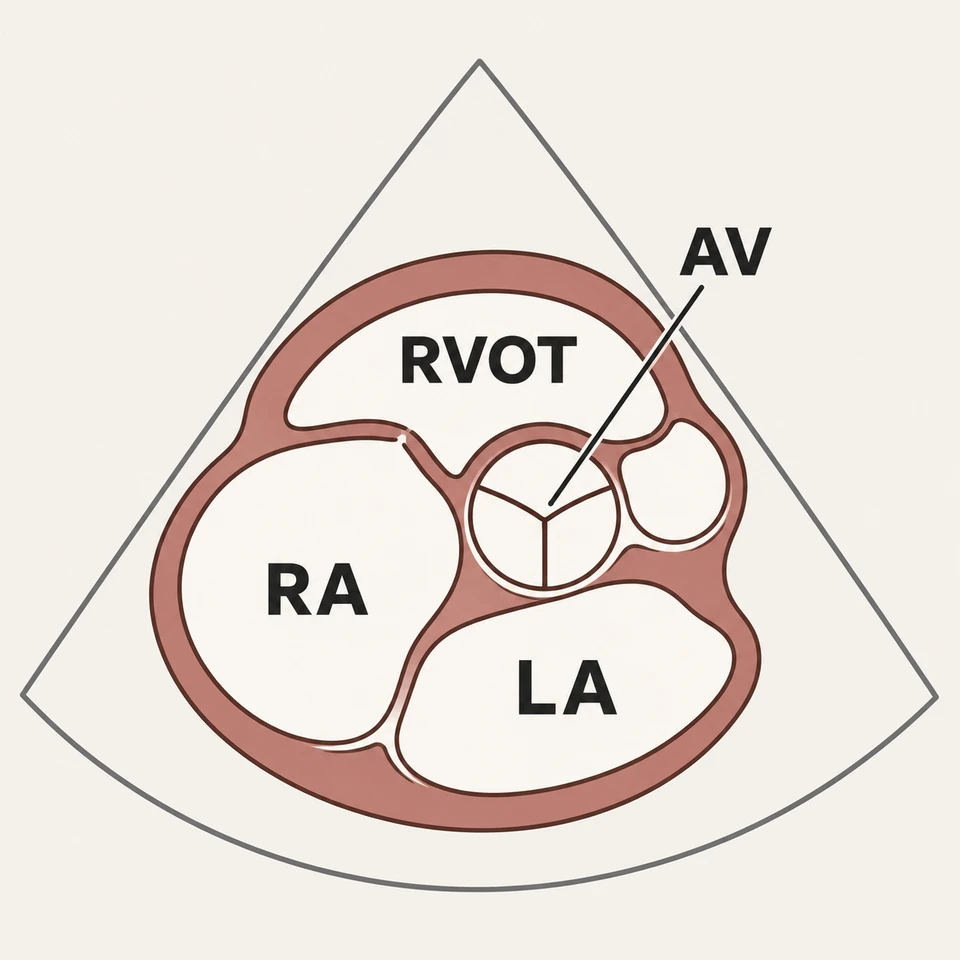 | 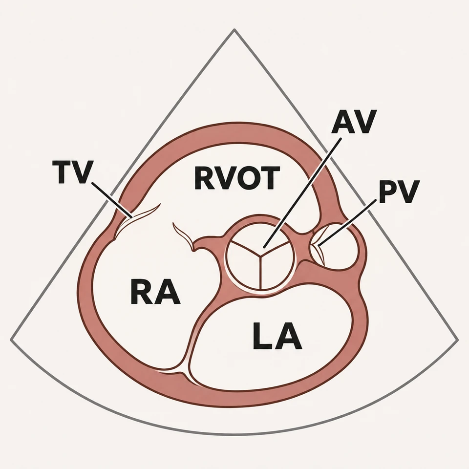 |

**Production checks:** Topology — pass; View identity — pass; Orientation — pass; Labels — pass; Phase — pass; Readability — pass.

#### Original artwork assessment

- Hard junction/landmark failure: RA and RV are separated by an almost uninterrupted muscular band at expected TV; no recognizable hinged tricuspid leaflets. Upper-right pulmonary outflow is a small sealed compartment with no clear PV connection to RVOT.

#### Final assessment

Corrected the RA-RV muscular barrier and ambiguous pulmonary compartment. Final valve-level short axis shows a central closed trileaflet AV, two thin open tricuspid profiles on opposing annular hinges, a clear RA-to-RV path, and a recognizable pulmonic junction between RVOT and PA.

#### Phase and limits

- **Phase:**

  Open tricuspid leaflet profiles with closed aortic and pulmonary cusps are compatible with diastole. No exact subphase is asserted.

- **Limits:**

  - Central three-cusp AV and atrial orientation are otherwise correct; preserve those relationships.

  - The aortic valve is trileaflet; AV must not be confused with the tricuspid atrioventricular valve TV.

  - RVOT and PA dimensions are schematic and are not measurements of normal caliber.

  - Schematic proportions are not calibrated dimensions and cannot establish normality, pathology or function.

  - Static image review does not validate acquisition technique, motion, Doppler, ECG timing or patient diagnosis.

#### Source and exact view

- **Catalogue table:**

  2

- **Catalogue view:**

  2.8

- **Catalogue source:**

  <https://www.asecho.org/wp-content/uploads/2019/01/2019_Comprehensive-TTE.pdf>

- **Sources used in this review:**

  - Record

    - **Url:**

      <https://www.asecho.org/wp-content/uploads/2025/07/Guidelines-for-Performing-a-Comprehensive-Transthoracic-Echocardiographic-Examination-in-Adults.pdf>

    - **Title:**

      Guidelines for Performing a Comprehensive Transthoracic Echocardiographic Examination in Adults

    - **Publication:**

      Mitchell et al.; JASE 2019;32:1–64

    - **Table:**

      2

    - **Row:**

      2.8

    - **Pdf page:**

      20

    - **Role:**

      Exact-plane anatomy drawing and corresponding real echocardiographic frame; visually compared.

    - **Date note:**

      The 2025/07 URL is the rehost location, not the guideline publication year.

#### Review scope and evidence

- **Independent review:**

  TTE reviewer independently compared the original 960px asset with the exact ASE row and inspected its full-size pixels and static thumbnails. A complementary root review inspected original assets/contact sheets. The final generated master was independently inspected at full size by both the TTE reviewer and root; the TTE reviewer then rechecked the final master and fresh 200px plus 384px resamples. These are independent AI-assisted source comparisons, not clinical certification by an echocardiographer.

- **Full size reviewed:**

  Yes

- **Thumbnail reviewed:**

  Yes

- **Inspection:**

  - **Original full size:**

    960×960 WebP individually inspected against source before disposition.

  - **Final full size:**

    Generated PNG master re-inspected full-size.

  - **Final static thumbnail sizes px:**

    - 200

    - 384

  - **Final 200px contact sheet:**

    tte-final-200px-contact.png

  - **Final 384px replacement contact sheet:**

    tte-final-replacements-384px-contact.png

  - **Actual browser render review:**

    Separate integration responsibility; this record asserts full-size and static resampled-image review only.

- **Gate findings:**

  - **Topology:**

    RA communicates with the RV through a broad opening between opposing TV free tips. RVOT curves anteriorly around the central aortic valve and reaches the pulmonary valve/artery junction. IAS remains intact; atria do not open into either great artery.

  - **View identity:**

    AV-level PSAX of ASE 2.8: central trileaflet AV, anterior RVOT, screen-left RA/TV, posterior LA and right-sided PV context.

  - **Orientation:**

    RVOT near field, AV central, RA display left, LA posterior/far field, PV and pulmonary outflow display right.

  - **Labels:**

    RVOT, RA and LA are within their cavities; AV, TV and PV leaders end at the corresponding thin valve profiles.

  - **Phase:**

    Open tricuspid leaflet profiles with closed aortic and pulmonary cusps are compatible with diastole. No exact subphase is asserted.

  - **Readability:**

    At 200px and 384px, the central three-cusp valve, open TV route, separate LA, pulmonary junction and six labels remain distinguishable. Small PV leaflets require the detail view for fine morphology.

- **Hard failures:**

  None recorded.

#### Preservation and correction constraints

- Keep central trileaflet AV and posterior LA relationship.

- Attach each TV leaflet to its own opposite annular hinge; free tips must not reach the opposite hinge.

- For this diastolic image show an open white RA-RV route, with closed thin AV/PV cusps.

- Keep RVOT-PV-PA connected by the actual pulmonary junction; no sealed supernumerary chamber.

- Preserve intact IAS and no great-artery/atrial communication.

#### Reconsidered concerns

- Original muscular tricuspid seal removed.

- First replacement spanning leaflet corrected to opposing hinged leaflets.

- Pulmonary junction now contains thin identifiable cusps instead of a featureless sealed compartment.

- Final topology and labels remain interpretable after thumbnail resampling.

#### Additional review metadata

- **Original asset:**

  - **Path:**

    `public/assets/reference-views-v54/tte-psax_av.webp`

  - **Sha256:**

    `34adc35b8d4a2b26592a7284c9ba9535dcc03905d59b2b82e62ba8b4b9df715d`

- **Source facts and operational criteria:**

  - **Source facts:**

    Imaging-plane anatomy, visible landmarks and conventional orientation are anchored to the cited exact ASE table row; additional sources are identified separately.

  - **Operational criteria:**

    Patent lumen tracing, no false muscular seals, attached leaflet profiles, legible labels at 200px/384px and absence of invented structures are artwork acceptance checks applied by the reviewers, not numerical clinical thresholds.

- **Export review:**

  - **Stage:**

    Local production WebP files, before publication

  - **Status:**

    pass

  - **Files inspected:**

    Actual 960px image and actual 384px thumbnail; 200px rendition derived from the encoded thumbnail

  - **Reviewer:**

    TTE review agent; root also inspected all seven exported thumbnails at 240px

  - **Findings:**

    RA–RV opening and valve leaders remain distinct. Fine semilunar cusp morphology is best assessed at expanded size.

  - **Remaining display limit:**

    Fine leaflet and cusp interpretation requires the enlarged illustration.

<details>
<summary>Exact prompts and authoring history</summary>

Prompts describe requested changes. Historical authoring records do not supersede this review’s findings.

##### Accepted replacement: exact final prompt and preceding prompts

- **Tool:**

  image_gen

- **Prompt:**

  ```text
  Use case: scientific-educational precise-object-edit. Correct ONLY THE TRICUSPID LEAFLETS in this candidate TTE basal PSAX schematic, preserving everything else including the excellent central AV, PV, PA, RVOT, RA, LA, all text and labels, palette and sector.
  The present TV leaflets coapt awkwardly at an outer-wall hinge. We need a clear normal DIASTOLIC OPEN tricuspid valve. Delete the current TV leaflet curves between RA (below-left) and RVOT (above). Keep the two annular attachment points: outer-left annular hinge at approximately x330,y620 and opposing inner-right hinge at x525,y660 in this 1254 image. Redraw exactly two thin pale leaflet profiles: the OUTER-LEFT leaflet starts at its left hinge and extends upward/right into the RV cavity with its free tip around x430,y535; the INNER-RIGHT leaflet starts at its right hinge and extends upward/left into RV cavity, its free tip around x490,y585. These are thin curved membrane leaves, much thinner than myocardium. The free tips must remain WELL APART; neither leaflet crosses to the opposite wall or hinge. Leave a broad unobstructed white blood-pool gap between them so a path from RA into anterior RVOT is immediately obvious. No continuous line, flap, membrane or terracotta wall may cross that opening. Preserve the intact IAS between RA and LA and the solid separation from central Ao. Reattach TV leader to one actual thin leaflet. No other edits. Keep AV and PV CLOSED in this diastolic image with thin coapting cusps, unchanged. Match original style exactly.
  ```

- **Reference inputs:**

  - Record

    - **Role:**

      previous candidate or original style/edit target

    - **Url:**

      Not specified.

    - **Name:**

      tte-psax_av.webp

    - **Sha256:**

      `34adc35b8d4a2b26592a7284c9ba9535dcc03905d59b2b82e62ba8b4b9df715d`

  - Record

    - **Role:**

      authoritative exact-plane reference

    - **Url:**

      <https://www.asecho.org/wp-content/uploads/2025/07/Guidelines-for-Performing-a-Comprehensive-Transthoracic-Echocardiographic-Examination-in-Adults.pdf>

    - **Name:**

      ase-tte-20.png

    - **Sha256:**

      `33dff94d5647bea412dcee972e8ac0f62ed79b74a3228f9574ffb4bcc33d99de`

  - Record

    - **Role:**

      previous candidate or original style/edit target

    - **Url:**

      Not specified.

    - **Name:**

      exec-58d5d922-d9d7-4259-8fe0-042399fde58b.png

    - **Sha256:**

      `6b9e290aad3e5d31c91e5709e6ae6c26d8308ee97f8e49dc62f5a6b0ba093ba2`

- **Earlier prompts in order:**

  - ```text
    Use case: scientific-educational. Correct ONE TTE parasternal short-axis reference illustration at AORTIC VALVE LEVEL (ASE TTE Table 2 row 2.8). Image1 is current style/edit target. Image2 is official reference page ONLY: use row2.8 anatomy and corresponding echo, not other rows. Preserve square warm-ivory field, terracotta walls, thin brown contours, bold charcoal labels and gray fan-shaped sector. Flat 2D clean schematic, no textures or shading.
    Anatomy must match the row2.8 true basal PSAX plane: small CENTRAL circular aortic valve with THREE thin cusps and Y-shaped closed coaptation. Right ventricular anterior outflow region wraps around its TOP; right atrium lies display LEFT/below the RV; left atrium lies display BOTTOM/RIGHT behind the aortic root, separated from RA by a thin intact interatrial septum. The small pulmonary outflow lumen is to display RIGHT of central Ao.
    CRITICAL CORRECTIONS: replace the thick continuous muscular barrier between RA and RV with a real TRICUSPID VALVE junction: two thin hinged leaflet profiles visible at that opening, open in this diastolic schematic, with a visible white aperture between RA and the anterior RV cavity. The basal AV-plane RV cavity labelled 'RVOT' is continuous with this inlet in the plane. At the upper-right bend of RVOT, depict the thin PULMONARY VALVE closed in diastole between RVOT and visible short PA lumen. This must NOT be an unrelated sealed extra chamber beside Ao; small PA lumen lies beyond two fine cusps with continuity to vessel wall, no thick tissue cap at the valve. LA must remain SEPARATE from the RA, aortic lumen and PA: don't create false fistulas to make everything connect.
    Moderate RV muscle, thin RA/LA walls, aortic cusp edges thin and readable. Exact primary labels inside cavities: 'RVOT' top, 'RA' left, 'LA' bottom-right. Short external leader 'AV' lands on central aortic leaflet. Add small but clear 'TV' leader at the true RA–RV junction left and 'PV' leader at the true RVOT–PA junction right. At most six labels, no cusp names, no LV, no arrows crossing chamber blood pools. Give label endpoints visible clearance from adjacent structures. Diagnostic anatomy fills sector but leaves readable margins. Every valve is leaflets at a boundary, not a thick wall or floating membrane. Do not copy source image pixels or typography.
    ```

##### Original artwork: provenance location

- **Historical manifest:**

  docs/reference-views-v54/asset-manifest.json

- **Historical master sha256:**

  `4261782ff94bef5e1e8ca31cddd5e13c15f0c6f1ef8375ee6ca1f6441b858fa9`

- **Note:**

  The immutable historical manifest preserves the original authoring prompts. This report reproduces the exact prompts for this revision’s seven replacements; all current QC findings and retained-view decisions are included above.

</details>

#### Asset identity

| Asset | Path / identity | Pixels | Bytes | SHA-256 |
| --- | --- | --- | --- | --- |
| Original illustration | `public/assets/reference-views-v54/tte-psax_av.webp` | 960 × 960 | 54,364 | `34adc35b8d4a2b26592a7284c9ba9535dcc03905d59b2b82e62ba8b4b9df715d` |
| Current illustration | `public/assets/reference-views-v58/tte-psax_av.webp` | 960 × 960 | 57,474 | `8454d3623e7a6b821fd481fd9cc4d72938f3b205dc229167a2d9907e1676ec44` |
| Original thumbnail | `public/assets/reference-views-v54/thumbs/tte-psax_av.webp` | 384 × 384 | 16,342 | `a893d1e76c187f6d0f25e41651aa5f70e58da1f486bf8e617c648c8ceb36938d` |
| Current thumbnail | `public/assets/reference-views-v58/thumbs/tte-psax_av.webp` | 384 × 384 | 17,402 | `557fdd859238264280be0e52fe6c9d507a17e82109699281e4cbaf6b3fbb7557` |
| Accepted generation master | `Master PNG hash; no published source image embedded` | — | — | `a72492fc63aeb6e4b39422977320c1688492c9920e179955bc8713011e85356c` |
| Historical generation master | `Original master PNG hash` | — | — | `4261782ff94bef5e1e8ca31cddd5e13c15f0c6f1ef8375ee6ca1f6441b858fa9` |

---

### TTE · Parasternal short axis — aortic valve zoom

**ID:** `tte:psax_av_zoom` · **Decision:** Retained · **ASE table/view:** 2 / 2.9

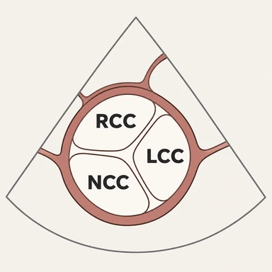

The full illustration and thumbnail are retained byte-for-byte from v54.

**Production checks:** Topology — pass; View identity — pass; Orientation — pass; Labels — pass; Phase — pass; Readability — pass.

#### Original artwork assessment

- Three aortic cusps are correctly distinguished and labelled RCC anterior/upper-left, NCC posterior/lower-left, LCC right in this conventional display.

#### Final assessment

Three aortic cusps are correctly distinguished and labelled RCC anterior/upper-left, NCC posterior/lower-left, LCC right in this conventional display.

#### Phase and limits

- **Phase:**

  Three aortic cusp margins meet centrally, a closure/diastolic-compatible configuration. No finer timing is specified.

- **Limits:**

  - Cusp areas and sinus dimensions are schematic. Narrow central coaptation seam is not an ASD/VSD or fourth cusp.

  - Schematic proportions are not calibrated dimensions and cannot establish normality, pathology or function.

  - Static image review does not validate acquisition technique, motion, Doppler, ECG timing or patient diagnosis.

#### Source and exact view

- **Catalogue table:**

  2

- **Catalogue view:**

  2.9

- **Catalogue source:**

  <https://www.asecho.org/wp-content/uploads/2019/01/2019_Comprehensive-TTE.pdf>

- **Sources used in this review:**

  - Record

    - **Url:**

      <https://www.asecho.org/wp-content/uploads/2025/07/Guidelines-for-Performing-a-Comprehensive-Transthoracic-Echocardiographic-Examination-in-Adults.pdf>

    - **Title:**

      Guidelines for Performing a Comprehensive Transthoracic Echocardiographic Examination in Adults

    - **Publication:**

      Mitchell et al.; JASE 2019;32:1–64

    - **Table:**

      2

    - **Row:**

      2.9

    - **Pdf page:**

      20

    - **Role:**

      Exact-plane anatomy drawing and corresponding real echocardiographic frame; visually compared.

    - **Date note:**

      The 2025/07 URL is the rehost location, not the guideline publication year.

#### Review scope and evidence

- **Independent review:**

  TTE reviewer independently compared the original 960px asset with the exact ASE row and inspected its full-size pixels and static thumbnails. A complementary root review inspected original assets/contact sheets. The TTE reviewer rechecked this retained asset in a fresh 200px final contact sheet; no claim is made that root separately reviewed every retained image full-size. These are independent AI-assisted source comparisons, not clinical certification by an echocardiographer.

- **Full size reviewed:**

  Yes

- **Thumbnail reviewed:**

  Yes

- **Inspection:**

  - **Original full size:**

    960×960 WebP individually inspected against source before disposition.

  - **Final full size:**

    Original 960×960 WebP retained without pixel changes.

  - **Final static thumbnail sizes px:**

    - 200

  - **Final 200px contact sheet:**

    tte-final-200px-contact.png

  - **Final 384px replacement contact sheet:**

    Not specified.

  - **Actual browser render review:**

    Separate integration responsibility; this record asserts full-size and static resampled-image review only.

- **Gate findings:**

  - **Topology:**

    One aortic root contains three cusp regions with a central coaptation pattern; no fourth cusp or separate chamber is implied.

  - **View identity:**

    Valve-only PSAX magnification matches ASE 2.9.

  - **Orientation:**

    RCC anterior/upper-left, NCC posterior/lower-left and LCC toward display right in this conventional source orientation.

  - **Labels:**

    RCC, NCC and LCC are fully contained in the correct cusp regions.

  - **Phase:**

    Three aortic cusp margins meet centrally, a closure/diastolic-compatible configuration. No finer timing is specified.

  - **Readability:**

    Three cusp labels and the central coaptation pattern are distinct at 200px.

- **Hard failures:**

  None recorded.

#### Preservation and correction constraints

- Preserve three rather than two or four cusp regions.

- Do not mirror RCC/NCC/LCC positions.

- Keep leaflet coaptation thin and distinct from the root wall.

#### Reconsidered concerns

- A narrow central coaptation seam is expected valve anatomy, not a septal defect.

- Unequal schematic cusp areas do not constitute a quantitative claim.

#### Additional review metadata

- **Original asset:**

  - **Path:**

    `public/assets/reference-views-v54/tte-psax_av_zoom.webp`

  - **Sha256:**

    `e2acf8a9d73aaf33ba0be3b3265b11d03d36608ae3f9883cbaba2e0800f45609`

- **Source facts and operational criteria:**

  - **Source facts:**

    Imaging-plane anatomy, visible landmarks and conventional orientation are anchored to the cited exact ASE table row; additional sources are identified separately.

  - **Operational criteria:**

    Patent lumen tracing, no false muscular seals, attached leaflet profiles, legible labels at 200px/384px and absence of invented structures are artwork acceptance checks applied by the reviewers, not numerical clinical thresholds.

- **Export review:**

  - **Stage:**

    Retained production thumbnail pairing

  - **Status:**

    pass

  - **Files inspected:**

    Actual 384px thumbnail path in the current manifest, displayed at 200px

  - **Reviewer:**

    TTE review agent

  - **Findings:**

    Matched the previously reviewed full-size view identity; no swapped image, corrupted label, unexpected crop or gallery-size label blocker.

<details>
<summary>Exact prompts and authoring history</summary>

Prompts describe requested changes. Historical authoring records do not supersede this review’s findings.

##### Original artwork: provenance location

- **Historical manifest:**

  docs/reference-views-v54/asset-manifest.json

- **Historical master sha256:**

  `560663cccc02da22a2396c39e6d210fbb33a5804b7e8f3e98d883d776c5c8274`

- **Note:**

  The immutable historical manifest preserves the original authoring prompts. This report reproduces the exact prompts for this revision’s seven replacements; all current QC findings and retained-view decisions are included above.

</details>

#### Asset identity

| Asset | Path / identity | Pixels | Bytes | SHA-256 |
| --- | --- | --- | --- | --- |
| Original illustration | `public/assets/reference-views-v54/tte-psax_av_zoom.webp` | 960 × 960 | 45,722 | `e2acf8a9d73aaf33ba0be3b3265b11d03d36608ae3f9883cbaba2e0800f45609` |
| Current illustration | `public/assets/reference-views-v54/tte-psax_av_zoom.webp` | 960 × 960 | 45,722 | `e2acf8a9d73aaf33ba0be3b3265b11d03d36608ae3f9883cbaba2e0800f45609` |
| Original thumbnail | `public/assets/reference-views-v54/thumbs/tte-psax_av_zoom.webp` | 384 × 384 | 14,100 | `f2c6d1bfcdcc1c689d5126b89d6a814cce6d6e6dbf1e68a3e693a4552e8994a6` |
| Current thumbnail | `public/assets/reference-views-v54/thumbs/tte-psax_av_zoom.webp` | 384 × 384 | 14,100 | `f2c6d1bfcdcc1c689d5126b89d6a814cce6d6e6dbf1e68a3e693a4552e8994a6` |
| Historical generation master | `Original master PNG hash` | — | — | `560663cccc02da22a2396c39e6d210fbb33a5804b7e8f3e98d883d776c5c8274` |

---

### TTE · Parasternal short axis — tricuspid valve focus

**ID:** `tte:psax_tv` · **Decision:** Retained · **ASE table/view:** 2 / 2.10a

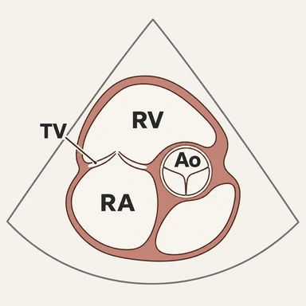

The full illustration and thumbnail are retained byte-for-byte from v54.

**Production checks:** Topology — pass; View identity — pass; Orientation — pass; Labels — pass; Phase — pass; Readability — pass.

#### Original artwork assessment

- Thin TV leaflets form the RA-RV junction at display left. Central Ao cross-section provides orientation; posterior unlabelled atrial context remains separate.

#### Final assessment

Thin TV leaflets form the RA-RV junction at display left. Central Ao cross-section provides orientation; posterior unlabelled atrial context remains separate.

#### Phase and limits

- **Phase:**

  TV and AV profiles are near coaptation. The image is not ECG-timed; the pixels do not establish a unique cardiac phase.

- **Limits:**

  - Ao text lies in central aortic root region and is not intended to name an individual cusp.

  - Schematic proportions are not calibrated dimensions and cannot establish normality, pathology or function.

  - Static image review does not validate acquisition technique, motion, Doppler, ECG timing or patient diagnosis.

#### Source and exact view

- **Catalogue table:**

  2

- **Catalogue view:**

  2.10a

- **Catalogue source:**

  <https://www.asecho.org/wp-content/uploads/2019/01/2019_Comprehensive-TTE.pdf>

- **Sources used in this review:**

  - Record

    - **Url:**

      <https://www.asecho.org/wp-content/uploads/2025/07/Guidelines-for-Performing-a-Comprehensive-Transthoracic-Echocardiographic-Examination-in-Adults.pdf>

    - **Title:**

      Guidelines for Performing a Comprehensive Transthoracic Echocardiographic Examination in Adults

    - **Publication:**

      Mitchell et al.; JASE 2019;32:1–64

    - **Table:**

      2

    - **Row:**

      2.10a

    - **Pdf page:**

      20

    - **Role:**

      Exact-plane anatomy drawing and corresponding real echocardiographic frame; visually compared.

    - **Date note:**

      The 2025/07 URL is the rehost location, not the guideline publication year.

#### Review scope and evidence

- **Independent review:**

  TTE reviewer independently compared the original 960px asset with the exact ASE row and inspected its full-size pixels and static thumbnails. A complementary root review inspected original assets/contact sheets. The TTE reviewer rechecked this retained asset in a fresh 200px final contact sheet; no claim is made that root separately reviewed every retained image full-size. These are independent AI-assisted source comparisons, not clinical certification by an echocardiographer.

- **Full size reviewed:**

  Yes

- **Thumbnail reviewed:**

  Yes

- **Inspection:**

  - **Original full size:**

    960×960 WebP individually inspected against source before disposition.

  - **Final full size:**

    Original 960×960 WebP retained without pixel changes.

  - **Final static thumbnail sizes px:**

    - 200

  - **Final 200px contact sheet:**

    tte-final-200px-contact.png

  - **Final 384px replacement contact sheet:**

    Not specified.

  - **Actual browser render review:**

    Separate integration responsibility; this record asserts full-size and static resampled-image review only.

- **Gate findings:**

  - **Topology:**

    Thin TV leaflets occupy the RA-RV junction. Ao and the posterior atrial profile are separate from right-sided inflow.

  - **View identity:**

    Tricuspid-focused PSAX with central aortic landmark corresponds to ASE 2.10a.

  - **Orientation:**

    RV anterior/near field, RA display left and below TV; central Ao supplies orientation.

  - **Labels:**

    TV leader reaches the tricuspid leaflets; RV, RA and Ao lie within their respective lumens.

  - **Phase:**

    TV and AV profiles are near coaptation. The image is not ECG-timed; the pixels do not establish a unique cardiac phase.

  - **Readability:**

    The TV leader, valve junction and three structure labels remain legible at 200px.

- **Hard failures:**

  None recorded.

#### Preservation and correction constraints

- Retain attached thin TV leaflets at RA-RV junction.

- Keep central Ao as a separate landmark.

- Do not add unsupported tricuspid leaflet names or a broad myocardial seal.

#### Reconsidered concerns

- Ao text names the central aortic structure, not an individual aortic cusp.

- Near-coapting thin valves are not grounds for inventing a specific phase or calling an obstruction.

#### Additional review metadata

- **Original asset:**

  - **Path:**

    `public/assets/reference-views-v54/tte-psax_tv.webp`

  - **Sha256:**

    `2db6c0ef17322d3f998d5accd34484938e7c081922feeafc1883e51c02976956`

- **Source facts and operational criteria:**

  - **Source facts:**

    Imaging-plane anatomy, visible landmarks and conventional orientation are anchored to the cited exact ASE table row; additional sources are identified separately.

  - **Operational criteria:**

    Patent lumen tracing, no false muscular seals, attached leaflet profiles, legible labels at 200px/384px and absence of invented structures are artwork acceptance checks applied by the reviewers, not numerical clinical thresholds.

- **Export review:**

  - **Stage:**

    Retained production thumbnail pairing

  - **Status:**

    pass

  - **Files inspected:**

    Actual 384px thumbnail path in the current manifest, displayed at 200px

  - **Reviewer:**

    TTE review agent

  - **Findings:**

    Matched the previously reviewed full-size view identity; no swapped image, corrupted label, unexpected crop or gallery-size label blocker.

<details>
<summary>Exact prompts and authoring history</summary>

Prompts describe requested changes. Historical authoring records do not supersede this review’s findings.

##### Original artwork: provenance location

- **Historical manifest:**

  docs/reference-views-v54/asset-manifest.json

- **Historical master sha256:**

  `463f3617eff7e55c3a8013462a13ffac67485ccff8859085e337cc1850ee666c`

- **Note:**

  The immutable historical manifest preserves the original authoring prompts. This report reproduces the exact prompts for this revision’s seven replacements; all current QC findings and retained-view decisions are included above.

</details>

#### Asset identity

| Asset | Path / identity | Pixels | Bytes | SHA-256 |
| --- | --- | --- | --- | --- |
| Original illustration | `public/assets/reference-views-v54/tte-psax_tv.webp` | 960 × 960 | 52,104 | `2db6c0ef17322d3f998d5accd34484938e7c081922feeafc1883e51c02976956` |
| Current illustration | `public/assets/reference-views-v54/tte-psax_tv.webp` | 960 × 960 | 52,104 | `2db6c0ef17322d3f998d5accd34484938e7c081922feeafc1883e51c02976956` |
| Original thumbnail | `public/assets/reference-views-v54/thumbs/tte-psax_tv.webp` | 384 × 384 | 15,112 | `21a0fcb88313b3eb0541f2338b0a61c94995d84d7f3e8a19238457a28e463ab9` |
| Current thumbnail | `public/assets/reference-views-v54/thumbs/tte-psax_tv.webp` | 384 × 384 | 15,112 | `21a0fcb88313b3eb0541f2338b0a61c94995d84d7f3e8a19238457a28e463ab9` |
| Historical generation master | `Original master PNG hash` | — | — | `463f3617eff7e55c3a8013462a13ffac67485ccff8859085e337cc1850ee666c` |

---

### TTE · Parasternal short axis — pulmonary valve and artery focus

**ID:** `tte:psax_pv` · **Decision:** Retained · **ASE table/view:** 2 / 2.10b

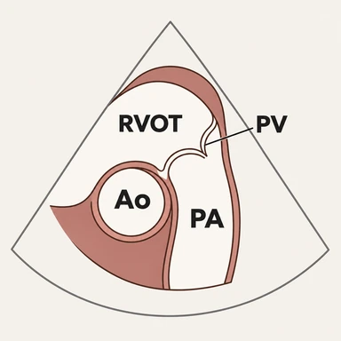

The full illustration and thumbnail are retained byte-for-byte from v54.

**Production checks:** Topology — pass; View identity — pass; Orientation — pass; Labels — pass; Phase — pass; Readability — pass.

#### Original artwork assessment

- RVOT connects through thin pulmonary cusps to longitudinal PA alongside separate aortic cross-section; the pulmonary leaflets are recognizable and labelled.

#### Final assessment

RVOT connects through thin pulmonary cusps to longitudinal PA alongside separate aortic cross-section; the pulmonary leaflets are recognizable and labelled.

#### Phase and limits

- **Phase:**

  Pulmonary cusps appear near coaptation; no exact cardiac phase is claimed.

- **Limits:**

  - Static coaptation is allowed. PA cropping at the inferior artwork boundary is a framing convention; not a vessel ending anatomically.

  - Schematic proportions are not calibrated dimensions and cannot establish normality, pathology or function.

  - Static image review does not validate acquisition technique, motion, Doppler, ECG timing or patient diagnosis.

#### Source and exact view

- **Catalogue table:**

  2

- **Catalogue view:**

  2.10b

- **Catalogue source:**

  <https://www.asecho.org/wp-content/uploads/2019/01/2019_Comprehensive-TTE.pdf>

- **Sources used in this review:**

  - Record

    - **Url:**

      <https://www.asecho.org/wp-content/uploads/2025/07/Guidelines-for-Performing-a-Comprehensive-Transthoracic-Echocardiographic-Examination-in-Adults.pdf>

    - **Title:**

      Guidelines for Performing a Comprehensive Transthoracic Echocardiographic Examination in Adults

    - **Publication:**

      Mitchell et al.; JASE 2019;32:1–64

    - **Table:**

      2

    - **Row:**

      2.10b

    - **Pdf page:**

      21

    - **Role:**

      Exact-plane anatomy drawing and corresponding real echocardiographic frame; visually compared.

    - **Date note:**

      The 2025/07 URL is the rehost location, not the guideline publication year.

#### Review scope and evidence

- **Independent review:**

  TTE reviewer independently compared the original 960px asset with the exact ASE row and inspected its full-size pixels and static thumbnails. A complementary root review inspected original assets/contact sheets. The TTE reviewer rechecked this retained asset in a fresh 200px final contact sheet; no claim is made that root separately reviewed every retained image full-size. These are independent AI-assisted source comparisons, not clinical certification by an echocardiographer.

- **Full size reviewed:**

  Yes

- **Thumbnail reviewed:**

  Yes

- **Inspection:**

  - **Original full size:**

    960×960 WebP individually inspected against source before disposition.

  - **Final full size:**

    Original 960×960 WebP retained without pixel changes.

  - **Final static thumbnail sizes px:**

    - 200

  - **Final 200px contact sheet:**

    tte-final-200px-contact.png

  - **Final 384px replacement contact sheet:**

    Not specified.

  - **Actual browser render review:**

    Separate integration responsibility; this record asserts full-size and static resampled-image review only.

- **Gate findings:**

  - **Topology:**

    RVOT and longitudinal PA meet across recognizable thin pulmonary cusps; Ao remains separate.

  - **View identity:**

    PV/PA-focused PSAX corresponds to ASE 2.10b, distinct from AV/TV focus.

  - **Orientation:**

    RVOT anterior/near field, PA extending on display right, circular Ao to its left.

  - **Labels:**

    RVOT, PA and Ao lie within the correct lumens; PV leader terminates on the pulmonic cusp profile.

  - **Phase:**

    Pulmonary cusps appear near coaptation; no exact cardiac phase is claimed.

  - **Readability:**

    Valve junction and all four labels are clear at 200px; fine leaflet separation is assessed full-size.

- **Hard failures:**

  None recorded.

#### Preservation and correction constraints

- Preserve the RVOT-PV-PA longitudinal connection.

- Keep circular Ao separate and avoid adding aortic cusps above its valve plane.

- Treat inferior PA edge as crop continuation, not anatomical termination.

#### Reconsidered concerns

- Thin pulmonary coaptation is acceptable.

- PA cropping at the artwork boundary is an imaging/framing convention.

#### Additional review metadata

- **Original asset:**

  - **Path:**

    `public/assets/reference-views-v54/tte-psax_pv.webp`

  - **Sha256:**

    `28a5c9462d3bf84e7539056232c071d0adaf5d10c5b876c0be15ebf7064f0c06`

- **Source facts and operational criteria:**

  - **Source facts:**

    Imaging-plane anatomy, visible landmarks and conventional orientation are anchored to the cited exact ASE table row; additional sources are identified separately.

  - **Operational criteria:**

    Patent lumen tracing, no false muscular seals, attached leaflet profiles, legible labels at 200px/384px and absence of invented structures are artwork acceptance checks applied by the reviewers, not numerical clinical thresholds.

- **Export review:**

  - **Stage:**

    Retained production thumbnail pairing

  - **Status:**

    pass

  - **Files inspected:**

    Actual 384px thumbnail path in the current manifest, displayed at 200px

  - **Reviewer:**

    TTE review agent

  - **Findings:**

    Matched the previously reviewed full-size view identity; no swapped image, corrupted label, unexpected crop or gallery-size label blocker.

<details>
<summary>Exact prompts and authoring history</summary>

Prompts describe requested changes. Historical authoring records do not supersede this review’s findings.

##### Original artwork: provenance location

- **Historical manifest:**

  docs/reference-views-v54/asset-manifest.json

- **Historical master sha256:**

  `fd1fc1dd72f45fe590d3f46c5efd67e56348bb57932e5b3b036865a3521c4823`

- **Note:**

  The immutable historical manifest preserves the original authoring prompts. This report reproduces the exact prompts for this revision’s seven replacements; all current QC findings and retained-view decisions are included above.

</details>

#### Asset identity

| Asset | Path / identity | Pixels | Bytes | SHA-256 |
| --- | --- | --- | --- | --- |
| Original illustration | `public/assets/reference-views-v54/tte-psax_pv.webp` | 960 × 960 | 46,776 | `28a5c9462d3bf84e7539056232c071d0adaf5d10c5b876c0be15ebf7064f0c06` |
| Current illustration | `public/assets/reference-views-v54/tte-psax_pv.webp` | 960 × 960 | 46,776 | `28a5c9462d3bf84e7539056232c071d0adaf5d10c5b876c0be15ebf7064f0c06` |
| Original thumbnail | `public/assets/reference-views-v54/thumbs/tte-psax_pv.webp` | 384 × 384 | 14,052 | `6af92c6f6f0733cb870b03e4d8f8489503f04f38da58d41a9eaca5bcea21a987` |
| Current thumbnail | `public/assets/reference-views-v54/thumbs/tte-psax_pv.webp` | 384 × 384 | 14,052 | `6af92c6f6f0733cb870b03e4d8f8489503f04f38da58d41a9eaca5bcea21a987` |
| Historical generation master | `Original master PNG hash` | — | — | `fd1fc1dd72f45fe590d3f46c5efd67e56348bb57932e5b3b036865a3521c4823` |

---

### TTE · Parasternal short axis — mitral valve level

**ID:** `tte:psax_mitral` · **Decision:** Retained · **ASE table/view:** 2 / 2.11

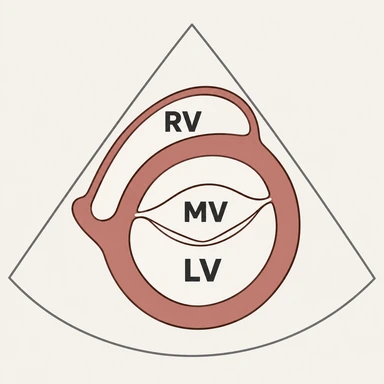

The full illustration and thumbnail are retained byte-for-byte from v54.

**Production checks:** Topology — pass; View identity — pass; Orientation — pass; Labels — pass; Phase — pass; Readability — pass.

#### Original artwork assessment

- Distinct basal short-axis profile: circular LV wall, crescent RV and central fishmouth MV aperture between anterior/posterior leaflet contours, without midpapillary muscle heads.

#### Final assessment

Distinct basal short-axis profile: circular LV wall, crescent RV and central fishmouth MV aperture between anterior/posterior leaflet contours, without midpapillary muscle heads.

#### Phase and limits

- **Phase:**

  Visible fishmouth MV aperture is compatible with diastolic opening; exact filling subphase is not specified.

- **Limits:**

  - LV label denotes the LV short-axis chamber region; leaflet areas are deliberately simplified, without scallop assignments.

  - Schematic proportions are not calibrated dimensions and cannot establish normality, pathology or function.

  - Static image review does not validate acquisition technique, motion, Doppler, ECG timing or patient diagnosis.

#### Source and exact view

- **Catalogue table:**

  2

- **Catalogue view:**

  2.11

- **Catalogue source:**

  <https://www.asecho.org/wp-content/uploads/2019/01/2019_Comprehensive-TTE.pdf>

- **Sources used in this review:**

  - Record

    - **Url:**

      <https://www.asecho.org/wp-content/uploads/2025/07/Guidelines-for-Performing-a-Comprehensive-Transthoracic-Echocardiographic-Examination-in-Adults.pdf>

    - **Title:**

      Guidelines for Performing a Comprehensive Transthoracic Echocardiographic Examination in Adults

    - **Publication:**

      Mitchell et al.; JASE 2019;32:1–64

    - **Table:**

      2

    - **Row:**

      2.11

    - **Pdf page:**

      21

    - **Role:**

      Exact-plane anatomy drawing and corresponding real echocardiographic frame; visually compared.

    - **Date note:**

      The 2025/07 URL is the rehost location, not the guideline publication year.

#### Review scope and evidence

- **Independent review:**

  TTE reviewer independently compared the original 960px asset with the exact ASE row and inspected its full-size pixels and static thumbnails. A complementary root review inspected original assets/contact sheets. The TTE reviewer rechecked this retained asset in a fresh 200px final contact sheet; no claim is made that root separately reviewed every retained image full-size. These are independent AI-assisted source comparisons, not clinical certification by an echocardiographer.

- **Full size reviewed:**

  Yes

- **Thumbnail reviewed:**

  Yes

- **Inspection:**

  - **Original full size:**

    960×960 WebP individually inspected against source before disposition.

  - **Final full size:**

    Original 960×960 WebP retained without pixel changes.

  - **Final static thumbnail sizes px:**

    - 200

  - **Final 200px contact sheet:**

    tte-final-200px-contact.png

  - **Final 384px replacement contact sheet:**

    Not specified.

  - **Actual browser render review:**

    Separate integration responsibility; this record asserts full-size and static resampled-image review only.

- **Gate findings:**

  - **Topology:**

    Central mitral aperture and opposing leaflet contours sit inside the basal LV short axis; a separate crescent RV lies anteriorly.

  - **View identity:**

    Basal MV-level PSAX of ASE 2.11, differentiated from papillary and apical levels by its valve aperture.

  - **Orientation:**

    RV crescent is near field; LV circular short-axis region is deeper; the MV sits within the LV basal plane.

  - **Labels:**

    RV, MV and LV name the correct structures/regions without unsupported scallop labels.

  - **Phase:**

    Visible fishmouth MV aperture is compatible with diastolic opening; exact filling subphase is not specified.

  - **Readability:**

    Fishmouth shape and three labels survive 200px reduction without becoming a papillary-level image.

- **Hard failures:**

  None recorded.

#### Preservation and correction constraints

- Preserve open mitral fishmouth and crescent RV.

- Do not add midventricular papillary heads to this basal valve level.

- Avoid implying exact scallop identity from the simplified contours.

#### Reconsidered concerns

- LV text identifies the ventricular short-axis region rather than an extra chamber.

- Leaflet area simplification does not erase the plane-defining opening.

#### Additional review metadata

- **Original asset:**

  - **Path:**

    `public/assets/reference-views-v54/tte-psax_mitral.webp`

  - **Sha256:**

    `624dbe50f6360a96849d72a14deb743052dd2d70010c440c984773fc29f0b442`

- **Source facts and operational criteria:**

  - **Source facts:**

    Imaging-plane anatomy, visible landmarks and conventional orientation are anchored to the cited exact ASE table row; additional sources are identified separately.

  - **Operational criteria:**

    Patent lumen tracing, no false muscular seals, attached leaflet profiles, legible labels at 200px/384px and absence of invented structures are artwork acceptance checks applied by the reviewers, not numerical clinical thresholds.

- **Export review:**

  - **Stage:**

    Retained production thumbnail pairing

  - **Status:**

    pass

  - **Files inspected:**

    Actual 384px thumbnail path in the current manifest, displayed at 200px

  - **Reviewer:**

    TTE review agent

  - **Findings:**

    Matched the previously reviewed full-size view identity; no swapped image, corrupted label, unexpected crop or gallery-size label blocker.

<details>
<summary>Exact prompts and authoring history</summary>

Prompts describe requested changes. Historical authoring records do not supersede this review’s findings.

##### Original artwork: provenance location

- **Historical manifest:**

  docs/reference-views-v54/asset-manifest.json

- **Historical master sha256:**

  `c2389ce3482a2c5f5d5721764e03338fee4b38a5d4faa8e6b438b658fb742e1c`

- **Note:**

  The immutable historical manifest preserves the original authoring prompts. This report reproduces the exact prompts for this revision’s seven replacements; all current QC findings and retained-view decisions are included above.

</details>

#### Asset identity

| Asset | Path / identity | Pixels | Bytes | SHA-256 |
| --- | --- | --- | --- | --- |
| Original illustration | `public/assets/reference-views-v54/tte-psax_mitral.webp` | 960 × 960 | 51,194 | `624dbe50f6360a96849d72a14deb743052dd2d70010c440c984773fc29f0b442` |
| Current illustration | `public/assets/reference-views-v54/tte-psax_mitral.webp` | 960 × 960 | 51,194 | `624dbe50f6360a96849d72a14deb743052dd2d70010c440c984773fc29f0b442` |
| Original thumbnail | `public/assets/reference-views-v54/thumbs/tte-psax_mitral.webp` | 384 × 384 | 14,734 | `2cbd3e2b950008dfae8f95b5a98b7fbb148279b14f7eb2ea406bb47ff7d2f4c6` |
| Current thumbnail | `public/assets/reference-views-v54/thumbs/tte-psax_mitral.webp` | 384 × 384 | 14,734 | `2cbd3e2b950008dfae8f95b5a98b7fbb148279b14f7eb2ea406bb47ff7d2f4c6` |
| Historical generation master | `Original master PNG hash` | — | — | `c2389ce3482a2c5f5d5721764e03338fee4b38a5d4faa8e6b438b658fb742e1c` |

---

### TTE · Parasternal short axis — papillary muscle level

**ID:** `tte:psax_papillary` · **Decision:** Retained · **ASE table/view:** 2 / 2.12

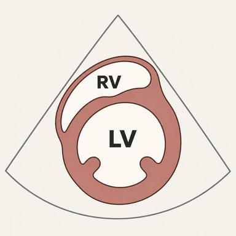

The full illustration and thumbnail are retained byte-for-byte from v54.

**Production checks:** Topology — pass; View identity — pass; Orientation — pass; Labels — pass; Phase — pass; Readability — pass.

#### Original artwork assessment

- Round LV with crescent RV and two separate inward papillary profiles, no mitral leaflet line. Level is visually distinct from basal mitral and apical levels.

#### Final assessment

Round LV with crescent RV and two separate inward papillary profiles, no mitral leaflet line. Level is visually distinct from basal mitral and apical levels.

#### Phase and limits

- **Phase:**

  No valve is present to establish phase. Cavity size and wall thickness are schematic; no systolic/diastolic measurement is implied.

- **Limits:**

  - Papillary profiles are simplified wall-contiguous buds rather than anatomically measured muscle dimensions; both are below the anterior septum.

  - Schematic proportions are not calibrated dimensions and cannot establish normality, pathology or function.

  - Static image review does not validate acquisition technique, motion, Doppler, ECG timing or patient diagnosis.

#### Source and exact view

- **Catalogue table:**

  2

- **Catalogue view:**

  2.12

- **Catalogue source:**

  <https://www.asecho.org/wp-content/uploads/2019/01/2019_Comprehensive-TTE.pdf>

- **Sources used in this review:**

  - Record

    - **Url:**

      <https://www.asecho.org/wp-content/uploads/2025/07/Guidelines-for-Performing-a-Comprehensive-Transthoracic-Echocardiographic-Examination-in-Adults.pdf>

    - **Title:**

      Guidelines for Performing a Comprehensive Transthoracic Echocardiographic Examination in Adults

    - **Publication:**

      Mitchell et al.; JASE 2019;32:1–64

    - **Table:**

      2

    - **Row:**

      2.12

    - **Pdf page:**

      21

    - **Role:**

      Exact-plane anatomy drawing and corresponding real echocardiographic frame; visually compared.

    - **Date note:**

      The 2025/07 URL is the rehost location, not the guideline publication year.

#### Review scope and evidence

- **Independent review:**

  TTE reviewer independently compared the original 960px asset with the exact ASE row and inspected its full-size pixels and static thumbnails. A complementary root review inspected original assets/contact sheets. The TTE reviewer rechecked this retained asset in a fresh 200px final contact sheet; no claim is made that root separately reviewed every retained image full-size. These are independent AI-assisted source comparisons, not clinical certification by an echocardiographer.

- **Full size reviewed:**

  Yes

- **Thumbnail reviewed:**

  Yes

- **Inspection:**

  - **Original full size:**

    960×960 WebP individually inspected against source before disposition.

  - **Final full size:**

    Original 960×960 WebP retained without pixel changes.

  - **Final static thumbnail sizes px:**

    - 200

  - **Final 200px contact sheet:**

    tte-final-200px-contact.png

  - **Final 384px replacement contact sheet:**

    Not specified.

  - **Actual browser render review:**

    Separate integration responsibility; this record asserts full-size and static resampled-image review only.

- **Gate findings:**

  - **Topology:**

    Circular LV is bounded by myocardium with two separate inward papillary profiles; RV crescent remains outside the LV cavity.

  - **View identity:**

    Midpapillary PSAX of ASE 2.12; no mitral aperture or apical-only ring.

  - **Orientation:**

    RV lies anterior/near field; papillary profiles lie on the lower/lateral portions of the LV contour in the reference convention.

  - **Labels:**

    RV and LV are inside their own lumens and do not cover papillary tips.

  - **Phase:**

    No valve is present to establish phase. Cavity size and wall thickness are schematic; no systolic/diastolic measurement is implied.

  - **Readability:**

    Two papillary profiles, ventricular boundary and RV crescent remain distinguishable at 200px.

- **Hard failures:**

  None recorded.

#### Preservation and correction constraints

- Keep two distinct papillary profiles and a round LV short-axis outline.

- Do not replace papillary muscles with valve leaflets.

- Preserve separate RV crescent without flattening the LV septum into a pathology cue.

#### Reconsidered concerns

- Wall-contiguous papillary buds are an accepted schematic simplification.

- Papillary size and LV wall thickness are not used as diagnostic measurements.

#### Additional review metadata

- **Original asset:**

  - **Path:**

    `public/assets/reference-views-v54/tte-psax_papillary.webp`

  - **Sha256:**

    `9e9dc4f4140a9bcea33d3d62bbb4846cf063d1eef5426e16cb2bd986d9bad138`

- **Source facts and operational criteria:**

  - **Source facts:**

    Imaging-plane anatomy, visible landmarks and conventional orientation are anchored to the cited exact ASE table row; additional sources are identified separately.

  - **Operational criteria:**

    Patent lumen tracing, no false muscular seals, attached leaflet profiles, legible labels at 200px/384px and absence of invented structures are artwork acceptance checks applied by the reviewers, not numerical clinical thresholds.

- **Export review:**

  - **Stage:**

    Retained production thumbnail pairing

  - **Status:**

    pass

  - **Files inspected:**

    Actual 384px thumbnail path in the current manifest, displayed at 200px

  - **Reviewer:**

    TTE review agent

  - **Findings:**

    Matched the previously reviewed full-size view identity; no swapped image, corrupted label, unexpected crop or gallery-size label blocker.

<details>
<summary>Exact prompts and authoring history</summary>

Prompts describe requested changes. Historical authoring records do not supersede this review’s findings.

##### Original artwork: provenance location

- **Historical manifest:**

  docs/reference-views-v54/asset-manifest.json

- **Historical master sha256:**

  `12b669b6a21c974eb963ef8f12649c4208a662db5654b373bcd3100f08ba56cf`

- **Note:**

  The immutable historical manifest preserves the original authoring prompts. This report reproduces the exact prompts for this revision’s seven replacements; all current QC findings and retained-view decisions are included above.

</details>

#### Asset identity

| Asset | Path / identity | Pixels | Bytes | SHA-256 |
| --- | --- | --- | --- | --- |
| Original illustration | `public/assets/reference-views-v54/tte-psax_papillary.webp` | 960 × 960 | 42,702 | `9e9dc4f4140a9bcea33d3d62bbb4846cf063d1eef5426e16cb2bd986d9bad138` |
| Current illustration | `public/assets/reference-views-v54/tte-psax_papillary.webp` | 960 × 960 | 42,702 | `9e9dc4f4140a9bcea33d3d62bbb4846cf063d1eef5426e16cb2bd986d9bad138` |
| Original thumbnail | `public/assets/reference-views-v54/thumbs/tte-psax_papillary.webp` | 384 × 384 | 12,586 | `cbdd37ef7809cba863a1f65b39ffd2444e26c0eab6cf56b50d2d411d8670e0ef` |
| Current thumbnail | `public/assets/reference-views-v54/thumbs/tte-psax_papillary.webp` | 384 × 384 | 12,586 | `cbdd37ef7809cba863a1f65b39ffd2444e26c0eab6cf56b50d2d411d8670e0ef` |
| Historical generation master | `Original master PNG hash` | — | — | `12b669b6a21c974eb963ef8f12649c4208a662db5654b373bcd3100f08ba56cf` |

---

### TTE · Parasternal short axis — apical level

**ID:** `tte:psax_apical` · **Decision:** Retained · **ASE table/view:** 2 / 2.13

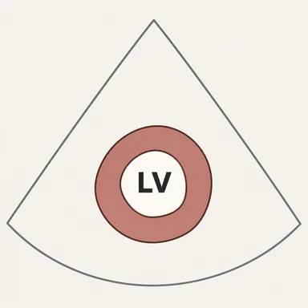

The full illustration and thumbnail are retained byte-for-byte from v54.

**Production checks:** Topology — pass; View identity — pass; Orientation — pass; Labels — pass; Phase — pass; Readability — pass.

#### Original artwork assessment

- Small circular apical LV with thick surrounding myocardium, no MV or large papillary muscles, no required RV at this apical level.

#### Final assessment

Small circular apical LV with thick surrounding myocardium, no MV or large papillary muscles, no required RV at this apical level.

#### Phase and limits

- **Phase:**

  No valve or ECG marker determines phase; apical cavity dimensions are nonquantitative.

- **Limits:**

  - Ring thickness and cavity size are schematic, not a diagnosis of hypertrophy.

  - Schematic proportions are not calibrated dimensions and cannot establish normality, pathology or function.

  - Static image review does not validate acquisition technique, motion, Doppler, ECG timing or patient diagnosis.

#### Source and exact view

- **Catalogue table:**

  2

- **Catalogue view:**

  2.13

- **Catalogue source:**

  <https://www.asecho.org/wp-content/uploads/2019/01/2019_Comprehensive-TTE.pdf>

- **Sources used in this review:**

  - Record

    - **Url:**

      <https://www.asecho.org/wp-content/uploads/2025/07/Guidelines-for-Performing-a-Comprehensive-Transthoracic-Echocardiographic-Examination-in-Adults.pdf>

    - **Title:**

      Guidelines for Performing a Comprehensive Transthoracic Echocardiographic Examination in Adults

    - **Publication:**

      Mitchell et al.; JASE 2019;32:1–64

    - **Table:**

      2

    - **Row:**

      2.13

    - **Pdf page:**

      21

    - **Role:**

      Exact-plane anatomy drawing and corresponding real echocardiographic frame; visually compared.

    - **Date note:**

      The 2025/07 URL is the rehost location, not the guideline publication year.

#### Review scope and evidence

- **Independent review:**

  TTE reviewer independently compared the original 960px asset with the exact ASE row and inspected its full-size pixels and static thumbnails. A complementary root review inspected original assets/contact sheets. The TTE reviewer rechecked this retained asset in a fresh 200px final contact sheet; no claim is made that root separately reviewed every retained image full-size. These are independent AI-assisted source comparisons, not clinical certification by an echocardiographer.

- **Full size reviewed:**

  Yes

- **Thumbnail reviewed:**

  Yes

- **Inspection:**

  - **Original full size:**

    960×960 WebP individually inspected against source before disposition.

  - **Final full size:**

    Original 960×960 WebP retained without pixel changes.

  - **Final static thumbnail sizes px:**

    - 200

  - **Final 200px contact sheet:**

    tte-final-200px-contact.png

  - **Final 384px replacement contact sheet:**

    Not specified.

  - **Actual browser render review:**

    Separate integration responsibility; this record asserts full-size and static resampled-image review only.

- **Gate findings:**

  - **Topology:**

    Single small LV lumen surrounded by myocardium; no false valve, papillary head or second intraventricular chamber.

  - **View identity:**

    Apical PSAX of ASE 2.13, distinct from basal mitral and midpapillary levels.

  - **Orientation:**

    Small central apical LV lies inside the standard sector; no unwarranted left/right chamber inference is added.

  - **Labels:**

    LV is centered inside the only ventricular lumen.

  - **Phase:**

    No valve or ECG marker determines phase; apical cavity dimensions are nonquantitative.

  - **Readability:**

    Simple ring contour and LV label remain clear at 200px.

- **Hard failures:**

  None recorded.

#### Preservation and correction constraints

- Keep the apical slice free of mitral valve and large papillary muscles.

- Do not force an RV lumen where the reference level does not show one.

- Do not imply hypertrophy from stylized wall thickness.

#### Reconsidered concerns

- Absence of RV at this apical level is source-consistent.

- The thick ring is an icon convention, not a hypertrophy diagnosis.

#### Additional review metadata

- **Original asset:**

  - **Path:**

    `public/assets/reference-views-v54/tte-psax_apical.webp`

  - **Sha256:**

    `6b29f0af3fdab8bb4c4eb285523aa22881c4f16f0715b15c16cb1fad54414d83`

- **Source facts and operational criteria:**

  - **Source facts:**

    Imaging-plane anatomy, visible landmarks and conventional orientation are anchored to the cited exact ASE table row; additional sources are identified separately.

  - **Operational criteria:**

    Patent lumen tracing, no false muscular seals, attached leaflet profiles, legible labels at 200px/384px and absence of invented structures are artwork acceptance checks applied by the reviewers, not numerical clinical thresholds.

- **Export review:**

  - **Stage:**

    Retained production thumbnail pairing

  - **Status:**

    pass

  - **Files inspected:**

    Actual 384px thumbnail path in the current manifest, displayed at 200px

  - **Reviewer:**

    TTE review agent

  - **Findings:**

    Matched the previously reviewed full-size view identity; no swapped image, corrupted label, unexpected crop or gallery-size label blocker.

<details>
<summary>Exact prompts and authoring history</summary>

Prompts describe requested changes. Historical authoring records do not supersede this review’s findings.

##### Original artwork: provenance location

- **Historical manifest:**

  docs/reference-views-v54/asset-manifest.json

- **Historical master sha256:**

  `beace1ef3e521ef5b1ac0816acfccb3b3d18d17f7b039b2c659a73451a82e377`

- **Note:**

  The immutable historical manifest preserves the original authoring prompts. This report reproduces the exact prompts for this revision’s seven replacements; all current QC findings and retained-view decisions are included above.

</details>

#### Asset identity

| Asset | Path / identity | Pixels | Bytes | SHA-256 |
| --- | --- | --- | --- | --- |
| Original illustration | `public/assets/reference-views-v54/tte-psax_apical.webp` | 960 × 960 | 30,542 | `6b29f0af3fdab8bb4c4eb285523aa22881c4f16f0715b15c16cb1fad54414d83` |
| Current illustration | `public/assets/reference-views-v54/tte-psax_apical.webp` | 960 × 960 | 30,542 | `6b29f0af3fdab8bb4c4eb285523aa22881c4f16f0715b15c16cb1fad54414d83` |
| Original thumbnail | `public/assets/reference-views-v54/thumbs/tte-psax_apical.webp` | 384 × 384 | 7,908 | `ce8a631d8e04f85bae5f3638b4ca7746434c4ad9cdfaa34dc02c92057dbe36f5` |
| Current thumbnail | `public/assets/reference-views-v54/thumbs/tte-psax_apical.webp` | 384 × 384 | 7,908 | `ce8a631d8e04f85bae5f3638b4ca7746434c4ad9cdfaa34dc02c92057dbe36f5` |
| Historical generation master | `Original master PNG hash` | — | — | `beace1ef3e521ef5b1ac0816acfccb3b3d18d17f7b039b2c659a73451a82e377` |

---

### TTE · Apical four-chamber

**ID:** `tte:a4c` · **Decision:** Retained · **ASE table/view:** 2 / 2.14

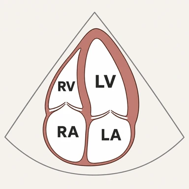

The full illustration and thumbnail are retained byte-for-byte from v54.

**Production checks:** Topology — pass; View identity — pass; Orientation — pass; Labels — pass; Phase — pass; Readability — pass.

#### Original artwork assessment

- Four chambers correctly ordered with apex near field, atria far field, RV/RA display-left and LV/LA display-right. AV valves are thin and TV is more apical; septa intact; no LVOT.

#### Final assessment

Four chambers correctly ordered with apex near field, atria far field, RV/RA display-left and LV/LA display-right. AV valves are thin and TV is more apical; septa intact; no LVOT.

#### Phase and limits

- **Phase:**

  Thin atrioventricular leaflet profiles are near coaptation. A closed-valve-compatible state is shown, without an exact timed phase claim.

- **Limits:**

  - Nearly coapting valves are a valid static phase. Normal asymmetric RV/LV shapes retained.

  - Schematic proportions are not calibrated dimensions and cannot establish normality, pathology or function.

  - Static image review does not validate acquisition technique, motion, Doppler, ECG timing or patient diagnosis.

#### Source and exact view

- **Catalogue table:**

  2

- **Catalogue view:**

  2.14

- **Catalogue source:**

  <https://www.asecho.org/wp-content/uploads/2019/01/2019_Comprehensive-TTE.pdf>

- **Sources used in this review:**

  - Record

    - **Url:**

      <https://www.asecho.org/wp-content/uploads/2025/07/Guidelines-for-Performing-a-Comprehensive-Transthoracic-Echocardiographic-Examination-in-Adults.pdf>

    - **Title:**

      Guidelines for Performing a Comprehensive Transthoracic Echocardiographic Examination in Adults

    - **Publication:**

      Mitchell et al.; JASE 2019;32:1–64

    - **Table:**

      2

    - **Row:**

      2.14

    - **Pdf page:**

      21

    - **Role:**

      Exact-plane anatomy drawing and corresponding real echocardiographic frame; visually compared.

    - **Date note:**

      The 2025/07 URL is the rehost location, not the guideline publication year.

#### Review scope and evidence

- **Independent review:**

  TTE reviewer independently compared the original 960px asset with the exact ASE row and inspected its full-size pixels and static thumbnails. A complementary root review inspected original assets/contact sheets. The TTE reviewer rechecked this retained asset in a fresh 200px final contact sheet; no claim is made that root separately reviewed every retained image full-size. These are independent AI-assisted source comparisons, not clinical certification by an echocardiographer.

- **Full size reviewed:**

  Yes

- **Thumbnail reviewed:**

  Yes

- **Inspection:**

  - **Original full size:**

    960×960 WebP individually inspected against source before disposition.

  - **Final full size:**

    Original 960×960 WebP retained without pixel changes.

  - **Final static thumbnail sizes px:**

    - 200

  - **Final 200px contact sheet:**

    tte-final-200px-contact.png

  - **Final 384px replacement contact sheet:**

    Not specified.

  - **Actual browser render review:**

    Separate integration responsibility; this record asserts full-size and static resampled-image review only.

- **Gate findings:**

  - **Topology:**

    RA joins RV through TV; LA joins LV through MV. IVS and IAS are intact; no LVOT or extra chamber is inserted.

  - **View identity:**

    Standard four-chamber apical anatomy matches ASE 2.14.

  - **Orientation:**

    Ventricles/apex near field, atria far field; RV/RA display left, LV/LA right. TV attachment is more apical than MV.

  - **Labels:**

    RV, LV, RA and LA labels are placed in the intended four lumens.

  - **Phase:**

    Thin atrioventricular leaflet profiles are near coaptation. A closed-valve-compatible state is shown, without an exact timed phase claim.

  - **Readability:**

    Four chambers, intact septa and relative AV valve level remain clear at 200px.

- **Hard failures:**

  None recorded.

#### Preservation and correction constraints

- Preserve four-chamber topology and normal LV-forming apex.

- Keep TV septal insertion modestly more apical than MV.

- Exclude LVOT/AV and coronary sinus from the standard A4C drawing.

#### Reconsidered concerns

- Thin leaflet coaptation is physiologically possible.

- Normal RV/LV asymmetry is retained rather than normalized into two equal ventricles.

#### Additional review metadata

- **Original asset:**

  - **Path:**

    `public/assets/reference-views-v54/tte-a4c.webp`

  - **Sha256:**

    `6f9a69fef4e87d78d32085c1a5c3f1d0c23116425743bad746027cf40a9ea305`

- **Source facts and operational criteria:**

  - **Source facts:**

    Imaging-plane anatomy, visible landmarks and conventional orientation are anchored to the cited exact ASE table row; additional sources are identified separately.

  - **Operational criteria:**

    Patent lumen tracing, no false muscular seals, attached leaflet profiles, legible labels at 200px/384px and absence of invented structures are artwork acceptance checks applied by the reviewers, not numerical clinical thresholds.

- **Export review:**

  - **Stage:**

    Retained production thumbnail pairing

  - **Status:**

    pass

  - **Files inspected:**

    Actual 384px thumbnail path in the current manifest, displayed at 200px

  - **Reviewer:**

    TTE review agent

  - **Findings:**

    Matched the previously reviewed full-size view identity; no swapped image, corrupted label, unexpected crop or gallery-size label blocker.

<details>
<summary>Exact prompts and authoring history</summary>

Prompts describe requested changes. Historical authoring records do not supersede this review’s findings.

##### Original artwork: provenance location

- **Historical manifest:**

  docs/reference-views-v54/asset-manifest.json

- **Historical master sha256:**

  `4deb5620c0c8bd5a9551c990a360d42e063efe9db49be368a14094b30e7a83b9`

- **Note:**

  The immutable historical manifest preserves the original authoring prompts. This report reproduces the exact prompts for this revision’s seven replacements; all current QC findings and retained-view decisions are included above.

</details>

#### Asset identity

| Asset | Path / identity | Pixels | Bytes | SHA-256 |
| --- | --- | --- | --- | --- |
| Original illustration | `public/assets/reference-views-v54/tte-a4c.webp` | 960 × 960 | 47,640 | `6f9a69fef4e87d78d32085c1a5c3f1d0c23116425743bad746027cf40a9ea305` |
| Current illustration | `public/assets/reference-views-v54/tte-a4c.webp` | 960 × 960 | 47,640 | `6f9a69fef4e87d78d32085c1a5c3f1d0c23116425743bad746027cf40a9ea305` |
| Original thumbnail | `public/assets/reference-views-v54/thumbs/tte-a4c.webp` | 384 × 384 | 14,346 | `b9023902c777bc24096b1ada36453d68329aebbad46748b5d06c000c2d1f9ac2` |
| Current thumbnail | `public/assets/reference-views-v54/thumbs/tte-a4c.webp` | 384 × 384 | 14,346 | `b9023902c777bc24096b1ada36453d68329aebbad46748b5d06c000c2d1f9ac2` |
| Historical generation master | `Original master PNG hash` | — | — | `4deb5620c0c8bd5a9551c990a360d42e063efe9db49be368a14094b30e7a83b9` |

---

### TTE · Apical four-chamber — LV zoom

**ID:** `tte:a4c_lv` · **Decision:** Retained · **ASE table/view:** 2 / 2.15

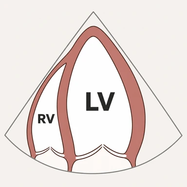

The full illustration and thumbnail are retained byte-for-byte from v54.

**Production checks:** Topology — pass; View identity — pass; Orientation — pass; Labels — pass; Phase — pass; Readability — pass.

#### Original artwork assessment

- LV-focused A4C correctly magnifies LV with complete apical contour and partial atria cropped at fan base; RV remains a supporting left profile; no outflow tract.

#### Final assessment

LV-focused A4C correctly magnifies LV with complete apical contour and partial atria cropped at fan base; RV remains a supporting left profile; no outflow tract.

#### Phase and limits

- **Phase:**

  Basal AV leaflet profiles are near coaptation; no precise cardiac phase is inferable.

- **Limits:**

  - This is a focus/crop, not a separate anatomic plane. Do not regenerate merely because atria are incomplete.

  - Schematic proportions are not calibrated dimensions and cannot establish normality, pathology or function.

  - Static image review does not validate acquisition technique, motion, Doppler, ECG timing or patient diagnosis.

#### Source and exact view

- **Catalogue table:**

  2

- **Catalogue view:**

  2.15

- **Catalogue source:**

  <https://www.asecho.org/wp-content/uploads/2019/01/2019_Comprehensive-TTE.pdf>

- **Sources used in this review:**

  - Record

    - **Url:**

      <https://www.asecho.org/wp-content/uploads/2025/07/Guidelines-for-Performing-a-Comprehensive-Transthoracic-Echocardiographic-Examination-in-Adults.pdf>

    - **Title:**

      Guidelines for Performing a Comprehensive Transthoracic Echocardiographic Examination in Adults

    - **Publication:**

      Mitchell et al.; JASE 2019;32:1–64

    - **Table:**

      2

    - **Row:**

      2.15

    - **Pdf page:**

      22

    - **Role:**

      Exact-plane anatomy drawing and corresponding real echocardiographic frame; visually compared.

    - **Date note:**

      The 2025/07 URL is the rehost location, not the guideline publication year.

#### Review scope and evidence

- **Independent review:**

  TTE reviewer independently compared the original 960px asset with the exact ASE row and inspected its full-size pixels and static thumbnails. A complementary root review inspected original assets/contact sheets. The TTE reviewer rechecked this retained asset in a fresh 200px final contact sheet; no claim is made that root separately reviewed every retained image full-size. These are independent AI-assisted source comparisons, not clinical certification by an echocardiographer.

- **Full size reviewed:**

  Yes

- **Thumbnail reviewed:**

  Yes

- **Inspection:**

  - **Original full size:**

    960×960 WebP individually inspected against source before disposition.

  - **Final full size:**

    Original 960×960 WebP retained without pixel changes.

  - **Final static thumbnail sizes px:**

    - 200

  - **Final 200px contact sheet:**

    tte-final-200px-contact.png

  - **Final 384px replacement contact sheet:**

    Not specified.

  - **Actual browser render review:**

    Separate integration responsibility; this record asserts full-size and static resampled-image review only.

- **Gate findings:**

  - **Topology:**

    Complete LV cavity/apex connects to basal MV junction; partial RA/LA below the valves are intentionally cropped. Septum separates the supporting RV.

  - **View identity:**

    LV-optimized A4C magnification of ASE 2.15; excludes LVOT.

  - **Orientation:**

    LV/apex near field on display right; supporting RV on left; atrial portions at far-field crop.

  - **Labels:**

    LV is prominent and RV is correctly placed in its supporting cavity.

  - **Phase:**

    Basal AV leaflet profiles are near coaptation; no precise cardiac phase is inferable.

  - **Readability:**

    Large LV label and complete apex remain clear at 200px; AV valves still distinguish the basal boundary from a muscle cap.

- **Hard failures:**

  None recorded.

#### Preservation and correction constraints

- Preserve full LV apex and supporting RV profile.

- Keep basal mitral junction thin; incomplete atria are acceptable zoom framing.

- Do not add LVOT or aortic root to this four-chamber focus.

#### Reconsidered concerns

- Cropped atria are expected in a ventricular optimization view.

- Focus is an acquisition/framing variant rather than a separate whole-heart anatomy.

#### Additional review metadata

- **Original asset:**

  - **Path:**

    `public/assets/reference-views-v54/tte-a4c_lv.webp`

  - **Sha256:**

    `07e3df3306b8d488ab13a801f15e03ace38399b4d8751e56c8ca59369c5828d0`

- **Source facts and operational criteria:**

  - **Source facts:**

    Imaging-plane anatomy, visible landmarks and conventional orientation are anchored to the cited exact ASE table row; additional sources are identified separately.

  - **Operational criteria:**

    Patent lumen tracing, no false muscular seals, attached leaflet profiles, legible labels at 200px/384px and absence of invented structures are artwork acceptance checks applied by the reviewers, not numerical clinical thresholds.

- **Export review:**

  - **Stage:**

    Retained production thumbnail pairing

  - **Status:**

    pass

  - **Files inspected:**

    Actual 384px thumbnail path in the current manifest, displayed at 200px

  - **Reviewer:**

    TTE review agent

  - **Findings:**

    Matched the previously reviewed full-size view identity; no swapped image, corrupted label, unexpected crop or gallery-size label blocker.

<details>
<summary>Exact prompts and authoring history</summary>

Prompts describe requested changes. Historical authoring records do not supersede this review’s findings.

##### Original artwork: provenance location

- **Historical manifest:**

  docs/reference-views-v54/asset-manifest.json

- **Historical master sha256:**

  `cd186f04baa3d1741a3db3c1c3c17ec64c00d5e0c28badc542bb9369451d8070`

- **Note:**

  The immutable historical manifest preserves the original authoring prompts. This report reproduces the exact prompts for this revision’s seven replacements; all current QC findings and retained-view decisions are included above.

</details>

#### Asset identity

| Asset | Path / identity | Pixels | Bytes | SHA-256 |
| --- | --- | --- | --- | --- |
| Original illustration | `public/assets/reference-views-v54/tte-a4c_lv.webp` | 960 × 960 | 47,574 | `07e3df3306b8d488ab13a801f15e03ace38399b4d8751e56c8ca59369c5828d0` |
| Current illustration | `public/assets/reference-views-v54/tte-a4c_lv.webp` | 960 × 960 | 47,574 | `07e3df3306b8d488ab13a801f15e03ace38399b4d8751e56c8ca59369c5828d0` |
| Original thumbnail | `public/assets/reference-views-v54/thumbs/tte-a4c_lv.webp` | 384 × 384 | 13,286 | `8d7c0eb69f9291a9a063a07b03ffe75ba56e085f04358a719d9f34c1ef690f25` |
| Current thumbnail | `public/assets/reference-views-v54/thumbs/tte-a4c_lv.webp` | 384 × 384 | 13,286 | `8d7c0eb69f9291a9a063a07b03ffe75ba56e085f04358a719d9f34c1ef690f25` |
| Historical generation master | `Original master PNG hash` | — | — | `cd186f04baa3d1741a3db3c1c3c17ec64c00d5e0c28badc542bb9369451d8070` |

---

### TTE · Apical four-chamber — RV focus

**ID:** `tte:a4c_rv` · **Decision:** Clarity improvement · **ASE table/view:** 2 / 2.16

| Before — superseded v54 artwork | After — accepted v58 artwork |
| --- | --- |
| 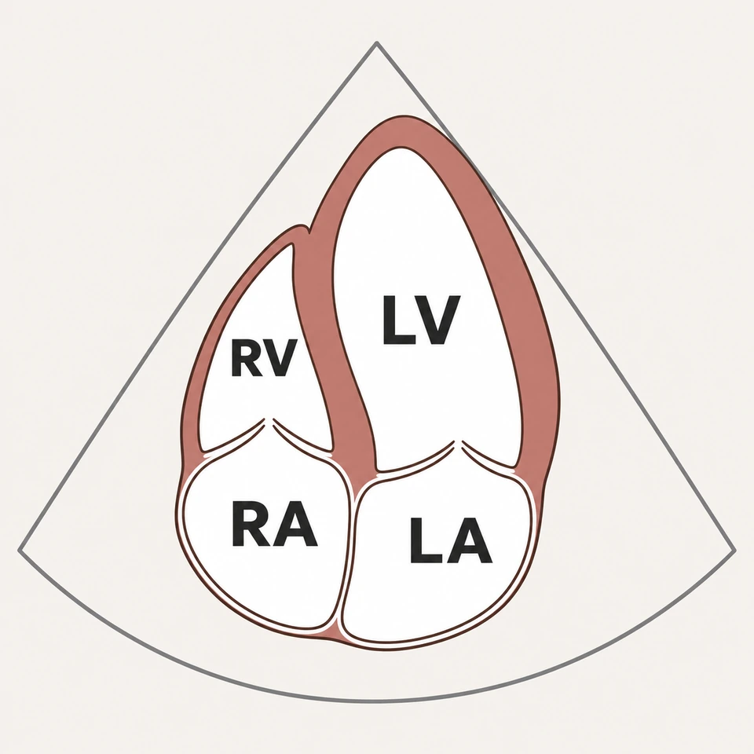 | 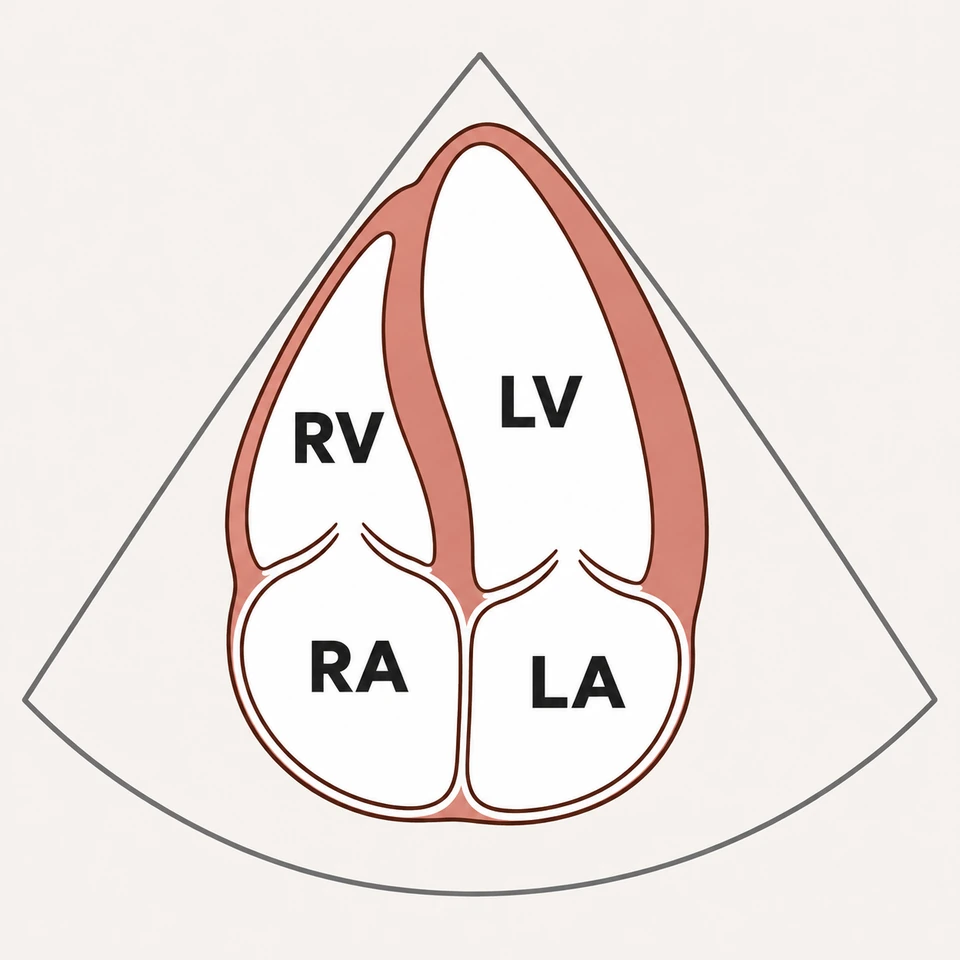 |

**Production checks:** Topology — pass; View identity — pass; Orientation — pass; Labels — pass; Phase — pass; Readability — pass.

#### Original artwork assessment

- Framing and reference-identity clarity need improvement: full RV free wall/apical extent is abbreviated and RV-focused image is not clearly distinct from standard A4C. This is a depiction/focus concern, not a claim that original small RV proportions are inherently pathologic.

#### Final assessment

Improved RV-focused framing and complete RV free-wall/apical visibility while retaining a normal smaller asymmetric RV and a LV-forming apex. The final image preserves correct four-chamber topology, intact septa, thin RV free wall and modest apical TV offset.

#### Phase and limits

- **Phase:**

  Small visible gaps between each AV leaflet pair are compatible with diastolic opening. The opening is modest and the schematic does not establish a specific diastolic subphase.

- **Limits:**

  - Do not enlarge RV until it forms apex or dominates LV. Preserve normal LV-forming apex and smaller RV; improve RV free-wall/apical visibility and framing. Source-based clinical focus depends on probe plane, not just relative cavity size.

  - The prompt width/length percentages are operational illustration directions, not ASE diagnostic thresholds or a normal range.

  - A schematic cannot validate probe position or RV dimensions; focus identity is judged against the source plane and visible landmarks.

  - Schematic proportions are not calibrated dimensions and cannot establish normality, pathology or function.

  - Static image review does not validate acquisition technique, motion, Doppler, ECG timing or patient diagnosis.

#### Source and exact view

- **Catalogue table:**

  2

- **Catalogue view:**

  2.16

- **Catalogue source:**

  <https://www.asecho.org/wp-content/uploads/2019/01/2019_Comprehensive-TTE.pdf>

- **Sources used in this review:**

  - Record

    - **Url:**

      <https://www.asecho.org/wp-content/uploads/2025/07/Guidelines-for-Performing-a-Comprehensive-Transthoracic-Echocardiographic-Examination-in-Adults.pdf>

    - **Title:**

      Guidelines for Performing a Comprehensive Transthoracic Echocardiographic Examination in Adults

    - **Publication:**

      Mitchell et al.; JASE 2019;32:1–64

    - **Table:**

      2

    - **Row:**

      2.16

    - **Pdf page:**

      22

    - **Role:**

      Exact-plane anatomy drawing and corresponding real echocardiographic frame; visually compared.

    - **Date note:**

      The 2025/07 URL is the rehost location, not the guideline publication year.

  - Record

    - **Url:**

      <https://www.asecho.org/wp-content/uploads/2026/08/ASE-Right-Heart-Guidelines-May-2025.pdf>

    - **Title:**

      Guidelines for the Echocardiographic Assessment of the Right Heart in Adults and Special Considerations in Pulmonary Hypertension

    - **Publication year:**

      2025

    - **Figure:**

      2

    - **Printed page:**

      151

    - **Pdf page:**

      11

    - **Role:**

      RV-focused acquisition and normal source illustration: complete RV free wall/apex, exclusion of LVOT/CS, normal LV-forming apex.

    - **Date note:**

      2026/08 is the rehost URL date, not the guideline publication year.

#### Review scope and evidence

- **Independent review:**

  TTE reviewer independently compared the original 960px asset with the exact ASE row and inspected its full-size pixels and static thumbnails. A complementary root review inspected original assets/contact sheets. The final generated master was independently inspected at full size by both the TTE reviewer and root; the TTE reviewer then rechecked the final master and fresh 200px plus 384px resamples. These are independent AI-assisted source comparisons, not clinical certification by an echocardiographer.

- **Full size reviewed:**

  Yes

- **Thumbnail reviewed:**

  Yes

- **Inspection:**

  - **Original full size:**

    960×960 WebP individually inspected against source before disposition.

  - **Final full size:**

    Generated PNG master re-inspected full-size.

  - **Final static thumbnail sizes px:**

    - 200

    - 384

  - **Final 200px contact sheet:**

    tte-final-200px-contact.png

  - **Final 384px replacement contact sheet:**

    tte-final-replacements-384px-contact.png

  - **Actual browser render review:**

    Separate integration responsibility; this record asserts full-size and static resampled-image review only.

- **Gate findings:**

  - **Topology:**

    RA-to-RV and LA-to-LV junctions each have thin opposing attached leaflet profiles, without muscular seals. Both septa are intact. No LVOT, aortic root or coronary sinus has been added.

  - **View identity:**

    RV-focused A4C follows ASE 2.16 and the complete free-wall/apex guidance of ASE 2025 Figure 2. Focus is achieved through visibility/framing, not pathological RV enlargement.

  - **Orientation:**

    RV/RA display left and LV/LA right; LV reaches the highest near-field apex. RV is smaller and asymmetric with a fully visible free wall. TV insertion lies modestly closer to apex than MV.

  - **Labels:**

    RV, RA, LV and LA are large, distinct and contained in the correct four lumens.

  - **Phase:**

    Small visible gaps between each AV leaflet pair are compatible with diastolic opening. The opening is modest and the schematic does not establish a specific diastolic subphase.

  - **Readability:**

    At 200px and 384px, the normal LV-forming apex, smaller complete RV, two AV junctions, septa and labels remain visible. The view does not become an RV-dilation icon after reduction.

- **Hard failures:**

  None recorded.

#### Preservation and correction constraints

- Show complete RV free wall and apical extent through framing, while LV remains apex-forming.

- Keep a normal smaller asymmetric RV and thinner RV than LV free wall; no severe septal bowing.

- Preserve the modest TV apical offset and correct RA-RV/LA-LV leaflet hinges.

- Exclude LVOT, AV, aorta, CS and extra chambers.

- Treat any numerical proportions in the generation prompt as artwork constraints only, never clinical thresholds.

#### Reconsidered concerns

- Original concern classified as framing/identity clarity, not intrinsically pathological small-RV anatomy.

- First candidate rejected because RV became dominant and apex-forming.

- Second candidate restores LV-forming apex and normal RV asymmetry while showing complete RV wall/apex.

- Root independently inspected the second candidate at full size and approved it; final 200px/384px checks passed.

#### Additional review metadata

- **Original asset:**

  - **Path:**

    `public/assets/reference-views-v54/tte-a4c_rv.webp`

  - **Sha256:**

    `21d79a2958ed0778ee46c2c3ddfe909b541f6eef09c7785a5bf3a5a48b2b9476`

- **Source facts and operational criteria:**

  - **Source facts:**

    Imaging-plane anatomy, visible landmarks and conventional orientation are anchored to the cited exact ASE table row; additional sources are identified separately.

  - **Operational criteria:**

    Patent lumen tracing, no false muscular seals, attached leaflet profiles, legible labels at 200px/384px and absence of invented structures are artwork acceptance checks applied by the reviewers, not numerical clinical thresholds.

- **Export review:**

  - **Stage:**

    Local production WebP files, before publication

  - **Status:**

    pass

  - **Files inspected:**

    Actual 960px image and actual 384px thumbnail; 200px rendition derived from the encoded thumbnail

  - **Reviewer:**

    TTE review agent; root also inspected all seven exported thumbnails at 240px

  - **Findings:**

    LV-forming apex, complete RV outline, intact septa and all four chamber labels remain recognizable.

  - **Remaining display limit:**

    Fine leaflet and cusp interpretation requires the enlarged illustration.

<details>
<summary>Exact prompts and authoring history</summary>

Prompts describe requested changes. Historical authoring records do not supersede this review’s findings.

##### Accepted replacement: exact final prompt and preceding prompts

- **Tool:**

  image_gen

- **Prompt:**

  ```text
  Use case: scientific-educational. Correct the RV-focused apical four-chamber schematic, ONE square image.
  INPUT1 is the edit target from the previous attempt. INPUT2 is the official ASE 2025 Figure2 RV-focused anatomy drawing; use its NORMAL chamber proportions and apex relationship to guide correction. INPUT3 is the corresponding real echocardiogram from ASE Table2 row2.16.
  The previous attempt incorrectly enlarged RV until it became the apex-forming chamber. Correct that. This is FRAMING of a normal RV-focused imaging plane, not right ventricular dilation.
  MAKE THESE GEOMETRIC CORRECTIONS: LV on screen-right must extend all the way to the near-field apical tip. The LV apex is the highest/nearest point of the heart, at least slightly nearer the sector vertex than the RV apex. RV is screen-left, asymmetric and tapering, with its complete apex just below and beside LV apex as in INPUT2. RV mid/basal blood-pool WIDTH should be roughly 70–90% of adjacent LV width, not wider than LV. RV long-axis length approximately85–90% of LV long-axis length. Preserve full RV lateral/free wall in view and frame the whole heart so the RV lies near the sector center; this is the focus distinction. A normal RV does not wrap around or extend beyond LV apex. Septum should be gently curved, not bowed severely into LV. RV wall clearly thinner than LV.
  KEEP four chambers: RV upper-left above RA lower-left, LV upper-right above LA lower-right; thin intact IAS and moderately thick intact IVS, no additional structures. Both atria thin-walled and normal sized, no dilation. Keep two thin attached leaflet profiles at each correct atrioventricular junction. For diastolic illustration, give each pair a clearly visible moderate central gap, with tips aimed into ventricle. No muscular bridge, detached leaflet, leaflet reaching opposite annular hinge, or artificial orifice narrowing. TV annulus modestly closer to apex than MV annulus. No LVOT, AV, aorta or coronary sinus.
  Preserve the previous candidate's restrained style exactly: ivory background and blood cavities, terracotta myocardium, fine dark brown outlines, thin gray sector with apex at top and curved base, flat opaque fills. No gradients/texture/3D/ultrasound noise.
  EXACT labels only "RV", "RA", "LV", "LA", bold clean dark sans serif, inside their own lumens without overlapping valves/walls. No title, arrows, badges or extra text.
  Main check: NORMAL LV-forming apex + smaller but complete and clearly framed RV. This image must not suggest pathological RV enlargement. Preserve visual clarity and all chamber connections.
  ```

- **Iteration reviews:**

  - Record

    - **Attempt:**

      1

    - **Status:**

      rejected

    - **Output sha256:**

      `fbf8ad67282890b70fffc7822f3dea1664e0f3669a38c2f86f114c59bf04bb58`

    - **Reason:**

      RV enlarged until wider/longer and apex-forming; root independent review rejected the pathological implication.

  - Record

    - **Attempt:**

      2

    - **Status:**

      pass

    - **Output sha256:**

      `1b177de3fbfd3c275e759d90196303330ab9251d161f8129770c5d2ab052caea`

    - **Reason:**

      LV-forming apex restored; complete smaller asymmetric RV with thin free wall, correct AV hinges/offset, intact septa and no LVOT/CS. TTE and root full-size review passed; final 200px and 384px review passed.

- **Prompt limitations:**

  - ```text
    Numerical width/length proportions in the exact prompt were operational artwork directions, not clinical normal limits.
    ```

- **Reference inputs:**

  - Record

    - **Url:**

      <https://www.asecho.org/wp-content/uploads/2025/07/Guidelines-for-Performing-a-Comprehensive-Transthoracic-Echocardiographic-Examination-in-Adults.pdf>

    - **Role:**

      official ASE row 2.16 anatomic reference

    - **Name:**

      tte-2-16-anatomy.png

    - **Sha256:**

      `b600df1a64321501418b1789a7bf21f1e5808bc2e2117bc22d85aa001550862c`

  - Record

    - **Url:**

      <https://www.asecho.org/wp-content/uploads/2025/07/Guidelines-for-Performing-a-Comprehensive-Transthoracic-Echocardiographic-Examination-in-Adults.pdf>

    - **Role:**

      official ASE row 2.16 real ultrasound reference

    - **Name:**

      tte-2-16-echo.png

    - **Sha256:**

      `86d60e081ce30a6ffdf2ff210d81a0b392ade8f3ca1f8a9482986acd6b62aa50`

  - Record

    - **Url:**

      Not specified.

    - **Role:**

      current artwork style only

    - **Name:**

      tte-a4c_rv.webp

    - **Sha256:**

      `21d79a2958ed0778ee46c2c3ddfe909b541f6eef09c7785a5bf3a5a48b2b9476`

  - Record

    - **Url:**

      Not specified.

    - **Role:**

      previous candidate edit target

    - **Name:**

      exec-d79c82f4-f02f-478e-82db-79e06fbe4d15.png

    - **Sha256:**

      `fbf8ad67282890b70fffc7822f3dea1664e0f3669a38c2f86f114c59bf04bb58`

  - Record

    - **Url:**

      <https://www.asecho.org/wp-content/uploads/2026/08/ASE-Right-Heart-Guidelines-May-2025.pdf>

    - **Role:**

      ASE2025 Fig2 normal RV-focused anatomy

    - **Name:**

      ase2025-rv-focused-fig2.png

    - **Sha256:**

      `fa459ed42d469d7859ed3f95969f972be405aa9d9f15e0ce847305986bd903f8`

- **Earlier prompts in order:**

  - ```text
    Use case: scientific-educational.
    Create ONE corrected original flat medical reference illustration of the TTE RV-FOCUSED APICAL FOUR-CHAMBER view, ASE Table 2 row 2.16. This is an anatomy navigation card, square image, not an external heart rendering.
    INPUT ROLES: Image 1 is official reference anatomy and image 2 is the corresponding actual RV-focused echocardiogram. They determine plane and screen orientation. Image 3 is the CURRENT INCORRECT icon, used ONLY for exact palette, sector, line style and typography; do not copy its narrow short RV or dominant LV geometry.
    CORRECTION: genuinely show the whole RV-focused imaging plane, with a broad right ventricular basal and mid cavity, complete long free wall and complete apex, prominently framed in the center-left of the sector. Follow the real echo's enlarged RV-focused field. The RV must be clearly wider and longer than its short sliver in image3. The RV is still normal in shape, a tapered asymmetric chamber with thinner myocardium than the LV; focusing must not imply pathologic RV hypertrophy or massive dilation. The LV is the adjacent narrower supporting chamber on screen right, not the dominant subject. RV and LV extend toward the top/near field; RA below RV on screen left and LA below LV on screen right. All four chambers remain separately identifiable. Continuous IVS and thin IAS; no holes.
    VALVES: One thin tricuspid valve at the RA-RV junction, and one thin mitral valve at the LA-LV junction, each composed of two opposing delicate leaflet profiles attached at the annulus. Choose diastole with modest, clearly visible openings between the free tips. No muscular partition at either orifice, no leaflet spanning to opposite hinge, no floating leaves. TV septal attachment modestly closer to apex than MV septal attachment. Never add LVOT, AV, aortic root, coronary sinus or extra chambers to this RV-focused four-chamber plane.
    STYLE: Match Image3's very restrained warm ivory background and ivory-white lumens, muted terracotta myocardium, fine dark brown outlines, thin neutral-gray sector boundary with vertex centered at top and curved base. Flat opaque fills, no texture, no gradients, no 3D, no colored flow. Wall thickness differentiation: thin atria, thin RV free wall, moderately thick LV and septum. All anatomy inside fan with modest margins; no exaggerated apex points.
    EXACT TEXT: "RV" centered prominently in right ventricular lumen on screen-left; "RA" inside right atrium below; "LV" inside left ventricular lumen on screen-right; "LA" inside left atrium below. Four labels only, bold dark clean sans serif, same size and contrast as current icon. No title, degree number, extra label, watermark, arrows or legend. Keep label glyphs clear of tissue and leaflets.
    QUALITY GATES before output: complete identifiable RV free wall and apex; RV-focus distinct from standard A4C; correct four chamber topology; both valves attached at correct annular rims with open white lumen between tips; no crop of RV apex, no falsely closed myocardium across inflow; correct left/right orientation.
    ```

##### Original artwork: provenance location

- **Historical manifest:**

  docs/reference-views-v54/asset-manifest.json

- **Historical master sha256:**

  `aab5dee2e98ffc7d97e60eb23cd6cc81103c842928de6d5904b5aa146a872dda`

- **Note:**

  The immutable historical manifest preserves the original authoring prompts. This report reproduces the exact prompts for this revision’s seven replacements; all current QC findings and retained-view decisions are included above.

</details>

#### Asset identity

| Asset | Path / identity | Pixels | Bytes | SHA-256 |
| --- | --- | --- | --- | --- |
| Original illustration | `public/assets/reference-views-v54/tte-a4c_rv.webp` | 960 × 960 | 51,684 | `21d79a2958ed0778ee46c2c3ddfe909b541f6eef09c7785a5bf3a5a48b2b9476` |
| Current illustration | `public/assets/reference-views-v58/tte-a4c_rv.webp` | 960 × 960 | 52,626 | `81e1b32b014fc93261d0e759d317c75d707631125d67da12f657249e7dce5693` |
| Original thumbnail | `public/assets/reference-views-v54/thumbs/tte-a4c_rv.webp` | 384 × 384 | 14,472 | `6860435fc9a74763fc3aab20d48b313839024229c8fb3dd0f0744adaac962f30` |
| Current thumbnail | `public/assets/reference-views-v58/thumbs/tte-a4c_rv.webp` | 384 × 384 | 15,186 | `499a6997ba078fa35a1801006e9e0f164a55bb9e3b2b052ad418fc15fdb9bcfc` |
| Accepted generation master | `Master PNG hash; no published source image embedded` | — | — | `1b177de3fbfd3c275e759d90196303330ab9251d161f8129770c5d2ab052caea` |
| Historical generation master | `Original master PNG hash` | — | — | `aab5dee2e98ffc7d97e60eb23cd6cc81103c842928de6d5904b5aa146a872dda` |

---

### TTE · Apical five-chamber

**ID:** `tte:a5c` · **Decision:** Retained · **ASE table/view:** 2 / 2.17

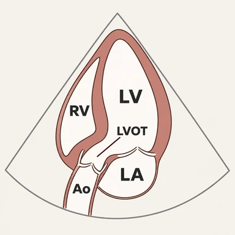

The full illustration and thumbnail are retained byte-for-byte from v54.

**Production checks:** Topology — pass; View identity — pass; Orientation — pass; Labels — pass; Phase — pass; Readability — pass.

#### Original artwork assessment

- Current anteriorly angled A5C closely follows the isolated ASE 2.17a anatomy and echo contours: LV, RV, LA plus LVOT/Ao. A distinct RA cavity is not apparent in either the current image or that specific official reference frame.

- Earlier provisional reject for absent RA withdrawn after closer inspection of isolated official row2.17a anatomy and real-echo crops.

#### Final assessment

Current anteriorly angled A5C closely follows the isolated ASE 2.17a anatomy and echo contours: LV, RV, LA plus LVOT/Ao. A distinct RA cavity is not apparent in either the current image or that specific official reference frame.

#### Phase and limits

- **Phase:**

  Static valve profiles are stylized and near coaptation; no exact cardiac phase is assigned.

- **Limits:**

  - Do not use literal visible chamber count as a hard rejection rule: RA visibility depends on anterior angulation. General A5C descriptions retain RA, but this exact source frame does not clearly depict it. Label identifies outflow-added A4C plane, not five anatomical chambers.

  - Schematic proportions are not calibrated dimensions and cannot establish normality, pathology or function.

  - Static image review does not validate acquisition technique, motion, Doppler, ECG timing or patient diagnosis.

#### Source and exact view

- **Catalogue table:**

  2

- **Catalogue view:**

  2.17

- **Catalogue source:**

  <https://www.asecho.org/wp-content/uploads/2019/01/2019_Comprehensive-TTE.pdf>

- **Sources used in this review:**

  - Record

    - **Url:**

      <https://www.asecho.org/wp-content/uploads/2025/07/Guidelines-for-Performing-a-Comprehensive-Transthoracic-Echocardiographic-Examination-in-Adults.pdf>

    - **Title:**

      Guidelines for Performing a Comprehensive Transthoracic Echocardiographic Examination in Adults

    - **Publication:**

      Mitchell et al.; JASE 2019;32:1–64

    - **Table:**

      2

    - **Row:**

      2.17a

    - **Pdf page:**

      22

    - **Role:**

      Exact-plane anatomy drawing and corresponding real echocardiographic frame; visually compared.

    - **Date note:**

      The 2025/07 URL is the rehost location, not the guideline publication year.

#### Review scope and evidence

- **Independent review:**

  TTE reviewer independently compared the original 960px asset with the exact ASE row and inspected its full-size pixels and static thumbnails. A complementary root review inspected original assets/contact sheets. The TTE reviewer rechecked this retained asset in a fresh 200px final contact sheet; no claim is made that root separately reviewed every retained image full-size. These are independent AI-assisted source comparisons, not clinical certification by an echocardiographer.

- **Full size reviewed:**

  Yes

- **Thumbnail reviewed:**

  Yes

- **Inspection:**

  - **Original full size:**

    960×960 WebP individually inspected against source before disposition.

  - **Final full size:**

    Original 960×960 WebP retained without pixel changes.

  - **Final static thumbnail sizes px:**

    - 200

  - **Final 200px contact sheet:**

    tte-final-200px-contact.png

  - **Final 384px replacement contact sheet:**

    Not specified.

  - **Actual browser render review:**

    Separate integration responsibility; this record asserts full-size and static resampled-image review only.

- **Gate findings:**

  - **Topology:**

    Anterior angulation introduces continuous LV-to-LVOT-to-Ao anatomy while retaining LV, RV and LA. It does not add a literal fifth anatomical chamber.

  - **View identity:**

    Matches the isolated ASE Table 2 row 2.17a anatomy and actual echo frame, not the separate 2.17b RVOT variant.

  - **Orientation:**

    Apical ventricular geometry stays near field; outflow crosses toward far-field Ao and posterior LA. The source-specific anterior plane makes a distinct RA cavity inconspicuous.

  - **Labels:**

    LV, RV, LA, LVOT and Ao identify the structures actually represented; no label is placed in an invented RA.

  - **Phase:**

    Static valve profiles are stylized and near coaptation; no exact cardiac phase is assigned.

  - **Readability:**

    LVOT and Ao remain distinguishable from LA at 200px, preserving the outflow-added identity.

- **Hard failures:**

  None recorded.

#### Preservation and correction constraints

- Preserve source row 2.17a rather than switching to the different 2.17b plane.

- Show continuous LVOT-Ao connection; never treat Ao as a true fifth chamber.

- Do not force visible RA into this particular source-matched anterior plane solely to satisfy literal chamber counting.

#### Reconsidered concerns

- An earlier provisional rejection for absent visible RA was withdrawn after isolated official anatomy and real-echo review.

- Exact source frame, rather than generic literal five-chamber counting, supports retention.

#### Additional review metadata

- **Original asset:**

  - **Path:**

    `public/assets/reference-views-v54/tte-a5c.webp`

  - **Sha256:**

    `b0dc593fb0fd67d457f508ac811b738d3c763b5689da0cd4e757df9810516b31`

- **Source facts and operational criteria:**

  - **Source facts:**

    Imaging-plane anatomy, visible landmarks and conventional orientation are anchored to the cited exact ASE table row; additional sources are identified separately.

  - **Operational criteria:**

    Patent lumen tracing, no false muscular seals, attached leaflet profiles, legible labels at 200px/384px and absence of invented structures are artwork acceptance checks applied by the reviewers, not numerical clinical thresholds.

- **Export review:**

  - **Stage:**

    Retained production thumbnail pairing

  - **Status:**

    pass

  - **Files inspected:**

    Actual 384px thumbnail path in the current manifest, displayed at 200px

  - **Reviewer:**

    TTE review agent

  - **Findings:**

    Matched the previously reviewed full-size view identity; no swapped image, corrupted label, unexpected crop or gallery-size label blocker.

<details>
<summary>Exact prompts and authoring history</summary>

Prompts describe requested changes. Historical authoring records do not supersede this review’s findings.

##### Original artwork: provenance location

- **Historical manifest:**

  docs/reference-views-v54/asset-manifest.json

- **Historical master sha256:**

  `5c1084e83dc7c005e20fb3c204698ac0e153610e23cfae155b675e766942affa`

- **Note:**

  The immutable historical manifest preserves the original authoring prompts. This report reproduces the exact prompts for this revision’s seven replacements; all current QC findings and retained-view decisions are included above.

</details>

#### Asset identity

| Asset | Path / identity | Pixels | Bytes | SHA-256 |
| --- | --- | --- | --- | --- |
| Original illustration | `public/assets/reference-views-v54/tte-a5c.webp` | 960 × 960 | 53,370 | `b0dc593fb0fd67d457f508ac811b738d3c763b5689da0cd4e757df9810516b31` |
| Current illustration | `public/assets/reference-views-v54/tte-a5c.webp` | 960 × 960 | 53,370 | `b0dc593fb0fd67d457f508ac811b738d3c763b5689da0cd4e757df9810516b31` |
| Original thumbnail | `public/assets/reference-views-v54/thumbs/tte-a5c.webp` | 384 × 384 | 15,110 | `d6ee7b1a75f41efa2d7e604c8d6d6bea9f490f3f1c52ca9d5cc147f8c4302807` |
| Current thumbnail | `public/assets/reference-views-v54/thumbs/tte-a5c.webp` | 384 × 384 | 15,110 | `d6ee7b1a75f41efa2d7e604c8d6d6bea9f490f3f1c52ca9d5cc147f8c4302807` |
| Historical generation master | `Original master PNG hash` | — | — | `5c1084e83dc7c005e20fb3c204698ac0e153610e23cfae155b675e766942affa` |

---

### TTE · Apical four-chamber — posterior angulation

**ID:** `tte:a4c_cs` · **Decision:** Retained · **ASE table/view:** 2 / 2.18

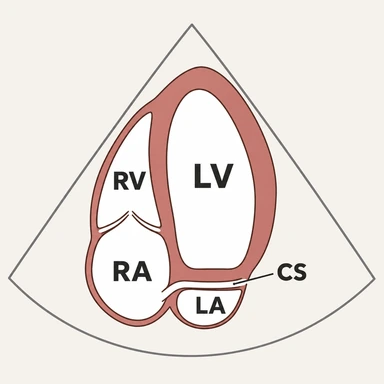

The full illustration and thumbnail are retained byte-for-byte from v54.

**Production checks:** Topology — pass; View identity — pass; Orientation — pass; Labels — pass; Phase — pass; Readability — pass.

#### Original artwork assessment

- Correct posteriorly angled view: transverse coronary sinus beneath posterior LV enters RA, separated from LA; LV base is muscular because MV is out of this plane.

#### Final assessment

Correct posteriorly angled view: transverse coronary sinus beneath posterior LV enters RA, separated from LA; LV base is muscular because MV is out of this plane.

#### Phase and limits

- **Phase:**

  MV is out of the posteriorly angled imaging plane; the static TV profile does not establish a specific cardiac phase.

- **Limits:**

  - IMPORTANT: do not falsely reject closed LV/LA outlines or insert MV here. Their normal anatomical connection is out of plane in this posterior CS view.

  - Schematic proportions are not calibrated dimensions and cannot establish normality, pathology or function.

  - Static image review does not validate acquisition technique, motion, Doppler, ECG timing or patient diagnosis.

#### Source and exact view

- **Catalogue table:**

  2

- **Catalogue view:**

  2.18

- **Catalogue source:**

  <https://www.asecho.org/wp-content/uploads/2019/01/2019_Comprehensive-TTE.pdf>

- **Sources used in this review:**

  - Record

    - **Url:**

      <https://www.asecho.org/wp-content/uploads/2025/07/Guidelines-for-Performing-a-Comprehensive-Transthoracic-Echocardiographic-Examination-in-Adults.pdf>

    - **Title:**

      Guidelines for Performing a Comprehensive Transthoracic Echocardiographic Examination in Adults

    - **Publication:**

      Mitchell et al.; JASE 2019;32:1–64

    - **Table:**

      2

    - **Row:**

      2.18

    - **Pdf page:**

      22

    - **Role:**

      Exact-plane anatomy drawing and corresponding real echocardiographic frame; visually compared.

    - **Date note:**

      The 2025/07 URL is the rehost location, not the guideline publication year.

#### Review scope and evidence

- **Independent review:**

  TTE reviewer independently compared the original 960px asset with the exact ASE row and inspected its full-size pixels and static thumbnails. A complementary root review inspected original assets/contact sheets. The TTE reviewer rechecked this retained asset in a fresh 200px final contact sheet; no claim is made that root separately reviewed every retained image full-size. These are independent AI-assisted source comparisons, not clinical certification by an echocardiographer.

- **Full size reviewed:**

  Yes

- **Thumbnail reviewed:**

  Yes

- **Inspection:**

  - **Original full size:**

    960×960 WebP individually inspected against source before disposition.

  - **Final full size:**

    Original 960×960 WebP retained without pixel changes.

  - **Final static thumbnail sizes px:**

    - 200

  - **Final 200px contact sheet:**

    tte-final-200px-contact.png

  - **Final 384px replacement contact sheet:**

    Not specified.

  - **Actual browser render review:**

    Separate integration responsibility; this record asserts full-size and static resampled-image review only.

- **Gate findings:**

  - **Topology:**

    Coronary sinus runs below the posterior LV and enters RA. It remains distinct from LA. Muscular LV base is correct because MV is out of this slice.

  - **View identity:**

    Posteriorly angulated A4C/CS view of ASE 2.18, not standard A4C.

  - **Orientation:**

    RV/RA display left, LV/LA right; CS transversely separates posterior LV from LA and approaches RA.

  - **Labels:**

    RV, LV, RA, LA and CS label the correct cavities or vessel; CS leader reaches the venous channel.

  - **Phase:**

    MV is out of the posteriorly angled imaging plane; the static TV profile does not establish a specific cardiac phase.

  - **Readability:**

    The CS path, RA entry and intentionally closed posterior LV contour remain clear at 200px.

- **Hard failures:**

  None recorded.

#### Preservation and correction constraints

- Preserve the posterior plane with MV out of view.

- Keep CS continuous into RA and separate from LA.

- Never insert a new mitral opening through the posterior LV/LA boundary in this view.

#### Reconsidered concerns

- The apparent closed LV-LA separation is a correct out-of-plane relationship, unlike the failed PLAX MV junction.

- Retained without anatomical edits to avoid manufacturing a false in-plane mitral orifice.

#### Additional review metadata

- **Original asset:**

  - **Path:**

    `public/assets/reference-views-v54/tte-a4c_cs.webp`

  - **Sha256:**

    `eab357180cc6626609da729e7c37d835fc423bf50096a59953e071494fcadd95`

- **Source facts and operational criteria:**

  - **Source facts:**

    Imaging-plane anatomy, visible landmarks and conventional orientation are anchored to the cited exact ASE table row; additional sources are identified separately.

  - **Operational criteria:**

    Patent lumen tracing, no false muscular seals, attached leaflet profiles, legible labels at 200px/384px and absence of invented structures are artwork acceptance checks applied by the reviewers, not numerical clinical thresholds.

- **Export review:**

  - **Stage:**

    Retained production thumbnail pairing

  - **Status:**

    pass

  - **Files inspected:**

    Actual 384px thumbnail path in the current manifest, displayed at 200px

  - **Reviewer:**

    TTE review agent

  - **Findings:**

    Matched the previously reviewed full-size view identity; no swapped image, corrupted label, unexpected crop or gallery-size label blocker.

<details>
<summary>Exact prompts and authoring history</summary>

Prompts describe requested changes. Historical authoring records do not supersede this review’s findings.

##### Original artwork: provenance location

- **Historical manifest:**

  docs/reference-views-v54/asset-manifest.json

- **Historical master sha256:**

  `0a59f3d3da7a8dc64bdaeadeb5b23ac47abf25e79c25f4eb01c7dbf16b8b4783`

- **Note:**

  The immutable historical manifest preserves the original authoring prompts. This report reproduces the exact prompts for this revision’s seven replacements; all current QC findings and retained-view decisions are included above.

</details>

#### Asset identity

| Asset | Path / identity | Pixels | Bytes | SHA-256 |
| --- | --- | --- | --- | --- |
| Original illustration | `public/assets/reference-views-v54/tte-a4c_cs.webp` | 960 × 960 | 45,868 | `eab357180cc6626609da729e7c37d835fc423bf50096a59953e071494fcadd95` |
| Current illustration | `public/assets/reference-views-v54/tte-a4c_cs.webp` | 960 × 960 | 45,868 | `eab357180cc6626609da729e7c37d835fc423bf50096a59953e071494fcadd95` |
| Original thumbnail | `public/assets/reference-views-v54/thumbs/tte-a4c_cs.webp` | 384 × 384 | 14,210 | `dedc926a1b97c61adc7260270ebca025713860edd753e5ea6ebfbc305f2a98e9` |
| Current thumbnail | `public/assets/reference-views-v54/thumbs/tte-a4c_cs.webp` | 384 × 384 | 14,210 | `dedc926a1b97c61adc7260270ebca025713860edd753e5ea6ebfbc305f2a98e9` |
| Historical generation master | `Original master PNG hash` | — | — | `0a59f3d3da7a8dc64bdaeadeb5b23ac47abf25e79c25f4eb01c7dbf16b8b4783` |

---

### TTE · Apical two-chamber

**ID:** `tte:a2c` · **Decision:** Retained · **ASE table/view:** 2 / 2.19

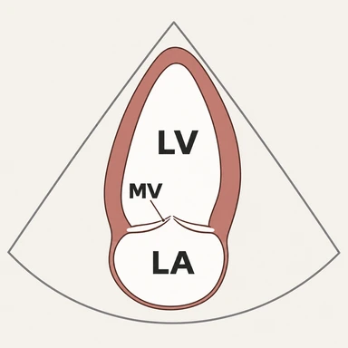

The full illustration and thumbnail are retained byte-for-byte from v54.

**Production checks:** Topology — pass; View identity — pass; Orientation — pass; Labels — pass; Phase — pass; Readability — pass.

#### Original artwork assessment

- Only LV, LA and thin MV shown; no RV or aortic root; full long-axis LV apex and basal atrium fit the plane.

#### Final assessment

Only LV, LA and thin MV shown; no RV or aortic root; full long-axis LV apex and basal atrium fit the plane.

#### Phase and limits

- **Phase:**

  Thin MV profiles are near coaptation; no precise timed cardiac phase is claimed.

- **Limits:**

  - Coapting MV is a valid static phase. Leaflet scallops and papillary apparatus omitted intentionally.

  - Schematic proportions are not calibrated dimensions and cannot establish normality, pathology or function.

  - Static image review does not validate acquisition technique, motion, Doppler, ECG timing or patient diagnosis.

#### Source and exact view

- **Catalogue table:**

  2

- **Catalogue view:**

  2.19

- **Catalogue source:**

  <https://www.asecho.org/wp-content/uploads/2019/01/2019_Comprehensive-TTE.pdf>

- **Sources used in this review:**

  - Record

    - **Url:**

      <https://www.asecho.org/wp-content/uploads/2025/07/Guidelines-for-Performing-a-Comprehensive-Transthoracic-Echocardiographic-Examination-in-Adults.pdf>

    - **Title:**

      Guidelines for Performing a Comprehensive Transthoracic Echocardiographic Examination in Adults

    - **Publication:**

      Mitchell et al.; JASE 2019;32:1–64

    - **Table:**

      2

    - **Row:**

      2.19

    - **Pdf page:**

      23

    - **Role:**

      Exact-plane anatomy drawing and corresponding real echocardiographic frame; visually compared.

    - **Date note:**

      The 2025/07 URL is the rehost location, not the guideline publication year.

#### Review scope and evidence

- **Independent review:**

  TTE reviewer independently compared the original 960px asset with the exact ASE row and inspected its full-size pixels and static thumbnails. A complementary root review inspected original assets/contact sheets. The TTE reviewer rechecked this retained asset in a fresh 200px final contact sheet; no claim is made that root separately reviewed every retained image full-size. These are independent AI-assisted source comparisons, not clinical certification by an echocardiographer.

- **Full size reviewed:**

  Yes

- **Thumbnail reviewed:**

  Yes

- **Inspection:**

  - **Original full size:**

    960×960 WebP individually inspected against source before disposition.

  - **Final full size:**

    Original 960×960 WebP retained without pixel changes.

  - **Final static thumbnail sizes px:**

    - 200

  - **Final 200px contact sheet:**

    tte-final-200px-contact.png

  - **Final 384px replacement contact sheet:**

    Not specified.

  - **Actual browser render review:**

    Separate integration responsibility; this record asserts full-size and static resampled-image review only.

- **Gate findings:**

  - **Topology:**

    LV and LA meet at thin mitral leaflets. No RV, LVOT or aortic root contaminates the two-chamber plane.

  - **View identity:**

    LV/LA two-chamber apical view matches ASE 2.19.

  - **Orientation:**

    LV apex near field, LA far field, MV between them.

  - **Labels:**

    LV and LA remain inside their cavities; MV identifies the basal mitral leaflet profile.

  - **Phase:**

    Thin MV profiles are near coaptation; no precise timed cardiac phase is claimed.

  - **Readability:**

    Two-chamber identity, complete LV apex and mitral junction are clear at 200px.

- **Hard failures:**

  None recorded.

#### Preservation and correction constraints

- Keep only LV, LA and MV as the principal plane structures.

- Retain complete apical contour and thin mitral leaflets.

- Avoid adding aortic root or right-heart chambers.

#### Reconsidered concerns

- Near-coaptation is not mistaken for a muscular seal.

- Scallop and papillary-apparatus detail is intentionally omitted at this icon scale.

#### Additional review metadata

- **Original asset:**

  - **Path:**

    `public/assets/reference-views-v54/tte-a2c.webp`

  - **Sha256:**

    `1707228af80c5bcb96cd31a36857764138d378c15b388e7e84b3debdd671b487`

- **Source facts and operational criteria:**

  - **Source facts:**

    Imaging-plane anatomy, visible landmarks and conventional orientation are anchored to the cited exact ASE table row; additional sources are identified separately.

  - **Operational criteria:**

    Patent lumen tracing, no false muscular seals, attached leaflet profiles, legible labels at 200px/384px and absence of invented structures are artwork acceptance checks applied by the reviewers, not numerical clinical thresholds.

- **Export review:**

  - **Stage:**

    Retained production thumbnail pairing

  - **Status:**

    pass

  - **Files inspected:**

    Actual 384px thumbnail path in the current manifest, displayed at 200px

  - **Reviewer:**

    TTE review agent

  - **Findings:**

    Matched the previously reviewed full-size view identity; no swapped image, corrupted label, unexpected crop or gallery-size label blocker.

<details>
<summary>Exact prompts and authoring history</summary>

Prompts describe requested changes. Historical authoring records do not supersede this review’s findings.

##### Original artwork: provenance location

- **Historical manifest:**

  docs/reference-views-v54/asset-manifest.json

- **Historical master sha256:**

  `8ee380245ab68b94d9a2c75aa84d0c97a2a567c85ed07c4dff6463f712d22c53`

- **Note:**

  The immutable historical manifest preserves the original authoring prompts. This report reproduces the exact prompts for this revision’s seven replacements; all current QC findings and retained-view decisions are included above.

</details>

#### Asset identity

| Asset | Path / identity | Pixels | Bytes | SHA-256 |
| --- | --- | --- | --- | --- |
| Original illustration | `public/assets/reference-views-v54/tte-a2c.webp` | 960 × 960 | 42,164 | `1707228af80c5bcb96cd31a36857764138d378c15b388e7e84b3debdd671b487` |
| Current illustration | `public/assets/reference-views-v54/tte-a2c.webp` | 960 × 960 | 42,164 | `1707228af80c5bcb96cd31a36857764138d378c15b388e7e84b3debdd671b487` |
| Original thumbnail | `public/assets/reference-views-v54/thumbs/tte-a2c.webp` | 384 × 384 | 11,932 | `441450d743a52f210a03eb1b31f8f0565418f84f91a47a7f6ff2cf2c2035c740` |
| Current thumbnail | `public/assets/reference-views-v54/thumbs/tte-a2c.webp` | 384 × 384 | 11,932 | `441450d743a52f210a03eb1b31f8f0565418f84f91a47a7f6ff2cf2c2035c740` |
| Historical generation master | `Original master PNG hash` | — | — | `8ee380245ab68b94d9a2c75aa84d0c97a2a567c85ed07c4dff6463f712d22c53` |

---

### TTE · Apical two-chamber — LV zoom

**ID:** `tte:a2c_lv` · **Decision:** Retained · **ASE table/view:** 2 / 2.20

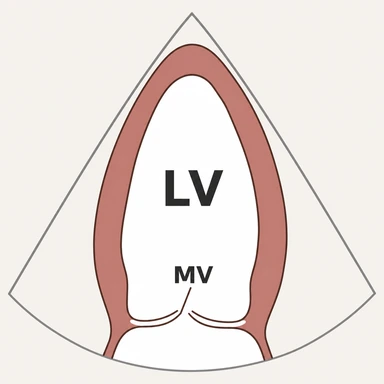

The full illustration and thumbnail are retained byte-for-byte from v54.

**Production checks:** Topology — pass; View identity — pass; Orientation — pass; Labels — pass; Phase — pass; Readability — pass.

#### Original artwork assessment

- Correct LV-focused two-chamber framing: enlarged complete LV apex, basal MV and atrial portion cropped; no outflow or right heart.

#### Final assessment

Correct LV-focused two-chamber framing: enlarged complete LV apex, basal MV and atrial portion cropped; no outflow or right heart.

#### Phase and limits

- **Phase:**

  Thin MV profiles at the cropped base are near coaptation; exact phase is not specified.

- **Limits:**

  - MV leader meets a thin leaflet tip and can look continuous with it at small size; readable and not an anatomical partition.

  - Schematic proportions are not calibrated dimensions and cannot establish normality, pathology or function.

  - Static image review does not validate acquisition technique, motion, Doppler, ECG timing or patient diagnosis.

#### Source and exact view

- **Catalogue table:**

  2

- **Catalogue view:**

  2.20

- **Catalogue source:**

  <https://www.asecho.org/wp-content/uploads/2019/01/2019_Comprehensive-TTE.pdf>

- **Sources used in this review:**

  - Record

    - **Url:**

      <https://www.asecho.org/wp-content/uploads/2025/07/Guidelines-for-Performing-a-Comprehensive-Transthoracic-Echocardiographic-Examination-in-Adults.pdf>

    - **Title:**

      Guidelines for Performing a Comprehensive Transthoracic Echocardiographic Examination in Adults

    - **Publication:**

      Mitchell et al.; JASE 2019;32:1–64

    - **Table:**

      2

    - **Row:**

      2.20

    - **Pdf page:**

      23

    - **Role:**

      Exact-plane anatomy drawing and corresponding real echocardiographic frame; visually compared.

    - **Date note:**

      The 2025/07 URL is the rehost location, not the guideline publication year.

#### Review scope and evidence

- **Independent review:**

  TTE reviewer independently compared the original 960px asset with the exact ASE row and inspected its full-size pixels and static thumbnails. A complementary root review inspected original assets/contact sheets. The TTE reviewer rechecked this retained asset in a fresh 200px final contact sheet; no claim is made that root separately reviewed every retained image full-size. These are independent AI-assisted source comparisons, not clinical certification by an echocardiographer.

- **Full size reviewed:**

  Yes

- **Thumbnail reviewed:**

  Yes

- **Inspection:**

  - **Original full size:**

    960×960 WebP individually inspected against source before disposition.

  - **Final full size:**

    Original 960×960 WebP retained without pixel changes.

  - **Final static thumbnail sizes px:**

    - 200

  - **Final 200px contact sheet:**

    tte-final-200px-contact.png

  - **Final 384px replacement contact sheet:**

    Not specified.

  - **Actual browser render review:**

    Separate integration responsibility; this record asserts full-size and static resampled-image review only.

- **Gate findings:**

  - **Topology:**

    LV has a complete apex and basal thin mitral junction; partially cropped LA remains behind the MV. No outflow or RV is added.

  - **View identity:**

    LV-focused two-chamber crop matches ASE 2.20.

  - **Orientation:**

    LV apex near field; mitral base and partial LA at far-field crop.

  - **Labels:**

    LV is centered in the large lumen; MV short leader terminates on a leaflet.

  - **Phase:**

    Thin MV profiles at the cropped base are near coaptation; exact phase is not specified.

  - **Readability:**

    Large LV and smaller MV labels are readable at 200px; leader/leaflet contact does not create an apparent thick barrier.

- **Hard failures:**

  None recorded.

#### Preservation and correction constraints

- Keep entire LV apex despite atrial crop.

- Preserve thin MV profile and partial LA context.

- Do not insert RV or LVOT into the two-chamber zoom.

#### Reconsidered concerns

- Atrial truncation is expected zoom framing.

- The small MV pointer touches leaflet tissue and is not an anatomical partition.

#### Additional review metadata

- **Original asset:**

  - **Path:**

    `public/assets/reference-views-v54/tte-a2c_lv.webp`

  - **Sha256:**

    `45db9f030ce91e4555451b0e824dd1cb3dafa0bb210d432eefa8ee8b387c8b16`

- **Source facts and operational criteria:**

  - **Source facts:**

    Imaging-plane anatomy, visible landmarks and conventional orientation are anchored to the cited exact ASE table row; additional sources are identified separately.

  - **Operational criteria:**

    Patent lumen tracing, no false muscular seals, attached leaflet profiles, legible labels at 200px/384px and absence of invented structures are artwork acceptance checks applied by the reviewers, not numerical clinical thresholds.

- **Export review:**

  - **Stage:**

    Retained production thumbnail pairing

  - **Status:**

    pass

  - **Files inspected:**

    Actual 384px thumbnail path in the current manifest, displayed at 200px

  - **Reviewer:**

    TTE review agent

  - **Findings:**

    Matched the previously reviewed full-size view identity; no swapped image, corrupted label, unexpected crop or gallery-size label blocker.

<details>
<summary>Exact prompts and authoring history</summary>

Prompts describe requested changes. Historical authoring records do not supersede this review’s findings.

##### Original artwork: provenance location

- **Historical manifest:**

  docs/reference-views-v54/asset-manifest.json

- **Historical master sha256:**

  `f862ec339eba3c493c56fc0ad72064c0e869e90e20a6d056e97a09c0d9be98b1`

- **Note:**

  The immutable historical manifest preserves the original authoring prompts. This report reproduces the exact prompts for this revision’s seven replacements; all current QC findings and retained-view decisions are included above.

</details>

#### Asset identity

| Asset | Path / identity | Pixels | Bytes | SHA-256 |
| --- | --- | --- | --- | --- |
| Original illustration | `public/assets/reference-views-v54/tte-a2c_lv.webp` | 960 × 960 | 39,088 | `45db9f030ce91e4555451b0e824dd1cb3dafa0bb210d432eefa8ee8b387c8b16` |
| Current illustration | `public/assets/reference-views-v54/tte-a2c_lv.webp` | 960 × 960 | 39,088 | `45db9f030ce91e4555451b0e824dd1cb3dafa0bb210d432eefa8ee8b387c8b16` |
| Original thumbnail | `public/assets/reference-views-v54/thumbs/tte-a2c_lv.webp` | 384 × 384 | 11,668 | `8a59a75c7d448848e69bf15f652972057c755c87f6b64c6cfd6f067c7d05e7fd` |
| Current thumbnail | `public/assets/reference-views-v54/thumbs/tte-a2c_lv.webp` | 384 × 384 | 11,668 | `8a59a75c7d448848e69bf15f652972057c755c87f6b64c6cfd6f067c7d05e7fd` |
| Historical generation master | `Original master PNG hash` | — | — | `f862ec339eba3c493c56fc0ad72064c0e869e90e20a6d056e97a09c0d9be98b1` |

---

### TTE · Apical long axis — three-chamber

**ID:** `tte:a3c` · **Decision:** Retained · **ASE table/view:** 2 / 2.21

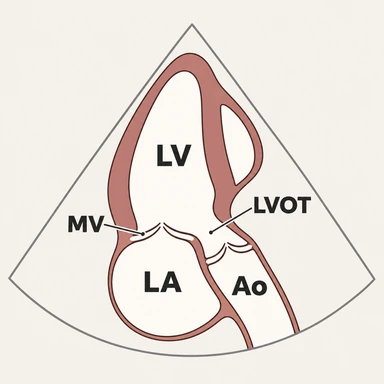

The full illustration and thumbnail are retained byte-for-byte from v54.

**Production checks:** Topology — pass; View identity — pass; Orientation — pass; Labels — pass; Phase — pass; Readability — pass.

#### Original artwork assessment

- Correct apical long-axis core: LV to LA through thin MV and LVOT to AV/Ao on display right; supporting unlabelled RV fragment matches source.

#### Final assessment

Correct apical long-axis core: LV to LA through thin MV and LVOT to AV/Ao on display right; supporting unlabelled RV fragment matches source.

#### Phase and limits

- **Phase:**

  MV and AV profiles are near coaptation; the still image does not determine a unique timed phase.

- **Limits:**

  - Do not incorrectly reject every unlabelled RV slice in A3C; it can occur anterior to the septum. Thin valves may depict an isovolumetric phase.

  - Schematic proportions are not calibrated dimensions and cannot establish normality, pathology or function.

  - Static image review does not validate acquisition technique, motion, Doppler, ECG timing or patient diagnosis.

#### Source and exact view

- **Catalogue table:**

  2

- **Catalogue view:**

  2.21

- **Catalogue source:**

  <https://www.asecho.org/wp-content/uploads/2019/01/2019_Comprehensive-TTE.pdf>

- **Sources used in this review:**

  - Record

    - **Url:**

      <https://www.asecho.org/wp-content/uploads/2025/07/Guidelines-for-Performing-a-Comprehensive-Transthoracic-Echocardiographic-Examination-in-Adults.pdf>

    - **Title:**

      Guidelines for Performing a Comprehensive Transthoracic Echocardiographic Examination in Adults

    - **Publication:**

      Mitchell et al.; JASE 2019;32:1–64

    - **Table:**

      2

    - **Row:**

      2.21

    - **Pdf page:**

      23

    - **Role:**

      Exact-plane anatomy drawing and corresponding real echocardiographic frame; visually compared.

    - **Date note:**

      The 2025/07 URL is the rehost location, not the guideline publication year.

#### Review scope and evidence

- **Independent review:**

  TTE reviewer independently compared the original 960px asset with the exact ASE row and inspected its full-size pixels and static thumbnails. A complementary root review inspected original assets/contact sheets. The TTE reviewer rechecked this retained asset in a fresh 200px final contact sheet; no claim is made that root separately reviewed every retained image full-size. These are independent AI-assisted source comparisons, not clinical certification by an echocardiographer.

- **Full size reviewed:**

  Yes

- **Thumbnail reviewed:**

  Yes

- **Inspection:**

  - **Original full size:**

    960×960 WebP individually inspected against source before disposition.

  - **Final full size:**

    Original 960×960 WebP retained without pixel changes.

  - **Final static thumbnail sizes px:**

    - 200

  - **Final 200px contact sheet:**

    tte-final-200px-contact.png

  - **Final 384px replacement contact sheet:**

    Not specified.

  - **Actual browser render review:**

    Separate integration responsibility; this record asserts full-size and static resampled-image review only.

- **Gate findings:**

  - **Topology:**

    LV connects to LA through MV and to Ao through LVOT/AV; AML borders the outflow. Supporting anterior RV slice remains separate.

  - **View identity:**

    Apical long-axis/three-chamber plane matches ASE 2.21.

  - **Orientation:**

    LV apex near field, LA far field, LVOT/Ao toward display right; small RV portion is anterior to septum.

  - **Labels:**

    LV, LA, Ao and LVOT lie in the correct lumens; MV leader ends on the mitral leaflet.

  - **Phase:**

    MV and AV profiles are near coaptation; the still image does not determine a unique timed phase.

  - **Readability:**

    LA and Ao remain separate at 200px and the labeled LVOT establishes three-chamber identity.

- **Hard failures:**

  None recorded.

#### Preservation and correction constraints

- Retain LV-to-Ao continuity and distinct LA-to-LV mitral junction.

- Do not eliminate source-consistent supporting RV fragment simply because the view is called three-chamber.

- Keep thin rather than muscular valve closures.

#### Reconsidered concerns

- Small anterior RV slice is permitted by this source plane.

- Near-coapting valves do not justify an exact phase claim or a topology rejection.

#### Additional review metadata

- **Original asset:**

  - **Path:**

    `public/assets/reference-views-v54/tte-a3c.webp`

  - **Sha256:**

    `2d3403825cd4f2b6869f60eb8c7b981e6f74ab491125de8292f4349feaae2871`

- **Source facts and operational criteria:**

  - **Source facts:**

    Imaging-plane anatomy, visible landmarks and conventional orientation are anchored to the cited exact ASE table row; additional sources are identified separately.

  - **Operational criteria:**

    Patent lumen tracing, no false muscular seals, attached leaflet profiles, legible labels at 200px/384px and absence of invented structures are artwork acceptance checks applied by the reviewers, not numerical clinical thresholds.

- **Export review:**

  - **Stage:**

    Retained production thumbnail pairing

  - **Status:**

    pass

  - **Files inspected:**

    Actual 384px thumbnail path in the current manifest, displayed at 200px

  - **Reviewer:**

    TTE review agent

  - **Findings:**

    Matched the previously reviewed full-size view identity; no swapped image, corrupted label, unexpected crop or gallery-size label blocker.

<details>
<summary>Exact prompts and authoring history</summary>

Prompts describe requested changes. Historical authoring records do not supersede this review’s findings.

##### Original artwork: provenance location

- **Historical manifest:**

  docs/reference-views-v54/asset-manifest.json

- **Historical master sha256:**

  `37d486baabbf60c92e5b700cd882b088bcbb69fc3ae8e0765980413f92d90a25`

- **Note:**

  The immutable historical manifest preserves the original authoring prompts. This report reproduces the exact prompts for this revision’s seven replacements; all current QC findings and retained-view decisions are included above.

</details>

#### Asset identity

| Asset | Path / identity | Pixels | Bytes | SHA-256 |
| --- | --- | --- | --- | --- |
| Original illustration | `public/assets/reference-views-v54/tte-a3c.webp` | 960 × 960 | 51,134 | `2d3403825cd4f2b6869f60eb8c7b981e6f74ab491125de8292f4349feaae2871` |
| Current illustration | `public/assets/reference-views-v54/tte-a3c.webp` | 960 × 960 | 51,134 | `2d3403825cd4f2b6869f60eb8c7b981e6f74ab491125de8292f4349feaae2871` |
| Original thumbnail | `public/assets/reference-views-v54/thumbs/tte-a3c.webp` | 384 × 384 | 15,114 | `4b330e317c6f5bcc6ed63397e0903de6026d50c4c8bce3dee69bc1df30e2b581` |
| Current thumbnail | `public/assets/reference-views-v54/thumbs/tte-a3c.webp` | 384 × 384 | 15,114 | `4b330e317c6f5bcc6ed63397e0903de6026d50c4c8bce3dee69bc1df30e2b581` |
| Historical generation master | `Original master PNG hash` | — | — | `37d486baabbf60c92e5b700cd882b088bcbb69fc3ae8e0765980413f92d90a25` |

---

### TTE · Apical long axis — LV zoom

**ID:** `tte:a3c_lv` · **Decision:** Retained · **ASE table/view:** 2 / 2.22

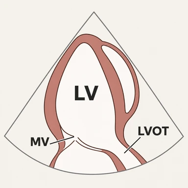

The full illustration and thumbnail are retained byte-for-byte from v54.

**Production checks:** Topology — pass; View identity — pass; Orientation — pass; Labels — pass; Phase — pass; Readability — pass.

#### Original artwork assessment

- Magnified apical long-axis LV with basal MV, open LVOT leading beyond cropped base, and supporting anterior RV fragment; clear distinction from A2C zoom.

#### Final assessment

Magnified apical long-axis LV with basal MV, open LVOT leading beyond cropped base, and supporting anterior RV fragment; clear distinction from A2C zoom.

#### Phase and limits

- **Phase:**

  The mitral profile is stylized and aortic valve is largely cropped; precise phase cannot be assigned.

- **Limits:**

  - Valve/chordal strokes simplified; cropped aortic valve and LA are appropriate for LV zoom, not a missing-anatomy failure.

  - Schematic proportions are not calibrated dimensions and cannot establish normality, pathology or function.

  - Static image review does not validate acquisition technique, motion, Doppler, ECG timing or patient diagnosis.

#### Source and exact view

- **Catalogue table:**

  2

- **Catalogue view:**

  2.22

- **Catalogue source:**

  <https://www.asecho.org/wp-content/uploads/2019/01/2019_Comprehensive-TTE.pdf>

- **Sources used in this review:**

  - Record

    - **Url:**

      <https://www.asecho.org/wp-content/uploads/2025/07/Guidelines-for-Performing-a-Comprehensive-Transthoracic-Echocardiographic-Examination-in-Adults.pdf>

    - **Title:**

      Guidelines for Performing a Comprehensive Transthoracic Echocardiographic Examination in Adults

    - **Publication:**

      Mitchell et al.; JASE 2019;32:1–64

    - **Table:**

      2

    - **Row:**

      2.22

    - **Pdf page:**

      23

    - **Role:**

      Exact-plane anatomy drawing and corresponding real echocardiographic frame; visually compared.

    - **Date note:**

      The 2025/07 URL is the rehost location, not the guideline publication year.

#### Review scope and evidence

- **Independent review:**

  TTE reviewer independently compared the original 960px asset with the exact ASE row and inspected its full-size pixels and static thumbnails. A complementary root review inspected original assets/contact sheets. The TTE reviewer rechecked this retained asset in a fresh 200px final contact sheet; no claim is made that root separately reviewed every retained image full-size. These are independent AI-assisted source comparisons, not clinical certification by an echocardiographer.

- **Full size reviewed:**

  Yes

- **Thumbnail reviewed:**

  Yes

- **Inspection:**

  - **Original full size:**

    960×960 WebP individually inspected against source before disposition.

  - **Final full size:**

    Original 960×960 WebP retained without pixel changes.

  - **Final static thumbnail sizes px:**

    - 200

  - **Final 200px contact sheet:**

    tte-final-200px-contact.png

  - **Final 384px replacement contact sheet:**

    Not specified.

  - **Actual browser render review:**

    Separate integration responsibility; this record asserts full-size and static resampled-image review only.

- **Gate findings:**

  - **Topology:**

    Enlarged LV leads to basal LVOT beyond crop; MV borders partial LA. Supporting anterior RV fragment stays outside LV.

  - **View identity:**

    LV-focused apical long axis matches ASE 2.22 and remains distinct from A2C by LVOT.

  - **Orientation:**

    LV apex near field, LVOT at lower display right, MV/LA at basal lower left, small RV profile anteriorly.

  - **Labels:**

    LV label is central; MV and LVOT leaders meet their intended structures.

  - **Phase:**

    The mitral profile is stylized and aortic valve is largely cropped; precise phase cannot be assigned.

  - **Readability:**

    LVOT remains apparent at 200px and both basal leaders retain separate endpoints.

- **Hard failures:**

  None recorded.

#### Preservation and correction constraints

- Preserve full LV apex and clearly visible LVOT despite cropped valve/root.

- Keep MV distinct from the outflow boundary.

- Do not require complete LA or AV when the prescribed view is a ventricular zoom.

#### Reconsidered concerns

- Cropped LA and AV are expected focus framing.

- Fine subvalvular strokes are simplified without creating false connections.

#### Additional review metadata

- **Original asset:**

  - **Path:**

    `public/assets/reference-views-v54/tte-a3c_lv.webp`

  - **Sha256:**

    `6486c6c52f1fd2cee679a0fbe4d27374c3c15d904874cbc9f018c586f0f0ed5e`

- **Source facts and operational criteria:**

  - **Source facts:**

    Imaging-plane anatomy, visible landmarks and conventional orientation are anchored to the cited exact ASE table row; additional sources are identified separately.

  - **Operational criteria:**

    Patent lumen tracing, no false muscular seals, attached leaflet profiles, legible labels at 200px/384px and absence of invented structures are artwork acceptance checks applied by the reviewers, not numerical clinical thresholds.

- **Export review:**

  - **Stage:**

    Retained production thumbnail pairing

  - **Status:**

    pass

  - **Files inspected:**

    Actual 384px thumbnail path in the current manifest, displayed at 200px

  - **Reviewer:**

    TTE review agent

  - **Findings:**

    Matched the previously reviewed full-size view identity; no swapped image, corrupted label, unexpected crop or gallery-size label blocker.

<details>
<summary>Exact prompts and authoring history</summary>

Prompts describe requested changes. Historical authoring records do not supersede this review’s findings.

##### Original artwork: provenance location

- **Historical manifest:**

  docs/reference-views-v54/asset-manifest.json

- **Historical master sha256:**

  `17e2729091c69b900e0f2d1d7b479369c53929ac7236ad72c2596ed5223336dd`

- **Note:**

  The immutable historical manifest preserves the original authoring prompts. This report reproduces the exact prompts for this revision’s seven replacements; all current QC findings and retained-view decisions are included above.

</details>

#### Asset identity

| Asset | Path / identity | Pixels | Bytes | SHA-256 |
| --- | --- | --- | --- | --- |
| Original illustration | `public/assets/reference-views-v54/tte-a3c_lv.webp` | 960 × 960 | 47,882 | `6486c6c52f1fd2cee679a0fbe4d27374c3c15d904874cbc9f018c586f0f0ed5e` |
| Current illustration | `public/assets/reference-views-v54/tte-a3c_lv.webp` | 960 × 960 | 47,882 | `6486c6c52f1fd2cee679a0fbe4d27374c3c15d904874cbc9f018c586f0f0ed5e` |
| Original thumbnail | `public/assets/reference-views-v54/thumbs/tte-a3c_lv.webp` | 384 × 384 | 13,612 | `f956e41927f6763e8abec75cd7ccbbc69d3c5d6aeba76e7fee150d70295b8664` |
| Current thumbnail | `public/assets/reference-views-v54/thumbs/tte-a3c_lv.webp` | 384 × 384 | 13,612 | `f956e41927f6763e8abec75cd7ccbbc69d3c5d6aeba76e7fee150d70295b8664` |
| Historical generation master | `Original master PNG hash` | — | — | `17e2729091c69b900e0f2d1d7b479369c53929ac7236ad72c2596ed5223336dd` |

---

### TTE · Apical four-chamber — left atrial and pulmonary vein focus

**ID:** `tte:a4c_la_pv` · **Decision:** Anatomical correction · **ASE table/view:** 2 / 2.23

| Before — superseded v54 artwork | After — accepted v58 artwork |
| --- | --- |
| 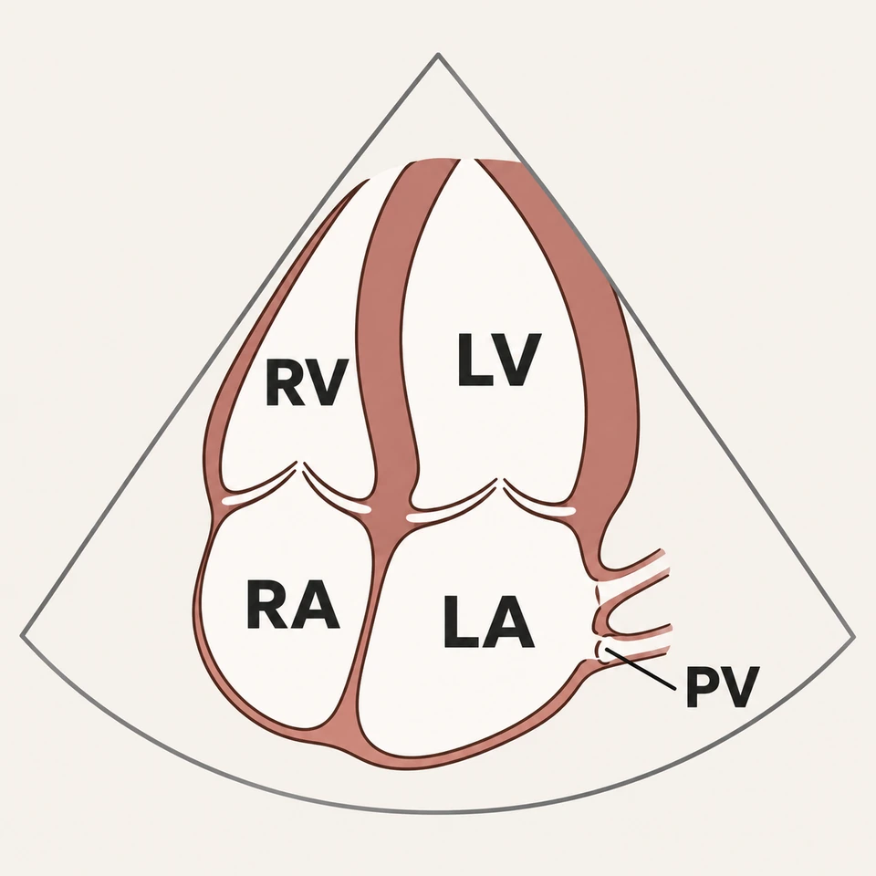 | 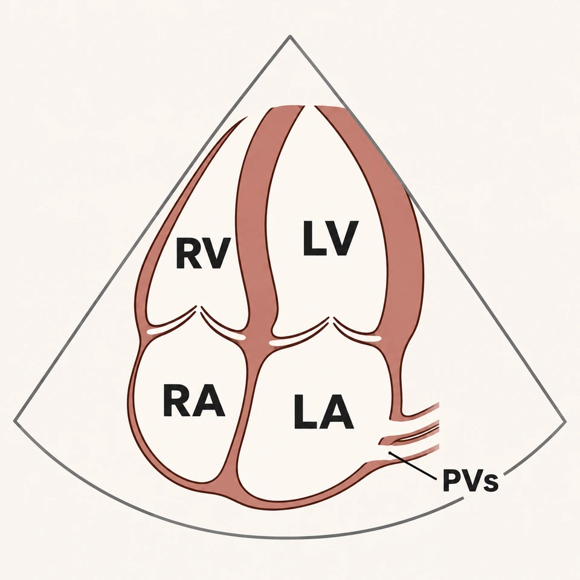 |

**Production checks:** Topology — pass; View identity — pass; Orientation — pass; Labels — pass; Phase — pass; Readability — pass.

#### Original artwork assessment

- Pulmonary-vein ostia retain dark residual arc/dash boundaries across their LA junctions, suggesting valves/membranes; upper ostium is placed relatively close to mitral annulus rather than far/posterior LA in reference. Label PV is ambiguous across set.

#### Final assessment

Replaced ambiguous pulmonary-venous ostial boundaries with two continuously open, unvalved vein lumens entering the posterior/far-field LA. PVs label and leader now distinguish veins from the pulmonary valve while preserving atrial septum and four-chamber orientation.

#### Phase and limits

- **Phase:**

  Atrioventricular leaflet profiles are near coaptation, but the image is not phase-specific. Pulmonary venous ostia remain open and unvalved irrespective of this illustrated valve state.

- **Limits:**

  - Use unvalved continuous vein lumens entering far-field LA base. Atrial focus may crop ventricular tips; never add atrial septal communications or connect veins to RA.

  - The image shows two veins in a 2D plane; it does not imply only two pulmonary veins exist or identify all individual veins.

  - Cropped ventricular tips are intentional focal framing, not a claim of foreshortened measurements.

  - Schematic proportions are not calibrated dimensions and cannot establish normality, pathology or function.

  - Static image review does not validate acquisition technique, motion, Doppler, ECG timing or patient diagnosis.

#### Source and exact view

- **Catalogue table:**

  2

- **Catalogue view:**

  2.23

- **Catalogue source:**

  <https://www.asecho.org/wp-content/uploads/2019/01/2019_Comprehensive-TTE.pdf>

- **Sources used in this review:**

  - Record

    - **Url:**

      <https://www.asecho.org/wp-content/uploads/2025/07/Guidelines-for-Performing-a-Comprehensive-Transthoracic-Echocardiographic-Examination-in-Adults.pdf>

    - **Title:**

      Guidelines for Performing a Comprehensive Transthoracic Echocardiographic Examination in Adults

    - **Publication:**

      Mitchell et al.; JASE 2019;32:1–64

    - **Table:**

      2

    - **Row:**

      2.23

    - **Pdf page:**

      24

    - **Role:**

      Exact-plane anatomy drawing and corresponding real echocardiographic frame; visually compared.

    - **Date note:**

      The 2025/07 URL is the rehost location, not the guideline publication year.

#### Review scope and evidence

- **Independent review:**

  TTE reviewer independently compared the original 960px asset with the exact ASE row and inspected its full-size pixels and static thumbnails. A complementary root review inspected original assets/contact sheets. The final generated master was independently inspected at full size by both the TTE reviewer and root; the TTE reviewer then rechecked the final master and fresh 200px plus 384px resamples. These are independent AI-assisted source comparisons, not clinical certification by an echocardiographer.

- **Full size reviewed:**

  Yes

- **Thumbnail reviewed:**

  Yes

- **Inspection:**

  - **Original full size:**

    960×960 WebP individually inspected against source before disposition.

  - **Final full size:**

    Generated PNG master re-inspected full-size.

  - **Final static thumbnail sizes px:**

    - 200

    - 384

  - **Final 200px contact sheet:**

    tte-final-200px-contact.png

  - **Final 384px replacement contact sheet:**

    tte-final-replacements-384px-contact.png

  - **Actual browser render review:**

    Separate integration responsibility; this record asserts full-size and static resampled-image review only.

- **Gate findings:**

  - **Topology:**

    Both visible pulmonary venous lumens open directly into LA without a transverse membrane, leaflet or muscular plug. Neither enters RA. IAS remains intact; correct AV junctions remain thin.

  - **View identity:**

    LA/pulmonary-vein focused A4C framing matches ASE 2.23. Ventricular tips are intentionally cropped to emphasize atria and venous entries.

  - **Orientation:**

    RV/RA display left, LV/LA right; the visible veins enter the posterior/far-field LA contour, away from the mitral annulus.

  - **Labels:**

    RV, LV, RA and LA occupy their cavities. PVs leader points into a vein lumen and avoids ambiguous singular PV terminology used elsewhere for pulmonary valve.

  - **Phase:**

    Atrioventricular leaflet profiles are near coaptation, but the image is not phase-specific. Pulmonary venous ostia remain open and unvalved irrespective of this illustrated valve state.

  - **Readability:**

    At both 200px and 384px the two venous entry gaps remain open and the PVs label is distinct. No residual ostial line becomes a false valve after resampling.

- **Hard failures:**

  None recorded.

#### Preservation and correction constraints

- Keep both depicted pulmonary venous mouths continuously open into LA.

- Never draw valves, plugs or residual cross-lumen contour lines at pulmonary venous ostia.

- Keep venous entries at posterior/far-field LA and IAS intact.

- Use PVs/Pulvns with a lumen-directed leader, not ambiguous PV alone.

- Preserve appropriate ventricular cropping for atrial focus rather than inventing complete four-vein anatomy.

#### Reconsidered concerns

- Original residual ostial arcs/dashes no longer bridge the venous lumen.

- Venous entries moved toward source-consistent posterior/far-field LA.

- Label ambiguity resolved by PVs.

- Both venous connections remain demonstrably patent at thumbnail scale.

#### Additional review metadata

- **Original asset:**

  - **Path:**

    `public/assets/reference-views-v54/tte-a4c_la_pv.webp`

  - **Sha256:**

    `33cd5477d87ed6c15ca1294bae4786f008219f1559d28ae0fbd5304845474d03`

- **Source facts and operational criteria:**

  - **Source facts:**

    Imaging-plane anatomy, visible landmarks and conventional orientation are anchored to the cited exact ASE table row; additional sources are identified separately.

  - **Operational criteria:**

    Patent lumen tracing, no false muscular seals, attached leaflet profiles, legible labels at 200px/384px and absence of invented structures are artwork acceptance checks applied by the reviewers, not numerical clinical thresholds.

- **Export review:**

  - **Stage:**

    Local production WebP files, before publication

  - **Status:**

    pass

  - **Files inspected:**

    Actual 960px image and actual 384px thumbnail; 200px rendition derived from the encoded thumbnail

  - **Reviewer:**

    TTE review agent; root also inspected all seven exported thumbnails at 240px

  - **Findings:**

    Both pulmonary venous ostia remain open and the PVs label remains legible.

  - **Remaining display limit:**

    Fine leaflet and cusp interpretation requires the enlarged illustration.

<details>
<summary>Exact prompts and authoring history</summary>

Prompts describe requested changes. Historical authoring records do not supersede this review’s findings.

##### Accepted replacement: exact final prompt and preceding prompts

- **Tool:**

  image_gen

- **Prompt:**

  ```text
  Use case: scientific-educational precise-object-edit. Correct ONE TTE apical four-chamber LEFT ATRIAL / PULMONARY VEIN focus (ASE Table2 row2.23). Image1 is exact current edit target/style. Image2 and3 are anatomical and real echo reference showing the full and atrial-focused variants: use them to place the veins on the far/posterior LA wall, not near the mitral annulus. Create original artwork, not a copy.
  Preserve same square minimal flat style: warm ivory background, restrained terracotta myocardium, thin dark-brown contours, bold black labels, thin gray ultrasound sector. Preserve atria in far field, RV display left, LV right, RA lower-left, LA lower-right, intact septa, correctly hinged thin CLOSED MV/TV in systole, thin atrial walls, cropped ventricular apices appropriate for an atrial-focused image.
  CORRECT the two pulmonary vein junctions into LA: remove ALL dark arcs, dashes, membranes or valve-like strokes across their ostia. Pulmonary veins have open unobstructed mouths into the LA; draw paired thin vessel walls with continuous white lumen into LA. Place the two vein entries a little lower toward the far-field/posterior-right LA wall, clearly AWAY from the mitral annulus. Keep them as two separate short vessels entering LA, with open outer ends continued off the anatomical field; do not fuse into each other and do not connect to RA. No venous valves, no tissue caps, no blocked ostia. Keep true intervening thin atrial wall between the mouths.
  Exact labels 'RV', 'LV', 'RA', 'LA' stay in their own blood pools. Replace ambiguous 'PV' with 'PVs' (plural pulmonary veins), using one short black leader into an unobstructed venous lumen, not a pseudo-valve at its opening. No extra title, legend, Doppler, textures, arrows or structures. Maintain generous label clearance and readable small-card anatomy.
  ```

- **Reference inputs:**

  - Record

    - **Role:**

      previous candidate or original style/edit target

    - **Url:**

      Not specified.

    - **Name:**

      tte-a4c_la_pv.webp

    - **Sha256:**

      `33cd5477d87ed6c15ca1294bae4786f008219f1559d28ae0fbd5304845474d03`

  - Record

    - **Role:**

      authoritative exact-plane reference

    - **Url:**

      <https://www.asecho.org/wp-content/uploads/2025/07/Guidelines-for-Performing-a-Comprehensive-Transthoracic-Echocardiographic-Examination-in-Adults.pdf>

    - **Name:**

      tte-2-23-anatomy.png

    - **Sha256:**

      `5617f3e589e0bbf520eff4f58ffcc8f6078f1a34d41eb621be35806a15b9a260`

  - Record

    - **Role:**

      authoritative exact-plane reference

    - **Url:**

      <https://www.asecho.org/wp-content/uploads/2025/07/Guidelines-for-Performing-a-Comprehensive-Transthoracic-Echocardiographic-Examination-in-Adults.pdf>

    - **Name:**

      tte-2-23-echo.png

    - **Sha256:**

      `6d2c1d77e46ca5adeeb7fb90c486c6e4265f3f53f4e424b38604933147cf4d5d`

##### Original artwork: provenance location

- **Historical manifest:**

  docs/reference-views-v54/asset-manifest.json

- **Historical master sha256:**

  `60c565834aa3e0140f94ff121742eefdfde727b41dced8c66b898de407544b37`

- **Note:**

  The immutable historical manifest preserves the original authoring prompts. This report reproduces the exact prompts for this revision’s seven replacements; all current QC findings and retained-view decisions are included above.

</details>

#### Asset identity

| Asset | Path / identity | Pixels | Bytes | SHA-256 |
| --- | --- | --- | --- | --- |
| Original illustration | `public/assets/reference-views-v54/tte-a4c_la_pv.webp` | 960 × 960 | 50,994 | `33cd5477d87ed6c15ca1294bae4786f008219f1559d28ae0fbd5304845474d03` |
| Current illustration | `public/assets/reference-views-v58/tte-a4c_la_pv.webp` | 960 × 960 | 53,076 | `f60674d5e9ee4c890ed6a5a3036d0f1b6f99e94cc6715bb21e581867f12a472a` |
| Original thumbnail | `public/assets/reference-views-v54/thumbs/tte-a4c_la_pv.webp` | 384 × 384 | 15,396 | `bbfeeef61f2446beb88b1e8f37ae7ffcf64c6633d3b223851d12756f3ac12308` |
| Current thumbnail | `public/assets/reference-views-v58/thumbs/tte-a4c_la_pv.webp` | 384 × 384 | 15,838 | `8101063f3eeda343da7745e561a329f1fd3522021a1228259c1ec2e645355771` |
| Accepted generation master | `Master PNG hash; no published source image embedded` | — | — | `fff1c5dc756a41b8269f3733d47895e0474b4d37acc5f3864bf81fff56b7fc07` |
| Historical generation master | `Original master PNG hash` | — | — | `60c565834aa3e0140f94ff121742eefdfde727b41dced8c66b898de407544b37` |

---

### TTE · Subcostal four-chamber

**ID:** `tte:subcostal` · **Decision:** Retained · **ASE table/view:** 2 / 2.24

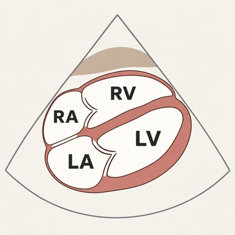

The full illustration and thumbnail are retained byte-for-byte from v54.

**Production checks:** Topology — pass; View identity — pass; Orientation — pass; Labels — pass; Phase — pass; Readability — pass.

#### Original artwork assessment

- Four chambers arranged obliquely under near-field liver; RV is nearer transducer, LV farther; atrial/ventricular septa intact, thin AV valves at respective chamber junctions.

#### Final assessment

Four chambers arranged obliquely under near-field liver; RV is nearer transducer, LV farther; atrial/ventricular septa intact, thin AV valves at respective chamber junctions.

#### Phase and limits

- **Phase:**

  Thin AV profiles are near coaptation; no precise cardiac or respiratory phase is claimed.

- **Limits:**

  - IAS is thin rather than a thick ventricular septum. Liver can remain unlabelled because heart structures are focus.

  - Schematic proportions are not calibrated dimensions and cannot establish normality, pathology or function.

  - Static image review does not validate acquisition technique, motion, Doppler, ECG timing or patient diagnosis.

#### Source and exact view

- **Catalogue table:**

  2

- **Catalogue view:**

  2.24

- **Catalogue source:**

  <https://www.asecho.org/wp-content/uploads/2019/01/2019_Comprehensive-TTE.pdf>

- **Sources used in this review:**

  - Record

    - **Url:**

      <https://www.asecho.org/wp-content/uploads/2025/07/Guidelines-for-Performing-a-Comprehensive-Transthoracic-Echocardiographic-Examination-in-Adults.pdf>

    - **Title:**

      Guidelines for Performing a Comprehensive Transthoracic Echocardiographic Examination in Adults

    - **Publication:**

      Mitchell et al.; JASE 2019;32:1–64

    - **Table:**

      2

    - **Row:**

      2.24

    - **Pdf page:**

      24

    - **Role:**

      Exact-plane anatomy drawing and corresponding real echocardiographic frame; visually compared.

    - **Date note:**

      The 2025/07 URL is the rehost location, not the guideline publication year.

#### Review scope and evidence

- **Independent review:**

  TTE reviewer independently compared the original 960px asset with the exact ASE row and inspected its full-size pixels and static thumbnails. A complementary root review inspected original assets/contact sheets. The TTE reviewer rechecked this retained asset in a fresh 200px final contact sheet; no claim is made that root separately reviewed every retained image full-size. These are independent AI-assisted source comparisons, not clinical certification by an echocardiographer.

- **Full size reviewed:**

  Yes

- **Thumbnail reviewed:**

  Yes

- **Inspection:**

  - **Original full size:**

    960×960 WebP individually inspected against source before disposition.

  - **Final full size:**

    Original 960×960 WebP retained without pixel changes.

  - **Final static thumbnail sizes px:**

    - 200

  - **Final 200px contact sheet:**

    tte-final-200px-contact.png

  - **Final 384px replacement contact sheet:**

    Not specified.

  - **Actual browser render review:**

    Separate integration responsibility; this record asserts full-size and static resampled-image review only.

- **Gate findings:**

  - **Topology:**

    Four chambers remain separated by intact atrial/ventricular septa and meet through their correct thin AV valves.

  - **View identity:**

    Oblique four-chamber slice beneath liver corresponds to ASE 2.24, distinct from apical A4C.

  - **Orientation:**

    Liver near field; RV nearer transducer than LV; right and left atrial profiles lie toward display left in the oblique subcostal layout.

  - **Labels:**

    RV, RA, LV and LA label their own cavities; liver context is recognizable without requiring a label.

  - **Phase:**

    Thin AV profiles are near coaptation; no precise cardiac or respiratory phase is claimed.

  - **Readability:**

    Oblique arrangement, liver band, all chamber labels and septa remain clear at 200px.

- **Hard failures:**

  None recorded.

#### Preservation and correction constraints

- Preserve near-field liver and anterior RV relationship.

- Keep IAS thin and intact; no artificial septal dropout.

- Do not rotate into standard apical layout simply for visual uniformity.

#### Reconsidered concerns

- Unlabelled liver is acceptable contextual anatomy.

- Subcostal obliquity is intentional and should not be normalized to apical orientation.

#### Additional review metadata

- **Original asset:**

  - **Path:**

    `public/assets/reference-views-v54/tte-subcostal.webp`

  - **Sha256:**

    `9d730c1e1e2478cf0ed332726e22e8f62443b429d8ab2172431b56492d8f5146`

- **Source facts and operational criteria:**

  - **Source facts:**

    Imaging-plane anatomy, visible landmarks and conventional orientation are anchored to the cited exact ASE table row; additional sources are identified separately.

  - **Operational criteria:**

    Patent lumen tracing, no false muscular seals, attached leaflet profiles, legible labels at 200px/384px and absence of invented structures are artwork acceptance checks applied by the reviewers, not numerical clinical thresholds.

- **Export review:**

  - **Stage:**

    Retained production thumbnail pairing

  - **Status:**

    pass

  - **Files inspected:**

    Actual 384px thumbnail path in the current manifest, displayed at 200px

  - **Reviewer:**

    TTE review agent

  - **Findings:**

    Matched the previously reviewed full-size view identity; no swapped image, corrupted label, unexpected crop or gallery-size label blocker.

<details>
<summary>Exact prompts and authoring history</summary>

Prompts describe requested changes. Historical authoring records do not supersede this review’s findings.

##### Original artwork: provenance location

- **Historical manifest:**

  docs/reference-views-v54/asset-manifest.json

- **Historical master sha256:**

  `96fb6f4bc1c1f29d841b8abb2909deadc098deea6d8bb6fb514e3060bbd83b37`

- **Note:**

  The immutable historical manifest preserves the original authoring prompts. This report reproduces the exact prompts for this revision’s seven replacements; all current QC findings and retained-view decisions are included above.

</details>

#### Asset identity

| Asset | Path / identity | Pixels | Bytes | SHA-256 |
| --- | --- | --- | --- | --- |
| Original illustration | `public/assets/reference-views-v54/tte-subcostal.webp` | 960 × 960 | 50,648 | `9d730c1e1e2478cf0ed332726e22e8f62443b429d8ab2172431b56492d8f5146` |
| Current illustration | `public/assets/reference-views-v54/tte-subcostal.webp` | 960 × 960 | 50,648 | `9d730c1e1e2478cf0ed332726e22e8f62443b429d8ab2172431b56492d8f5146` |
| Original thumbnail | `public/assets/reference-views-v54/thumbs/tte-subcostal.webp` | 384 × 384 | 14,918 | `3bf3fbb746028a1c5c0667ae47b086c8481cd71c73df1bd6d81028d621d6c272` |
| Current thumbnail | `public/assets/reference-views-v54/thumbs/tte-subcostal.webp` | 384 × 384 | 14,918 | `3bf3fbb746028a1c5c0667ae47b086c8481cd71c73df1bd6d81028d621d6c272` |
| Historical generation master | `Original master PNG hash` | — | — | `96fb6f4bc1c1f29d841b8abb2909deadc098deea6d8bb6fb514e3060bbd83b37` |

---

### TTE · Subcostal long axis — inferior vena cava

**ID:** `tte:subcostal_ivc` · **Decision:** Retained · **ASE table/view:** 2 / 2.25

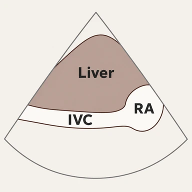

The full illustration and thumbnail are retained byte-for-byte from v54.

**Production checks:** Topology — pass; View identity — pass; Orientation — pass; Labels — pass; Phase — pass; Readability — pass.

#### Original artwork assessment

- Longitudinal thin-walled IVC under liver opens continuously into RA, no valve/muscular seal and no aortic substitution.

#### Final assessment

Longitudinal thin-walled IVC under liver opens continuously into RA, no valve/muscular seal and no aortic substitution.

#### Phase and limits

- **Phase:**

  No cardiac or respiratory phase is established; lumen caliber must not be used to infer pressure or collapsibility.

- **Limits:**

  - Only part of RA is in this plane; a TV/LV need not be added.

  - Schematic proportions are not calibrated dimensions and cannot establish normality, pathology or function.

  - Static image review does not validate acquisition technique, motion, Doppler, ECG timing or patient diagnosis.

#### Source and exact view

- **Catalogue table:**

  2

- **Catalogue view:**

  2.25

- **Catalogue source:**

  <https://www.asecho.org/wp-content/uploads/2019/01/2019_Comprehensive-TTE.pdf>

- **Sources used in this review:**

  - Record

    - **Url:**

      <https://www.asecho.org/wp-content/uploads/2025/07/Guidelines-for-Performing-a-Comprehensive-Transthoracic-Echocardiographic-Examination-in-Adults.pdf>

    - **Title:**

      Guidelines for Performing a Comprehensive Transthoracic Echocardiographic Examination in Adults

    - **Publication:**

      Mitchell et al.; JASE 2019;32:1–64

    - **Table:**

      2

    - **Row:**

      2.25

    - **Pdf page:**

      24

    - **Role:**

      Exact-plane anatomy drawing and corresponding real echocardiographic frame; visually compared.

    - **Date note:**

      The 2025/07 URL is the rehost location, not the guideline publication year.

#### Review scope and evidence

- **Independent review:**

  TTE reviewer independently compared the original 960px asset with the exact ASE row and inspected its full-size pixels and static thumbnails. A complementary root review inspected original assets/contact sheets. The TTE reviewer rechecked this retained asset in a fresh 200px final contact sheet; no claim is made that root separately reviewed every retained image full-size. These are independent AI-assisted source comparisons, not clinical certification by an echocardiographer.

- **Full size reviewed:**

  Yes

- **Thumbnail reviewed:**

  Yes

- **Inspection:**

  - **Original full size:**

    960×960 WebP individually inspected against source before disposition.

  - **Final full size:**

    Original 960×960 WebP retained without pixel changes.

  - **Final static thumbnail sizes px:**

    - 200

  - **Final 200px contact sheet:**

    tte-final-200px-contact.png

  - **Final 384px replacement contact sheet:**

    Not specified.

  - **Actual browser render review:**

    Separate integration responsibility; this record asserts full-size and static resampled-image review only.

- **Gate findings:**

  - **Topology:**

    Longitudinal IVC opens freely into RA below the liver; no muscular cap, false valve or aortic substitution.

  - **View identity:**

    Subcostal long-axis caval view matches ASE 2.25.

  - **Orientation:**

    Liver near field, longitudinal IVC below it and RA at the rightward termination.

  - **Labels:**

    Liver, IVC and RA are inside their intended regions/lumens.

  - **Phase:**

    No cardiac or respiratory phase is established; lumen caliber must not be used to infer pressure or collapsibility.

  - **Readability:**

    The unobstructed IVC-RA connection and all three labels are clear at 200px.

- **Hard failures:**

  None recorded.

#### Preservation and correction constraints

- Preserve continuous IVC-to-RA lumen.

- Keep liver above the vessel and do not substitute aortic wall anatomy.

- Do not add TV/LV to complete chambers that are outside this plane.

#### Reconsidered concerns

- Partial RA and absent other chambers are appropriate for focused caval view.

- No respiratory collapse or pressure claim is inferred from the static caliber.

#### Additional review metadata

- **Original asset:**

  - **Path:**

    `public/assets/reference-views-v54/tte-subcostal_ivc.webp`

  - **Sha256:**

    `1f832656106437a6a63fe34011f0b693fbb7bec9084b62ac041e69b61e1348d7`

- **Source facts and operational criteria:**

  - **Source facts:**

    Imaging-plane anatomy, visible landmarks and conventional orientation are anchored to the cited exact ASE table row; additional sources are identified separately.

  - **Operational criteria:**

    Patent lumen tracing, no false muscular seals, attached leaflet profiles, legible labels at 200px/384px and absence of invented structures are artwork acceptance checks applied by the reviewers, not numerical clinical thresholds.

- **Export review:**

  - **Stage:**

    Retained production thumbnail pairing

  - **Status:**

    pass

  - **Files inspected:**

    Actual 384px thumbnail path in the current manifest, displayed at 200px

  - **Reviewer:**

    TTE review agent

  - **Findings:**

    Matched the previously reviewed full-size view identity; no swapped image, corrupted label, unexpected crop or gallery-size label blocker.

<details>
<summary>Exact prompts and authoring history</summary>

Prompts describe requested changes. Historical authoring records do not supersede this review’s findings.

##### Original artwork: provenance location

- **Historical manifest:**

  docs/reference-views-v54/asset-manifest.json

- **Historical master sha256:**

  `a12afbf1ce0a91ceb8863e6da41f596cb64c7832dca810fb983ab617798126be`

- **Note:**

  The immutable historical manifest preserves the original authoring prompts. This report reproduces the exact prompts for this revision’s seven replacements; all current QC findings and retained-view decisions are included above.

</details>

#### Asset identity

| Asset | Path / identity | Pixels | Bytes | SHA-256 |
| --- | --- | --- | --- | --- |
| Original illustration | `public/assets/reference-views-v54/tte-subcostal_ivc.webp` | 960 × 960 | 30,128 | `1f832656106437a6a63fe34011f0b693fbb7bec9084b62ac041e69b61e1348d7` |
| Current illustration | `public/assets/reference-views-v54/tte-subcostal_ivc.webp` | 960 × 960 | 30,128 | `1f832656106437a6a63fe34011f0b693fbb7bec9084b62ac041e69b61e1348d7` |
| Original thumbnail | `public/assets/reference-views-v54/thumbs/tte-subcostal_ivc.webp` | 384 × 384 | 8,980 | `2884251225ae3ffacd16f45be353d7dd806017f16a30b3e2cce3c482dc8e5af9` |
| Current thumbnail | `public/assets/reference-views-v54/thumbs/tte-subcostal_ivc.webp` | 384 × 384 | 8,980 | `2884251225ae3ffacd16f45be353d7dd806017f16a30b3e2cce3c482dc8e5af9` |
| Historical generation master | `Original master PNG hash` | — | — | `a12afbf1ce0a91ceb8863e6da41f596cb64c7832dca810fb983ab617798126be` |

---

### TTE · Subcostal hepatic veins

**ID:** `tte:subcostal_hepatic` · **Decision:** Retained · **ASE table/view:** 2 / 2.26

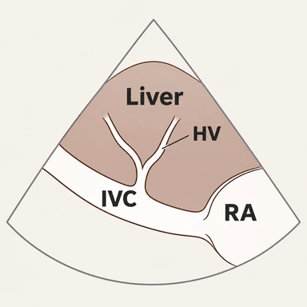

The full illustration and thumbnail are retained byte-for-byte from v54.

**Production checks:** Topology — pass; View identity — pass; Orientation — pass; Labels — pass; Phase — pass; Readability — pass.

#### Original artwork assessment

- Hepatic veins within liver merge into IVC, then RA; all vein junctions are open and labelled correctly.

#### Final assessment

Hepatic veins within liver merge into IVC, then RA; all vein junctions are open and labelled correctly.

#### Phase and limits

- **Phase:**

  The static venous anatomy is not assigned a cardiac or respiratory phase and provides no Doppler or pressure information.

- **Limits:**

  - Two short fine atrial rim curves at IVC ostium do not bridge lumen or block caval inflow; not a septum. No need to depict all three hepatic veins in one 2D plane.

  - Schematic proportions are not calibrated dimensions and cannot establish normality, pathology or function.

  - Static image review does not validate acquisition technique, motion, Doppler, ECG timing or patient diagnosis.

#### Source and exact view

- **Catalogue table:**

  2

- **Catalogue view:**

  2.26

- **Catalogue source:**

  <https://www.asecho.org/wp-content/uploads/2019/01/2019_Comprehensive-TTE.pdf>

- **Sources used in this review:**

  - Record

    - **Url:**

      <https://www.asecho.org/wp-content/uploads/2025/07/Guidelines-for-Performing-a-Comprehensive-Transthoracic-Echocardiographic-Examination-in-Adults.pdf>

    - **Title:**

      Guidelines for Performing a Comprehensive Transthoracic Echocardiographic Examination in Adults

    - **Publication:**

      Mitchell et al.; JASE 2019;32:1–64

    - **Table:**

      2

    - **Row:**

      2.26

    - **Pdf page:**

      24

    - **Role:**

      Exact-plane anatomy drawing and corresponding real echocardiographic frame; visually compared.

    - **Date note:**

      The 2025/07 URL is the rehost location, not the guideline publication year.

#### Review scope and evidence

- **Independent review:**

  TTE reviewer independently compared the original 960px asset with the exact ASE row and inspected its full-size pixels and static thumbnails. A complementary root review inspected original assets/contact sheets. The TTE reviewer rechecked this retained asset in a fresh 200px final contact sheet; no claim is made that root separately reviewed every retained image full-size. These are independent AI-assisted source comparisons, not clinical certification by an echocardiographer.

- **Full size reviewed:**

  Yes

- **Thumbnail reviewed:**

  Yes

- **Inspection:**

  - **Original full size:**

    960×960 WebP individually inspected against source before disposition.

  - **Final full size:**

    Original 960×960 WebP retained without pixel changes.

  - **Final static thumbnail sizes px:**

    - 200

  - **Final 200px contact sheet:**

    tte-final-200px-contact.png

  - **Final 384px replacement contact sheet:**

    Not specified.

  - **Actual browser render review:**

    Separate integration responsibility; this record asserts full-size and static resampled-image review only.

- **Gate findings:**

  - **Topology:**

    Hepatic veins within liver join IVC, then RA. Every target junction is visibly patent; thin rim strokes at caval entry do not bridge the lumen.

  - **View identity:**

    Subcostal hepatic-vein plane corresponds to ASE 2.26.

  - **Orientation:**

    Liver near field with branching HV; IVC runs beneath it to RA at display right.

  - **Labels:**

    Liver, HV, IVC and RA are correctly associated with tissue or venous lumens.

  - **Phase:**

    The static venous anatomy is not assigned a cardiac or respiratory phase and provides no Doppler or pressure information.

  - **Readability:**

    Branching HV-to-IVC connection and IVC-RA path remain distinct at 200px.

- **Hard failures:**

  None recorded.

#### Preservation and correction constraints

- Keep HV-to-IVC and IVC-to-RA junctions open.

- Avoid adding valves or septa across either venous pathway.

- Do not require all three hepatic veins to be shown in one 2D plane.

#### Reconsidered concerns

- Short fine rim curves at the caval entry do not constitute an obstructing septum.

- The depicted branch count is a slice convention, not an exhaustive venous anatomy claim.

#### Additional review metadata

- **Original asset:**

  - **Path:**

    `public/assets/reference-views-v54/tte-subcostal_hepatic.webp`

  - **Sha256:**

    `761c3d1bc210294199432c9347a406b1e8968d43eb11331dd94f51d92f742670`

- **Source facts and operational criteria:**

  - **Source facts:**

    Imaging-plane anatomy, visible landmarks and conventional orientation are anchored to the cited exact ASE table row; additional sources are identified separately.

  - **Operational criteria:**

    Patent lumen tracing, no false muscular seals, attached leaflet profiles, legible labels at 200px/384px and absence of invented structures are artwork acceptance checks applied by the reviewers, not numerical clinical thresholds.

- **Export review:**

  - **Stage:**

    Retained production thumbnail pairing

  - **Status:**

    pass

  - **Files inspected:**

    Actual 384px thumbnail path in the current manifest, displayed at 200px

  - **Reviewer:**

    TTE review agent

  - **Findings:**

    Matched the previously reviewed full-size view identity; no swapped image, corrupted label, unexpected crop or gallery-size label blocker.

<details>
<summary>Exact prompts and authoring history</summary>

Prompts describe requested changes. Historical authoring records do not supersede this review’s findings.

##### Original artwork: provenance location

- **Historical manifest:**

  docs/reference-views-v54/asset-manifest.json

- **Historical master sha256:**

  `0306a17cbb78b191e7f7a988f1fa18f5a0ae7c9a283f43167a995325c281ad28`

- **Note:**

  The immutable historical manifest preserves the original authoring prompts. This report reproduces the exact prompts for this revision’s seven replacements; all current QC findings and retained-view decisions are included above.

</details>

#### Asset identity

| Asset | Path / identity | Pixels | Bytes | SHA-256 |
| --- | --- | --- | --- | --- |
| Original illustration | `public/assets/reference-views-v54/tte-subcostal_hepatic.webp` | 960 × 960 | 41,624 | `761c3d1bc210294199432c9347a406b1e8968d43eb11331dd94f51d92f742670` |
| Current illustration | `public/assets/reference-views-v54/tte-subcostal_hepatic.webp` | 960 × 960 | 41,624 | `761c3d1bc210294199432c9347a406b1e8968d43eb11331dd94f51d92f742670` |
| Original thumbnail | `public/assets/reference-views-v54/thumbs/tte-subcostal_hepatic.webp` | 384 × 384 | 12,112 | `9a548883bdb7903ea4946f731141a3acb0f5c8ebc30ae8ffdf4b27a90971dd8a` |
| Current thumbnail | `public/assets/reference-views-v54/thumbs/tte-subcostal_hepatic.webp` | 384 × 384 | 12,112 | `9a548883bdb7903ea4946f731141a3acb0f5c8ebc30ae8ffdf4b27a90971dd8a` |
| Historical generation master | `Original master PNG hash` | — | — | `0306a17cbb78b191e7f7a988f1fa18f5a0ae7c9a283f43167a995325c281ad28` |

---

### TTE · Suprasternal notch — aortic arch

**ID:** `tte:ssn_arch` · **Decision:** Retained · **ASE table/view:** 2 / 2.27

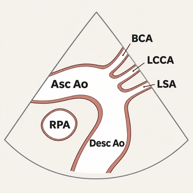

The full illustration and thumbnail are retained byte-for-byte from v54.

**Production checks:** Topology — pass; View identity — pass; Orientation — pass; Labels — pass; Phase — pass; Readability — pass.

#### Original artwork assessment

- Ascending, transverse and descending aortic lumen are continuous with three ordered arch branches (BCA, LCCA, LSA); RPA is a separate circular structure beneath arch.

#### Final assessment

Ascending, transverse and descending aortic lumen are continuous with three ordered arch branches (BCA, LCCA, LSA); RPA is a separate circular structure beneath arch.

#### Phase and limits

- **Phase:**

  No valve or timing information is shown; no cardiac phase, flow direction or pressure inference is made.

- **Limits:**

  - No false communication to RPA. Single-layer branch lumens continue outside sector; geometry matches 2D arch rather than external 3D candy-cane model.

  - Schematic proportions are not calibrated dimensions and cannot establish normality, pathology or function.

  - Static image review does not validate acquisition technique, motion, Doppler, ECG timing or patient diagnosis.

#### Source and exact view

- **Catalogue table:**

  2

- **Catalogue view:**

  2.27

- **Catalogue source:**

  <https://www.asecho.org/wp-content/uploads/2019/01/2019_Comprehensive-TTE.pdf>

- **Sources used in this review:**

  - Record

    - **Url:**

      <https://www.asecho.org/wp-content/uploads/2025/07/Guidelines-for-Performing-a-Comprehensive-Transthoracic-Echocardiographic-Examination-in-Adults.pdf>

    - **Title:**

      Guidelines for Performing a Comprehensive Transthoracic Echocardiographic Examination in Adults

    - **Publication:**

      Mitchell et al.; JASE 2019;32:1–64

    - **Table:**

      2

    - **Row:**

      2.27

    - **Pdf page:**

      25

    - **Role:**

      Exact-plane anatomy drawing and corresponding real echocardiographic frame; visually compared.

    - **Date note:**

      The 2025/07 URL is the rehost location, not the guideline publication year.

#### Review scope and evidence

- **Independent review:**

  TTE reviewer independently compared the original 960px asset with the exact ASE row and inspected its full-size pixels and static thumbnails. A complementary root review inspected original assets/contact sheets. The TTE reviewer rechecked this retained asset in a fresh 200px final contact sheet; no claim is made that root separately reviewed every retained image full-size. These are independent AI-assisted source comparisons, not clinical certification by an echocardiographer.

- **Full size reviewed:**

  Yes

- **Thumbnail reviewed:**

  Yes

- **Inspection:**

  - **Original full size:**

    960×960 WebP individually inspected against source before disposition.

  - **Final full size:**

    Original 960×960 WebP retained without pixel changes.

  - **Final static thumbnail sizes px:**

    - 200

  - **Final 200px contact sheet:**

    tte-final-200px-contact.png

  - **Final 384px replacement contact sheet:**

    Not specified.

  - **Actual browser render review:**

    Separate integration responsibility; this record asserts full-size and static resampled-image review only.

- **Gate findings:**

  - **Topology:**

    Ascending aorta, arch and descending aorta share one continuous lumen. BCA, LCCA and LSA arise in correct sequence; separate RPA below arch has no false communication.

  - **View identity:**

    Suprasternal long-axis arch slice matches ASE 2.27.

  - **Orientation:**

    Ascending Ao at display left, arch superiorly, descending Ao to right; RPA beneath arch.

  - **Labels:**

    Asc Ao, Desc Ao, BCA, LCCA, LSA and RPA identify the correct segments/branches without swapping branch order.

  - **Phase:**

    No valve or timing information is shown; no cardiac phase, flow direction or pressure inference is made.

  - **Readability:**

    Arch continuity, branch order and vessel labels remain recognizable at 200px; smallest branch labels are clearer full-size.

- **Hard failures:**

  None recorded.

#### Preservation and correction constraints

- Maintain continuous ascending-arch-descending lumen.

- Keep BCA then LCCA then LSA in the source orientation.

- Keep RPA separate below arch and allow branch continuation beyond the sector.

#### Reconsidered concerns

- No aortic-RPA shunt is implied.

- Branches leaving the sector represent slice continuation, not anatomical vessel endpoints.

#### Additional review metadata

- **Original asset:**

  - **Path:**

    `public/assets/reference-views-v54/tte-ssn_arch.webp`

  - **Sha256:**

    `2d03cc43a1f04718bc24575fb9d980f6212272bfd193d773663d39feb0a6b557`

- **Source facts and operational criteria:**

  - **Source facts:**

    Imaging-plane anatomy, visible landmarks and conventional orientation are anchored to the cited exact ASE table row; additional sources are identified separately.

  - **Operational criteria:**

    Patent lumen tracing, no false muscular seals, attached leaflet profiles, legible labels at 200px/384px and absence of invented structures are artwork acceptance checks applied by the reviewers, not numerical clinical thresholds.

- **Export review:**

  - **Stage:**

    Retained production thumbnail pairing

  - **Status:**

    pass

  - **Files inspected:**

    Actual 384px thumbnail path in the current manifest, displayed at 200px

  - **Reviewer:**

    TTE review agent

  - **Findings:**

    Matched the previously reviewed full-size view identity; no swapped image, corrupted label, unexpected crop or gallery-size label blocker.

<details>
<summary>Exact prompts and authoring history</summary>

Prompts describe requested changes. Historical authoring records do not supersede this review’s findings.

##### Original artwork: provenance location

- **Historical manifest:**

  docs/reference-views-v54/asset-manifest.json

- **Historical master sha256:**

  `6e985f9a112c40b0accb04399c0ea190ea7ecead7fce6c6c85231e22e2f3c355`

- **Note:**

  The immutable historical manifest preserves the original authoring prompts. This report reproduces the exact prompts for this revision’s seven replacements; all current QC findings and retained-view decisions are included above.

</details>

#### Asset identity

| Asset | Path / identity | Pixels | Bytes | SHA-256 |
| --- | --- | --- | --- | --- |
| Original illustration | `public/assets/reference-views-v54/tte-ssn_arch.webp` | 960 × 960 | 55,392 | `2d03cc43a1f04718bc24575fb9d980f6212272bfd193d773663d39feb0a6b557` |
| Current illustration | `public/assets/reference-views-v54/tte-ssn_arch.webp` | 960 × 960 | 55,392 | `2d03cc43a1f04718bc24575fb9d980f6212272bfd193d773663d39feb0a6b557` |
| Original thumbnail | `public/assets/reference-views-v54/thumbs/tte-ssn_arch.webp` | 384 × 384 | 16,164 | `ff2f840e8149d365bda1402a1be338d203af4d76db2acc8f343a56453b442684` |
| Current thumbnail | `public/assets/reference-views-v54/thumbs/tte-ssn_arch.webp` | 384 × 384 | 16,164 | `ff2f840e8149d365bda1402a1be338d203af4d76db2acc8f343a56453b442684` |
| Historical generation master | `Original master PNG hash` | — | — | `6e985f9a112c40b0accb04399c0ea190ea7ecead7fce6c6c85231e22e2f3c355` |

---

### TEE · Midesophageal five-chamber

**ID:** `tee:me5c` · **Decision:** Retained · **ASE table/view:** 10 / 1

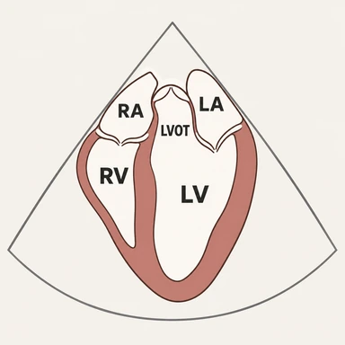

The full illustration and thumbnail are retained byte-for-byte from v54.

**Production checks:** Topology — pass; View identity — pass; Orientation — pass; Labels — pass; Phase — pass; Readability — pass.

#### Original artwork assessment

- Record

  - **Disposition:**

    retain

  - **Severity:**

    none

  - **Finding:**

    Correct chamber orientation and separate atrioventricular junctions, with a recognizable central LVOT. The short upper aortic/valve profile resembles the exact ASE section. Five-chamber identity remains distinguishable from ME four-chamber.

  - **Original asset:**

    `public/assets/reference-views-v54/tee-me5c.webp`

  - **Original sha256:**

    `f67457d89c587aaf4707f04fbb6fa5563067385753bf96428db1d26f824ce975`

#### Final assessment

Correct chamber orientation and separate atrioventricular junctions, with a recognizable central LVOT. The short upper aortic/valve profile resembles the exact ASE section. Five-chamber identity remains distinguishable from ME four-chamber.

#### Phase and limits

- **Phase:**

  Static anatomical schematic with simplified atrioventricular and aortic leaflet profiles. It does not specify a measured cardiac phase or depict continuous flow; the short vessel profile must not be interpreted as obstruction.

- **Limits:**

  - This is an AI-assisted production/source-comparison review, not independent clinical certification.

  - This is a simplified view-identification schematic. Relative size, wall thickness, leaflet excursion and flow are not quantitative.

  - ASE Table 10 anatomy and echo figures have low native resolution; enlarged crops do not add source detail.

  - Passing the thumbnail gate means major anatomy and labels remain identifiable at 200px and 384px; fine valve/chordal anatomy requires the expanded illustration.

  - The compact icon does not explain full aortic continuity or precise valve phase; it should remain a navigation schematic, not a flow diagram.

  - The small LVOT label remains identifiable at 200px; finer aortic leaflet detail requires the larger illustration.

#### Source and exact view

- **Catalogue table:**

  10

- **Catalogue view:**

  1

- **Catalogue source:**

  <https://www.asecho.org/wp-content/uploads/2014/05/2013_Performing-Comprehensive-TEE.pdf>

- **Sources used in this review:**

  - Record

    - **Url:**

      <https://www.asecho.org/wp-content/uploads/2025/04/2013_Performing-Comprehensive-TEE.pdf>

    - **Title:**

      ASE/SCA Guidelines for Performing a Comprehensive Transesophageal Echocardiographic Examination

    - **Publication year:**

      2013

    - **Table:**

      10

    - **View number:**

      1

    - **View name:**

      Midesophageal five-chamber

    - **Basis:**

      Exact anatomical section and matching ultrasound reference visually compared.

#### Review scope and evidence

- **Independent review:**

  The independent TEE review agent visually inspected this original at 960px and compared it with newly retrieved ASE Table 10 anatomy/echo references; historical approval was not accepted as evidence. The same agent inspected fresh 200px and 384px resizes. This records a single-agent source comparison for retained artwork, not independent human clinical certification.

- **Full size reviewed:**

  Yes

- **Thumbnail reviewed:**

  Yes

- **Visual review:**

  - **Accepted master dimensions px:**

    - 960

    - 960

  - **Original master reviewed at px:**

    960

  - **Accepted master reviewed at full size:**

    Yes

  - **Accepted master sha256:**

    `f67457d89c587aaf4707f04fbb6fa5563067385753bf96428db1d26f824ce975`

  - **Thumbnail scales px:**

    - 200

    - 384

  - **Resize method:**

    Pillow LANCZOS resampling only; no crop or anatomy edits.

  - **Reviewed on utc date:**

    2026-11-13

  - **Contact sheets:**

    - final-tee-200px-contact-1.png

    - final-tee-384px-contact-1.png

- **Approved final review:**

  - **Status:**

    approved_for_educational_schematic_use

  - **Finding:**

    Correct chamber orientation and separate atrioventricular junctions, with a recognizable central LVOT. The short upper aortic/valve profile resembles the exact ASE section. Five-chamber identity remains distinguishable from ME four-chamber.

  - **Reviewer count:**

    1

  - **Independent human clinical certification:**

    No

- **Gate evidence:**

  - **Topology:**

    Correct chamber orientation and separate atrioventricular junctions, with a recognizable central LVOT. The short upper aortic/valve profile resembles the exact ASE section. Five-chamber identity remains distinguishable from ME four-chamber.

  - **View identity:**

    Compared with ASE 2013 Table 10 view 1 (Midesophageal five-chamber); required view-defining profiles are present without an unsupported added chamber or plane.

  - **Orientation:**

    Atria are near field; RV is screen-left and LV screen-right; LVOT appears between the atrioventricular junctions in the reference plane.

  - **Labels:**

    - **Visible labels:**

      - RA

      - LA

      - LVOT

      - RV

      - LV

    - **Assessment:**

      All labels occupy the intended blood pool or use a leader to the intended structure. Abbreviations are interpreted in the context of this named view.

  - **Phase:**

    Static anatomical schematic with simplified atrioventricular and aortic leaflet profiles. It does not specify a measured cardiac phase or depict continuous flow; the short vessel profile must not be interpreted as obstruction.

  - **Readability:**

    Fresh 200px and 384px copies of the accepted master were visually inspected. Major structures remain distinguishable, all intended labels remain identifiable and no label is clipped or assigned to a wrong chamber. Fine structural interpretation requires the expanded image. The compact LVOT label remains identifiable at 200px.

- **Hard failures:**

  None recorded.

#### Preservation and correction constraints

- Preserve LA/RA in near field, LV screen-right, RV screen-left; keep LVOT distinct from atria.

- Preserve the exact referenced acquisition plane and display orientation; do not mirror the image or substitute a generic heart diagram.

- Keep chamber and vessel connections anatomically appropriate. Do not add muscular caps, blind sacs, false extra chambers or unreferenced structures.

- Distinguish thin valve tissue/coaptation from myocardium; a legitimate closed valve is not an obstruction.

- A closed vessel profile can reflect the imaging plane leaving that vessel. Do not force out-of-plane continuations without source support.

- Keep the existing ivory/terracotta/gray-sector style and labels legible at full and thumbnail sizes; leaders must terminate on the intended structure.

#### Reconsidered concerns

- Initially considered the very short aortic profile a blind end. Exact Table 10 anatomy/echo does not support this diagnosis: a bounded profile can result from the plane leaving the vessel.

#### Additional review metadata

- **Uncertainty flag:**

  Yes

- **Export review:**

  - **Stage:**

    Retained production thumbnail pairing

  - **Status:**

    pass

  - **Files inspected:**

    Actual 384px thumbnail path in the current manifest, displayed at 200px

  - **Reviewer:**

    TEE review agent

  - **Findings:**

    Matched the previously reviewed full-size view identity; no swapped image, corrupted label, unexpected crop or gallery-size label blocker.

<details>
<summary>Exact prompts and authoring history</summary>

Prompts describe requested changes. Historical authoring records do not supersede this review’s findings.

##### Original artwork: provenance location

- **Historical manifest:**

  docs/reference-views-v54/asset-manifest.json

- **Historical master sha256:**

  `eaa3ca318617714b9108ca3c0d22747cd348dd530994d81aa16c6345e4d81329`

- **Note:**

  The immutable historical manifest preserves the original authoring prompts. This report reproduces the exact prompts for this revision’s seven replacements; all current QC findings and retained-view decisions are included above.

</details>

#### Asset identity

| Asset | Path / identity | Pixels | Bytes | SHA-256 |
| --- | --- | --- | --- | --- |
| Original illustration | `public/assets/reference-views-v54/tee-me5c.webp` | 960 × 960 | 46,182 | `f67457d89c587aaf4707f04fbb6fa5563067385753bf96428db1d26f824ce975` |
| Current illustration | `public/assets/reference-views-v54/tee-me5c.webp` | 960 × 960 | 46,182 | `f67457d89c587aaf4707f04fbb6fa5563067385753bf96428db1d26f824ce975` |
| Original thumbnail | `public/assets/reference-views-v54/thumbs/tee-me5c.webp` | 384 × 384 | 13,400 | `03df948b150309e340d862dd84abf4f915da5c02820539a81ddbf18b063d623a` |
| Current thumbnail | `public/assets/reference-views-v54/thumbs/tee-me5c.webp` | 384 × 384 | 13,400 | `03df948b150309e340d862dd84abf4f915da5c02820539a81ddbf18b063d623a` |
| Historical generation master | `Original master PNG hash` | — | — | `eaa3ca318617714b9108ca3c0d22747cd348dd530994d81aa16c6345e4d81329` |

---

### TEE · Midesophageal four-chamber

**ID:** `tee:me4c` · **Decision:** Retained · **ASE table/view:** 10 / 2

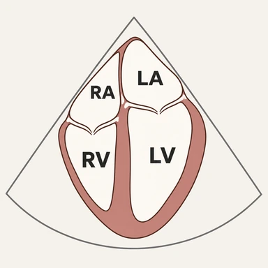

The full illustration and thumbnail are retained byte-for-byte from v54.

**Production checks:** Topology — pass; View identity — pass; Orientation — pass; Labels — pass; Phase — pass; Readability — pass.

#### Original artwork assessment

- Record

  - **Disposition:**

    retain

  - **Severity:**

    none

  - **Finding:**

    Four correctly labeled chambers, RV screen-left and LV right; atria near field; no LVOT/Ao. Tricuspid annular insertion is more apical than mitral. Thin leaflet profiles separate appropriate chambers without a muscular cap.

  - **Original asset:**

    `public/assets/reference-views-v54/tee-me4c.webp`

  - **Original sha256:**

    `d61a9af34a098aed4802005e5290f7727dd32483d4137f0f99f1ae34477ccbfc`

#### Final assessment

Four correctly labeled chambers, RV screen-left and LV right; atria near field; no LVOT/Ao. Tricuspid annular insertion is more apical than mitral. Thin leaflet profiles separate appropriate chambers without a muscular cap.

#### Phase and limits

- **Phase:**

  Static schematic with approximated thin atrioventricular leaflet profiles. Their coaptation is an acceptable illustrative state, not a muscular partition or a claim about cardiac timing.

- **Limits:**

  - This is an AI-assisted production/source-comparison review, not independent clinical certification.

  - This is a simplified view-identification schematic. Relative size, wall thickness, leaflet excursion and flow are not quantitative.

  - ASE Table 10 anatomy and echo figures have low native resolution; enlarged crops do not add source detail.

  - Passing the thumbnail gate means major anatomy and labels remain identifiable at 200px and 384px; fine valve/chordal anatomy requires the expanded illustration.

#### Source and exact view

- **Catalogue table:**

  10

- **Catalogue view:**

  2

- **Catalogue source:**

  <https://www.asecho.org/wp-content/uploads/2014/05/2013_Performing-Comprehensive-TEE.pdf>

- **Sources used in this review:**

  - Record

    - **Url:**

      <https://www.asecho.org/wp-content/uploads/2025/04/2013_Performing-Comprehensive-TEE.pdf>

    - **Title:**

      ASE/SCA Guidelines for Performing a Comprehensive Transesophageal Echocardiographic Examination

    - **Publication year:**

      2013

    - **Table:**

      10

    - **View number:**

      2

    - **View name:**

      Midesophageal four-chamber

    - **Basis:**

      Exact anatomical section and matching ultrasound reference visually compared.

#### Review scope and evidence

- **Independent review:**

  The independent TEE review agent visually inspected this original at 960px and compared it with newly retrieved ASE Table 10 anatomy/echo references; historical approval was not accepted as evidence. The same agent inspected fresh 200px and 384px resizes. This records a single-agent source comparison for retained artwork, not independent human clinical certification.

- **Full size reviewed:**

  Yes

- **Thumbnail reviewed:**

  Yes

- **Visual review:**

  - **Accepted master dimensions px:**

    - 960

    - 960

  - **Original master reviewed at px:**

    960

  - **Accepted master reviewed at full size:**

    Yes

  - **Accepted master sha256:**

    `d61a9af34a098aed4802005e5290f7727dd32483d4137f0f99f1ae34477ccbfc`

  - **Thumbnail scales px:**

    - 200

    - 384

  - **Resize method:**

    Pillow LANCZOS resampling only; no crop or anatomy edits.

  - **Reviewed on utc date:**

    2026-11-13

  - **Contact sheets:**

    - final-tee-200px-contact-1.png

    - final-tee-384px-contact-1.png

- **Approved final review:**

  - **Status:**

    approved_for_educational_schematic_use

  - **Finding:**

    Four correctly labeled chambers, RV screen-left and LV right; atria near field; no LVOT/Ao. Tricuspid annular insertion is more apical than mitral. Thin leaflet profiles separate appropriate chambers without a muscular cap.

  - **Reviewer count:**

    1

  - **Independent human clinical certification:**

    No

- **Gate evidence:**

  - **Topology:**

    Four correctly labeled chambers, RV screen-left and LV right; atria near field; no LVOT/Ao. Tricuspid annular insertion is more apical than mitral. Thin leaflet profiles separate appropriate chambers without a muscular cap.

  - **View identity:**

    Compared with ASE 2013 Table 10 view 2 (Midesophageal four-chamber); required view-defining profiles are present without an unsupported added chamber or plane.

  - **Orientation:**

    Atria are near field, ventricles deeper; RV screen-left, LV screen-right; TV insertion is more apical than MV insertion.

  - **Labels:**

    - **Visible labels:**

      - RA

      - LA

      - RV

      - LV

    - **Assessment:**

      All labels occupy the intended blood pool or use a leader to the intended structure. Abbreviations are interpreted in the context of this named view.

  - **Phase:**

    Static schematic with approximated thin atrioventricular leaflet profiles. Their coaptation is an acceptable illustrative state, not a muscular partition or a claim about cardiac timing.

  - **Readability:**

    Fresh 200px and 384px copies of the accepted master were visually inspected. Major structures remain distinguishable, all intended labels remain identifiable and no label is clipped or assigned to a wrong chamber. Fine structural interpretation requires the expanded image.

- **Hard failures:**

  None recorded.

#### Preservation and correction constraints

- Keep LVOT and aortic valve out of this plane.

- Do not replace closed leaflets with an open gap merely to make atrial communication obvious.

- Preserve the exact referenced acquisition plane and display orientation; do not mirror the image or substitute a generic heart diagram.

- Keep chamber and vessel connections anatomically appropriate. Do not add muscular caps, blind sacs, false extra chambers or unreferenced structures.

- Distinguish thin valve tissue/coaptation from myocardium; a legitimate closed valve is not an obstruction.

- A closed vessel profile can reflect the imaging plane leaving that vessel. Do not force out-of-plane continuations without source support.

- Keep the existing ivory/terracotta/gray-sector style and labels legible at full and thumbnail sizes; leaders must terminate on the intended structure.

#### Additional review metadata

- **Uncertainty flag:**

  No

- **Export review:**

  - **Stage:**

    Retained production thumbnail pairing

  - **Status:**

    pass

  - **Files inspected:**

    Actual 384px thumbnail path in the current manifest, displayed at 200px

  - **Reviewer:**

    TEE review agent

  - **Findings:**

    Matched the previously reviewed full-size view identity; no swapped image, corrupted label, unexpected crop or gallery-size label blocker.

<details>
<summary>Exact prompts and authoring history</summary>

Prompts describe requested changes. Historical authoring records do not supersede this review’s findings.

##### Original artwork: provenance location

- **Historical manifest:**

  docs/reference-views-v54/asset-manifest.json

- **Historical master sha256:**

  `596bb46a9b73f2cca0225aa51728d2911e40fb923fdbc15c498ab8a1f893d492`

- **Note:**

  The immutable historical manifest preserves the original authoring prompts. This report reproduces the exact prompts for this revision’s seven replacements; all current QC findings and retained-view decisions are included above.

</details>

#### Asset identity

| Asset | Path / identity | Pixels | Bytes | SHA-256 |
| --- | --- | --- | --- | --- |
| Original illustration | `public/assets/reference-views-v54/tee-me4c.webp` | 960 × 960 | 46,872 | `d61a9af34a098aed4802005e5290f7727dd32483d4137f0f99f1ae34477ccbfc` |
| Current illustration | `public/assets/reference-views-v54/tee-me4c.webp` | 960 × 960 | 46,872 | `d61a9af34a098aed4802005e5290f7727dd32483d4137f0f99f1ae34477ccbfc` |
| Original thumbnail | `public/assets/reference-views-v54/thumbs/tee-me4c.webp` | 384 × 384 | 13,862 | `5ff4ad3eb9c7d461da8e2c7c330123cc13c33bff11be2e8639ab887512cb79f1` |
| Current thumbnail | `public/assets/reference-views-v54/thumbs/tee-me4c.webp` | 384 × 384 | 13,862 | `5ff4ad3eb9c7d461da8e2c7c330123cc13c33bff11be2e8639ab887512cb79f1` |
| Historical generation master | `Original master PNG hash` | — | — | `596bb46a9b73f2cca0225aa51728d2911e40fb923fdbc15c498ab8a1f893d492` |

---

### TEE · Midesophageal mitral commissural

**ID:** `tee:mecommissural` · **Decision:** Retained · **ASE table/view:** 10 / 3

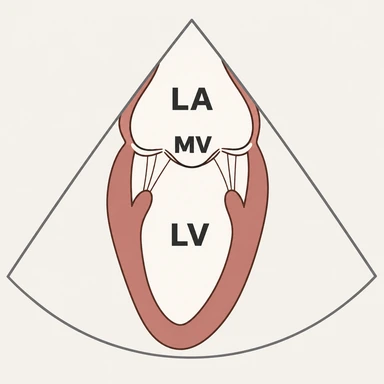

The full illustration and thumbnail are retained byte-for-byte from v54.

**Production checks:** Topology — pass; View identity — pass; Orientation — pass; Labels — pass; Phase — pass; Readability — pass.

#### Original artwork assessment

- Record

  - **Disposition:**

    retain

  - **Severity:**

    none

  - **Finding:**

    LA above LV, broad commissural leaflet profile, bilateral papillary/chordal support and readable labels. The central and lateral leaflet sections are consistent with a commissural intersection, rather than three separate physical mitral leaflets.

  - **Original asset:**

    `public/assets/reference-views-v54/tee-mecommissural.webp`

  - **Original sha256:**

    `41d74f473ab0d6bf5d73d6c542cab10772b7016e096e953526995d6327591ca2`

#### Final assessment

LA above LV, broad commissural leaflet profile, bilateral papillary/chordal support and readable labels. The central and lateral leaflet sections are consistent with a commissural intersection, rather than three separate physical mitral leaflets.

#### Phase and limits

- **Phase:**

  Static commissural section of the mitral apparatus; leaflet profiles and chordae establish the plane. No measured systolic/diastolic timing or quantitative valve excursion is asserted.

- **Limits:**

  - This is an AI-assisted production/source-comparison review, not independent clinical certification.

  - This is a simplified view-identification schematic. Relative size, wall thickness, leaflet excursion and flow are not quantitative.

  - ASE Table 10 anatomy and echo figures have low native resolution; enlarged crops do not add source detail.

  - Passing the thumbnail gate means major anatomy and labels remain identifiable at 200px and 384px; fine valve/chordal anatomy requires the expanded illustration.

  - Several visible mitral sections do not imply three separate anatomical leaflets; any added scallop labels need exact-plane verification.

#### Source and exact view

- **Catalogue table:**

  10

- **Catalogue view:**

  3

- **Catalogue source:**

  <https://www.asecho.org/wp-content/uploads/2014/05/2013_Performing-Comprehensive-TEE.pdf>

- **Sources used in this review:**

  - Record

    - **Url:**

      <https://www.asecho.org/wp-content/uploads/2025/04/2013_Performing-Comprehensive-TEE.pdf>

    - **Title:**

      ASE/SCA Guidelines for Performing a Comprehensive Transesophageal Echocardiographic Examination

    - **Publication year:**

      2013

    - **Table:**

      10

    - **View number:**

      3

    - **View name:**

      Midesophageal mitral commissural

    - **Basis:**

      Exact anatomical section and matching ultrasound reference visually compared.

  - Record

    - **Url:**

      <https://ccasociety.org/education/echoimage/part-1-tee-evaluation-of-the-mitral-valve/>

    - **Basis:**

      Mitral apparatus and commissural scallop relationships; multiple visible section profiles do not imply three physical mitral leaflets.

#### Review scope and evidence

- **Independent review:**

  The independent TEE review agent visually inspected this original at 960px and compared it with newly retrieved ASE Table 10 anatomy/echo references; historical approval was not accepted as evidence. The same agent inspected fresh 200px and 384px resizes. This records a single-agent source comparison for retained artwork, not independent human clinical certification.

- **Full size reviewed:**

  Yes

- **Thumbnail reviewed:**

  Yes

- **Visual review:**

  - **Accepted master dimensions px:**

    - 960

    - 960

  - **Original master reviewed at px:**

    960

  - **Accepted master reviewed at full size:**

    Yes

  - **Accepted master sha256:**

    `41d74f473ab0d6bf5d73d6c542cab10772b7016e096e953526995d6327591ca2`

  - **Thumbnail scales px:**

    - 200

    - 384

  - **Resize method:**

    Pillow LANCZOS resampling only; no crop or anatomy edits.

  - **Reviewed on utc date:**

    2026-11-13

  - **Contact sheets:**

    - final-tee-200px-contact-1.png

    - final-tee-384px-contact-1.png

- **Approved final review:**

  - **Status:**

    approved_for_educational_schematic_use

  - **Finding:**

    LA above LV, broad commissural leaflet profile, bilateral papillary/chordal support and readable labels. The central and lateral leaflet sections are consistent with a commissural intersection, rather than three separate physical mitral leaflets.

  - **Reviewer count:**

    1

  - **Independent human clinical certification:**

    No

- **Gate evidence:**

  - **Topology:**

    LA above LV, broad commissural leaflet profile, bilateral papillary/chordal support and readable labels. The central and lateral leaflet sections are consistent with a commissural intersection, rather than three separate physical mitral leaflets.

  - **View identity:**

    Compared with ASE 2013 Table 10 view 3 (Midesophageal mitral commissural); required view-defining profiles are present without an unsupported added chamber or plane.

  - **Orientation:**

    LA near field above LV, with bilateral ventricular chordal/papillary support. The central/lateral leaflet sections follow the commissural plane.

  - **Labels:**

    - **Visible labels:**

      - LA

      - MV

      - LV

    - **Assessment:**

      All labels occupy the intended blood pool or use a leader to the intended structure. Abbreviations are interpreted in the context of this named view.

  - **Phase:**

    Static commissural section of the mitral apparatus; leaflet profiles and chordae establish the plane. No measured systolic/diastolic timing or quantitative valve excursion is asserted.

  - **Readability:**

    Fresh 200px and 384px copies of the accepted master were visually inspected. Major structures remain distinguishable, all intended labels remain identifiable and no label is clipped or assigned to a wrong chamber. Fine structural interpretation requires the expanded image.

- **Hard failures:**

  None recorded.

#### Preservation and correction constraints

- Preserve chordal attachments to ventricular surfaces and papillary muscles.

- If adding scallop labels, verify exact plane; do not treat all sections as separate leaflets.

- Preserve the exact referenced acquisition plane and display orientation; do not mirror the image or substitute a generic heart diagram.

- Keep chamber and vessel connections anatomically appropriate. Do not add muscular caps, blind sacs, false extra chambers or unreferenced structures.

- Distinguish thin valve tissue/coaptation from myocardium; a legitimate closed valve is not an obstruction.

- A closed vessel profile can reflect the imaging plane leaving that vessel. Do not force out-of-plane continuations without source support.

- Keep the existing ivory/terracotta/gray-sector style and labels legible at full and thumbnail sizes; leaders must terminate on the intended structure.

#### Reconsidered concerns

- A three-profile valve appearance was reviewed against source. It is appropriate to P3/A2/P1 intersection and is not evidence of a trileaflet mitral valve.

#### Additional review metadata

- **Uncertainty flag:**

  No

- **Export review:**

  - **Stage:**

    Retained production thumbnail pairing

  - **Status:**

    pass

  - **Files inspected:**

    Actual 384px thumbnail path in the current manifest, displayed at 200px

  - **Reviewer:**

    TEE review agent

  - **Findings:**

    Matched the previously reviewed full-size view identity; no swapped image, corrupted label, unexpected crop or gallery-size label blocker.

<details>
<summary>Exact prompts and authoring history</summary>

Prompts describe requested changes. Historical authoring records do not supersede this review’s findings.

##### Original artwork: provenance location

- **Historical manifest:**

  docs/reference-views-v54/asset-manifest.json

- **Historical master sha256:**

  `fe14a3651d914c4f5f86fc450c84474ff535064854cd7b1c0a5282d7f7498c26`

- **Note:**

  The immutable historical manifest preserves the original authoring prompts. This report reproduces the exact prompts for this revision’s seven replacements; all current QC findings and retained-view decisions are included above.

</details>

#### Asset identity

| Asset | Path / identity | Pixels | Bytes | SHA-256 |
| --- | --- | --- | --- | --- |
| Original illustration | `public/assets/reference-views-v54/tee-mecommissural.webp` | 960 × 960 | 41,826 | `41d74f473ab0d6bf5d73d6c542cab10772b7016e096e953526995d6327591ca2` |
| Current illustration | `public/assets/reference-views-v54/tee-mecommissural.webp` | 960 × 960 | 41,826 | `41d74f473ab0d6bf5d73d6c542cab10772b7016e096e953526995d6327591ca2` |
| Original thumbnail | `public/assets/reference-views-v54/thumbs/tee-mecommissural.webp` | 384 × 384 | 12,498 | `e23008335043df27935a1a821e21fc76b100cde23b1135767599390ad6efeb77` |
| Current thumbnail | `public/assets/reference-views-v54/thumbs/tee-mecommissural.webp` | 384 × 384 | 12,498 | `e23008335043df27935a1a821e21fc76b100cde23b1135767599390ad6efeb77` |
| Historical generation master | `Original master PNG hash` | — | — | `fe14a3651d914c4f5f86fc450c84474ff535064854cd7b1c0a5282d7f7498c26` |

---

### TEE · Midesophageal two-chamber

**ID:** `tee:me2c` · **Decision:** Retained · **ASE table/view:** 10 / 4

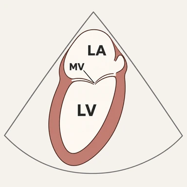

The full illustration and thumbnail are retained byte-for-byte from v54.

**Production checks:** Topology — pass; View identity — pass; Orientation — pass; Labels — pass; Phase — pass; Readability — pass.

#### Original artwork assessment

- Record

  - **Disposition:**

    retain

  - **Severity:**

    none

  - **Finding:**

    LA near-field, elongated LV far-field, MV at the actual junction, no invented RV or LVOT. Small right-sided atrial appendage contour is compatible with source. Labels remain legible at 240px.

  - **Original asset:**

    `public/assets/reference-views-v54/tee-me2c.webp`

  - **Original sha256:**

    `c0fa7d90056bd99d1983e3ee901da82e2256264c4b95b15b840f36197d375ce7`

#### Final assessment

LA near-field, elongated LV far-field, MV at the actual junction, no invented RV or LVOT. Small right-sided atrial appendage contour is compatible with source. Labels remain legible at 240px.

#### Phase and limits

- **Phase:**

  Static schematic with thin mitral leaflet profiles near coaptation. No claim of measured phase or leaflet excursion is made.

- **Limits:**

  - This is an AI-assisted production/source-comparison review, not independent clinical certification.

  - This is a simplified view-identification schematic. Relative size, wall thickness, leaflet excursion and flow are not quantitative.

  - ASE Table 10 anatomy and echo figures have low native resolution; enlarged crops do not add source detail.

  - Passing the thumbnail gate means major anatomy and labels remain identifiable at 200px and 384px; fine valve/chordal anatomy requires the expanded illustration.

#### Source and exact view

- **Catalogue table:**

  10

- **Catalogue view:**

  4

- **Catalogue source:**

  <https://www.asecho.org/wp-content/uploads/2014/05/2013_Performing-Comprehensive-TEE.pdf>

- **Sources used in this review:**

  - Record

    - **Url:**

      <https://www.asecho.org/wp-content/uploads/2025/04/2013_Performing-Comprehensive-TEE.pdf>

    - **Title:**

      ASE/SCA Guidelines for Performing a Comprehensive Transesophageal Echocardiographic Examination

    - **Publication year:**

      2013

    - **Table:**

      10

    - **View number:**

      4

    - **View name:**

      Midesophageal two-chamber

    - **Basis:**

      Exact anatomical section and matching ultrasound reference visually compared.

#### Review scope and evidence

- **Independent review:**

  The independent TEE review agent visually inspected this original at 960px and compared it with newly retrieved ASE Table 10 anatomy/echo references; historical approval was not accepted as evidence. The same agent inspected fresh 200px and 384px resizes. This records a single-agent source comparison for retained artwork, not independent human clinical certification.

- **Full size reviewed:**

  Yes

- **Thumbnail reviewed:**

  Yes

- **Visual review:**

  - **Accepted master dimensions px:**

    - 960

    - 960

  - **Original master reviewed at px:**

    960

  - **Accepted master reviewed at full size:**

    Yes

  - **Accepted master sha256:**

    `c0fa7d90056bd99d1983e3ee901da82e2256264c4b95b15b840f36197d375ce7`

  - **Thumbnail scales px:**

    - 200

    - 384

  - **Resize method:**

    Pillow LANCZOS resampling only; no crop or anatomy edits.

  - **Reviewed on utc date:**

    2026-11-13

  - **Contact sheets:**

    - final-tee-200px-contact-1.png

    - final-tee-384px-contact-1.png

- **Approved final review:**

  - **Status:**

    approved_for_educational_schematic_use

  - **Finding:**

    LA near-field, elongated LV far-field, MV at the actual junction, no invented RV or LVOT. Small right-sided atrial appendage contour is compatible with source. Labels remain legible at 240px.

  - **Reviewer count:**

    1

  - **Independent human clinical certification:**

    No

- **Gate evidence:**

  - **Topology:**

    LA near-field, elongated LV far-field, MV at the actual junction, no invented RV or LVOT. Small right-sided atrial appendage contour is compatible with source. Labels remain legible at 240px.

  - **View identity:**

    Compared with ASE 2013 Table 10 view 4 (Midesophageal two-chamber); required view-defining profiles are present without an unsupported added chamber or plane.

  - **Orientation:**

    LA is near field, elongated LV extends downward, small appendage contour is screen-right; no RV or aortic outlet is inserted into this plane.

  - **Labels:**

    - **Visible labels:**

      - LA

      - MV

      - LV

    - **Assessment:**

      All labels occupy the intended blood pool or use a leader to the intended structure. Abbreviations are interpreted in the context of this named view.

  - **Phase:**

    Static schematic with thin mitral leaflet profiles near coaptation. No claim of measured phase or leaflet excursion is made.

  - **Readability:**

    Fresh 200px and 384px copies of the accepted master were visually inspected. Major structures remain distinguishable, all intended labels remain identifiable and no label is clipped or assigned to a wrong chamber. Fine structural interpretation requires the expanded image.

- **Hard failures:**

  None recorded.

#### Preservation and correction constraints

- Keep the two-chamber identity distinct from three-chamber/long-axis.

- Preserve the exact referenced acquisition plane and display orientation; do not mirror the image or substitute a generic heart diagram.

- Keep chamber and vessel connections anatomically appropriate. Do not add muscular caps, blind sacs, false extra chambers or unreferenced structures.

- Distinguish thin valve tissue/coaptation from myocardium; a legitimate closed valve is not an obstruction.

- A closed vessel profile can reflect the imaging plane leaving that vessel. Do not force out-of-plane continuations without source support.

- Keep the existing ivory/terracotta/gray-sector style and labels legible at full and thumbnail sizes; leaders must terminate on the intended structure.

#### Additional review metadata

- **Uncertainty flag:**

  No

- **Export review:**

  - **Stage:**

    Retained production thumbnail pairing

  - **Status:**

    pass

  - **Files inspected:**

    Actual 384px thumbnail path in the current manifest, displayed at 200px

  - **Reviewer:**

    TEE review agent

  - **Findings:**

    Matched the previously reviewed full-size view identity; no swapped image, corrupted label, unexpected crop or gallery-size label blocker.

<details>
<summary>Exact prompts and authoring history</summary>

Prompts describe requested changes. Historical authoring records do not supersede this review’s findings.

##### Original artwork: provenance location

- **Historical manifest:**

  docs/reference-views-v54/asset-manifest.json

- **Historical master sha256:**

  `b1d98af70c440afaf8be46844265cbb14ccfe75bff55bca7a93b7a59e54c208b`

- **Note:**

  The immutable historical manifest preserves the original authoring prompts. This report reproduces the exact prompts for this revision’s seven replacements; all current QC findings and retained-view decisions are included above.

</details>

#### Asset identity

| Asset | Path / identity | Pixels | Bytes | SHA-256 |
| --- | --- | --- | --- | --- |
| Original illustration | `public/assets/reference-views-v54/tee-me2c.webp` | 960 × 960 | 38,582 | `c0fa7d90056bd99d1983e3ee901da82e2256264c4b95b15b840f36197d375ce7` |
| Current illustration | `public/assets/reference-views-v54/tee-me2c.webp` | 960 × 960 | 38,582 | `c0fa7d90056bd99d1983e3ee901da82e2256264c4b95b15b840f36197d375ce7` |
| Original thumbnail | `public/assets/reference-views-v54/thumbs/tee-me2c.webp` | 384 × 384 | 11,404 | `5f123a70413568c9b77ecc665a27f7b0ad5ff13c44ec435a1eaa300ed19b0711` |
| Current thumbnail | `public/assets/reference-views-v54/thumbs/tee-me2c.webp` | 384 × 384 | 11,404 | `5f123a70413568c9b77ecc665a27f7b0ad5ff13c44ec435a1eaa300ed19b0711` |
| Historical generation master | `Original master PNG hash` | — | — | `b1d98af70c440afaf8be46844265cbb14ccfe75bff55bca7a93b7a59e54c208b` |

---

### TEE · Midesophageal long-axis

**ID:** `tee:melax` · **Decision:** Anatomical correction · **ASE table/view:** 10 / 5

| Before — superseded v54 artwork | After — accepted v58 artwork |
| --- | --- |
| 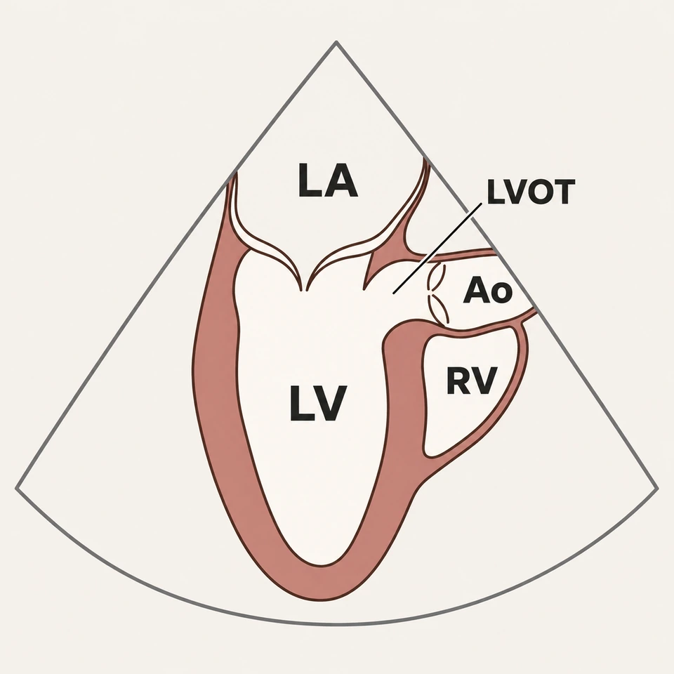 | 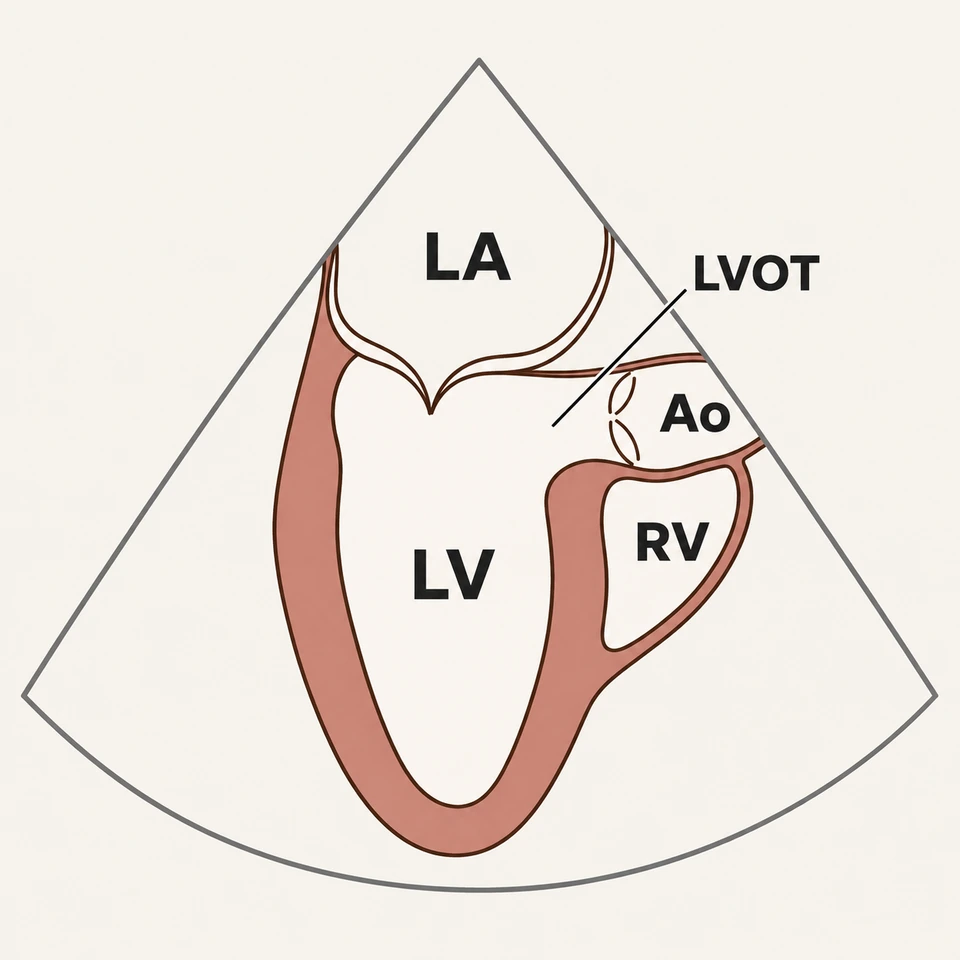 |

**Production checks:** Topology — pass; View identity — pass; Orientation — pass; Labels — pass; Phase — pass; Readability — pass.

#### Original artwork assessment

- Record

  - **Disposition:**

    replace

  - **Severity:**

    major

  - **Finding:**

    A pointed solid terracotta spur descends from the aortomitral region into the LVOT just left of the AV, around x520/y390 in the 960px asset. It reads as an extra muscular projection rather than a thin leaflet/curtain and is not supported by the exact source.

  - **Original asset:**

    `public/assets/reference-views-v54/tee-melax.webp`

  - **Original sha256:**

    `fe5a48680e65064584e62cea86fc7b696be6dcef50922fad13efbb154414e068`

#### Final assessment

Root candidate independently inspected: muscular LVOT spur removed, broad outflow and thin aortomitral continuity maintained, correct chamber orientation and label targeting. Accepted by root and independent TEE reviewer for schematic use.

#### Phase and limits

- **Phase:**

  Systolic-style schematic: mitral leaflet profiles approximate coaptation and aortic cusp profiles are separated. This records the intended static valve-state combination, not complete valve kinetics, timing or hemodynamics.

- **Limits:**

  - This is an AI-assisted production/source-comparison review, not independent clinical certification.

  - This is a simplified view-identification schematic. Relative size, wall thickness, leaflet excursion and flow are not quantitative.

  - ASE Table 10 anatomy and echo figures have low native resolution; enlarged crops do not add source detail.

  - Passing the thumbnail gate means major anatomy and labels remain identifiable at 200px and 384px; fine valve/chordal anatomy requires the expanded illustration.

  - Wall thickness and degree of valve opening are stylized, not quantitative measurements.

#### Source and exact view

- **Catalogue table:**

  10

- **Catalogue view:**

  5

- **Catalogue source:**

  <https://www.asecho.org/wp-content/uploads/2014/05/2013_Performing-Comprehensive-TEE.pdf>

- **Sources used in this review:**

  - Record

    - **Url:**

      <https://www.asecho.org/wp-content/uploads/2025/04/2013_Performing-Comprehensive-TEE.pdf>

    - **Title:**

      ASE/SCA Guidelines for Performing a Comprehensive Transesophageal Echocardiographic Examination

    - **Publication year:**

      2013

    - **Table:**

      10

    - **View number:**

      5

    - **View name:**

      Midesophageal long-axis

    - **Basis:**

      Exact anatomical section and matching ultrasound reference visually compared.

#### Review scope and evidence

- **Independent review:**

  The accepted generated master was visually inspected by both the root reviewer and the independent TEE review agent. The TEE agent compared it with the exact ASE anatomy/echo plane and inspected fresh 200px and 384px resizes. Approval is limited to educational schematic production quality; neither reviewer is being represented as a human clinician.

- **Full size reviewed:**

  Yes

- **Thumbnail reviewed:**

  Yes

- **Visual review:**

  - **Accepted master dimensions px:**

    - 1254

    - 1254

  - **Original master reviewed at px:**

    960

  - **Accepted master reviewed at full size:**

    Yes

  - **Accepted master sha256:**

    `b1730235bc4d0b099157ecf734e0c27bd9ba31ee3ed74da5a46b10f6df4d7e7a`

  - **Thumbnail scales px:**

    - 200

    - 384

  - **Resize method:**

    Pillow LANCZOS resampling only; no crop or anatomy edits.

  - **Reviewed on utc date:**

    2026-11-13

  - **Contact sheets:**

    - final-tee-200px-contact-1.png

    - final-tee-384px-contact-1.png

- **Approved final review:**

  - **Status:**

    approved_for_educational_schematic_use

  - **Finding:**

    Root candidate independently inspected: muscular LVOT spur removed, broad outflow and thin aortomitral continuity maintained, correct chamber orientation and label targeting. Accepted by root and independent TEE reviewer for schematic use.

  - **Reviewer count:**

    2

  - **Independent human clinical certification:**

    No

- **Gate evidence:**

  - **Topology:**

    Root candidate independently inspected: muscular LVOT spur removed, broad outflow and thin aortomitral continuity maintained, correct chamber orientation and label targeting. Accepted by root and independent TEE reviewer for schematic use.

  - **View identity:**

    Compared with ASE 2013 Table 10 view 5 (Midesophageal long-axis); required view-defining profiles are present without an unsupported added chamber or plane.

  - **Orientation:**

    LA is near field, elongated LV left/deeper, aortic root exits screen-right, and a small RV/outflow section is below the aortic root.

  - **Labels:**

    - **Visible labels:**

      - LA

      - LV

      - RV

      - Ao

      - LVOT

    - **Assessment:**

      All labels occupy the intended blood pool or use a leader to the intended structure. Abbreviations are interpreted in the context of this named view.

  - **Phase:**

    Systolic-style schematic: mitral leaflet profiles approximate coaptation and aortic cusp profiles are separated. This records the intended static valve-state combination, not complete valve kinetics, timing or hemodynamics.

  - **Readability:**

    Fresh 200px and 384px copies of the accepted master were visually inspected. Major structures remain distinguishable, all intended labels remain identifiable and no label is clipped or assigned to a wrong chamber. Fine structural interpretation requires the expanded image.

- **Hard failures:**

  None recorded.

#### Preservation and correction constraints

- Replace spur with thin aortomitral continuity.

- Keep broad LV-to-LVOT-to-AV-to-Ao lumen.

- Retain near-field LA, LV left/far-field and RV outflow context right.

- Do not add papillary muscles to this plane.

- Preserve a genuine LA-LV valve junction and keep LA separate from Ao; removing a spur must not create an atrial-aortic communication.

- Retain slender hinged cusp profiles, and do not introduce a second outflow or ventricular partition.

- Preserve the exact referenced acquisition plane and display orientation; do not mirror the image or substitute a generic heart diagram.

- Keep chamber and vessel connections anatomically appropriate. Do not add muscular caps, blind sacs, false extra chambers or unreferenced structures.

- Distinguish thin valve tissue/coaptation from myocardium; a legitimate closed valve is not an obstruction.

- A closed vessel profile can reflect the imaging plane leaving that vessel. Do not force out-of-plane continuations without source support.

- Keep the existing ivory/terracotta/gray-sector style and labels legible at full and thumbnail sizes; leaders must terminate on the intended structure.

#### Additional review metadata

- **Uncertainty flag:**

  No

- **Export review:**

  - **Stage:**

    Local production WebP files, before publication

  - **Status:**

    pass

  - **Files inspected:**

    Actual 960px image and actual 384px thumbnail; 200px rendition derived from the encoded thumbnail

  - **Reviewer:**

    TEE review agent; root also inspected all seven exported thumbnails at 240px

  - **Findings:**

    Broad smooth LVOT remains visible; no resampling-induced tissue spur or ambiguous label target.

  - **Remaining display limit:**

    Fine leaflet and cusp interpretation requires the enlarged illustration.

<details>
<summary>Exact prompts and authoring history</summary>

Prompts describe requested changes. Historical authoring records do not supersede this review’s findings.

##### Accepted replacement: exact final prompt and preceding prompts

- **Tool:**

  image_gen

- **Prompt:**

  ```text
  Use case: scientific-educational precise-object-edit. Correct ONE TEE mid-esophageal LONG-AXIS illustration (ASE2013 Table10 view5). Image1 is the original style/edit target; images2 and3 are anatomical and real-echo references for this exact view. Keep all current correct orientation and composition: LA near top, long LV below, aortic outlet to screen right, small RV below/right of aortic root. Preserve warm ivory field, terracotta myocardium, thin brown contours, gray ultrasound sector and existing bold labels LA, LV, RV, Ao, LVOT. No additional labels or titles.
  The targeted error is the large triangular terracotta spur projecting DOWN into the LVOT between the mitral anterior leaflet and aortic root (around x520 y390 of 960px image). This invents an obstructing muscular projection. REMOVE that spur entirely. Replace the entire local LA–aortic root interval with a smooth THIN fibrous aorto-mitral continuity, continuous from the anterior mitral leaflet to the posterior aortic annulus, with no beak/hook/point projecting into the outflow blood pool. The LVOT must have a broad smooth white lumen from LV to AV/Ao. Keep LA separated from Ao by the thin fibrous boundary; do not make an LA–aorta fistula. Preserve thin mitral leaflet coaptation (systole) at genuine LA–LV junction, and thin OPEN aortic cusps at the LVOT–Ao junction (systolic ejection). No extra leaflet or muscular bar behind the mitral leaflets. Same precise flat original style. Anatomy is an original schematic informed by reference, not a copied source figure.
  ```

- **Output sha256:**

  `b1730235bc4d0b099157ecf734e0c27bd9ba31ee3ed74da5a46b10f6df4d7e7a`

- **Reference inputs:**

  - Record

    - **Url:**

      Not specified.

    - **Role:**

      previous candidate or original style/edit target

    - **Source type:**

      existing_project_asset

    - **Name:**

      tee-melax.webp

    - **Sha256:**

      `fe5a48680e65064584e62cea86fc7b696be6dcef50922fad13efbb154414e068`

  - Record

    - **Url:**

      <https://www.asecho.org/wp-content/uploads/2025/04/2013_Performing-Comprehensive-TEE.pdf>

    - **Role:**

      authoritative exact-plane reference

    - **Source type:**

      authoritative_anatomy_or_echo_crop

    - **Name:**

      tee-05-anatomy.png

    - **Sha256:**

      `f5591f8bfb4e0352dad1da4351e37d22a69486e835778cee2de3659d021dcbba`

  - Record

    - **Url:**

      <https://www.asecho.org/wp-content/uploads/2025/04/2013_Performing-Comprehensive-TEE.pdf>

    - **Role:**

      authoritative exact-plane reference

    - **Source type:**

      authoritative_anatomy_or_echo_crop

    - **Name:**

      tee-05-echo.png

    - **Sha256:**

      `95d36b096f29998e9ab3efc6179ca8799bd4548c380efffcf5be8a4f40424fd0`

##### Original artwork: provenance location

- **Historical manifest:**

  docs/reference-views-v54/asset-manifest.json

- **Historical master sha256:**

  `d41aa26a1414d3acc904e6d6bb09ca795e63f4831b51554d4da487f08e8d5a93`

- **Note:**

  The immutable historical manifest preserves the original authoring prompts. This report reproduces the exact prompts for this revision’s seven replacements; all current QC findings and retained-view decisions are included above.

</details>

#### Asset identity

| Asset | Path / identity | Pixels | Bytes | SHA-256 |
| --- | --- | --- | --- | --- |
| Original illustration | `public/assets/reference-views-v54/tee-melax.webp` | 960 × 960 | 45,312 | `fe5a48680e65064584e62cea86fc7b696be6dcef50922fad13efbb154414e068` |
| Current illustration | `public/assets/reference-views-v58/tee-melax.webp` | 960 × 960 | 45,784 | `402a63c208abe4858333366f8e3cb08b1bbaf83ef55126a6e5e9f99b31b2257b` |
| Original thumbnail | `public/assets/reference-views-v54/thumbs/tee-melax.webp` | 384 × 384 | 13,330 | `755f3caa0ba112afe9ea9d3d2e11add7a44a5140670e44da683f3251ae566512` |
| Current thumbnail | `public/assets/reference-views-v58/thumbs/tee-melax.webp` | 384 × 384 | 13,464 | `96b4d146b3078a741d8f5ca7a190974c4c31046b47e231119a61a7c1b49cdfc6` |
| Accepted generation master | `Master PNG hash; no published source image embedded` | — | — | `b1730235bc4d0b099157ecf734e0c27bd9ba31ee3ed74da5a46b10f6df4d7e7a` |
| Historical generation master | `Original master PNG hash` | — | — | `d41aa26a1414d3acc904e6d6bb09ca795e63f4831b51554d4da487f08e8d5a93` |

---

### TEE · Midesophageal aortic valve long-axis

**ID:** `tee:meavlax` · **Decision:** Anatomical correction · **ASE table/view:** 10 / 6

| Before — superseded v54 artwork | After — accepted v58 artwork |
| --- | --- |
| 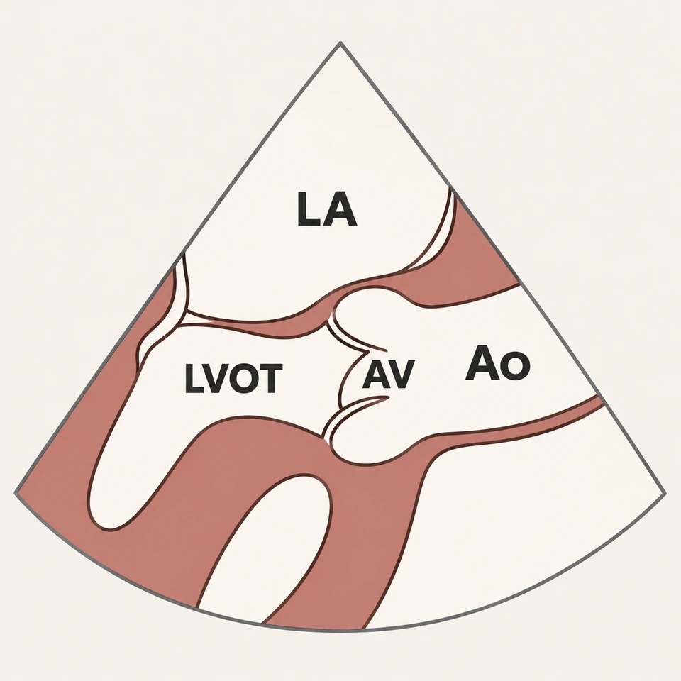 | 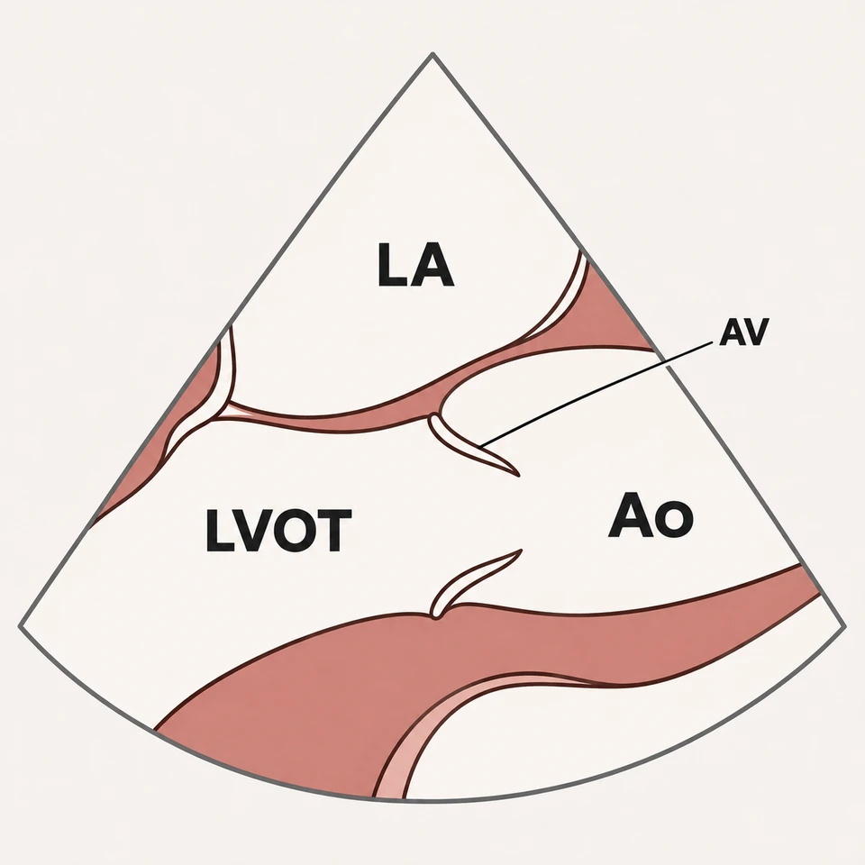 |

**Production checks:** Topology — pass; View identity — pass; Orientation — pass; Labels — pass; Phase — pass; Readability — pass.

#### Original artwork assessment

- Record

  - **Disposition:**

    replace

  - **Severity:**

    major

  - **Finding:**

    LVOT terminates as a rounded closed narrow pouch at lower-left instead of remaining continuous into the LV beyond the cropped field. The large AV label directly overlaps the defining cusp/orifice region. The source has open LVOT continuation through the lower-left sector.

  - **Original asset:**

    `public/assets/reference-views-v54/tee-meavlax.webp`

  - **Original sha256:**

    `62fa18c04fd9f844938c7eb9bd4375c096f186550a5c1f1beb92161ed07f2119`

#### Final assessment

Final candidate 2 independently inspected at full size: broad LVOT continues through lower-left sector, one continuous aortic lumen, separate false upper compartment and internal red stripe removed, two thin hinge-based AV cusp profiles remain, AV label external with leader terminating on upper cusp. Matches intended ME AV long-axis topology. Accepted by root and independent TEE reviewer for schematic use.

#### Phase and limits

- **Phase:**

  Static schematic with aortic cusps partly separated and a patent central outflow. It is an open-valve illustrative state, not a complete motion or hemodynamic representation.

- **Limits:**

  - This is an AI-assisted production/source-comparison review, not independent clinical certification.

  - This is a simplified view-identification schematic. Relative size, wall thickness, leaflet excursion and flow are not quantitative.

  - ASE Table 10 anatomy and echo figures have low native resolution; enlarged crops do not add source detail.

  - Passing the thumbnail gate means major anatomy and labels remain identifiable at 200px and 384px; fine valve/chordal anatomy requires the expanded illustration.

  - The external AV label is intentionally smaller than chamber labels. It remains identifiable at 200px and clearer at 384px; detailed cusp relationships require the expanded illustration.

#### Source and exact view

- **Catalogue table:**

  10

- **Catalogue view:**

  6

- **Catalogue source:**

  <https://www.asecho.org/wp-content/uploads/2014/05/2013_Performing-Comprehensive-TEE.pdf>

- **Sources used in this review:**

  - Record

    - **Url:**

      <https://www.asecho.org/wp-content/uploads/2025/04/2013_Performing-Comprehensive-TEE.pdf>

    - **Title:**

      ASE/SCA Guidelines for Performing a Comprehensive Transesophageal Echocardiographic Examination

    - **Publication year:**

      2013

    - **Table:**

      10

    - **View number:**

      6

    - **View name:**

      Midesophageal aortic valve long-axis

    - **Basis:**

      Exact anatomical section and matching ultrasound reference visually compared.

#### Review scope and evidence

- **Independent review:**

  The accepted generated master was visually inspected by both the root reviewer and the independent TEE review agent. The TEE agent compared it with the exact ASE anatomy/echo plane and inspected fresh 200px and 384px resizes. Approval is limited to educational schematic production quality; neither reviewer is being represented as a human clinician.

- **Full size reviewed:**

  Yes

- **Thumbnail reviewed:**

  Yes

- **Visual review:**

  - **Accepted master dimensions px:**

    - 1254

    - 1254

  - **Original master reviewed at px:**

    960

  - **Accepted master reviewed at full size:**

    Yes

  - **Accepted master sha256:**

    `f77ae9bfbe0ef9e53a739a40647f32fb0a9089d62abebb2acc8295310e9cf164`

  - **Thumbnail scales px:**

    - 200

    - 384

  - **Resize method:**

    Pillow LANCZOS resampling only; no crop or anatomy edits.

  - **Reviewed on utc date:**

    2026-11-13

  - **Contact sheets:**

    - final-tee-200px-contact-1.png

    - final-tee-384px-contact-1.png

- **Approved final review:**

  - **Status:**

    approved_for_educational_schematic_use

  - **Finding:**

    Final candidate 2 independently inspected at full size: broad LVOT continues through lower-left sector, one continuous aortic lumen, separate false upper compartment and internal red stripe removed, two thin hinge-based AV cusp profiles remain, AV label external with leader terminating on upper cusp. Matches intended ME AV long-axis topology. Accepted by root and independent TEE reviewer for schematic use.

  - **Reviewer count:**

    2

  - **Independent human clinical certification:**

    No

- **Gate evidence:**

  - **Topology:**

    Final candidate 2 independently inspected at full size: broad LVOT continues through lower-left sector, one continuous aortic lumen, separate false upper compartment and internal red stripe removed, two thin hinge-based AV cusp profiles remain, AV label external with leader terminating on upper cusp. Matches intended ME AV long-axis topology. Accepted by root and independent TEE reviewer for schematic use.

  - **View identity:**

    Compared with ASE 2013 Table 10 view 6 (Midesophageal aortic valve long-axis); required view-defining profiles are present without an unsupported added chamber or plane.

  - **Orientation:**

    LA above the outflow; LVOT enters from lower-left and joins Ao to screen-right; thin aortomitral relation is retained.

  - **Labels:**

    - **Visible labels:**

      - LA

      - LVOT

      - Ao

      - AV

    - **Assessment:**

      All labels occupy the intended blood pool or use a leader to the intended structure. Abbreviations are interpreted in the context of this named view.

  - **Phase:**

    Static schematic with aortic cusps partly separated and a patent central outflow. It is an open-valve illustrative state, not a complete motion or hemodynamic representation.

  - **Readability:**

    Fresh 200px and 384px copies of the accepted master were visually inspected. Major structures remain distinguishable, all intended labels remain identifiable and no label is clipped or assigned to a wrong chamber. Fine structural interpretation requires the expanded image. The smaller external AV label is still identifiable at 200px; its leader and cusp endpoint are clear at 384px.

- **Hard failures:**

  None recorded.

#### Preservation and correction constraints

- Continue LVOT openly off lower-left field toward LV.

- Draw a single aortic lumen with wall bulges for sinuses; no extra upper tube or internal muscular partition.

- Keep two thin hinge-based AV cusp profiles and position AV label outside their geometry with a short leader.

- Maintain LA above and thin aortomitral relation.

- Maintain one uninterrupted aortic blood pool beyond the two cusp profiles; the sinus must be a wall bulge of that same lumen.

- Do not draw a long cusp-to-sector line, extra upper aortic tube or terracotta stripe across the outflow.

- Preserve the exact referenced acquisition plane and display orientation; do not mirror the image or substitute a generic heart diagram.

- Keep chamber and vessel connections anatomically appropriate. Do not add muscular caps, blind sacs, false extra chambers or unreferenced structures.

- Distinguish thin valve tissue/coaptation from myocardium; a legitimate closed valve is not an obstruction.

- A closed vessel profile can reflect the imaging plane leaving that vessel. Do not force out-of-plane continuations without source support.

- Keep the existing ivory/terracotta/gray-sector style and labels legible at full and thumbnail sizes; leaders must terminate on the intended structure.

#### Rejected candidate history

- Record

  - **Status:**

    rejected

  - **File name:**

    exec-a96ef1f2-a41f-446a-ae6c-0eea5917fdde.png

  - **Sha256:**

    `d5aa162790b7c7dccafcb0249f5bb062fd5d736bb32e7a2844c220124c9be773`

  - **Review:**

    Rejected independently: LVOT opened, but generation invented a separate elongated upper aortic-sinus tube and an internal terracotta dividing wall. Root notified to regenerate.

  - **Prompt history index:**

    ```text
    0
    ```

  - **Exact prompt:**

    ```text
    Use case: scientific-educational. Correct ONE TEE mid-esophageal AORTIC-VALVE LONG-AXIS zoom (ASE2013 Table10 view6), keeping exact original minimal style. Image1 is edit target/style; images2 and3 are exact authoritative anatomy and echo. Match their true continuity and section. Square warm ivory, restrained terracotta tissue, thin dark brown outlines, large dark sans-serif labels, thin gray sector. No gradients, shadows, texture or titles.
    CRITICAL ERROR: the existing LVOT is a blind-ended sealed curved pouch at bottom left. It is NOT a separate chamber. Rebuild left side: show a BROAD WHITE LVOT lumen continuing LEFT and DOWN out of the sector into the unseen LV. The opening must intersect the left/bottom-left ultrasound boundary; there is NO curved myocardial cap closing this lumen. Its lower wall is the smooth basal septal contour leading to the aortic annulus, not a hook intruding into the lumen. At center, two thin aortic cusps are OPEN in systole, with clear central ejection gap to the aortic lumen continuing horizontally to display right. Upper LA lies in near field above LVOT/aortic root and is separated by the thin aorto-mitral curtain. A small cropped RV profile may remain far-field below aortic root, with thin RV free wall, as in source. Preserve correct LA–MV–LV junction at extreme left only if visible; do not invent thick barrier or extra valve.
    Labels exactly 'LA' above, 'LVOT' centered in broad open left outflow lumen, 'Ao' inside aorta to right, and 'AV' as a short EXTERNAL leader ending on one thin aortic cusp. AV text must NOT occupy or obscure the cusp/orifice. Avoid huge hypertrophic tissue slab; keep myocardial rim modest. The outer gray ultrasound boundary is not a physical wall. Never cap the LVOT just to fit the sector. Preserve source orientation; anatomy fills sector; one image.
    ```

#### Additional review metadata

- **Uncertainty flag:**

  No

- **Export review:**

  - **Stage:**

    Local production WebP files, before publication

  - **Status:**

    pass

  - **Files inspected:**

    Actual 960px image and actual 384px thumbnail; 200px rendition derived from the encoded thumbnail

  - **Reviewer:**

    TEE review agent; root also inspected all seven exported thumbnails at 240px

  - **Findings:**

    Lower-left LVOT remains continuous with one aortic lumen; external AV text and leader remain identifiable.

  - **Remaining display limit:**

    Fine leaflet and cusp interpretation requires the enlarged illustration.

<details>
<summary>Exact prompts and authoring history</summary>

Prompts describe requested changes. Historical authoring records do not supersede this review’s findings.

##### Accepted replacement: exact final prompt and preceding prompts

- **Tool:**

  image_gen

- **Prompt:**

  ```text
  Use case: scientific-educational precise-object-edit. Correct this candidate TEE aortic valve long-axis zoom, changing only the erroneous aortic compartment/label at upper right.
  The LVOT at lower left is now correctly OPEN beyond the sector; keep that. LA above and broad Ao lumen right are correct. But there is a FALSE ELONGATED SECOND AORTIC CHAMBER containing the 'AV' text, separated from the main aorta by a terracotta horizontal stripe from the upper cusp toward the right border. REMOVE that entire internal terracotta stripe/double-line partition. The two apparent aortic spaces must merge into ONE broad uninterrupted aortic blood pool. There is only ONE upper aortic wall directly beneath LA and one lower wall. The aortic sinus is merely a shallow bulge of this same lumen at a cusp hinge; it is not another tube or chamber.
  Keep exactly TWO thin aortic cusp profiles hinged at opposite annular rims: upper cusp attaches directly to the single upper aortic root wall and points right; lower cusp attaches to the single lower aortic root wall and points right. Open central gap between cusps (systole). No long internal line extends from either cusp tip to the right sector boundary. Every white region immediately beyond either cusp belongs to the SAME aortic lumen labelled 'Ao'.
  MOVE 'AV' text outside the sector at right, with a short leader terminating directly on upper cusp. This external label may be slightly smaller than chamber labels. Keep 'LVOT','LA','Ao' inside their correct spaces. Maintain the broad LV→LVOT→AV→Ao continuity, thin aorto-mitral curtain and no muscular plug or sealed pouch. Preserve flat ivory/terracotta original style, gray sector, square crop and no new structures.
  ```

- **Output sha256:**

  `f77ae9bfbe0ef9e53a739a40647f32fb0a9089d62abebb2acc8295310e9cf164`

- **Reference inputs:**

  - Record

    - **Url:**

      Not specified.

    - **Role:**

      previous candidate or original style/edit target

    - **Source type:**

      existing_project_asset

    - **Name:**

      tee-meavlax.webp

    - **Sha256:**

      `62fa18c04fd9f844938c7eb9bd4375c096f186550a5c1f1beb92161ed07f2119`

  - Record

    - **Url:**

      <https://www.asecho.org/wp-content/uploads/2025/04/2013_Performing-Comprehensive-TEE.pdf>

    - **Role:**

      authoritative exact-plane reference

    - **Source type:**

      authoritative_anatomy_or_echo_crop

    - **Name:**

      tee-06-anatomy.png

    - **Sha256:**

      `0f3b4399496be15b0b40650ddab650635497964af3cb21d8b46268d666357ca5`

  - Record

    - **Url:**

      <https://www.asecho.org/wp-content/uploads/2025/04/2013_Performing-Comprehensive-TEE.pdf>

    - **Role:**

      authoritative exact-plane reference

    - **Source type:**

      authoritative_anatomy_or_echo_crop

    - **Name:**

      tee-06-echo.png

    - **Sha256:**

      `217671d7c498e26341a17df94cfd29a579bf0bfbcd5d338e5226822a1e727cd9`

  - Record

    - **Url:**

      Not specified.

    - **Role:**

      previous candidate or original style/edit target

    - **Source type:**

      generated_intermediate

    - **Name:**

      exec-a96ef1f2-a41f-446a-ae6c-0eea5917fdde.png

    - **Sha256:**

      `d5aa162790b7c7dccafcb0249f5bb062fd5d736bb32e7a2844c220124c9be773`

- **Earlier prompts in order:**

  - ```text
    Use case: scientific-educational. Correct ONE TEE mid-esophageal AORTIC-VALVE LONG-AXIS zoom (ASE2013 Table10 view6), keeping exact original minimal style. Image1 is edit target/style; images2 and3 are exact authoritative anatomy and echo. Match their true continuity and section. Square warm ivory, restrained terracotta tissue, thin dark brown outlines, large dark sans-serif labels, thin gray sector. No gradients, shadows, texture or titles.
    CRITICAL ERROR: the existing LVOT is a blind-ended sealed curved pouch at bottom left. It is NOT a separate chamber. Rebuild left side: show a BROAD WHITE LVOT lumen continuing LEFT and DOWN out of the sector into the unseen LV. The opening must intersect the left/bottom-left ultrasound boundary; there is NO curved myocardial cap closing this lumen. Its lower wall is the smooth basal septal contour leading to the aortic annulus, not a hook intruding into the lumen. At center, two thin aortic cusps are OPEN in systole, with clear central ejection gap to the aortic lumen continuing horizontally to display right. Upper LA lies in near field above LVOT/aortic root and is separated by the thin aorto-mitral curtain. A small cropped RV profile may remain far-field below aortic root, with thin RV free wall, as in source. Preserve correct LA–MV–LV junction at extreme left only if visible; do not invent thick barrier or extra valve.
    Labels exactly 'LA' above, 'LVOT' centered in broad open left outflow lumen, 'Ao' inside aorta to right, and 'AV' as a short EXTERNAL leader ending on one thin aortic cusp. AV text must NOT occupy or obscure the cusp/orifice. Avoid huge hypertrophic tissue slab; keep myocardial rim modest. The outer gray ultrasound boundary is not a physical wall. Never cap the LVOT just to fit the sector. Preserve source orientation; anatomy fills sector; one image.
    ```

##### Original artwork: provenance location

- **Historical manifest:**

  docs/reference-views-v54/asset-manifest.json

- **Historical master sha256:**

  `61cad9a8e1562d94a776acebcaeea3ee860979bdf95c4b6ac4053637fd8c153d`

- **Note:**

  The immutable historical manifest preserves the original authoring prompts. This report reproduces the exact prompts for this revision’s seven replacements; all current QC findings and retained-view decisions are included above.

</details>

#### Asset identity

| Asset | Path / identity | Pixels | Bytes | SHA-256 |
| --- | --- | --- | --- | --- |
| Original illustration | `public/assets/reference-views-v54/tee-meavlax.webp` | 960 × 960 | 46,936 | `62fa18c04fd9f844938c7eb9bd4375c096f186550a5c1f1beb92161ed07f2119` |
| Current illustration | `public/assets/reference-views-v58/tee-meavlax.webp` | 960 × 960 | 44,510 | `33d1dd41d5b9eaab554985d2eef603975fae6d6e6c27aaff93dec6ab9f1f1d65` |
| Original thumbnail | `public/assets/reference-views-v54/thumbs/tee-meavlax.webp` | 384 × 384 | 13,576 | `c0453b967ee25128781c52bac4143da44c417fd3b016644eeae7ccf817fd41f3` |
| Current thumbnail | `public/assets/reference-views-v58/thumbs/tee-meavlax.webp` | 384 × 384 | 13,162 | `5ff7e531130356050a1cd005d3615cf07aa7dbcb96f4759b5d9ef18b84414a76` |
| Accepted generation master | `Master PNG hash; no published source image embedded` | — | — | `f77ae9bfbe0ef9e53a739a40647f32fb0a9089d62abebb2acc8295310e9cf164` |
| Historical generation master | `Original master PNG hash` | — | — | `61cad9a8e1562d94a776acebcaeea3ee860979bdf95c4b6ac4053637fd8c153d` |

---

### TEE · Midesophageal ascending aorta long-axis

**ID:** `tee:meaaolax` · **Decision:** Retained · **ASE table/view:** 10 / 7

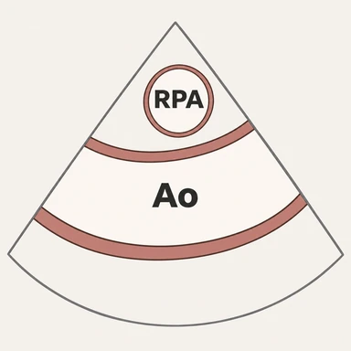

The full illustration and thumbnail are retained byte-for-byte from v54.

**Production checks:** Topology — pass; View identity — pass; Orientation — pass; Labels — pass; Phase — pass; Readability — pass.

#### Original artwork assessment

- Record

  - **Disposition:**

    retain

  - **Severity:**

    none

  - **Finding:**

    Long-axis aortic lumen lies below separate round near-field RPA; normal smooth lumens, no false communication or added valves. Matches exact source composition.

  - **Original asset:**

    `public/assets/reference-views-v54/tee-meaaolax.webp`

  - **Original sha256:**

    `c3b78743ad0dede581cf554b3ec1388ca74b0235cad3fbf60d39032ef3b7c16e`

#### Final assessment

Long-axis aortic lumen lies below separate round near-field RPA; normal smooth lumens, no false communication or added valves. Matches exact source composition.

#### Phase and limits

- **Phase:**

  Static vessel section; no valve state, systolic dimension or diastolic dimension is encoded.

- **Limits:**

  - This is an AI-assisted production/source-comparison review, not independent clinical certification.

  - This is a simplified view-identification schematic. Relative size, wall thickness, leaflet excursion and flow are not quantitative.

  - ASE Table 10 anatomy and echo figures have low native resolution; enlarged crops do not add source detail.

  - Passing the thumbnail gate means major anatomy and labels remain identifiable at 200px and 384px; fine valve/chordal anatomy requires the expanded illustration.

  - Aortic wall is stylized thicker than the RPA wall; not a topology error.

#### Source and exact view

- **Catalogue table:**

  10

- **Catalogue view:**

  7

- **Catalogue source:**

  <https://www.asecho.org/wp-content/uploads/2014/05/2013_Performing-Comprehensive-TEE.pdf>

- **Sources used in this review:**

  - Record

    - **Url:**

      <https://www.asecho.org/wp-content/uploads/2025/04/2013_Performing-Comprehensive-TEE.pdf>

    - **Title:**

      ASE/SCA Guidelines for Performing a Comprehensive Transesophageal Echocardiographic Examination

    - **Publication year:**

      2013

    - **Table:**

      10

    - **View number:**

      7

    - **View name:**

      Midesophageal ascending aorta long-axis

    - **Basis:**

      Exact anatomical section and matching ultrasound reference visually compared.

#### Review scope and evidence

- **Independent review:**

  The independent TEE review agent visually inspected this original at 960px and compared it with newly retrieved ASE Table 10 anatomy/echo references; historical approval was not accepted as evidence. The same agent inspected fresh 200px and 384px resizes. This records a single-agent source comparison for retained artwork, not independent human clinical certification.

- **Full size reviewed:**

  Yes

- **Thumbnail reviewed:**

  Yes

- **Visual review:**

  - **Accepted master dimensions px:**

    - 960

    - 960

  - **Original master reviewed at px:**

    960

  - **Accepted master reviewed at full size:**

    Yes

  - **Accepted master sha256:**

    `c3b78743ad0dede581cf554b3ec1388ca74b0235cad3fbf60d39032ef3b7c16e`

  - **Thumbnail scales px:**

    - 200

    - 384

  - **Resize method:**

    Pillow LANCZOS resampling only; no crop or anatomy edits.

  - **Reviewed on utc date:**

    2026-11-13

  - **Contact sheets:**

    - final-tee-200px-contact-1.png

    - final-tee-384px-contact-1.png

- **Approved final review:**

  - **Status:**

    approved_for_educational_schematic_use

  - **Finding:**

    Long-axis aortic lumen lies below separate round near-field RPA; normal smooth lumens, no false communication or added valves. Matches exact source composition.

  - **Reviewer count:**

    1

  - **Independent human clinical certification:**

    No

- **Gate evidence:**

  - **Topology:**

    Long-axis aortic lumen lies below separate round near-field RPA; normal smooth lumens, no false communication or added valves. Matches exact source composition.

  - **View identity:**

    Compared with ASE 2013 Table 10 view 7 (Midesophageal ascending aorta long-axis); required view-defining profiles are present without an unsupported added chamber or plane.

  - **Orientation:**

    Round RPA profile is near field above a separate elongated aortic lumen.

  - **Labels:**

    - **Visible labels:**

      - RPA

      - Ao

    - **Assessment:**

      All labels occupy the intended blood pool or use a leader to the intended structure. Abbreviations are interpreted in the context of this named view.

  - **Phase:**

    Static vessel section; no valve state, systolic dimension or diastolic dimension is encoded.

  - **Readability:**

    Fresh 200px and 384px copies of the accepted master were visually inspected. Major structures remain distinguishable, all intended labels remain identifiable and no label is clipped or assigned to a wrong chamber. Fine structural interpretation requires the expanded image.

- **Hard failures:**

  None recorded.

#### Preservation and correction constraints

- Keep RPA cross-section separate from elongated aortic lumen.

- Preserve the exact referenced acquisition plane and display orientation; do not mirror the image or substitute a generic heart diagram.

- Keep chamber and vessel connections anatomically appropriate. Do not add muscular caps, blind sacs, false extra chambers or unreferenced structures.

- Distinguish thin valve tissue/coaptation from myocardium; a legitimate closed valve is not an obstruction.

- A closed vessel profile can reflect the imaging plane leaving that vessel. Do not force out-of-plane continuations without source support.

- Keep the existing ivory/terracotta/gray-sector style and labels legible at full and thumbnail sizes; leaders must terminate on the intended structure.

#### Additional notes

- Aortic wall is stylized thicker than the RPA wall; not a topology error.

#### Additional review metadata

- **Uncertainty flag:**

  No

- **Export review:**

  - **Stage:**

    Retained production thumbnail pairing

  - **Status:**

    pass

  - **Files inspected:**

    Actual 384px thumbnail path in the current manifest, displayed at 200px

  - **Reviewer:**

    TEE review agent

  - **Findings:**

    Matched the previously reviewed full-size view identity; no swapped image, corrupted label, unexpected crop or gallery-size label blocker.

<details>
<summary>Exact prompts and authoring history</summary>

Prompts describe requested changes. Historical authoring records do not supersede this review’s findings.

##### Original artwork: provenance location

- **Historical manifest:**

  docs/reference-views-v54/asset-manifest.json

- **Historical master sha256:**

  `aafbeb5a790cc6c026081832d1133be7783e97e729d627c4f5cb03aca66e5410`

- **Note:**

  The immutable historical manifest preserves the original authoring prompts. This report reproduces the exact prompts for this revision’s seven replacements; all current QC findings and retained-view decisions are included above.

</details>

#### Asset identity

| Asset | Path / identity | Pixels | Bytes | SHA-256 |
| --- | --- | --- | --- | --- |
| Original illustration | `public/assets/reference-views-v54/tee-meaaolax.webp` | 960 × 960 | 38,442 | `c3b78743ad0dede581cf554b3ec1388ca74b0235cad3fbf60d39032ef3b7c16e` |
| Current illustration | `public/assets/reference-views-v54/tee-meaaolax.webp` | 960 × 960 | 38,442 | `c3b78743ad0dede581cf554b3ec1388ca74b0235cad3fbf60d39032ef3b7c16e` |
| Original thumbnail | `public/assets/reference-views-v54/thumbs/tee-meaaolax.webp` | 384 × 384 | 11,326 | `56427fede43a9190b056d811f331777820b56fe896dcaa2cd284dd8169a0a26b` |
| Current thumbnail | `public/assets/reference-views-v54/thumbs/tee-meaaolax.webp` | 384 × 384 | 11,326 | `56427fede43a9190b056d811f331777820b56fe896dcaa2cd284dd8169a0a26b` |
| Historical generation master | `Original master PNG hash` | — | — | `aafbeb5a790cc6c026081832d1133be7783e97e729d627c4f5cb03aca66e5410` |

---

### TEE · Midesophageal ascending aorta short-axis

**ID:** `tee:meaaosax` · **Decision:** Retained · **ASE table/view:** 10 / 8

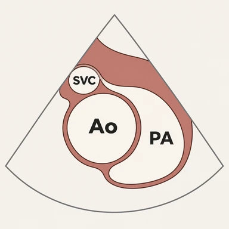

The full illustration and thumbnail are retained byte-for-byte from v54.

**Production checks:** Topology — pass; View identity — pass; Orientation — pass; Labels — pass; Phase — pass; Readability — pass.

#### Original artwork assessment

- Record

  - **Disposition:**

    retain

  - **Severity:**

    none

  - **Finding:**

    Aortic cross-section, smaller SVC cross-section and adjacent longitudinal/crescent PA profile match Table 10 view 8. No labeled vessel joins another incorrectly.

  - **Original asset:**

    `public/assets/reference-views-v54/tee-meaaosax.webp`

  - **Original sha256:**

    `8d3c6fef79e6aa18a3d1b40d769a625136b09d5be110db588830fd720fea27ab`

#### Final assessment

Aortic cross-section, smaller SVC cross-section and adjacent longitudinal/crescent PA profile match Table 10 view 8. No labeled vessel joins another incorrectly.

#### Phase and limits

- **Phase:**

  Static vascular section; no valve motion or timed vessel dimension is encoded.

- **Limits:**

  - This is an AI-assisted production/source-comparison review, not independent clinical certification.

  - This is a simplified view-identification schematic. Relative size, wall thickness, leaflet excursion and flow are not quantitative.

  - ASE Table 10 anatomy and echo figures have low native resolution; enlarged crops do not add source detail.

  - Passing the thumbnail gate means major anatomy and labels remain identifiable at 200px and 384px; fine valve/chordal anatomy requires the expanded illustration.

  - Terracotta perivascular region is heavier than ideal; this is a style limitation rather than demonstrated abnormal myocardium.

#### Source and exact view

- **Catalogue table:**

  10

- **Catalogue view:**

  8

- **Catalogue source:**

  <https://www.asecho.org/wp-content/uploads/2014/05/2013_Performing-Comprehensive-TEE.pdf>

- **Sources used in this review:**

  - Record

    - **Url:**

      <https://www.asecho.org/wp-content/uploads/2025/04/2013_Performing-Comprehensive-TEE.pdf>

    - **Title:**

      ASE/SCA Guidelines for Performing a Comprehensive Transesophageal Echocardiographic Examination

    - **Publication year:**

      2013

    - **Table:**

      10

    - **View number:**

      8

    - **View name:**

      Midesophageal ascending aorta short-axis

    - **Basis:**

      Exact anatomical section and matching ultrasound reference visually compared.

#### Review scope and evidence

- **Independent review:**

  The independent TEE review agent visually inspected this original at 960px and compared it with newly retrieved ASE Table 10 anatomy/echo references; historical approval was not accepted as evidence. The same agent inspected fresh 200px and 384px resizes. This records a single-agent source comparison for retained artwork, not independent human clinical certification.

- **Full size reviewed:**

  Yes

- **Thumbnail reviewed:**

  Yes

- **Visual review:**

  - **Accepted master dimensions px:**

    - 960

    - 960

  - **Original master reviewed at px:**

    960

  - **Accepted master reviewed at full size:**

    Yes

  - **Accepted master sha256:**

    `8d3c6fef79e6aa18a3d1b40d769a625136b09d5be110db588830fd720fea27ab`

  - **Thumbnail scales px:**

    - 200

    - 384

  - **Resize method:**

    Pillow LANCZOS resampling only; no crop or anatomy edits.

  - **Reviewed on utc date:**

    2026-11-13

  - **Contact sheets:**

    - final-tee-200px-contact-1.png

    - final-tee-384px-contact-1.png

- **Approved final review:**

  - **Status:**

    approved_for_educational_schematic_use

  - **Finding:**

    Aortic cross-section, smaller SVC cross-section and adjacent longitudinal/crescent PA profile match Table 10 view 8. No labeled vessel joins another incorrectly.

  - **Reviewer count:**

    1

  - **Independent human clinical certification:**

    No

- **Gate evidence:**

  - **Topology:**

    Aortic cross-section, smaller SVC cross-section and adjacent longitudinal/crescent PA profile match Table 10 view 8. No labeled vessel joins another incorrectly.

  - **View identity:**

    Compared with ASE 2013 Table 10 view 8 (Midesophageal ascending aorta short-axis); required view-defining profiles are present without an unsupported added chamber or plane.

  - **Orientation:**

    Round Ao section, smaller SVC to upper-left and crescent/longitudinal PA to screen-right match the exact reference slice.

  - **Labels:**

    - **Visible labels:**

      - SVC

      - Ao

      - PA

    - **Assessment:**

      All labels occupy the intended blood pool or use a leader to the intended structure. Abbreviations are interpreted in the context of this named view.

  - **Phase:**

    Static vascular section; no valve motion or timed vessel dimension is encoded.

  - **Readability:**

    Fresh 200px and 384px copies of the accepted master were visually inspected. Major structures remain distinguishable, all intended labels remain identifiable and no label is clipped or assigned to a wrong chamber. Fine structural interpretation requires the expanded image.

- **Hard failures:**

  None recorded.

#### Preservation and correction constraints

- Preserve vessel-plane orientation and separate lumens.

- Preserve the exact referenced acquisition plane and display orientation; do not mirror the image or substitute a generic heart diagram.

- Keep chamber and vessel connections anatomically appropriate. Do not add muscular caps, blind sacs, false extra chambers or unreferenced structures.

- Distinguish thin valve tissue/coaptation from myocardium; a legitimate closed valve is not an obstruction.

- A closed vessel profile can reflect the imaging plane leaving that vessel. Do not force out-of-plane continuations without source support.

- Keep the existing ivory/terracotta/gray-sector style and labels legible at full and thumbnail sizes; leaders must terminate on the intended structure.

#### Reconsidered concerns

- The crescent PA looked like a closed banana on initial inspection. Exact source depicts this bounded section; no unsupported tube extension should be imposed.

#### Additional notes

- Terracotta perivascular region is heavier than ideal; this is a style limitation rather than demonstrated abnormal myocardium.

#### Additional review metadata

- **Uncertainty flag:**

  No

- **Export review:**

  - **Stage:**

    Retained production thumbnail pairing

  - **Status:**

    pass

  - **Files inspected:**

    Actual 384px thumbnail path in the current manifest, displayed at 200px

  - **Reviewer:**

    TEE review agent

  - **Findings:**

    Matched the previously reviewed full-size view identity; no swapped image, corrupted label, unexpected crop or gallery-size label blocker.

<details>
<summary>Exact prompts and authoring history</summary>

Prompts describe requested changes. Historical authoring records do not supersede this review’s findings.

##### Original artwork: provenance location

- **Historical manifest:**

  docs/reference-views-v54/asset-manifest.json

- **Historical master sha256:**

  `389b1064315116b827de4615fd0c5bc21595ea207360dad17f9fbd7198713d40`

- **Note:**

  The immutable historical manifest preserves the original authoring prompts. This report reproduces the exact prompts for this revision’s seven replacements; all current QC findings and retained-view decisions are included above.

</details>

#### Asset identity

| Asset | Path / identity | Pixels | Bytes | SHA-256 |
| --- | --- | --- | --- | --- |
| Original illustration | `public/assets/reference-views-v54/tee-meaaosax.webp` | 960 × 960 | 41,762 | `8d3c6fef79e6aa18a3d1b40d769a625136b09d5be110db588830fd720fea27ab` |
| Current illustration | `public/assets/reference-views-v54/tee-meaaosax.webp` | 960 × 960 | 41,762 | `8d3c6fef79e6aa18a3d1b40d769a625136b09d5be110db588830fd720fea27ab` |
| Original thumbnail | `public/assets/reference-views-v54/thumbs/tee-meaaosax.webp` | 384 × 384 | 12,638 | `399d43d75e9ffc482e614230bdbcb31f655ad11799d9f6115534bfa51f2153b8` |
| Current thumbnail | `public/assets/reference-views-v54/thumbs/tee-meaaosax.webp` | 384 × 384 | 12,638 | `399d43d75e9ffc482e614230bdbcb31f655ad11799d9f6115534bfa51f2153b8` |
| Historical generation master | `Original master PNG hash` | — | — | `389b1064315116b827de4615fd0c5bc21595ea207360dad17f9fbd7198713d40` |

---

### TEE · Midesophageal right pulmonary vein

**ID:** `tee:merpv` · **Decision:** Retained · **ASE table/view:** 10 / 9

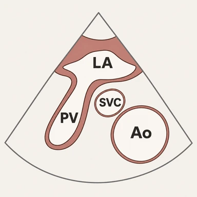

The full illustration and thumbnail are retained byte-for-byte from v54.

**Production checks:** Topology — pass; View identity — pass; Orientation — pass; Labels — pass; Phase — pass; Readability — pass.

#### Original artwork assessment

- Record

  - **Disposition:**

    retain

  - **Severity:**

    none

  - **Finding:**

    Near-field atrial/pulmonary venous profile with separate SVC and Ao cross-sections agrees with exact Table 10 view 9. No valve in the pulmonary vein; LA-to-PV junction is open.

  - **Original asset:**

    `public/assets/reference-views-v54/tee-merpv.webp`

  - **Original sha256:**

    `cf08a88d38c54f3edebf03fe7cb145f279c0d201b512f8246f3fe1625cf518c5`

#### Final assessment

Near-field atrial/pulmonary venous profile with separate SVC and Ao cross-sections agrees with exact Table 10 view 9. No valve in the pulmonary vein; LA-to-PV junction is open.

#### Phase and limits

- **Phase:**

  Static pulmonary-venous acquisition section; no venous valve or cardiac-phase-specific flow is represented.

- **Limits:**

  - This is an AI-assisted production/source-comparison review, not independent clinical certification.

  - This is a simplified view-identification schematic. Relative size, wall thickness, leaflet excursion and flow are not quantitative.

  - ASE Table 10 anatomy and echo figures have low native resolution; enlarged crops do not add source detail.

  - Passing the thumbnail gate means major anatomy and labels remain identifiable at 200px and 384px; fine valve/chordal anatomy requires the expanded illustration.

  - PV abbreviation is context dependent and should be expanded as pulmonary vein in surrounding UI text; this is not a claim that both right-vein ostia are fully characterized in one icon.

  - PV means pulmonary vein in this view; it must not be expanded as pulmonary valve.

#### Source and exact view

- **Catalogue table:**

  10

- **Catalogue view:**

  9

- **Catalogue source:**

  <https://www.asecho.org/wp-content/uploads/2014/05/2013_Performing-Comprehensive-TEE.pdf>

- **Sources used in this review:**

  - Record

    - **Url:**

      <https://www.asecho.org/wp-content/uploads/2025/04/2013_Performing-Comprehensive-TEE.pdf>

    - **Title:**

      ASE/SCA Guidelines for Performing a Comprehensive Transesophageal Echocardiographic Examination

    - **Publication year:**

      2013

    - **Table:**

      10

    - **View number:**

      9

    - **View name:**

      Midesophageal right pulmonary vein

    - **Basis:**

      Exact anatomical section and matching ultrasound reference visually compared.

#### Review scope and evidence

- **Independent review:**

  The independent TEE review agent visually inspected this original at 960px and compared it with newly retrieved ASE Table 10 anatomy/echo references; historical approval was not accepted as evidence. The same agent inspected fresh 200px and 384px resizes. This records a single-agent source comparison for retained artwork, not independent human clinical certification.

- **Full size reviewed:**

  Yes

- **Thumbnail reviewed:**

  Yes

- **Visual review:**

  - **Accepted master dimensions px:**

    - 960

    - 960

  - **Original master reviewed at px:**

    960

  - **Accepted master reviewed at full size:**

    Yes

  - **Accepted master sha256:**

    `cf08a88d38c54f3edebf03fe7cb145f279c0d201b512f8246f3fe1625cf518c5`

  - **Thumbnail scales px:**

    - 200

    - 384

  - **Resize method:**

    Pillow LANCZOS resampling only; no crop or anatomy edits.

  - **Reviewed on utc date:**

    2026-11-13

  - **Contact sheets:**

    - final-tee-200px-contact-1.png

    - final-tee-384px-contact-1.png

- **Approved final review:**

  - **Status:**

    approved_for_educational_schematic_use

  - **Finding:**

    Near-field atrial/pulmonary venous profile with separate SVC and Ao cross-sections agrees with exact Table 10 view 9. No valve in the pulmonary vein; LA-to-PV junction is open.

  - **Reviewer count:**

    1

  - **Independent human clinical certification:**

    No

- **Gate evidence:**

  - **Topology:**

    Near-field atrial/pulmonary venous profile with separate SVC and Ao cross-sections agrees with exact Table 10 view 9. No valve in the pulmonary vein; LA-to-PV junction is open.

  - **View identity:**

    Compared with ASE 2013 Table 10 view 9 (Midesophageal right pulmonary vein); required view-defining profiles are present without an unsupported added chamber or plane.

  - **Orientation:**

    LA/pulmonary venous section is near/left, with separate SVC and Ao circular profiles deeper/right, as in the source.

  - **Labels:**

    - **Visible labels:**

      - LA

      - PV

      - SVC

      - Ao

    - **Assessment:**

      All labels occupy the intended blood pool or use a leader to the intended structure. Abbreviations are interpreted in the context of this named view.

  - **Phase:**

    Static pulmonary-venous acquisition section; no venous valve or cardiac-phase-specific flow is represented.

  - **Readability:**

    Fresh 200px and 384px copies of the accepted master were visually inspected. Major structures remain distinguishable, all intended labels remain identifiable and no label is clipped or assigned to a wrong chamber. Fine structural interpretation requires the expanded image.

- **Hard failures:**

  None recorded.

#### Preservation and correction constraints

- Keep pulmonary vein connected to LA, SVC/Ao separate.

- Any future label expansion to RUPV/RLPV requires a separately verified exact plane.

- Preserve the exact referenced acquisition plane and display orientation; do not mirror the image or substitute a generic heart diagram.

- Keep chamber and vessel connections anatomically appropriate. Do not add muscular caps, blind sacs, false extra chambers or unreferenced structures.

- Distinguish thin valve tissue/coaptation from myocardium; a legitimate closed valve is not an obstruction.

- A closed vessel profile can reflect the imaging plane leaving that vessel. Do not force out-of-plane continuations without source support.

- Keep the existing ivory/terracotta/gray-sector style and labels legible at full and thumbnail sizes; leaders must terminate on the intended structure.

#### Reconsidered concerns

- Initially flagged finger-like distal PV contour as a blind vein. Exact anatomical source has the same contour. A vessel leaving the plane must not be called obstruction or forcibly extended.

#### Additional review metadata

- **Uncertainty flag:**

  Yes

- **Export review:**

  - **Stage:**

    Retained production thumbnail pairing

  - **Status:**

    pass

  - **Files inspected:**

    Actual 384px thumbnail path in the current manifest, displayed at 200px

  - **Reviewer:**

    TEE review agent

  - **Findings:**

    Matched the previously reviewed full-size view identity; no swapped image, corrupted label, unexpected crop or gallery-size label blocker.

<details>
<summary>Exact prompts and authoring history</summary>

Prompts describe requested changes. Historical authoring records do not supersede this review’s findings.

##### Original artwork: provenance location

- **Historical manifest:**

  docs/reference-views-v54/asset-manifest.json

- **Historical master sha256:**

  `cb6f0dfb8cccf7cf49f4ed9f3bbed9e724b8c6c56a014e9b5ec85bd9f35cabb1`

- **Note:**

  The immutable historical manifest preserves the original authoring prompts. This report reproduces the exact prompts for this revision’s seven replacements; all current QC findings and retained-view decisions are included above.

</details>

#### Asset identity

| Asset | Path / identity | Pixels | Bytes | SHA-256 |
| --- | --- | --- | --- | --- |
| Original illustration | `public/assets/reference-views-v54/tee-merpv.webp` | 960 × 960 | 47,634 | `cf08a88d38c54f3edebf03fe7cb145f279c0d201b512f8246f3fe1625cf518c5` |
| Current illustration | `public/assets/reference-views-v54/tee-merpv.webp` | 960 × 960 | 47,634 | `cf08a88d38c54f3edebf03fe7cb145f279c0d201b512f8246f3fe1625cf518c5` |
| Original thumbnail | `public/assets/reference-views-v54/thumbs/tee-merpv.webp` | 384 × 384 | 14,598 | `20dbcccd06a4a4fe2a759007f8f98b77aba7302542a9252fad709d303cc93800` |
| Current thumbnail | `public/assets/reference-views-v54/thumbs/tee-merpv.webp` | 384 × 384 | 14,598 | `20dbcccd06a4a4fe2a759007f8f98b77aba7302542a9252fad709d303cc93800` |
| Historical generation master | `Original master PNG hash` | — | — | `cb6f0dfb8cccf7cf49f4ed9f3bbed9e724b8c6c56a014e9b5ec85bd9f35cabb1` |

---

### TEE · Midesophageal aortic valve short-axis

**ID:** `tee:meavsax` · **Decision:** Retained · **ASE table/view:** 10 / 10

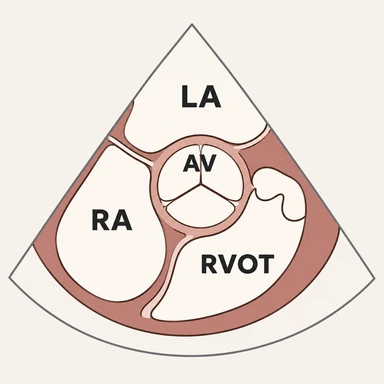

The full illustration and thumbnail are retained byte-for-byte from v54.

**Production checks:** Topology — pass; View identity — pass; Orientation — pass; Labels — pass; Phase — pass; Readability — pass.

#### Original artwork assessment

- Record

  - **Disposition:**

    retain

  - **Severity:**

    minor

  - **Finding:**

    Three-cusp AV pattern, near-field LA, left RA and right/far-field RVOT agree with the standard view. Target AV is recognizable. Secondary pulmonic outline is simplified but source-consistent.

  - **Original asset:**

    `public/assets/reference-views-v54/tee-meavsax.webp`

  - **Original sha256:**

    `2d934e7f1a3740cf9953cb761d23ea5bdbe2a4ac45f6f1e6b4118609907a43bd`

#### Final assessment

Three-cusp AV pattern, near-field LA, left RA and right/far-field RVOT agree with the standard view. Target AV is recognizable. Secondary pulmonic outline is simplified but source-consistent.

#### Phase and limits

- **Phase:**

  Aortic cusp profiles form a closed-valve three-way coaptation pattern. This illustrative state is not a quantitative assessment of valve opening or timing.

- **Limits:**

  - This is an AI-assisted production/source-comparison review, not independent clinical certification.

  - This is a simplified view-identification schematic. Relative size, wall thickness, leaflet excursion and flow are not quantitative.

  - ASE Table 10 anatomy and echo figures have low native resolution; enlarged crops do not add source detail.

  - Passing the thumbnail gate means major anatomy and labels remain identifiable at 200px and 384px; fine valve/chordal anatomy requires the expanded illustration.

  - AV text lies close to the upper coaptation line. A future optional label move could expose more cusp detail, but central three-cusp junction remains visible.

  - At 200px the central three-way cusp junction remains identifiable despite the nearby AV text; the thumbnail is not a detailed cusp-nomenclature teaching panel.

#### Source and exact view

- **Catalogue table:**

  10

- **Catalogue view:**

  10

- **Catalogue source:**

  <https://www.asecho.org/wp-content/uploads/2014/05/2013_Performing-Comprehensive-TEE.pdf>

- **Sources used in this review:**

  - Record

    - **Url:**

      <https://www.asecho.org/wp-content/uploads/2025/04/2013_Performing-Comprehensive-TEE.pdf>

    - **Title:**

      ASE/SCA Guidelines for Performing a Comprehensive Transesophageal Echocardiographic Examination

    - **Publication year:**

      2013

    - **Table:**

      10

    - **View number:**

      10

    - **View name:**

      Midesophageal aortic valve short-axis

    - **Basis:**

      Exact anatomical section and matching ultrasound reference visually compared.

#### Review scope and evidence

- **Independent review:**

  The independent TEE review agent visually inspected this original at 960px and compared it with newly retrieved ASE Table 10 anatomy/echo references; historical approval was not accepted as evidence. The same agent inspected fresh 200px and 384px resizes. This records a single-agent source comparison for retained artwork, not independent human clinical certification.

- **Full size reviewed:**

  Yes

- **Thumbnail reviewed:**

  Yes

- **Visual review:**

  - **Accepted master dimensions px:**

    - 960

    - 960

  - **Original master reviewed at px:**

    960

  - **Accepted master reviewed at full size:**

    Yes

  - **Accepted master sha256:**

    `2d934e7f1a3740cf9953cb761d23ea5bdbe2a4ac45f6f1e6b4118609907a43bd`

  - **Thumbnail scales px:**

    - 200

    - 384

  - **Resize method:**

    Pillow LANCZOS resampling only; no crop or anatomy edits.

  - **Reviewed on utc date:**

    2026-11-13

  - **Contact sheets:**

    - final-tee-200px-contact-1.png

    - final-tee-384px-contact-1.png

- **Approved final review:**

  - **Status:**

    approved_for_educational_schematic_use

  - **Finding:**

    Three-cusp AV pattern, near-field LA, left RA and right/far-field RVOT agree with the standard view. Target AV is recognizable. Secondary pulmonic outline is simplified but source-consistent.

  - **Reviewer count:**

    1

  - **Independent human clinical certification:**

    No

- **Gate evidence:**

  - **Topology:**

    Three-cusp AV pattern, near-field LA, left RA and right/far-field RVOT agree with the standard view. Target AV is recognizable. Secondary pulmonic outline is simplified but source-consistent.

  - **View identity:**

    Compared with ASE 2013 Table 10 view 10 (Midesophageal aortic valve short-axis); required view-defining profiles are present without an unsupported added chamber or plane.

  - **Orientation:**

    LA near field, RA screen-left, three-cusp AV central and RVOT deeper/right.

  - **Labels:**

    - **Visible labels:**

      - LA

      - AV

      - RA

      - RVOT

    - **Assessment:**

      All labels occupy the intended blood pool or use a leader to the intended structure. Abbreviations are interpreted in the context of this named view.

  - **Phase:**

    Aortic cusp profiles form a closed-valve three-way coaptation pattern. This illustrative state is not a quantitative assessment of valve opening or timing.

  - **Readability:**

    Fresh 200px and 384px copies of the accepted master were visually inspected. Major structures remain distinguishable, all intended labels remain identifiable and no label is clipped or assigned to a wrong chamber. Fine structural interpretation requires the expanded image. The nearby AV label leaves the central three-cusp junction identifiable.

- **Hard failures:**

  None recorded.

#### Preservation and correction constraints

- If revising labels, keep all three cusp boundaries clear; do not move valve geometry or invent a fourth cusp.

- Preserve the exact referenced acquisition plane and display orientation; do not mirror the image or substitute a generic heart diagram.

- Keep chamber and vessel connections anatomically appropriate. Do not add muscular caps, blind sacs, false extra chambers or unreferenced structures.

- Distinguish thin valve tissue/coaptation from myocardium; a legitimate closed valve is not an obstruction.

- A closed vessel profile can reflect the imaging plane leaving that vessel. Do not force out-of-plane continuations without source support.

- Keep the existing ivory/terracotta/gray-sector style and labels legible at full and thumbnail sizes; leaders must terminate on the intended structure.

#### Reconsidered concerns

- The lobulated far-field RVOT endpoint resembles the source pulmonary-valve region; not enough evidence to label it atresia or a closed outflow.

#### Additional notes

- AV text lies close to the upper coaptation line. A future optional label move could expose more cusp detail, but central three-cusp junction remains visible.

#### Additional review metadata

- **Uncertainty flag:**

  No

- **Export review:**

  - **Stage:**

    Retained production thumbnail pairing

  - **Status:**

    pass

  - **Files inspected:**

    Actual 384px thumbnail path in the current manifest, displayed at 200px

  - **Reviewer:**

    TEE review agent

  - **Findings:**

    Matched the previously reviewed full-size view identity; no swapped image, corrupted label, unexpected crop or gallery-size label blocker.

<details>
<summary>Exact prompts and authoring history</summary>

Prompts describe requested changes. Historical authoring records do not supersede this review’s findings.

##### Original artwork: provenance location

- **Historical manifest:**

  docs/reference-views-v54/asset-manifest.json

- **Historical master sha256:**

  `aa820066aaca4b0b506ed771b66b397e992d4e29fedf58fdef48f294706ac31e`

- **Note:**

  The immutable historical manifest preserves the original authoring prompts. This report reproduces the exact prompts for this revision’s seven replacements; all current QC findings and retained-view decisions are included above.

</details>

#### Asset identity

| Asset | Path / identity | Pixels | Bytes | SHA-256 |
| --- | --- | --- | --- | --- |
| Original illustration | `public/assets/reference-views-v54/tee-meavsax.webp` | 960 × 960 | 51,812 | `2d934e7f1a3740cf9953cb761d23ea5bdbe2a4ac45f6f1e6b4118609907a43bd` |
| Current illustration | `public/assets/reference-views-v54/tee-meavsax.webp` | 960 × 960 | 51,812 | `2d934e7f1a3740cf9953cb761d23ea5bdbe2a4ac45f6f1e6b4118609907a43bd` |
| Original thumbnail | `public/assets/reference-views-v54/thumbs/tee-meavsax.webp` | 384 × 384 | 15,584 | `8b09845292df913875545b4654537a7ef7d68ebb3d865a6c26e72eaa09fcbcef` |
| Current thumbnail | `public/assets/reference-views-v54/thumbs/tee-meavsax.webp` | 384 × 384 | 15,584 | `8b09845292df913875545b4654537a7ef7d68ebb3d865a6c26e72eaa09fcbcef` |
| Historical generation master | `Original master PNG hash` | — | — | `aa820066aaca4b0b506ed771b66b397e992d4e29fedf58fdef48f294706ac31e` |

---

### TEE · Midesophageal RV inflow-outflow

**ID:** `tee:mervinout` · **Decision:** Retained · **ASE table/view:** 10 / 11

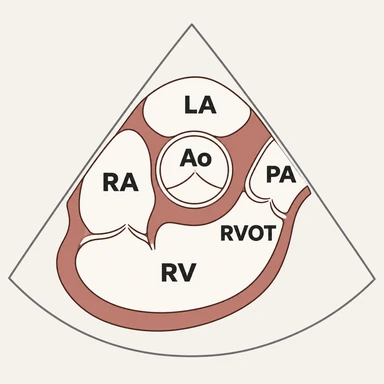

The full illustration and thumbnail are retained byte-for-byte from v54.

**Production checks:** Topology — pass; View identity — pass; Orientation — pass; Labels — pass; Phase — pass; Readability — pass.

#### Original artwork assessment

- Record

  - **Disposition:**

    retain

  - **Severity:**

    none

  - **Finding:**

    RA through TV to RV and RV through RVOT/PV to PA are correctly laid out; RV and RVOT are one continuous cavity. LA and central aortic section remain separate. Matches source.

  - **Original asset:**

    `public/assets/reference-views-v54/tee-mervinout.webp`

  - **Original sha256:**

    `bc0ede210921547c0107eb81b7f7975435887c02da52fa94bbd961a6f8096a24`

#### Final assessment

RA through TV to RV and RV through RVOT/PV to PA are correctly laid out; RV and RVOT are one continuous cavity. LA and central aortic section remain separate. Matches source.

#### Phase and limits

- **Phase:**

  Static right-heart inflow/outflow section with simplified tricuspid, aortic and pulmonic profiles. It does not claim a measured synchronized phase or reproduce valve kinetics.

- **Limits:**

  - This is an AI-assisted production/source-comparison review, not independent clinical certification.

  - This is a simplified view-identification schematic. Relative size, wall thickness, leaflet excursion and flow are not quantitative.

  - ASE Table 10 anatomy and echo figures have low native resolution; enlarged crops do not add source detail.

  - Passing the thumbnail gate means major anatomy and labels remain identifiable at 200px and 384px; fine valve/chordal anatomy requires the expanded illustration.

#### Source and exact view

- **Catalogue table:**

  10

- **Catalogue view:**

  11

- **Catalogue source:**

  <https://www.asecho.org/wp-content/uploads/2014/05/2013_Performing-Comprehensive-TEE.pdf>

- **Sources used in this review:**

  - Record

    - **Url:**

      <https://www.asecho.org/wp-content/uploads/2025/04/2013_Performing-Comprehensive-TEE.pdf>

    - **Title:**

      ASE/SCA Guidelines for Performing a Comprehensive Transesophageal Echocardiographic Examination

    - **Publication year:**

      2013

    - **Table:**

      10

    - **View number:**

      11

    - **View name:**

      Midesophageal RV inflow-outflow

    - **Basis:**

      Exact anatomical section and matching ultrasound reference visually compared.

#### Review scope and evidence

- **Independent review:**

  The independent TEE review agent visually inspected this original at 960px and compared it with newly retrieved ASE Table 10 anatomy/echo references; historical approval was not accepted as evidence. The same agent inspected fresh 200px and 384px resizes. This records a single-agent source comparison for retained artwork, not independent human clinical certification.

- **Full size reviewed:**

  Yes

- **Thumbnail reviewed:**

  Yes

- **Visual review:**

  - **Accepted master dimensions px:**

    - 960

    - 960

  - **Original master reviewed at px:**

    960

  - **Accepted master reviewed at full size:**

    Yes

  - **Accepted master sha256:**

    `bc0ede210921547c0107eb81b7f7975435887c02da52fa94bbd961a6f8096a24`

  - **Thumbnail scales px:**

    - 200

    - 384

  - **Resize method:**

    Pillow LANCZOS resampling only; no crop or anatomy edits.

  - **Reviewed on utc date:**

    2026-11-13

  - **Contact sheets:**

    - final-tee-200px-contact-1.png

    - final-tee-384px-contact-1.png

- **Approved final review:**

  - **Status:**

    approved_for_educational_schematic_use

  - **Finding:**

    RA through TV to RV and RV through RVOT/PV to PA are correctly laid out; RV and RVOT are one continuous cavity. LA and central aortic section remain separate. Matches source.

  - **Reviewer count:**

    1

  - **Independent human clinical certification:**

    No

- **Gate evidence:**

  - **Topology:**

    RA through TV to RV and RV through RVOT/PV to PA are correctly laid out; RV and RVOT are one continuous cavity. LA and central aortic section remain separate. Matches source.

  - **View identity:**

    Compared with ASE 2013 Table 10 view 11 (Midesophageal RV inflow-outflow); required view-defining profiles are present without an unsupported added chamber or plane.

  - **Orientation:**

    RA/TV/RV lie left/lower, central aortic cross-section above RV, and RVOT leads toward PA at screen-right.

  - **Labels:**

    - **Visible labels:**

      - LA

      - Ao

      - RA

      - RV

      - PA

      - RVOT

    - **Assessment:**

      All labels occupy the intended blood pool or use a leader to the intended structure. Abbreviations are interpreted in the context of this named view.

  - **Phase:**

    Static right-heart inflow/outflow section with simplified tricuspid, aortic and pulmonic profiles. It does not claim a measured synchronized phase or reproduce valve kinetics.

  - **Readability:**

    Fresh 200px and 384px copies of the accepted master were visually inspected. Major structures remain distinguishable, all intended labels remain identifiable and no label is clipped or assigned to a wrong chamber. Fine structural interpretation requires the expanded image.

- **Hard failures:**

  None recorded.

#### Preservation and correction constraints

- No partition may be added between RV and RVOT.

- Maintain correct TV and PV locations.

- Preserve the exact referenced acquisition plane and display orientation; do not mirror the image or substitute a generic heart diagram.

- Keep chamber and vessel connections anatomically appropriate. Do not add muscular caps, blind sacs, false extra chambers or unreferenced structures.

- Distinguish thin valve tissue/coaptation from myocardium; a legitimate closed valve is not an obstruction.

- A closed vessel profile can reflect the imaging plane leaving that vessel. Do not force out-of-plane continuations without source support.

- Keep the existing ivory/terracotta/gray-sector style and labels legible at full and thumbnail sizes; leaders must terminate on the intended structure.

#### Additional review metadata

- **Uncertainty flag:**

  No

- **Export review:**

  - **Stage:**

    Retained production thumbnail pairing

  - **Status:**

    pass

  - **Files inspected:**

    Actual 384px thumbnail path in the current manifest, displayed at 200px

  - **Reviewer:**

    TEE review agent

  - **Findings:**

    Matched the previously reviewed full-size view identity; no swapped image, corrupted label, unexpected crop or gallery-size label blocker.

<details>
<summary>Exact prompts and authoring history</summary>

Prompts describe requested changes. Historical authoring records do not supersede this review’s findings.

##### Original artwork: provenance location

- **Historical manifest:**

  docs/reference-views-v54/asset-manifest.json

- **Historical master sha256:**

  `b58356fe03597de3979b196e630354324baeffd5b4a30edf156eac1bf2646876`

- **Note:**

  The immutable historical manifest preserves the original authoring prompts. This report reproduces the exact prompts for this revision’s seven replacements; all current QC findings and retained-view decisions are included above.

</details>

#### Asset identity

| Asset | Path / identity | Pixels | Bytes | SHA-256 |
| --- | --- | --- | --- | --- |
| Original illustration | `public/assets/reference-views-v54/tee-mervinout.webp` | 960 × 960 | 53,722 | `bc0ede210921547c0107eb81b7f7975435887c02da52fa94bbd961a6f8096a24` |
| Current illustration | `public/assets/reference-views-v54/tee-mervinout.webp` | 960 × 960 | 53,722 | `bc0ede210921547c0107eb81b7f7975435887c02da52fa94bbd961a6f8096a24` |
| Original thumbnail | `public/assets/reference-views-v54/thumbs/tee-mervinout.webp` | 384 × 384 | 16,184 | `c8836cd778bea05f82bfeaeb4554aa77887fb78c597222319d4a99dd3dc9d2c6` |
| Current thumbnail | `public/assets/reference-views-v54/thumbs/tee-mervinout.webp` | 384 × 384 | 16,184 | `c8836cd778bea05f82bfeaeb4554aa77887fb78c597222319d4a99dd3dc9d2c6` |
| Historical generation master | `Original master PNG hash` | — | — | `b58356fe03597de3979b196e630354324baeffd5b4a30edf156eac1bf2646876` |

---

### TEE · Midesophageal modified bicaval tricuspid valve

**ID:** `tee:memodbicaval` · **Decision:** Retained · **ASE table/view:** 10 / 12

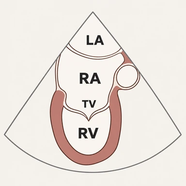

The full illustration and thumbnail are retained byte-for-byte from v54.

**Production checks:** Topology — pass; View identity — pass; Orientation — pass; Labels — pass; Phase — pass; Readability — pass.

#### Original artwork assessment

- Record

  - **Disposition:**

    retain

  - **Severity:**

    none

  - **Finding:**

    LA in near field separated from RA; TV separates RA and RV; accompanying round vessel profile is left unlabeled rather than assigned an unsupported identity. Geometry agrees with exact source.

  - **Original asset:**

    `public/assets/reference-views-v54/tee-memodbicaval.webp`

  - **Original sha256:**

    `ee4a5045c750c1de1ca992f9c65754875947e07d3f9af61c28a8f911a518642f`

#### Final assessment

LA in near field separated from RA; TV separates RA and RV; accompanying round vessel profile is left unlabeled rather than assigned an unsupported identity. Geometry agrees with exact source.

#### Phase and limits

- **Phase:**

  Static schematic with thin tricuspid leaflet profiles at the RA-RV junction. No measured cardiac phase or quantitative excursion is asserted.

- **Limits:**

  - This is an AI-assisted production/source-comparison review, not independent clinical certification.

  - This is a simplified view-identification schematic. Relative size, wall thickness, leaflet excursion and flow are not quantitative.

  - ASE Table 10 anatomy and echo figures have low native resolution; enlarged crops do not add source detail.

  - Passing the thumbnail gate means major anatomy and labels remain identifiable at 200px and 384px; fine valve/chordal anatomy requires the expanded illustration.

  - The secondary round structure is intentionally unlabeled; the simplified image does not convey every venous structure that may be assessed during a modified bicaval acquisition.

#### Source and exact view

- **Catalogue table:**

  10

- **Catalogue view:**

  12

- **Catalogue source:**

  <https://www.asecho.org/wp-content/uploads/2014/05/2013_Performing-Comprehensive-TEE.pdf>

- **Sources used in this review:**

  - Record

    - **Url:**

      <https://www.asecho.org/wp-content/uploads/2025/04/2013_Performing-Comprehensive-TEE.pdf>

    - **Title:**

      ASE/SCA Guidelines for Performing a Comprehensive Transesophageal Echocardiographic Examination

    - **Publication year:**

      2013

    - **Table:**

      10

    - **View number:**

      12

    - **View name:**

      Midesophageal modified bicaval tricuspid valve

    - **Basis:**

      Exact anatomical section and matching ultrasound reference visually compared.

#### Review scope and evidence

- **Independent review:**

  The independent TEE review agent visually inspected this original at 960px and compared it with newly retrieved ASE Table 10 anatomy/echo references; historical approval was not accepted as evidence. The same agent inspected fresh 200px and 384px resizes. This records a single-agent source comparison for retained artwork, not independent human clinical certification.

- **Full size reviewed:**

  Yes

- **Thumbnail reviewed:**

  Yes

- **Visual review:**

  - **Accepted master dimensions px:**

    - 960

    - 960

  - **Original master reviewed at px:**

    960

  - **Accepted master reviewed at full size:**

    Yes

  - **Accepted master sha256:**

    `ee4a5045c750c1de1ca992f9c65754875947e07d3f9af61c28a8f911a518642f`

  - **Thumbnail scales px:**

    - 200

    - 384

  - **Resize method:**

    Pillow LANCZOS resampling only; no crop or anatomy edits.

  - **Reviewed on utc date:**

    2026-11-13

  - **Contact sheets:**

    - final-tee-200px-contact-1.png

    - final-tee-384px-contact-1.png

- **Approved final review:**

  - **Status:**

    approved_for_educational_schematic_use

  - **Finding:**

    LA in near field separated from RA; TV separates RA and RV; accompanying round vessel profile is left unlabeled rather than assigned an unsupported identity. Geometry agrees with exact source.

  - **Reviewer count:**

    1

  - **Independent human clinical certification:**

    No

- **Gate evidence:**

  - **Topology:**

    LA in near field separated from RA; TV separates RA and RV; accompanying round vessel profile is left unlabeled rather than assigned an unsupported identity. Geometry agrees with exact source.

  - **View identity:**

    Compared with ASE 2013 Table 10 view 12 (Midesophageal modified bicaval tricuspid valve); required view-defining profiles are present without an unsupported added chamber or plane.

  - **Orientation:**

    LA lies near field, RA below, TV and RV deeper; the accompanying round structure is left unlabeled.

  - **Labels:**

    - **Visible labels:**

      - LA

      - RA

      - TV

      - RV

    - **Assessment:**

      All labels occupy the intended blood pool or use a leader to the intended structure. Abbreviations are interpreted in the context of this named view.

  - **Phase:**

    Static schematic with thin tricuspid leaflet profiles at the RA-RV junction. No measured cardiac phase or quantitative excursion is asserted.

  - **Readability:**

    Fresh 200px and 384px copies of the accepted master were visually inspected. Major structures remain distinguishable, all intended labels remain identifiable and no label is clipped or assigned to a wrong chamber. Fine structural interpretation requires the expanded image.

- **Hard failures:**

  None recorded.

#### Preservation and correction constraints

- Do not add an IVC label to the unlabeled circle without proving its identity.

- Preserve the exact referenced acquisition plane and display orientation; do not mirror the image or substitute a generic heart diagram.

- Keep chamber and vessel connections anatomically appropriate. Do not add muscular caps, blind sacs, false extra chambers or unreferenced structures.

- Distinguish thin valve tissue/coaptation from myocardium; a legitimate closed valve is not an obstruction.

- A closed vessel profile can reflect the imaging plane leaving that vessel. Do not force out-of-plane continuations without source support.

- Keep the existing ivory/terracotta/gray-sector style and labels legible at full and thumbnail sizes; leaders must terminate on the intended structure.

#### Additional review metadata

- **Uncertainty flag:**

  Yes

- **Export review:**

  - **Stage:**

    Retained production thumbnail pairing

  - **Status:**

    pass

  - **Files inspected:**

    Actual 384px thumbnail path in the current manifest, displayed at 200px

  - **Reviewer:**

    TEE review agent

  - **Findings:**

    Matched the previously reviewed full-size view identity; no swapped image, corrupted label, unexpected crop or gallery-size label blocker.

<details>
<summary>Exact prompts and authoring history</summary>

Prompts describe requested changes. Historical authoring records do not supersede this review’s findings.

##### Original artwork: provenance location

- **Historical manifest:**

  docs/reference-views-v54/asset-manifest.json

- **Historical master sha256:**

  `b7ff41df86a692949303898a0e60139ae44bc062d69f874626352489b21b3540`

- **Note:**

  The immutable historical manifest preserves the original authoring prompts. This report reproduces the exact prompts for this revision’s seven replacements; all current QC findings and retained-view decisions are included above.

</details>

#### Asset identity

| Asset | Path / identity | Pixels | Bytes | SHA-256 |
| --- | --- | --- | --- | --- |
| Original illustration | `public/assets/reference-views-v54/tee-memodbicaval.webp` | 960 × 960 | 45,324 | `ee4a5045c750c1de1ca992f9c65754875947e07d3f9af61c28a8f911a518642f` |
| Current illustration | `public/assets/reference-views-v54/tee-memodbicaval.webp` | 960 × 960 | 45,324 | `ee4a5045c750c1de1ca992f9c65754875947e07d3f9af61c28a8f911a518642f` |
| Original thumbnail | `public/assets/reference-views-v54/thumbs/tee-memodbicaval.webp` | 384 × 384 | 13,052 | `7788cd90401633c0ce118c50d23b78bf4a3554c250ac5e4f5b46455776040214` |
| Current thumbnail | `public/assets/reference-views-v54/thumbs/tee-memodbicaval.webp` | 384 × 384 | 13,052 | `7788cd90401633c0ce118c50d23b78bf4a3554c250ac5e4f5b46455776040214` |
| Historical generation master | `Original master PNG hash` | — | — | `b7ff41df86a692949303898a0e60139ae44bc062d69f874626352489b21b3540` |

---

### TEE · Midesophageal bicaval

**ID:** `tee:bicaval` · **Decision:** Retained · **ASE table/view:** 10 / 13

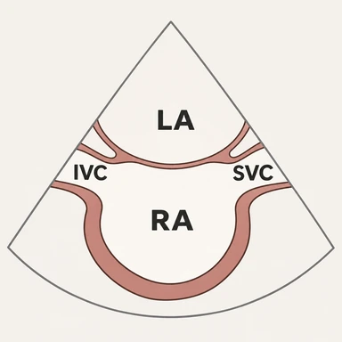

The full illustration and thumbnail are retained byte-for-byte from v54.

**Production checks:** Topology — pass; View identity — pass; Orientation — pass; Labels — pass; Phase — pass; Readability — pass.

#### Original artwork assessment

- Record

  - **Disposition:**

    retain

  - **Severity:**

    none

  - **Finding:**

    LA near field, RA deeper, IAS boundary intact; left IVC and right SVC enter the RA and never the LA. Large labels do not obscure the junctions.

  - **Original asset:**

    `public/assets/reference-views-v54/tee-bicaval.webp`

  - **Original sha256:**

    `fa33a97c0b3155d5b3b7f4c29f7a2a475dec423055676fbe0d8df3050aaf067e`

#### Final assessment

LA near field, RA deeper, IAS boundary intact; left IVC and right SVC enter the RA and never the LA. Large labels do not obscure the junctions.

#### Phase and limits

- **Phase:**

  Static atrial and caval section; no cardiac-phase-specific motion or flow is encoded.

- **Limits:**

  - This is an AI-assisted production/source-comparison review, not independent clinical certification.

  - This is a simplified view-identification schematic. Relative size, wall thickness, leaflet excursion and flow are not quantitative.

  - ASE Table 10 anatomy and echo figures have low native resolution; enlarged crops do not add source detail.

  - Passing the thumbnail gate means major anatomy and labels remain identifiable at 200px and 384px; fine valve/chordal anatomy requires the expanded illustration.

  - Published literature warns that a structure sometimes labeled IVC in bicaval images is coronary sinus. This original idealized diagram has intended caval continuity, but corresponding ultrasound frames require independent identification.

#### Source and exact view

- **Catalogue table:**

  10

- **Catalogue view:**

  13

- **Catalogue source:**

  <https://www.asecho.org/wp-content/uploads/2014/05/2013_Performing-Comprehensive-TEE.pdf>

- **Sources used in this review:**

  - Record

    - **Url:**

      <https://www.asecho.org/wp-content/uploads/2025/04/2013_Performing-Comprehensive-TEE.pdf>

    - **Title:**

      ASE/SCA Guidelines for Performing a Comprehensive Transesophageal Echocardiographic Examination

    - **Publication year:**

      2013

    - **Table:**

      10

    - **View number:**

      13

    - **View name:**

      Midesophageal bicaval

    - **Basis:**

      Exact anatomical section and matching ultrasound reference visually compared.

  - Record

    - **Url:**

      <https://cdt.amegroups.org/article/view/19583/html>

    - **Basis:**

      Published caution about misidentifying coronary sinus as IVC in bicaval imaging; used to limit interpretation, not to re-label this intended schematic.

#### Review scope and evidence

- **Independent review:**

  The independent TEE review agent visually inspected this original at 960px and compared it with newly retrieved ASE Table 10 anatomy/echo references; historical approval was not accepted as evidence. The same agent inspected fresh 200px and 384px resizes. This records a single-agent source comparison for retained artwork, not independent human clinical certification.

- **Full size reviewed:**

  Yes

- **Thumbnail reviewed:**

  Yes

- **Visual review:**

  - **Accepted master dimensions px:**

    - 960

    - 960

  - **Original master reviewed at px:**

    960

  - **Accepted master reviewed at full size:**

    Yes

  - **Accepted master sha256:**

    `fa33a97c0b3155d5b3b7f4c29f7a2a475dec423055676fbe0d8df3050aaf067e`

  - **Thumbnail scales px:**

    - 200

    - 384

  - **Resize method:**

    Pillow LANCZOS resampling only; no crop or anatomy edits.

  - **Reviewed on utc date:**

    2026-11-13

  - **Contact sheets:**

    - final-tee-200px-contact-1.png

    - final-tee-384px-contact-1.png

- **Approved final review:**

  - **Status:**

    approved_for_educational_schematic_use

  - **Finding:**

    LA near field, RA deeper, IAS boundary intact; left IVC and right SVC enter the RA and never the LA. Large labels do not obscure the junctions.

  - **Reviewer count:**

    1

  - **Independent human clinical certification:**

    No

- **Gate evidence:**

  - **Topology:**

    LA near field, RA deeper, IAS boundary intact; left IVC and right SVC enter the RA and never the LA. Large labels do not obscure the junctions.

  - **View identity:**

    Compared with ASE 2013 Table 10 view 13 (Midesophageal bicaval); required view-defining profiles are present without an unsupported added chamber or plane.

  - **Orientation:**

    LA is near field, RA deeper; intended IVC is screen-left and SVC screen-right, both communicating with RA.

  - **Labels:**

    - **Visible labels:**

      - LA

      - RA

      - IVC

      - SVC

    - **Assessment:**

      All labels occupy the intended blood pool or use a leader to the intended structure. Abbreviations are interpreted in the context of this named view.

  - **Phase:**

    Static atrial and caval section; no cardiac-phase-specific motion or flow is encoded.

  - **Readability:**

    Fresh 200px and 384px copies of the accepted master were visually inspected. Major structures remain distinguishable, all intended labels remain identifiable and no label is clipped or assigned to a wrong chamber. Fine structural interpretation requires the expanded image.

- **Hard failures:**

  None recorded.

#### Preservation and correction constraints

- Keep labels as an idealized intended caval schematic; do not infer that every real 90–110 degree frame necessarily shows true IVC and SVC simultaneously.

- Preserve the exact referenced acquisition plane and display orientation; do not mirror the image or substitute a generic heart diagram.

- Keep chamber and vessel connections anatomically appropriate. Do not add muscular caps, blind sacs, false extra chambers or unreferenced structures.

- Distinguish thin valve tissue/coaptation from myocardium; a legitimate closed valve is not an obstruction.

- A closed vessel profile can reflect the imaging plane leaving that vessel. Do not force out-of-plane continuations without source support.

- Keep the existing ivory/terracotta/gray-sector style and labels legible at full and thumbnail sizes; leaders must terminate on the intended structure.

#### Additional review metadata

- **Uncertainty flag:**

  Yes

- **Export review:**

  - **Stage:**

    Retained production thumbnail pairing

  - **Status:**

    pass

  - **Files inspected:**

    Actual 384px thumbnail path in the current manifest, displayed at 200px

  - **Reviewer:**

    TEE review agent

  - **Findings:**

    Matched the previously reviewed full-size view identity; no swapped image, corrupted label, unexpected crop or gallery-size label blocker.

<details>
<summary>Exact prompts and authoring history</summary>

Prompts describe requested changes. Historical authoring records do not supersede this review’s findings.

##### Original artwork: provenance location

- **Historical manifest:**

  docs/reference-views-v54/asset-manifest.json

- **Historical master sha256:**

  `a2e597ad57e784e8872fe18fb26a8b7a5fd7d33091f62c25db25a9e25f1fe1be`

- **Note:**

  The immutable historical manifest preserves the original authoring prompts. This report reproduces the exact prompts for this revision’s seven replacements; all current QC findings and retained-view decisions are included above.

</details>

#### Asset identity

| Asset | Path / identity | Pixels | Bytes | SHA-256 |
| --- | --- | --- | --- | --- |
| Original illustration | `public/assets/reference-views-v54/tee-bicaval.webp` | 960 × 960 | 38,838 | `fa33a97c0b3155d5b3b7f4c29f7a2a475dec423055676fbe0d8df3050aaf067e` |
| Current illustration | `public/assets/reference-views-v54/tee-bicaval.webp` | 960 × 960 | 38,838 | `fa33a97c0b3155d5b3b7f4c29f7a2a475dec423055676fbe0d8df3050aaf067e` |
| Original thumbnail | `public/assets/reference-views-v54/thumbs/tee-bicaval.webp` | 384 × 384 | 11,936 | `4aa2f0d6bfc08000936a44ad4913cf3b6fbd2eb2fb60ee0ae132638908cac37d` |
| Current thumbnail | `public/assets/reference-views-v54/thumbs/tee-bicaval.webp` | 384 × 384 | 11,936 | `4aa2f0d6bfc08000936a44ad4913cf3b6fbd2eb2fb60ee0ae132638908cac37d` |
| Historical generation master | `Original master PNG hash` | — | — | `a2e597ad57e784e8872fe18fb26a8b7a5fd7d33091f62c25db25a9e25f1fe1be` |

---

### TEE · Midesophageal right and left pulmonary veins

**ID:** `tee:mepv` · **Decision:** Retained · **ASE table/view:** 10 / 14

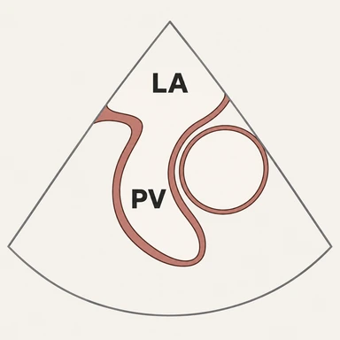

The full illustration and thumbnail are retained byte-for-byte from v54.

**Production checks:** Topology — pass; View identity — pass; Orientation — pass; Labels — pass; Phase — pass; Readability — pass.

#### Original artwork assessment

- Record

  - **Disposition:**

    retain

  - **Severity:**

    none

  - **Finding:**

    Longitudinal pulmonary-venous/atrial section with adjacent round PA context matches exact Table 10 view 14. No invented venous valve or wrong chamber connection.

  - **Original asset:**

    `public/assets/reference-views-v54/tee-mepv.webp`

  - **Original sha256:**

    `3f1d6e785026685bba8413a3cb44d5e46a7c97d350ad023949bbfb0f07142494`

#### Final assessment

Longitudinal pulmonary-venous/atrial section with adjacent round PA context matches exact Table 10 view 14. No invented venous valve or wrong chamber connection.

#### Phase and limits

- **Phase:**

  Static representative pulmonary-venous acquisition plane, without a venous valve or phase-specific flow claim.

- **Limits:**

  - This is an AI-assisted production/source-comparison review, not independent clinical certification.

  - This is a simplified view-identification schematic. Relative size, wall thickness, leaflet excursion and flow are not quantitative.

  - ASE Table 10 anatomy and echo figures have low native resolution; enlarged crops do not add source detail.

  - Passing the thumbnail gate means major anatomy and labels remain identifiable at 200px and 384px; fine valve/chordal anatomy requires the expanded illustration.

  - This is a representative section for the right/left pulmonary-vein acquisition family, not a simultaneous map of both sides or all four veins.

  - PV means pulmonary vein in this view. Table 10 labels this acquisition UE whereas the text discusses ME positions; the icon alone does not adjudicate probe depth nomenclature.

#### Source and exact view

- **Catalogue table:**

  10

- **Catalogue view:**

  14

- **Catalogue source:**

  <https://www.asecho.org/wp-content/uploads/2014/05/2013_Performing-Comprehensive-TEE.pdf>

- **Sources used in this review:**

  - Record

    - **Url:**

      <https://www.asecho.org/wp-content/uploads/2025/04/2013_Performing-Comprehensive-TEE.pdf>

    - **Title:**

      ASE/SCA Guidelines for Performing a Comprehensive Transesophageal Echocardiographic Examination

    - **Publication year:**

      2013

    - **Table:**

      10

    - **View number:**

      14

    - **View name:**

      Midesophageal right and left pulmonary veins

    - **Basis:**

      Exact anatomical section and matching ultrasound reference visually compared.

#### Review scope and evidence

- **Independent review:**

  The independent TEE review agent visually inspected this original at 960px and compared it with newly retrieved ASE Table 10 anatomy/echo references; historical approval was not accepted as evidence. The same agent inspected fresh 200px and 384px resizes. This records a single-agent source comparison for retained artwork, not independent human clinical certification.

- **Full size reviewed:**

  Yes

- **Thumbnail reviewed:**

  Yes

- **Visual review:**

  - **Accepted master dimensions px:**

    - 960

    - 960

  - **Original master reviewed at px:**

    960

  - **Accepted master reviewed at full size:**

    Yes

  - **Accepted master sha256:**

    `3f1d6e785026685bba8413a3cb44d5e46a7c97d350ad023949bbfb0f07142494`

  - **Thumbnail scales px:**

    - 200

    - 384

  - **Resize method:**

    Pillow LANCZOS resampling only; no crop or anatomy edits.

  - **Reviewed on utc date:**

    2026-11-13

  - **Contact sheets:**

    - final-tee-200px-contact-1.png

    - final-tee-384px-contact-1.png

- **Approved final review:**

  - **Status:**

    approved_for_educational_schematic_use

  - **Finding:**

    Longitudinal pulmonary-venous/atrial section with adjacent round PA context matches exact Table 10 view 14. No invented venous valve or wrong chamber connection.

  - **Reviewer count:**

    1

  - **Independent human clinical certification:**

    No

- **Gate evidence:**

  - **Topology:**

    Longitudinal pulmonary-venous/atrial section with adjacent round PA context matches exact Table 10 view 14. No invented venous valve or wrong chamber connection.

  - **View identity:**

    Compared with ASE 2013 Table 10 view 14 (Midesophageal right and left pulmonary veins); required view-defining profiles are present without an unsupported added chamber or plane.

  - **Orientation:**

    Representative near-field LA with longitudinal pulmonary-venous profile and adjacent round pulmonary-arterial context follows Table 10 view 14.

  - **Labels:**

    - **Visible labels:**

      - LA

      - PV

    - **Assessment:**

      All labels occupy the intended blood pool or use a leader to the intended structure. Abbreviations are interpreted in the context of this named view.

  - **Phase:**

    Static representative pulmonary-venous acquisition plane, without a venous valve or phase-specific flow claim.

  - **Readability:**

    Fresh 200px and 384px copies of the accepted master were visually inspected. Major structures remain distinguishable, all intended labels remain identifiable and no label is clipped or assigned to a wrong chamber. Fine structural interpretation requires the expanded image.

- **Hard failures:**

  None recorded.

#### Preservation and correction constraints

- Do not force all four pulmonary veins into one plane.

- Use surrounding UI to expand pulmonary-vein abbreviation.

- Preserve the exact referenced acquisition plane and display orientation; do not mirror the image or substitute a generic heart diagram.

- Keep chamber and vessel connections anatomically appropriate. Do not add muscular caps, blind sacs, false extra chambers or unreferenced structures.

- Distinguish thin valve tissue/coaptation from myocardium; a legitimate closed valve is not an obstruction.

- A closed vessel profile can reflect the imaging plane leaving that vessel. Do not force out-of-plane continuations without source support.

- Keep the existing ivory/terracotta/gray-sector style and labels legible at full and thumbnail sizes; leaders must terminate on the intended structure.

#### Reconsidered concerns

- The closed-ended appearance was traced to source-plane geometry and is not a proven anatomical occlusion.

#### Additional review metadata

- **Uncertainty flag:**

  Yes

- **Export review:**

  - **Stage:**

    Retained production thumbnail pairing

  - **Status:**

    pass

  - **Files inspected:**

    Actual 384px thumbnail path in the current manifest, displayed at 200px

  - **Reviewer:**

    TEE review agent

  - **Findings:**

    Matched the previously reviewed full-size view identity; no swapped image, corrupted label, unexpected crop or gallery-size label blocker.

<details>
<summary>Exact prompts and authoring history</summary>

Prompts describe requested changes. Historical authoring records do not supersede this review’s findings.

##### Original artwork: provenance location

- **Historical manifest:**

  docs/reference-views-v54/asset-manifest.json

- **Historical master sha256:**

  `764aacceb84040dea177eb88198b77ea32a5cb509e3aefa87c125916f8a4fd95`

- **Note:**

  The immutable historical manifest preserves the original authoring prompts. This report reproduces the exact prompts for this revision’s seven replacements; all current QC findings and retained-view decisions are included above.

</details>

#### Asset identity

| Asset | Path / identity | Pixels | Bytes | SHA-256 |
| --- | --- | --- | --- | --- |
| Original illustration | `public/assets/reference-views-v54/tee-mepv.webp` | 960 × 960 | 39,572 | `3f1d6e785026685bba8413a3cb44d5e46a7c97d350ad023949bbfb0f07142494` |
| Current illustration | `public/assets/reference-views-v54/tee-mepv.webp` | 960 × 960 | 39,572 | `3f1d6e785026685bba8413a3cb44d5e46a7c97d350ad023949bbfb0f07142494` |
| Original thumbnail | `public/assets/reference-views-v54/thumbs/tee-mepv.webp` | 384 × 384 | 11,258 | `015f3188bfa9aa17d8936ebb4985c0ad2ac42cddc4962ba89b1b3789ebdc1237` |
| Current thumbnail | `public/assets/reference-views-v54/thumbs/tee-mepv.webp` | 384 × 384 | 11,258 | `015f3188bfa9aa17d8936ebb4985c0ad2ac42cddc4962ba89b1b3789ebdc1237` |
| Historical generation master | `Original master PNG hash` | — | — | `764aacceb84040dea177eb88198b77ea32a5cb509e3aefa87c125916f8a4fd95` |

---

### TEE · Midesophageal left atrial appendage

**ID:** `tee:melaa` · **Decision:** Retained · **ASE table/view:** 10 / 15

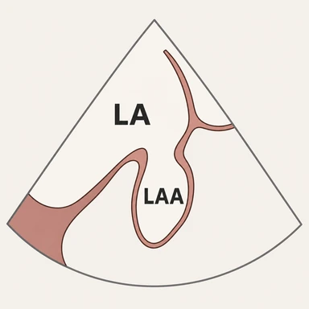

The full illustration and thumbnail are retained byte-for-byte from v54.

**Production checks:** Topology — pass; View identity — pass; Orientation — pass; Labels — pass; Phase — pass; Readability — pass.

#### Original artwork assessment

- Record

  - **Disposition:**

    retain

  - **Severity:**

    none

  - **Finding:**

    LAA has a patent neck into LA, a closed distal appendage boundary and no invented thrombus. Source orientation and appendage location retained. Labels are inside the correct blood pools.

  - **Original asset:**

    `public/assets/reference-views-v54/tee-melaa.webp`

  - **Original sha256:**

    `9db4f10e2fa1dcf0c465805240de6d69e59d9a4e81678bdda554dbed87278146`

#### Final assessment

LAA has a patent neck into LA, a closed distal appendage boundary and no invented thrombus. Source orientation and appendage location retained. Labels are inside the correct blood pools.

#### Phase and limits

- **Phase:**

  Static LA/LAA section; no phase-specific appendage emptying, contraction or flow velocity is encoded.

- **Limits:**

  - This is an AI-assisted production/source-comparison review, not independent clinical certification.

  - This is a simplified view-identification schematic. Relative size, wall thickness, leaflet excursion and flow are not quantitative.

  - ASE Table 10 anatomy and echo figures have low native resolution; enlarged crops do not add source detail.

  - Passing the thumbnail gate means major anatomy and labels remain identifiable at 200px and 384px; fine valve/chordal anatomy requires the expanded illustration.

#### Source and exact view

- **Catalogue table:**

  10

- **Catalogue view:**

  15

- **Catalogue source:**

  <https://www.asecho.org/wp-content/uploads/2014/05/2013_Performing-Comprehensive-TEE.pdf>

- **Sources used in this review:**

  - Record

    - **Url:**

      <https://www.asecho.org/wp-content/uploads/2025/04/2013_Performing-Comprehensive-TEE.pdf>

    - **Title:**

      ASE/SCA Guidelines for Performing a Comprehensive Transesophageal Echocardiographic Examination

    - **Publication year:**

      2013

    - **Table:**

      10

    - **View number:**

      15

    - **View name:**

      Midesophageal left atrial appendage

    - **Basis:**

      Exact anatomical section and matching ultrasound reference visually compared.

#### Review scope and evidence

- **Independent review:**

  The independent TEE review agent visually inspected this original at 960px and compared it with newly retrieved ASE Table 10 anatomy/echo references; historical approval was not accepted as evidence. The same agent inspected fresh 200px and 384px resizes. This records a single-agent source comparison for retained artwork, not independent human clinical certification.

- **Full size reviewed:**

  Yes

- **Thumbnail reviewed:**

  Yes

- **Visual review:**

  - **Accepted master dimensions px:**

    - 960

    - 960

  - **Original master reviewed at px:**

    960

  - **Accepted master reviewed at full size:**

    Yes

  - **Accepted master sha256:**

    `9db4f10e2fa1dcf0c465805240de6d69e59d9a4e81678bdda554dbed87278146`

  - **Thumbnail scales px:**

    - 200

    - 384

  - **Resize method:**

    Pillow LANCZOS resampling only; no crop or anatomy edits.

  - **Reviewed on utc date:**

    2026-11-13

  - **Contact sheets:**

    - final-tee-200px-contact-1.png

    - final-tee-384px-contact-1.png

- **Approved final review:**

  - **Status:**

    approved_for_educational_schematic_use

  - **Finding:**

    LAA has a patent neck into LA, a closed distal appendage boundary and no invented thrombus. Source orientation and appendage location retained. Labels are inside the correct blood pools.

  - **Reviewer count:**

    1

  - **Independent human clinical certification:**

    No

- **Gate evidence:**

  - **Topology:**

    LAA has a patent neck into LA, a closed distal appendage boundary and no invented thrombus. Source orientation and appendage location retained. Labels are inside the correct blood pools.

  - **View identity:**

    Compared with ASE 2013 Table 10 view 15 (Midesophageal left atrial appendage); required view-defining profiles are present without an unsupported added chamber or plane.

  - **Orientation:**

    LA occupies upper/left field; LAA projects lower/right with an open neck into LA and a closed distal appendage.

  - **Labels:**

    - **Visible labels:**

      - LA

      - LAA

    - **Assessment:**

      All labels occupy the intended blood pool or use a leader to the intended structure. Abbreviations are interpreted in the context of this named view.

  - **Phase:**

    Static LA/LAA section; no phase-specific appendage emptying, contraction or flow velocity is encoded.

  - **Readability:**

    Fresh 200px and 384px copies of the accepted master were visually inspected. Major structures remain distinguishable, all intended labels remain identifiable and no label is clipped or assigned to a wrong chamber. Fine structural interpretation requires the expanded image.

- **Hard failures:**

  None recorded.

#### Preservation and correction constraints

- Preserve open ostium and avoid mistaking appendage for a vein.

- Do not add arbitrary pectinate muscle masses.

- Preserve the exact referenced acquisition plane and display orientation; do not mirror the image or substitute a generic heart diagram.

- Keep chamber and vessel connections anatomically appropriate. Do not add muscular caps, blind sacs, false extra chambers or unreferenced structures.

- Distinguish thin valve tissue/coaptation from myocardium; a legitimate closed valve is not an obstruction.

- A closed vessel profile can reflect the imaging plane leaving that vessel. Do not force out-of-plane continuations without source support.

- Keep the existing ivory/terracotta/gray-sector style and labels legible at full and thumbnail sizes; leaders must terminate on the intended structure.

#### Additional review metadata

- **Uncertainty flag:**

  No

- **Export review:**

  - **Stage:**

    Retained production thumbnail pairing

  - **Status:**

    pass

  - **Files inspected:**

    Actual 384px thumbnail path in the current manifest, displayed at 200px

  - **Reviewer:**

    TEE review agent

  - **Findings:**

    Matched the previously reviewed full-size view identity; no swapped image, corrupted label, unexpected crop or gallery-size label blocker.

<details>
<summary>Exact prompts and authoring history</summary>

Prompts describe requested changes. Historical authoring records do not supersede this review’s findings.

##### Original artwork: provenance location

- **Historical manifest:**

  docs/reference-views-v54/asset-manifest.json

- **Historical master sha256:**

  `e1b4d294435833c6ed8c149e065b6eeeb90f3970a53ce8ce3179802625d34d73`

- **Note:**

  The immutable historical manifest preserves the original authoring prompts. This report reproduces the exact prompts for this revision’s seven replacements; all current QC findings and retained-view decisions are included above.

</details>

#### Asset identity

| Asset | Path / identity | Pixels | Bytes | SHA-256 |
| --- | --- | --- | --- | --- |
| Original illustration | `public/assets/reference-views-v54/tee-melaa.webp` | 960 × 960 | 35,346 | `9db4f10e2fa1dcf0c465805240de6d69e59d9a4e81678bdda554dbed87278146` |
| Current illustration | `public/assets/reference-views-v54/tee-melaa.webp` | 960 × 960 | 35,346 | `9db4f10e2fa1dcf0c465805240de6d69e59d9a4e81678bdda554dbed87278146` |
| Original thumbnail | `public/assets/reference-views-v54/thumbs/tee-melaa.webp` | 384 × 384 | 10,638 | `f55f90d2b932479cd5a818764cc4aa938f0c10839dd196d81dd5825ed13bc378` |
| Current thumbnail | `public/assets/reference-views-v54/thumbs/tee-melaa.webp` | 384 × 384 | 10,638 | `f55f90d2b932479cd5a818764cc4aa938f0c10839dd196d81dd5825ed13bc378` |
| Historical generation master | `Original master PNG hash` | — | — | `e1b4d294435833c6ed8c149e065b6eeeb90f3970a53ce8ce3179802625d34d73` |

---

### TEE · Transgastric basal short-axis

**ID:** `tee:tgbasalsax` · **Decision:** Retained · **ASE table/view:** 10 / 16

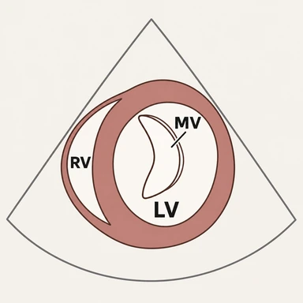

The full illustration and thumbnail are retained byte-for-byte from v54.

**Production checks:** Topology — pass; View identity — pass; Orientation — pass; Labels — pass; Phase — pass; Readability — pass.

#### Original artwork assessment

- Record

  - **Disposition:**

    retain

  - **Severity:**

    none

  - **Finding:**

    Round LV with crescent RV and central mitral-level crescent opening distinct from midpapillary and apical levels. Matches source basal section.

  - **Original asset:**

    `public/assets/reference-views-v54/tee-tgbasalsax.webp`

  - **Original sha256:**

    `5b999ec5201fcf6d4d5fc8ecbd41b79bcfbbff4a29f893be10004f68c83749a7`

#### Final assessment

Round LV with crescent RV and central mitral-level crescent opening distinct from midpapillary and apical levels. Matches source basal section.

#### Phase and limits

- **Phase:**

  Static short-axis mitral-level outline with a visible leaflet/orifice profile. It establishes slice level and does not encode measured phase, opening area or leaflet excursion.

- **Limits:**

  - This is an AI-assisted production/source-comparison review, not independent clinical certification.

  - This is a simplified view-identification schematic. Relative size, wall thickness, leaflet excursion and flow are not quantitative.

  - ASE Table 10 anatomy and echo figures have low native resolution; enlarged crops do not add source detail.

  - Passing the thumbnail gate means major anatomy and labels remain identifiable at 200px and 384px; fine valve/chordal anatomy requires the expanded illustration.

#### Source and exact view

- **Catalogue table:**

  10

- **Catalogue view:**

  16

- **Catalogue source:**

  <https://www.asecho.org/wp-content/uploads/2014/05/2013_Performing-Comprehensive-TEE.pdf>

- **Sources used in this review:**

  - Record

    - **Url:**

      <https://www.asecho.org/wp-content/uploads/2025/04/2013_Performing-Comprehensive-TEE.pdf>

    - **Title:**

      ASE/SCA Guidelines for Performing a Comprehensive Transesophageal Echocardiographic Examination

    - **Publication year:**

      2013

    - **Table:**

      10

    - **View number:**

      16

    - **View name:**

      Transgastric basal short-axis

    - **Basis:**

      Exact anatomical section and matching ultrasound reference visually compared.

#### Review scope and evidence

- **Independent review:**

  The independent TEE review agent visually inspected this original at 960px and compared it with newly retrieved ASE Table 10 anatomy/echo references; historical approval was not accepted as evidence. The same agent inspected fresh 200px and 384px resizes. This records a single-agent source comparison for retained artwork, not independent human clinical certification.

- **Full size reviewed:**

  Yes

- **Thumbnail reviewed:**

  Yes

- **Visual review:**

  - **Accepted master dimensions px:**

    - 960

    - 960

  - **Original master reviewed at px:**

    960

  - **Accepted master reviewed at full size:**

    Yes

  - **Accepted master sha256:**

    `5b999ec5201fcf6d4d5fc8ecbd41b79bcfbbff4a29f893be10004f68c83749a7`

  - **Thumbnail scales px:**

    - 200

    - 384

  - **Resize method:**

    Pillow LANCZOS resampling only; no crop or anatomy edits.

  - **Reviewed on utc date:**

    2026-11-13

  - **Contact sheets:**

    - final-tee-200px-contact-1.png

    - final-tee-384px-contact-1.png

- **Approved final review:**

  - **Status:**

    approved_for_educational_schematic_use

  - **Finding:**

    Round LV with crescent RV and central mitral-level crescent opening distinct from midpapillary and apical levels. Matches source basal section.

  - **Reviewer count:**

    1

  - **Independent human clinical certification:**

    No

- **Gate evidence:**

  - **Topology:**

    Round LV with crescent RV and central mitral-level crescent opening distinct from midpapillary and apical levels. Matches source basal section.

  - **View identity:**

    Compared with ASE 2013 Table 10 view 16 (Transgastric basal short-axis); required view-defining profiles are present without an unsupported added chamber or plane.

  - **Orientation:**

    Round LV is central with crescent RV on screen-left and a mitral-level short-axis profile within LV.

  - **Labels:**

    - **Visible labels:**

      - RV

      - LV

      - MV

    - **Assessment:**

      All labels occupy the intended blood pool or use a leader to the intended structure. Abbreviations are interpreted in the context of this named view.

  - **Phase:**

    Static short-axis mitral-level outline with a visible leaflet/orifice profile. It establishes slice level and does not encode measured phase, opening area or leaflet excursion.

  - **Readability:**

    Fresh 200px and 384px copies of the accepted master were visually inspected. Major structures remain distinguishable, all intended labels remain identifiable and no label is clipped or assigned to a wrong chamber. Fine structural interpretation requires the expanded image.

- **Hard failures:**

  None recorded.

#### Preservation and correction constraints

- Do not replace this valve section with the two papillary protrusions of midventricular SAX.

- Preserve the exact referenced acquisition plane and display orientation; do not mirror the image or substitute a generic heart diagram.

- Keep chamber and vessel connections anatomically appropriate. Do not add muscular caps, blind sacs, false extra chambers or unreferenced structures.

- Distinguish thin valve tissue/coaptation from myocardium; a legitimate closed valve is not an obstruction.

- A closed vessel profile can reflect the imaging plane leaving that vessel. Do not force out-of-plane continuations without source support.

- Keep the existing ivory/terracotta/gray-sector style and labels legible at full and thumbnail sizes; leaders must terminate on the intended structure.

#### Reconsidered concerns

- Floating crescent leaflet appearance was compared with exact basal schematic; it represents the short-axis valve section, not an unattached mass.

#### Additional review metadata

- **Uncertainty flag:**

  No

- **Export review:**

  - **Stage:**

    Retained production thumbnail pairing

  - **Status:**

    pass

  - **Files inspected:**

    Actual 384px thumbnail path in the current manifest, displayed at 200px

  - **Reviewer:**

    TEE review agent

  - **Findings:**

    Matched the previously reviewed full-size view identity; no swapped image, corrupted label, unexpected crop or gallery-size label blocker.

<details>
<summary>Exact prompts and authoring history</summary>

Prompts describe requested changes. Historical authoring records do not supersede this review’s findings.

##### Original artwork: provenance location

- **Historical manifest:**

  docs/reference-views-v54/asset-manifest.json

- **Historical master sha256:**

  `04acafe4eb39d8d0ae9b49e78fe6155d04791f6b152bae55e5c73855843bcdd3`

- **Note:**

  The immutable historical manifest preserves the original authoring prompts. This report reproduces the exact prompts for this revision’s seven replacements; all current QC findings and retained-view decisions are included above.

</details>

#### Asset identity

| Asset | Path / identity | Pixels | Bytes | SHA-256 |
| --- | --- | --- | --- | --- |
| Original illustration | `public/assets/reference-views-v54/tee-tgbasalsax.webp` | 960 × 960 | 47,042 | `5b999ec5201fcf6d4d5fc8ecbd41b79bcfbbff4a29f893be10004f68c83749a7` |
| Current illustration | `public/assets/reference-views-v54/tee-tgbasalsax.webp` | 960 × 960 | 47,042 | `5b999ec5201fcf6d4d5fc8ecbd41b79bcfbbff4a29f893be10004f68c83749a7` |
| Original thumbnail | `public/assets/reference-views-v54/thumbs/tee-tgbasalsax.webp` | 384 × 384 | 13,426 | `3635eeb0c2c450c21d5352fa62fdb6d3ca8f3672a408c3591b2330f984e07114` |
| Current thumbnail | `public/assets/reference-views-v54/thumbs/tee-tgbasalsax.webp` | 384 × 384 | 13,426 | `3635eeb0c2c450c21d5352fa62fdb6d3ca8f3672a408c3591b2330f984e07114` |
| Historical generation master | `Original master PNG hash` | — | — | `04acafe4eb39d8d0ae9b49e78fe6155d04791f6b152bae55e5c73855843bcdd3` |

---

### TEE · Transgastric midpapillary short-axis

**ID:** `tee:tgpapillary` · **Decision:** Retained · **ASE table/view:** 10 / 17


The full illustration and thumbnail are retained byte-for-byte from v54.

**Production checks:** Topology — pass; View identity — pass; Orientation — pass; Labels — pass; Phase — pass; Readability — pass.

#### Original artwork assessment

- Record

  - **Disposition:**

    retain

  - **Severity:**

    none

  - **Finding:**

    Round LV, left crescent RV and two papillary profiles in near-field/rightward positions match the exact source. No septum divides the LV.

  - **Original asset:**

    `public/assets/reference-views-v54/tee-tgpapillary.webp`

  - **Original sha256:**

    `f333378a22dd1f39bcc610b48dcedb60913e61475123a6ad1578bb30ac8763eb`

#### Final assessment

Round LV, left crescent RV and two papillary profiles in near-field/rightward positions match the exact source. No septum divides the LV.

#### Phase and limits

- **Phase:**

  Static midpapillary short-axis section; no measured end-systolic/end-diastolic size or contraction is encoded.

- **Limits:**

  - This is an AI-assisted production/source-comparison review, not independent clinical certification.

  - This is a simplified view-identification schematic. Relative size, wall thickness, leaflet excursion and flow are not quantitative.

  - ASE Table 10 anatomy and echo figures have low native resolution; enlarged crops do not add source detail.

  - Passing the thumbnail gate means major anatomy and labels remain identifiable at 200px and 384px; fine valve/chordal anatomy requires the expanded illustration.

  - Papillary profiles are simplified and broad; not suitable for teaching detailed papillary morphology.

#### Source and exact view

- **Catalogue table:**

  10

- **Catalogue view:**

  17

- **Catalogue source:**

  <https://www.asecho.org/wp-content/uploads/2014/05/2013_Performing-Comprehensive-TEE.pdf>

- **Sources used in this review:**

  - Record

    - **Url:**

      <https://www.asecho.org/wp-content/uploads/2025/04/2013_Performing-Comprehensive-TEE.pdf>

    - **Title:**

      ASE/SCA Guidelines for Performing a Comprehensive Transesophageal Echocardiographic Examination

    - **Publication year:**

      2013

    - **Table:**

      10

    - **View number:**

      17

    - **View name:**

      Transgastric midpapillary short-axis

    - **Basis:**

      Exact anatomical section and matching ultrasound reference visually compared.

#### Review scope and evidence

- **Independent review:**

  The independent TEE review agent visually inspected this original at 960px and compared it with newly retrieved ASE Table 10 anatomy/echo references; historical approval was not accepted as evidence. The same agent inspected fresh 200px and 384px resizes. This records a single-agent source comparison for retained artwork, not independent human clinical certification.

- **Full size reviewed:**

  Yes

- **Thumbnail reviewed:**

  Yes

- **Visual review:**

  - **Accepted master dimensions px:**

    - 960

    - 960

  - **Original master reviewed at px:**

    960

  - **Accepted master reviewed at full size:**

    Yes

  - **Accepted master sha256:**

    `f333378a22dd1f39bcc610b48dcedb60913e61475123a6ad1578bb30ac8763eb`

  - **Thumbnail scales px:**

    - 200

    - 384

  - **Resize method:**

    Pillow LANCZOS resampling only; no crop or anatomy edits.

  - **Reviewed on utc date:**

    2026-11-13

  - **Contact sheets:**

    - final-tee-200px-contact-1.png

    - final-tee-384px-contact-2.png

- **Approved final review:**

  - **Status:**

    approved_for_educational_schematic_use

  - **Finding:**

    Round LV, left crescent RV and two papillary profiles in near-field/rightward positions match the exact source. No septum divides the LV.

  - **Reviewer count:**

    1

  - **Independent human clinical certification:**

    No

- **Gate evidence:**

  - **Topology:**

    Round LV, left crescent RV and two papillary profiles in near-field/rightward positions match the exact source. No septum divides the LV.

  - **View identity:**

    Compared with ASE 2013 Table 10 view 17 (Transgastric midpapillary short-axis); required view-defining profiles are present without an unsupported added chamber or plane.

  - **Orientation:**

    Round LV and screen-left RV crescent; two papillary profiles occupy the source-specific near-field/rightward positions.

  - **Labels:**

    - **Visible labels:**

      - LV

      - RV

    - **Assessment:**

      All labels occupy the intended blood pool or use a leader to the intended structure. Abbreviations are interpreted in the context of this named view.

  - **Phase:**

    Static midpapillary short-axis section; no measured end-systolic/end-diastolic size or contraction is encoded.

  - **Readability:**

    Fresh 200px and 384px copies of the accepted master were visually inspected. Major structures remain distinguishable, all intended labels remain identifiable and no label is clipped or assigned to a wrong chamber. Fine structural interpretation requires the expanded image.

- **Hard failures:**

  None recorded.

#### Preservation and correction constraints

- Keep two distinct papillary profiles, do not add valve orifice.

- Preserve the exact referenced acquisition plane and display orientation; do not mirror the image or substitute a generic heart diagram.

- Keep chamber and vessel connections anatomically appropriate. Do not add muscular caps, blind sacs, false extra chambers or unreferenced structures.

- Distinguish thin valve tissue/coaptation from myocardium; a legitimate closed valve is not an obstruction.

- A closed vessel profile can reflect the imaging plane leaving that vessel. Do not force out-of-plane continuations without source support.

- Keep the existing ivory/terracotta/gray-sector style and labels legible at full and thumbnail sizes; leaders must terminate on the intended structure.

#### Reconsidered concerns

- Broad papillary attachment to wall was checked against source: it is schematic section geometry, not proof of intracavitary obstruction.

#### Additional notes

- Papillary profiles are simplified and broad; not suitable for teaching detailed papillary morphology.

#### Additional review metadata

- **Uncertainty flag:**

  No

- **Export review:**

  - **Stage:**

    Retained production thumbnail pairing

  - **Status:**

    pass

  - **Files inspected:**

    Actual 384px thumbnail path in the current manifest, displayed at 200px

  - **Reviewer:**

    TEE review agent

  - **Findings:**

    Matched the previously reviewed full-size view identity; no swapped image, corrupted label, unexpected crop or gallery-size label blocker.

<details>
<summary>Exact prompts and authoring history</summary>

Prompts describe requested changes. Historical authoring records do not supersede this review’s findings.

##### Original artwork: provenance location

- **Historical manifest:**

  docs/reference-views-v54/asset-manifest.json

- **Historical master sha256:**

  `7f916dcf9af897c407e40bddd7ec2b63850e73ab07ad539649b96a820c86b32a`

- **Note:**

  The immutable historical manifest preserves the original authoring prompts. This report reproduces the exact prompts for this revision’s seven replacements; all current QC findings and retained-view decisions are included above.

</details>

#### Asset identity

| Asset | Path / identity | Pixels | Bytes | SHA-256 |
| --- | --- | --- | --- | --- |
| Original illustration | `public/assets/reference-views-v54/tee-tgpapillary.webp` | 960 × 960 | 38,058 | `f333378a22dd1f39bcc610b48dcedb60913e61475123a6ad1578bb30ac8763eb` |
| Current illustration | `public/assets/reference-views-v54/tee-tgpapillary.webp` | 960 × 960 | 38,058 | `f333378a22dd1f39bcc610b48dcedb60913e61475123a6ad1578bb30ac8763eb` |
| Original thumbnail | `public/assets/reference-views-v54/thumbs/tee-tgpapillary.webp` | 384 × 384 | 11,314 | `98ee0bacaa19055c7aaf1cd80a910fa0c6467d0a9406fab84eebef9a490035ab` |
| Current thumbnail | `public/assets/reference-views-v54/thumbs/tee-tgpapillary.webp` | 384 × 384 | 11,314 | `98ee0bacaa19055c7aaf1cd80a910fa0c6467d0a9406fab84eebef9a490035ab` |
| Historical generation master | `Original master PNG hash` | — | — | `7f916dcf9af897c407e40bddd7ec2b63850e73ab07ad539649b96a820c86b32a` |

---

### TEE · Transgastric apical short-axis

**ID:** `tee:tgapicalsax` · **Decision:** Retained · **ASE table/view:** 10 / 18


The full illustration and thumbnail are retained byte-for-byte from v54.

**Production checks:** Topology — pass; View identity — pass; Orientation — pass; Labels — pass; Phase — pass; Readability — pass.

#### Original artwork assessment

- Record

  - **Disposition:**

    retain

  - **Severity:**

    none

  - **Finding:**

    Smaller round LV cavity with small RV crescent and no mitral valve or large papillary muscles. Correctly distinct apical level. Leader terminates in RV crescent.

  - **Original asset:**

    `public/assets/reference-views-v54/tee-tgapicalsax.webp`

  - **Original sha256:**

    `ab71bda9162e68793f9cfe6a6e20dc77c29fc5cb3ce696db96e287fa5aca7184`

#### Final assessment

Smaller round LV cavity with small RV crescent and no mitral valve or large papillary muscles. Correctly distinct apical level. Leader terminates in RV crescent.

#### Phase and limits

- **Phase:**

  Static apical short-axis section; no measured cardiac phase or contraction is encoded.

- **Limits:**

  - This is an AI-assisted production/source-comparison review, not independent clinical certification.

  - This is a simplified view-identification schematic. Relative size, wall thickness, leaflet excursion and flow are not quantitative.

  - ASE Table 10 anatomy and echo figures have low native resolution; enlarged crops do not add source detail.

  - Passing the thumbnail gate means major anatomy and labels remain identifiable at 200px and 384px; fine valve/chordal anatomy requires the expanded illustration.

#### Source and exact view

- **Catalogue table:**

  10

- **Catalogue view:**

  18

- **Catalogue source:**

  <https://www.asecho.org/wp-content/uploads/2014/05/2013_Performing-Comprehensive-TEE.pdf>

- **Sources used in this review:**

  - Record

    - **Url:**

      <https://www.asecho.org/wp-content/uploads/2025/04/2013_Performing-Comprehensive-TEE.pdf>

    - **Title:**

      ASE/SCA Guidelines for Performing a Comprehensive Transesophageal Echocardiographic Examination

    - **Publication year:**

      2013

    - **Table:**

      10

    - **View number:**

      18

    - **View name:**

      Transgastric apical short-axis

    - **Basis:**

      Exact anatomical section and matching ultrasound reference visually compared.

#### Review scope and evidence

- **Independent review:**

  The independent TEE review agent visually inspected this original at 960px and compared it with newly retrieved ASE Table 10 anatomy/echo references; historical approval was not accepted as evidence. The same agent inspected fresh 200px and 384px resizes. This records a single-agent source comparison for retained artwork, not independent human clinical certification.

- **Full size reviewed:**

  Yes

- **Thumbnail reviewed:**

  Yes

- **Visual review:**

  - **Accepted master dimensions px:**

    - 960

    - 960

  - **Original master reviewed at px:**

    960

  - **Accepted master reviewed at full size:**

    Yes

  - **Accepted master sha256:**

    `ab71bda9162e68793f9cfe6a6e20dc77c29fc5cb3ce696db96e287fa5aca7184`

  - **Thumbnail scales px:**

    - 200

    - 384

  - **Resize method:**

    Pillow LANCZOS resampling only; no crop or anatomy edits.

  - **Reviewed on utc date:**

    2026-11-13

  - **Contact sheets:**

    - final-tee-200px-contact-1.png

    - final-tee-384px-contact-2.png

- **Approved final review:**

  - **Status:**

    approved_for_educational_schematic_use

  - **Finding:**

    Smaller round LV cavity with small RV crescent and no mitral valve or large papillary muscles. Correctly distinct apical level. Leader terminates in RV crescent.

  - **Reviewer count:**

    1

  - **Independent human clinical certification:**

    No

- **Gate evidence:**

  - **Topology:**

    Smaller round LV cavity with small RV crescent and no mitral valve or large papillary muscles. Correctly distinct apical level. Leader terminates in RV crescent.

  - **View identity:**

    Compared with ASE 2013 Table 10 view 18 (Transgastric apical short-axis); required view-defining profiles are present without an unsupported added chamber or plane.

  - **Orientation:**

    Small round LV section and small screen-left RV crescent; no copied basal valve or large papillary landmarks.

  - **Labels:**

    - **Visible labels:**

      - RV

      - LV

    - **Assessment:**

      All labels occupy the intended blood pool or use a leader to the intended structure. Abbreviations are interpreted in the context of this named view.

  - **Phase:**

    Static apical short-axis section; no measured cardiac phase or contraction is encoded.

  - **Readability:**

    Fresh 200px and 384px copies of the accepted master were visually inspected. Major structures remain distinguishable, all intended labels remain identifiable and no label is clipped or assigned to a wrong chamber. Fine structural interpretation requires the expanded image.

- **Hard failures:**

  None recorded.

#### Preservation and correction constraints

- Keep apical level devoid of copied basal/MV landmarks.

- Preserve the exact referenced acquisition plane and display orientation; do not mirror the image or substitute a generic heart diagram.

- Keep chamber and vessel connections anatomically appropriate. Do not add muscular caps, blind sacs, false extra chambers or unreferenced structures.

- Distinguish thin valve tissue/coaptation from myocardium; a legitimate closed valve is not an obstruction.

- A closed vessel profile can reflect the imaging plane leaving that vessel. Do not force out-of-plane continuations without source support.

- Keep the existing ivory/terracotta/gray-sector style and labels legible at full and thumbnail sizes; leaders must terminate on the intended structure.

#### Additional review metadata

- **Uncertainty flag:**

  No

- **Export review:**

  - **Stage:**

    Retained production thumbnail pairing

  - **Status:**

    pass

  - **Files inspected:**

    Actual 384px thumbnail path in the current manifest, displayed at 200px

  - **Reviewer:**

    TEE review agent

  - **Findings:**

    Matched the previously reviewed full-size view identity; no swapped image, corrupted label, unexpected crop or gallery-size label blocker.

<details>
<summary>Exact prompts and authoring history</summary>

Prompts describe requested changes. Historical authoring records do not supersede this review’s findings.

##### Original artwork: provenance location

- **Historical manifest:**

  docs/reference-views-v54/asset-manifest.json

- **Historical master sha256:**

  `8961e927fb940b4192459b0217cb22b678e08107bc76ae64a8e9275fcd50e064`

- **Note:**

  The immutable historical manifest preserves the original authoring prompts. This report reproduces the exact prompts for this revision’s seven replacements; all current QC findings and retained-view decisions are included above.

</details>

#### Asset identity

| Asset | Path / identity | Pixels | Bytes | SHA-256 |
| --- | --- | --- | --- | --- |
| Original illustration | `public/assets/reference-views-v54/tee-tgapicalsax.webp` | 960 × 960 | 31,392 | `ab71bda9162e68793f9cfe6a6e20dc77c29fc5cb3ce696db96e287fa5aca7184` |
| Current illustration | `public/assets/reference-views-v54/tee-tgapicalsax.webp` | 960 × 960 | 31,392 | `ab71bda9162e68793f9cfe6a6e20dc77c29fc5cb3ce696db96e287fa5aca7184` |
| Original thumbnail | `public/assets/reference-views-v54/thumbs/tee-tgapicalsax.webp` | 384 × 384 | 9,728 | `2cd2b6771f7f53c3fc75555cd18902ecc7892c23a4b6b80542ce91c4177e31c6` |
| Current thumbnail | `public/assets/reference-views-v54/thumbs/tee-tgapicalsax.webp` | 384 × 384 | 9,728 | `2cd2b6771f7f53c3fc75555cd18902ecc7892c23a4b6b80542ce91c4177e31c6` |
| Historical generation master | `Original master PNG hash` | — | — | `8961e927fb940b4192459b0217cb22b678e08107bc76ae64a8e9275fcd50e064` |

---

### TEE · Transgastric RV basal

**ID:** `tee:tgrvbasal` · **Decision:** Retained · **ASE table/view:** 10 / 19


The full illustration and thumbnail are retained byte-for-byte from v54.

**Production checks:** Topology — pass; View identity — pass; Orientation — pass; Labels — pass; Phase — pass; Readability — pass.

#### Original artwork assessment

- Record

  - **Disposition:**

    retain

  - **Severity:**

    none

  - **Finding:**

    TV short-axis profile in basal RV region, separate partial LV, and connected elongated RVOT terminating at the pulmonary-valve section match exact source 19. No RV-to-RVOT partition.

  - **Original asset:**

    `public/assets/reference-views-v54/tee-tgrvbasal.webp`

  - **Original sha256:**

    `404299f75944df0bc18e097404fb8eeb84824271479a51622ea59d28553d47e4`

#### Final assessment

TV short-axis profile in basal RV region, separate partial LV, and connected elongated RVOT terminating at the pulmonary-valve section match exact source 19. No RV-to-RVOT partition.

#### Phase and limits

- **Phase:**

  Static basal RV/outflow section with simplified tricuspid and pulmonic profiles. No measured synchronized phase or complete distal PA anatomy is asserted.

- **Limits:**

  - This is an AI-assisted production/source-comparison review, not independent clinical certification.

  - This is a simplified view-identification schematic. Relative size, wall thickness, leaflet excursion and flow are not quantitative.

  - ASE Table 10 anatomy and echo figures have low native resolution; enlarged crops do not add source detail.

  - Passing the thumbnail gate means major anatomy and labels remain identifiable at 200px and 384px; fine valve/chordal anatomy requires the expanded illustration.

  - Small distal outflow depiction is schematic and should not be interpreted as complete PA anatomy.

  - The small TV and PV labels remain identifiable in the 200px thumbnail; their leaflet details require the expanded view.

#### Source and exact view

- **Catalogue table:**

  10

- **Catalogue view:**

  19

- **Catalogue source:**

  <https://www.asecho.org/wp-content/uploads/2014/05/2013_Performing-Comprehensive-TEE.pdf>

- **Sources used in this review:**

  - Record

    - **Url:**

      <https://www.asecho.org/wp-content/uploads/2025/04/2013_Performing-Comprehensive-TEE.pdf>

    - **Title:**

      ASE/SCA Guidelines for Performing a Comprehensive Transesophageal Echocardiographic Examination

    - **Publication year:**

      2013

    - **Table:**

      10

    - **View number:**

      19

    - **View name:**

      Transgastric RV basal

    - **Basis:**

      Exact anatomical section and matching ultrasound reference visually compared.

#### Review scope and evidence

- **Independent review:**

  The independent TEE review agent visually inspected this original at 960px and compared it with newly retrieved ASE Table 10 anatomy/echo references; historical approval was not accepted as evidence. The same agent inspected fresh 200px and 384px resizes. This records a single-agent source comparison for retained artwork, not independent human clinical certification.

- **Full size reviewed:**

  Yes

- **Thumbnail reviewed:**

  Yes

- **Visual review:**

  - **Accepted master dimensions px:**

    - 960

    - 960

  - **Original master reviewed at px:**

    960

  - **Accepted master reviewed at full size:**

    Yes

  - **Accepted master sha256:**

    `404299f75944df0bc18e097404fb8eeb84824271479a51622ea59d28553d47e4`

  - **Thumbnail scales px:**

    - 200

    - 384

  - **Resize method:**

    Pillow LANCZOS resampling only; no crop or anatomy edits.

  - **Reviewed on utc date:**

    2026-11-13

  - **Contact sheets:**

    - final-tee-200px-contact-1.png

    - final-tee-384px-contact-2.png

- **Approved final review:**

  - **Status:**

    approved_for_educational_schematic_use

  - **Finding:**

    TV short-axis profile in basal RV region, separate partial LV, and connected elongated RVOT terminating at the pulmonary-valve section match exact source 19. No RV-to-RVOT partition.

  - **Reviewer count:**

    1

  - **Independent human clinical certification:**

    No

- **Gate evidence:**

  - **Topology:**

    TV short-axis profile in basal RV region, separate partial LV, and connected elongated RVOT terminating at the pulmonary-valve section match exact source 19. No RV-to-RVOT partition.

  - **View identity:**

    Compared with ASE 2013 Table 10 view 19 (Transgastric RV basal); required view-defining profiles are present without an unsupported added chamber or plane.

  - **Orientation:**

    Basal RV/TV section is left, partial LV upper-right and RVOT elongated toward lower field; this is not a four-chamber projection.

  - **Labels:**

    - **Visible labels:**

      - TV

      - RV

      - LV

      - RVOT

      - PV

    - **Assessment:**

      All labels occupy the intended blood pool or use a leader to the intended structure. Abbreviations are interpreted in the context of this named view.

  - **Phase:**

    Static basal RV/outflow section with simplified tricuspid and pulmonic profiles. No measured synchronized phase or complete distal PA anatomy is asserted.

  - **Readability:**

    Fresh 200px and 384px copies of the accepted master were visually inspected. Major structures remain distinguishable, all intended labels remain identifiable and no label is clipped or assigned to a wrong chamber. Fine structural interpretation requires the expanded image.

- **Hard failures:**

  None recorded.

#### Preservation and correction constraints

- Preserve distinct TV short-axis versus elongated RVOT section; do not turn this into four chambers.

- Preserve the exact referenced acquisition plane and display orientation; do not mirror the image or substitute a generic heart diagram.

- Keep chamber and vessel connections anatomically appropriate. Do not add muscular caps, blind sacs, false extra chambers or unreferenced structures.

- Distinguish thin valve tissue/coaptation from myocardium; a legitimate closed valve is not an obstruction.

- A closed vessel profile can reflect the imaging plane leaving that vessel. Do not force out-of-plane continuations without source support.

- Keep the existing ivory/terracotta/gray-sector style and labels legible at full and thumbnail sizes; leaders must terminate on the intended structure.

#### Reconsidered concerns

- Short capped distal profile resembles the source slice leaving the outflow around the PV; not enough evidence to call this atresia.

#### Additional review metadata

- **Uncertainty flag:**

  Yes

- **Export review:**

  - **Stage:**

    Retained production thumbnail pairing

  - **Status:**

    pass

  - **Files inspected:**

    Actual 384px thumbnail path in the current manifest, displayed at 200px

  - **Reviewer:**

    TEE review agent

  - **Findings:**

    Matched the previously reviewed full-size view identity; no swapped image, corrupted label, unexpected crop or gallery-size label blocker.

<details>
<summary>Exact prompts and authoring history</summary>

Prompts describe requested changes. Historical authoring records do not supersede this review’s findings.

##### Original artwork: provenance location

- **Historical manifest:**

  docs/reference-views-v54/asset-manifest.json

- **Historical master sha256:**

  `a0bac0a56b4d50901a420d9869d190c5f9c92a93731b3fa6afc94b2adcbf8642`

- **Note:**

  The immutable historical manifest preserves the original authoring prompts. This report reproduces the exact prompts for this revision’s seven replacements; all current QC findings and retained-view decisions are included above.

</details>

#### Asset identity

| Asset | Path / identity | Pixels | Bytes | SHA-256 |
| --- | --- | --- | --- | --- |
| Original illustration | `public/assets/reference-views-v54/tee-tgrvbasal.webp` | 960 × 960 | 44,750 | `404299f75944df0bc18e097404fb8eeb84824271479a51622ea59d28553d47e4` |
| Current illustration | `public/assets/reference-views-v54/tee-tgrvbasal.webp` | 960 × 960 | 44,750 | `404299f75944df0bc18e097404fb8eeb84824271479a51622ea59d28553d47e4` |
| Original thumbnail | `public/assets/reference-views-v54/thumbs/tee-tgrvbasal.webp` | 384 × 384 | 12,808 | `c3699cdad049c93dd549ae11d7e17005d60b9248c8d615b68098fb31da44aa1f` |
| Current thumbnail | `public/assets/reference-views-v54/thumbs/tee-tgrvbasal.webp` | 384 × 384 | 12,808 | `c3699cdad049c93dd549ae11d7e17005d60b9248c8d615b68098fb31da44aa1f` |
| Historical generation master | `Original master PNG hash` | — | — | `a0bac0a56b4d50901a420d9869d190c5f9c92a93731b3fa6afc94b2adcbf8642` |

---

### TEE · Transgastric RV inflow-outflow

**ID:** `tee:tgrvinout` · **Decision:** Clarity improvement · **ASE table/view:** 10 / 20

| Before — superseded v54 artwork | After — accepted v58 artwork |
| --- | --- |
|  |  |

**Production checks:** Topology — pass; View identity — pass; Orientation — pass; Labels — pass; Phase — pass; Readability — pass.

#### Original artwork assessment

- Record

  - **Disposition:**

    replace

  - **Severity:**

    clarity

  - **Finding:**

    A solid terracotta bridge immediately distal to the thin PV strokes ends the tube above the sector edge. Although terminal profiles can be plane-related, this presentation ambiguously resembles a tissue cap. Replace to make the postvalvular continuity explicit without diagnosing pathology.

  - **Original asset:**

    `public/assets/reference-views-v54/tee-tgrvinout.webp`

  - **Original sha256:**

    `ccd09a8323367017337cddf26dc77d44d91057163838eb08d624836ff32f33da`

#### Final assessment

Inspected at full size and 240px by TEE reviewer and independently approved by root: the short thin-wall postvalvular pulmonary artery lumen reaches the sector edge, removing the ambiguous solid cap; RV/RVOT continuity, source plane, labels and style retained.

#### Phase and limits

- **Phase:**

  Diastolic schematic: PV closed, TV partly open. This records an illustrative valve-state choice, not a fully kinetic or quantitative representation.

- **Limits:**

  - This is an AI-assisted production/source-comparison review, not independent clinical certification.

  - This is a simplified view-identification schematic. Relative size, wall thickness, leaflet excursion and flow are not quantitative.

  - ASE Table 10 anatomy and echo figures have low native resolution; enlarged crops do not add source detail.

  - Passing the thumbnail gate means major anatomy and labels remain identifiable at 200px and 384px; fine valve/chordal anatomy requires the expanded illustration.

  - The correction reduces a capped-tube ambiguity; it is not a claim that the original represented pathological atresia.

  - PV here means pulmonary valve; the added short PA segment is not a full pulmonary-arterial map.

#### Source and exact view

- **Catalogue table:**

  10

- **Catalogue view:**

  20

- **Catalogue source:**

  <https://www.asecho.org/wp-content/uploads/2014/05/2013_Performing-Comprehensive-TEE.pdf>

- **Sources used in this review:**

  - Record

    - **Url:**

      <https://www.asecho.org/wp-content/uploads/2025/04/2013_Performing-Comprehensive-TEE.pdf>

    - **Title:**

      ASE/SCA Guidelines for Performing a Comprehensive Transesophageal Echocardiographic Examination

    - **Publication year:**

      2013

    - **Table:**

      10

    - **View number:**

      20

    - **View name:**

      Transgastric RV inflow-outflow

    - **Basis:**

      Exact anatomical section and matching ultrasound reference visually compared.

#### Review scope and evidence

- **Independent review:**

  The accepted generated master was visually inspected by both the root reviewer and the independent TEE review agent. The TEE agent compared it with the exact ASE anatomy/echo plane and inspected fresh 200px and 384px resizes. Approval is limited to educational schematic production quality; neither reviewer is being represented as a human clinician.

- **Full size reviewed:**

  Yes

- **Thumbnail reviewed:**

  Yes

- **Visual review:**

  - **Accepted master dimensions px:**

    - 1254

    - 1254

  - **Original master reviewed at px:**

    960

  - **Accepted master reviewed at full size:**

    Yes

  - **Accepted master sha256:**

    `134cfd345e19e1b3d8f4b5f4fbb69900f51fa8db84808fe12689ca76910490b7`

  - **Thumbnail scales px:**

    - 200

    - 384

  - **Resize method:**

    Pillow LANCZOS resampling only; no crop or anatomy edits.

  - **Reviewed on utc date:**

    2026-11-13

  - **Contact sheets:**

    - final-tee-200px-contact-1.png

    - final-tee-384px-contact-2.png

- **Approved final review:**

  - **Status:**

    approved_for_educational_schematic_use

  - **Finding:**

    Inspected at full size and 240px by TEE reviewer and independently approved by root: the short thin-wall postvalvular pulmonary artery lumen reaches the sector edge, removing the ambiguous solid cap; RV/RVOT continuity, source plane, labels and style retained.

  - **Reviewer count:**

    2

  - **Independent human clinical certification:**

    No

- **Gate evidence:**

  - **Topology:**

    Inspected at full size and 240px by TEE reviewer and independently approved by root: the short thin-wall postvalvular pulmonary artery lumen reaches the sector edge, removing the ambiguous solid cap; RV/RVOT continuity, source plane, labels and style retained.

  - **View identity:**

    Compared with ASE 2013 Table 10 view 20 (Transgastric RV inflow-outflow); required view-defining profiles are present without an unsupported added chamber or plane.

  - **Orientation:**

    RV is upper/middle, RA lower-left and RVOT curves down/right toward PV; the short PA continuation preserves that same plane.

  - **Labels:**

    - **Visible labels:**

      - RV

      - RA

      - RVOT

      - TV

      - PV

    - **Assessment:**

      All labels occupy the intended blood pool or use a leader to the intended structure. Abbreviations are interpreted in the context of this named view.

  - **Phase:**

    Diastolic schematic: PV closed, TV partly open. This records an illustrative valve-state choice, not a fully kinetic or quantitative representation.

  - **Readability:**

    Fresh 200px and 384px copies of the accepted master were visually inspected. Major structures remain distinguishable, all intended labels remain identifiable and no label is clipped or assigned to a wrong chamber. Fine structural interpretation requires the expanded image.

- **Hard failures:**

  None recorded.

#### Preservation and correction constraints

- Retain exact right-flexed TG plane and RV/RA/RVOT arrangement.

- Keep RV and RVOT one uninterrupted cavity.

- Add only a short true PA continuation beyond PV, with thin side walls continuing through the sector edge.

- No extra wall, second valve or new chamber beyond PV.

- Preserve existing five labels.

- Continue only the local postvalvular lumen to the bottom field edge; do not rotate or invent a different acquisition plane.

- Keep TV and PV as thin hinge-based valve profiles and preserve the one RV/RVOT blood pool.

- Preserve the exact referenced acquisition plane and display orientation; do not mirror the image or substitute a generic heart diagram.

- Keep chamber and vessel connections anatomically appropriate. Do not add muscular caps, blind sacs, false extra chambers or unreferenced structures.

- Distinguish thin valve tissue/coaptation from myocardium; a legitimate closed valve is not an obstruction.

- A closed vessel profile can reflect the imaging plane leaving that vessel. Do not force out-of-plane continuations without source support.

- Keep the existing ivory/terracotta/gray-sector style and labels legible at full and thumbnail sizes; leaders must terminate on the intended structure.

#### Additional review metadata

- **Uncertainty flag:**

  No

- **Export review:**

  - **Stage:**

    Local production WebP files, before publication

  - **Status:**

    pass

  - **Files inspected:**

    Actual 960px image and actual 384px thumbnail; 200px rendition derived from the encoded thumbnail

  - **Reviewer:**

    TEE review agent; root also inspected all seven exported thumbnails at 240px

  - **Findings:**

    RV/RVOT remains one cavity and the short postvalvular PA reaches the sector edge; TV/PV/RVOT labels remain identifiable.

  - **Remaining display limit:**

    Fine leaflet and cusp interpretation requires the enlarged illustration.

<details>
<summary>Exact prompts and authoring history</summary>

Prompts describe requested changes. Historical authoring records do not supersede this review’s findings.

##### Accepted replacement: exact final prompt and preceding prompts

- **Tool:**

  image_gen

- **Prompt:**

  ```text
  Use case: scientific-educational / precise-object-edit.
  Asset: one square educational TEE reference illustration, matching the supplied warm ivory/terracotta flat diagram style.
  
  INPUT ROLES: Image 1 is the current transgastric RV inflow–outflow illustration to edit. Image 2 is the ASE/SCA Table 10 view 20 anatomical plane reference. Image 3 is its matching real ultrasound reference. Preserve the orientation and existing composition; images 2/3 establish the exact view. Do not copy any guideline title, watermark, image texture or angle symbol.
  
  PRIMARY CORRECTION: The current illustration ends its RV outflow tract in a small solid terracotta bridge just below the pulmonary-valve leaflets, above the sector's bottom arc. This creates an ambiguous capped-tube appearance. Remove ONLY this extra tissue bridge. Carry the same white blood lumen beyond the pulmonic leaflets as a short postvalvular pulmonary artery segment with two thin terracotta side walls; let that short segment continue out through the bottom sector border. There must be continuous lumen on both sides of the thin pulmonary-valve leaflets, without another wall crossing the lumen. The PV is the valve between the RVOT and pulmonary artery; it is not the end wall of a blind sac.
  
  PRESERVE: RV as broad upper/middle cavity; RA as small thin-wall oval at lower-left; TV at their left-middle junction; RV and RVOT as ONE uninterrupted white cavity, with no wall or valve between their labels. RVOT curves toward lower-middle/right. Pulmonary valve remains near the lower end of RVOT and its leader points to a thin leaflet, not to tissue. Keep the same labels, in exactly these words: "RV", "RA", "RVOT", "TV", "PV". No PA label is needed for the short continuation. Do not add LV, LA or aorta. Do not mirror, rotate, change to another TEE view or turn this into a four-chamber heart silhouette.
  
  VALVES: TV should have two restrained, slim leaflet profiles attached at opposite annular hinges across the RA–RV junction. Keep a clear potential orifice; no muscular wall behind the leaflets. PV should have two fine hinged semilunar cusp strokes across the RVOT–PA junction, with no thick tissue cap below them. Avoid adding a second valve beyond PV or extra stripes through the vessel.
  
  STYLE: warm ivory background; muted terracotta muscle; flat fills; thin dark-brown contours; bold charcoal labels; neutral gray sector outline with apex top and curved base bottom. Keep label size and overall layout close to image 1. Thin atrial and pulmonary arterial walls; RV wall moderate and uniform. No shading, texture, 3D, decorative anatomy or legend. Change the lower outflow continuation and clarify the tricuspid leaflet strokes only; preserve all other anatomy and style.
  ```

- **Output sha256:**

  `134cfd345e19e1b3d8f4b5f4fbb69900f51fa8db84808fe12689ca76910490b7`

- **Reference inputs:**

  - Record

    - **Url:**

      Not specified.

    - **Role:**

      original style and edit target

    - **Source type:**

      existing_project_asset

    - **Name:**

      tee-tgrvinout.webp

    - **Sha256:**

      `ccd09a8323367017337cddf26dc77d44d91057163838eb08d624836ff32f33da`

  - Record

    - **Url:**

      <https://www.asecho.org/wp-content/uploads/2025/04/2013_Performing-Comprehensive-TEE.pdf>

    - **Role:**

      authoritative ASE Table 10 view 20 anatomy reference

    - **Source type:**

      authoritative_anatomy_or_echo_crop

    - **Name:**

      tee-20-anatomy.png

    - **Sha256:**

      `93eceeed10068d0a39f9e5d6c5e8cf5e93ec0463a779e1d72c1764d421bb8e05`

  - Record

    - **Url:**

      <https://www.asecho.org/wp-content/uploads/2025/04/2013_Performing-Comprehensive-TEE.pdf>

    - **Role:**

      matching authoritative ASE Table 10 view 20 ultrasound reference

    - **Source type:**

      authoritative_anatomy_or_echo_crop

    - **Name:**

      tee-20-echo.png

    - **Sha256:**

      `fddf17057469f36178ba995b90e51aadc0575dcdbf5f8fcec2a8e783335f8535`

##### Original artwork: provenance location

- **Historical manifest:**

  docs/reference-views-v54/asset-manifest.json

- **Historical master sha256:**

  `a424f59ad7c269b9712f290572a93501c3688bd44a31e106a4a570c97ba8a4e1`

- **Note:**

  The immutable historical manifest preserves the original authoring prompts. This report reproduces the exact prompts for this revision’s seven replacements; all current QC findings and retained-view decisions are included above.

</details>

#### Asset identity

| Asset | Path / identity | Pixels | Bytes | SHA-256 |
| --- | --- | --- | --- | --- |
| Original illustration | `public/assets/reference-views-v54/tee-tgrvinout.webp` | 960 × 960 | 42,978 | `ccd09a8323367017337cddf26dc77d44d91057163838eb08d624836ff32f33da` |
| Current illustration | `public/assets/reference-views-v58/tee-tgrvinout.webp` | 960 × 960 | 47,742 | `a4f520b2dda255f51d09e1220023997d4511a8be2cc9a7f50fd7af31970967f4` |
| Original thumbnail | `public/assets/reference-views-v54/thumbs/tee-tgrvinout.webp` | 384 × 384 | 13,718 | `0ef819cd5dd35f42fcf1e209facc95583da4d959e92155390173a1d0f06f15ae` |
| Current thumbnail | `public/assets/reference-views-v58/thumbs/tee-tgrvinout.webp` | 384 × 384 | 14,206 | `8aa9d43a7de4e56e4b4aa9a35bbdd1c9823983ce299f374aeb2f2d8a99885760` |
| Accepted generation master | `Master PNG hash; no published source image embedded` | — | — | `134cfd345e19e1b3d8f4b5f4fbb69900f51fa8db84808fe12689ca76910490b7` |
| Historical generation master | `Original master PNG hash` | — | — | `a424f59ad7c269b9712f290572a93501c3688bd44a31e106a4a570c97ba8a4e1` |

---

### TEE · Deep transgastric five-chamber

**ID:** `tee:deeptg5c` · **Decision:** Retained · **ASE table/view:** 10 / 21


The full illustration and thumbnail are retained byte-for-byte from v54.

**Production checks:** Topology — pass; View identity — pass; Orientation — pass; Labels — pass; Phase — pass; Readability — pass.

#### Original artwork assessment

- Record

  - **Disposition:**

    retain

  - **Severity:**

    none

  - **Finding:**

    Apical near-field view with LVOT/AV/Ao directed down into far field, LA/MV to right and right heart to left. Aorta remains connected to LV rather than an atrium. Matches source.

  - **Original asset:**

    `public/assets/reference-views-v54/tee-deeptg5c.webp`

  - **Original sha256:**

    `3ec7c1b7a92a5d13ad6cbebe13cdd66199a020aff5d935e3ed4a2d8781443d08`

#### Final assessment

Apical near-field view with LVOT/AV/Ao directed down into far field, LA/MV to right and right heart to left. Aorta remains connected to LV rather than an atrium. Matches source.

#### Phase and limits

- **Phase:**

  Static deep-transgastric anatomical section with simplified valve profiles. The icon is used to identify the acquisition plane, not to teach synchronized valve kinetics or quantify opening.

- **Limits:**

  - This is an AI-assisted production/source-comparison review, not independent clinical certification.

  - This is a simplified view-identification schematic. Relative size, wall thickness, leaflet excursion and flow are not quantitative.

  - ASE Table 10 anatomy and echo figures have low native resolution; enlarged crops do not add source detail.

  - Passing the thumbnail gate means major anatomy and labels remain identifiable at 200px and 384px; fine valve/chordal anatomy requires the expanded illustration.

  - Fine valve detail should be interpreted in the expanded view; the 200px icon establishes chamber/outflow orientation.

#### Source and exact view

- **Catalogue table:**

  10

- **Catalogue view:**

  21

- **Catalogue source:**

  <https://www.asecho.org/wp-content/uploads/2014/05/2013_Performing-Comprehensive-TEE.pdf>

- **Sources used in this review:**

  - Record

    - **Url:**

      <https://www.asecho.org/wp-content/uploads/2025/04/2013_Performing-Comprehensive-TEE.pdf>

    - **Title:**

      ASE/SCA Guidelines for Performing a Comprehensive Transesophageal Echocardiographic Examination

    - **Publication year:**

      2013

    - **Table:**

      10

    - **View number:**

      21

    - **View name:**

      Deep transgastric five-chamber

    - **Basis:**

      Exact anatomical section and matching ultrasound reference visually compared.

#### Review scope and evidence

- **Independent review:**

  The independent TEE review agent visually inspected this original at 960px and compared it with newly retrieved ASE Table 10 anatomy/echo references; historical approval was not accepted as evidence. The same agent inspected fresh 200px and 384px resizes. This records a single-agent source comparison for retained artwork, not independent human clinical certification.

- **Full size reviewed:**

  Yes

- **Thumbnail reviewed:**

  Yes

- **Visual review:**

  - **Accepted master dimensions px:**

    - 960

    - 960

  - **Original master reviewed at px:**

    960

  - **Accepted master reviewed at full size:**

    Yes

  - **Accepted master sha256:**

    `3ec7c1b7a92a5d13ad6cbebe13cdd66199a020aff5d935e3ed4a2d8781443d08`

  - **Thumbnail scales px:**

    - 200

    - 384

  - **Resize method:**

    Pillow LANCZOS resampling only; no crop or anatomy edits.

  - **Reviewed on utc date:**

    2026-11-13

  - **Contact sheets:**

    - final-tee-200px-contact-1.png

    - final-tee-384px-contact-2.png

- **Approved final review:**

  - **Status:**

    approved_for_educational_schematic_use

  - **Finding:**

    Apical near-field view with LVOT/AV/Ao directed down into far field, LA/MV to right and right heart to left. Aorta remains connected to LV rather than an atrium. Matches source.

  - **Reviewer count:**

    1

  - **Independent human clinical certification:**

    No

- **Gate evidence:**

  - **Topology:**

    Apical near-field view with LVOT/AV/Ao directed down into far field, LA/MV to right and right heart to left. Aorta remains connected to LV rather than an atrium. Matches source.

  - **View identity:**

    Compared with ASE 2013 Table 10 view 21 (Deep transgastric five-chamber); required view-defining profiles are present without an unsupported added chamber or plane.

  - **Orientation:**

    Apex/ventricular tip is near field; LVOT/AV/Ao run down into far field, right heart screen-left and LA screen-right.

  - **Labels:**

    - **Visible labels:**

      - RV

      - LV

      - RA

      - LA

      - Ao

      - AV

    - **Assessment:**

      All labels occupy the intended blood pool or use a leader to the intended structure. Abbreviations are interpreted in the context of this named view.

  - **Phase:**

    Static deep-transgastric anatomical section with simplified valve profiles. The icon is used to identify the acquisition plane, not to teach synchronized valve kinetics or quantify opening.

  - **Readability:**

    Fresh 200px and 384px copies of the accepted master were visually inspected. Major structures remain distinguishable, all intended labels remain identifiable and no label is clipped or assigned to a wrong chamber. Fine structural interpretation requires the expanded image.

- **Hard failures:**

  None recorded.

#### Preservation and correction constraints

- Preserve deep transgastric rather than ME orientation.

- Do not substitute an ordinary apical four-chamber image without LVOT.

- Preserve the exact referenced acquisition plane and display orientation; do not mirror the image or substitute a generic heart diagram.

- Keep chamber and vessel connections anatomically appropriate. Do not add muscular caps, blind sacs, false extra chambers or unreferenced structures.

- Distinguish thin valve tissue/coaptation from myocardium; a legitimate closed valve is not an obstruction.

- A closed vessel profile can reflect the imaging plane leaving that vessel. Do not force out-of-plane continuations without source support.

- Keep the existing ivory/terracotta/gray-sector style and labels legible at full and thumbnail sizes; leaders must terminate on the intended structure.

#### Additional review metadata

- **Uncertainty flag:**

  No

- **Export review:**

  - **Stage:**

    Retained production thumbnail pairing

  - **Status:**

    pass

  - **Files inspected:**

    Actual 384px thumbnail path in the current manifest, displayed at 200px

  - **Reviewer:**

    TEE review agent

  - **Findings:**

    Matched the previously reviewed full-size view identity; no swapped image, corrupted label, unexpected crop or gallery-size label blocker.

<details>
<summary>Exact prompts and authoring history</summary>

Prompts describe requested changes. Historical authoring records do not supersede this review’s findings.

##### Original artwork: provenance location

- **Historical manifest:**

  docs/reference-views-v54/asset-manifest.json

- **Historical master sha256:**

  `5fb008596fa34eb6d8b7fee82eddffdb134cae0fc2100ad255f71cbcddfac147`

- **Note:**

  The immutable historical manifest preserves the original authoring prompts. This report reproduces the exact prompts for this revision’s seven replacements; all current QC findings and retained-view decisions are included above.

</details>

#### Asset identity

| Asset | Path / identity | Pixels | Bytes | SHA-256 |
| --- | --- | --- | --- | --- |
| Original illustration | `public/assets/reference-views-v54/tee-deeptg5c.webp` | 960 × 960 | 53,602 | `3ec7c1b7a92a5d13ad6cbebe13cdd66199a020aff5d935e3ed4a2d8781443d08` |
| Current illustration | `public/assets/reference-views-v54/tee-deeptg5c.webp` | 960 × 960 | 53,602 | `3ec7c1b7a92a5d13ad6cbebe13cdd66199a020aff5d935e3ed4a2d8781443d08` |
| Original thumbnail | `public/assets/reference-views-v54/thumbs/tee-deeptg5c.webp` | 384 × 384 | 15,432 | `4d766e8ea95d15821212ae771bc602209ec62774ff19d8186135a91a681f9c14` |
| Current thumbnail | `public/assets/reference-views-v54/thumbs/tee-deeptg5c.webp` | 384 × 384 | 15,432 | `4d766e8ea95d15821212ae771bc602209ec62774ff19d8186135a91a681f9c14` |
| Historical generation master | `Original master PNG hash` | — | — | `5fb008596fa34eb6d8b7fee82eddffdb134cae0fc2100ad255f71cbcddfac147` |

---

### TEE · Transgastric two-chamber

**ID:** `tee:tg2c` · **Decision:** Retained · **ASE table/view:** 10 / 22


The full illustration and thumbnail are retained byte-for-byte from v54.

**Production checks:** Topology — pass; View identity — pass; Orientation — pass; Labels — pass; Phase — pass; Readability — pass.

#### Original artwork assessment

- Record

  - **Disposition:**

    retain

  - **Severity:**

    none

  - **Finding:**

    LV long axis toward screen-left with LA to right and MV at correct junction; no extra ventricle or aortic outlet. Distinct TG orientation.

  - **Original asset:**

    `public/assets/reference-views-v54/tee-tg2c.webp`

  - **Original sha256:**

    `9a24de632ab6639d5f4e2d8b2e1948df236a19a81b46778dd03b2e0ff4041305`

#### Final assessment

LV long axis toward screen-left with LA to right and MV at correct junction; no extra ventricle or aortic outlet. Distinct TG orientation.

#### Phase and limits

- **Phase:**

  Static transgastric section with thin mitral leaflet profiles. No measured phase or quantitative leaflet excursion is asserted.

- **Limits:**

  - This is an AI-assisted production/source-comparison review, not independent clinical certification.

  - This is a simplified view-identification schematic. Relative size, wall thickness, leaflet excursion and flow are not quantitative.

  - ASE Table 10 anatomy and echo figures have low native resolution; enlarged crops do not add source detail.

  - Passing the thumbnail gate means major anatomy and labels remain identifiable at 200px and 384px; fine valve/chordal anatomy requires the expanded illustration.

#### Source and exact view

- **Catalogue table:**

  10

- **Catalogue view:**

  22

- **Catalogue source:**

  <https://www.asecho.org/wp-content/uploads/2014/05/2013_Performing-Comprehensive-TEE.pdf>

- **Sources used in this review:**

  - Record

    - **Url:**

      <https://www.asecho.org/wp-content/uploads/2025/04/2013_Performing-Comprehensive-TEE.pdf>

    - **Title:**

      ASE/SCA Guidelines for Performing a Comprehensive Transesophageal Echocardiographic Examination

    - **Publication year:**

      2013

    - **Table:**

      10

    - **View number:**

      22

    - **View name:**

      Transgastric two-chamber

    - **Basis:**

      Exact anatomical section and matching ultrasound reference visually compared.

#### Review scope and evidence

- **Independent review:**

  The independent TEE review agent visually inspected this original at 960px and compared it with newly retrieved ASE Table 10 anatomy/echo references; historical approval was not accepted as evidence. The same agent inspected fresh 200px and 384px resizes. This records a single-agent source comparison for retained artwork, not independent human clinical certification.

- **Full size reviewed:**

  Yes

- **Thumbnail reviewed:**

  Yes

- **Visual review:**

  - **Accepted master dimensions px:**

    - 960

    - 960

  - **Original master reviewed at px:**

    960

  - **Accepted master reviewed at full size:**

    Yes

  - **Accepted master sha256:**

    `9a24de632ab6639d5f4e2d8b2e1948df236a19a81b46778dd03b2e0ff4041305`

  - **Thumbnail scales px:**

    - 200

    - 384

  - **Resize method:**

    Pillow LANCZOS resampling only; no crop or anatomy edits.

  - **Reviewed on utc date:**

    2026-11-13

  - **Contact sheets:**

    - final-tee-200px-contact-1.png

    - final-tee-384px-contact-2.png

- **Approved final review:**

  - **Status:**

    approved_for_educational_schematic_use

  - **Finding:**

    LV long axis toward screen-left with LA to right and MV at correct junction; no extra ventricle or aortic outlet. Distinct TG orientation.

  - **Reviewer count:**

    1

  - **Independent human clinical certification:**

    No

- **Gate evidence:**

  - **Topology:**

    LV long axis toward screen-left with LA to right and MV at correct junction; no extra ventricle or aortic outlet. Distinct TG orientation.

  - **View identity:**

    Compared with ASE 2013 Table 10 view 22 (Transgastric two-chamber); required view-defining profiles are present without an unsupported added chamber or plane.

  - **Orientation:**

    LV extends toward screen-left, LA is screen-right and MV occupies their genuine junction; no aortic outlet or RV is added.

  - **Labels:**

    - **Visible labels:**

      - LV

      - LA

      - MV

    - **Assessment:**

      All labels occupy the intended blood pool or use a leader to the intended structure. Abbreviations are interpreted in the context of this named view.

  - **Phase:**

    Static transgastric section with thin mitral leaflet profiles. No measured phase or quantitative leaflet excursion is asserted.

  - **Readability:**

    Fresh 200px and 384px copies of the accepted master were visually inspected. Major structures remain distinguishable, all intended labels remain identifiable and no label is clipped or assigned to a wrong chamber. Fine structural interpretation requires the expanded image.

- **Hard failures:**

  None recorded.

#### Preservation and correction constraints

- Keep LV and LA communicating through the actual MV section, with no thick wall behind leaflets.

- Preserve the exact referenced acquisition plane and display orientation; do not mirror the image or substitute a generic heart diagram.

- Keep chamber and vessel connections anatomically appropriate. Do not add muscular caps, blind sacs, false extra chambers or unreferenced structures.

- Distinguish thin valve tissue/coaptation from myocardium; a legitimate closed valve is not an obstruction.

- A closed vessel profile can reflect the imaging plane leaving that vessel. Do not force out-of-plane continuations without source support.

- Keep the existing ivory/terracotta/gray-sector style and labels legible at full and thumbnail sizes; leaders must terminate on the intended structure.

#### Additional review metadata

- **Uncertainty flag:**

  No

- **Export review:**

  - **Stage:**

    Retained production thumbnail pairing

  - **Status:**

    pass

  - **Files inspected:**

    Actual 384px thumbnail path in the current manifest, displayed at 200px

  - **Reviewer:**

    TEE review agent

  - **Findings:**

    Matched the previously reviewed full-size view identity; no swapped image, corrupted label, unexpected crop or gallery-size label blocker.

<details>
<summary>Exact prompts and authoring history</summary>

Prompts describe requested changes. Historical authoring records do not supersede this review’s findings.

##### Original artwork: provenance location

- **Historical manifest:**

  docs/reference-views-v54/asset-manifest.json

- **Historical master sha256:**

  `9631868bd90d8012b7f376d3ce2ad32b9dcb6dc387725ff9bb370e9532514d94`

- **Note:**

  The immutable historical manifest preserves the original authoring prompts. This report reproduces the exact prompts for this revision’s seven replacements; all current QC findings and retained-view decisions are included above.

</details>

#### Asset identity

| Asset | Path / identity | Pixels | Bytes | SHA-256 |
| --- | --- | --- | --- | --- |
| Original illustration | `public/assets/reference-views-v54/tee-tg2c.webp` | 960 × 960 | 40,998 | `9a24de632ab6639d5f4e2d8b2e1948df236a19a81b46778dd03b2e0ff4041305` |
| Current illustration | `public/assets/reference-views-v54/tee-tg2c.webp` | 960 × 960 | 40,998 | `9a24de632ab6639d5f4e2d8b2e1948df236a19a81b46778dd03b2e0ff4041305` |
| Original thumbnail | `public/assets/reference-views-v54/thumbs/tee-tg2c.webp` | 384 × 384 | 12,182 | `88bcec99b2bab55fe2beb0bca30fa1926ae2a452904e56c285852aa6afb02452` |
| Current thumbnail | `public/assets/reference-views-v54/thumbs/tee-tg2c.webp` | 384 × 384 | 12,182 | `88bcec99b2bab55fe2beb0bca30fa1926ae2a452904e56c285852aa6afb02452` |
| Historical generation master | `Original master PNG hash` | — | — | `9631868bd90d8012b7f376d3ce2ad32b9dcb6dc387725ff9bb370e9532514d94` |

---

### TEE · Transgastric RV inflow

**ID:** `tee:tgrvin` · **Decision:** Retained · **ASE table/view:** 10 / 23


The full illustration and thumbnail are retained byte-for-byte from v54.

**Production checks:** Topology — pass; View identity — pass; Orientation — pass; Labels — pass; Phase — pass; Readability — pass.

#### Original artwork assessment

- Record

  - **Disposition:**

    retain

  - **Severity:**

    none

  - **Finding:**

    Thin-walled RA on right communicates through TV with thin/moderate-walled RV on left; leader targets valve correctly. Reference-confirmed TG orientation.

  - **Original asset:**

    `public/assets/reference-views-v54/tee-tgrvin.webp`

  - **Original sha256:**

    `286ed54a7b217d50171d6269288051780831ce7a9d3e15be9e520b7d0f033c95`

#### Final assessment

Thin-walled RA on right communicates through TV with thin/moderate-walled RV on left; leader targets valve correctly. Reference-confirmed TG orientation.

#### Phase and limits

- **Phase:**

  Static transgastric RV inflow section with thin tricuspid leaflet profiles. No measured phase or quantitative excursion is asserted.

- **Limits:**

  - This is an AI-assisted production/source-comparison review, not independent clinical certification.

  - This is a simplified view-identification schematic. Relative size, wall thickness, leaflet excursion and flow are not quantitative.

  - ASE Table 10 anatomy and echo figures have low native resolution; enlarged crops do not add source detail.

  - Passing the thumbnail gate means major anatomy and labels remain identifiable at 200px and 384px; fine valve/chordal anatomy requires the expanded illustration.

#### Source and exact view

- **Catalogue table:**

  10

- **Catalogue view:**

  23

- **Catalogue source:**

  <https://www.asecho.org/wp-content/uploads/2014/05/2013_Performing-Comprehensive-TEE.pdf>

- **Sources used in this review:**

  - Record

    - **Url:**

      <https://www.asecho.org/wp-content/uploads/2025/04/2013_Performing-Comprehensive-TEE.pdf>

    - **Title:**

      ASE/SCA Guidelines for Performing a Comprehensive Transesophageal Echocardiographic Examination

    - **Publication year:**

      2013

    - **Table:**

      10

    - **View number:**

      23

    - **View name:**

      Transgastric RV inflow

    - **Basis:**

      Exact anatomical section and matching ultrasound reference visually compared.

#### Review scope and evidence

- **Independent review:**

  The independent TEE review agent visually inspected this original at 960px and compared it with newly retrieved ASE Table 10 anatomy/echo references; historical approval was not accepted as evidence. The same agent inspected fresh 200px and 384px resizes. This records a single-agent source comparison for retained artwork, not independent human clinical certification.

- **Full size reviewed:**

  Yes

- **Thumbnail reviewed:**

  Yes

- **Visual review:**

  - **Accepted master dimensions px:**

    - 960

    - 960

  - **Original master reviewed at px:**

    960

  - **Accepted master reviewed at full size:**

    Yes

  - **Accepted master sha256:**

    `286ed54a7b217d50171d6269288051780831ce7a9d3e15be9e520b7d0f033c95`

  - **Thumbnail scales px:**

    - 200

    - 384

  - **Resize method:**

    Pillow LANCZOS resampling only; no crop or anatomy edits.

  - **Reviewed on utc date:**

    2026-11-13

  - **Contact sheets:**

    - final-tee-200px-contact-1.png

    - final-tee-384px-contact-2.png

- **Approved final review:**

  - **Status:**

    approved_for_educational_schematic_use

  - **Finding:**

    Thin-walled RA on right communicates through TV with thin/moderate-walled RV on left; leader targets valve correctly. Reference-confirmed TG orientation.

  - **Reviewer count:**

    1

  - **Independent human clinical certification:**

    No

- **Gate evidence:**

  - **Topology:**

    Thin-walled RA on right communicates through TV with thin/moderate-walled RV on left; leader targets valve correctly. Reference-confirmed TG orientation.

  - **View identity:**

    Compared with ASE 2013 Table 10 view 23 (Transgastric RV inflow); required view-defining profiles are present without an unsupported added chamber or plane.

  - **Orientation:**

    RV extends screen-left, RA screen-right and TV lies between them, matching the transgastric inflow plane.

  - **Labels:**

    - **Visible labels:**

      - RV

      - RA

      - TV

    - **Assessment:**

      All labels occupy the intended blood pool or use a leader to the intended structure. Abbreviations are interpreted in the context of this named view.

  - **Phase:**

    Static transgastric RV inflow section with thin tricuspid leaflet profiles. No measured phase or quantitative excursion is asserted.

  - **Readability:**

    Fresh 200px and 384px copies of the accepted master were visually inspected. Major structures remain distinguishable, all intended labels remain identifiable and no label is clipped or assigned to a wrong chamber. Fine structural interpretation requires the expanded image.

- **Hard failures:**

  None recorded.

#### Preservation and correction constraints

- Keep this as RV inflow, not LV two-chamber.

- Preserve the exact referenced acquisition plane and display orientation; do not mirror the image or substitute a generic heart diagram.

- Keep chamber and vessel connections anatomically appropriate. Do not add muscular caps, blind sacs, false extra chambers or unreferenced structures.

- Distinguish thin valve tissue/coaptation from myocardium; a legitimate closed valve is not an obstruction.

- A closed vessel profile can reflect the imaging plane leaving that vessel. Do not force out-of-plane continuations without source support.

- Keep the existing ivory/terracotta/gray-sector style and labels legible at full and thumbnail sizes; leaders must terminate on the intended structure.

#### Additional review metadata

- **Uncertainty flag:**

  No

- **Export review:**

  - **Stage:**

    Retained production thumbnail pairing

  - **Status:**

    pass

  - **Files inspected:**

    Actual 384px thumbnail path in the current manifest, displayed at 200px

  - **Reviewer:**

    TEE review agent

  - **Findings:**

    Matched the previously reviewed full-size view identity; no swapped image, corrupted label, unexpected crop or gallery-size label blocker.

<details>
<summary>Exact prompts and authoring history</summary>

Prompts describe requested changes. Historical authoring records do not supersede this review’s findings.

##### Original artwork: provenance location

- **Historical manifest:**

  docs/reference-views-v54/asset-manifest.json

- **Historical master sha256:**

  `ebc4927fdd519597b68db95d01c35c16fc7a35e51cb5b6476409ebba7632b6bf`

- **Note:**

  The immutable historical manifest preserves the original authoring prompts. This report reproduces the exact prompts for this revision’s seven replacements; all current QC findings and retained-view decisions are included above.

</details>

#### Asset identity

| Asset | Path / identity | Pixels | Bytes | SHA-256 |
| --- | --- | --- | --- | --- |
| Original illustration | `public/assets/reference-views-v54/tee-tgrvin.webp` | 960 × 960 | 42,368 | `286ed54a7b217d50171d6269288051780831ce7a9d3e15be9e520b7d0f033c95` |
| Current illustration | `public/assets/reference-views-v54/tee-tgrvin.webp` | 960 × 960 | 42,368 | `286ed54a7b217d50171d6269288051780831ce7a9d3e15be9e520b7d0f033c95` |
| Original thumbnail | `public/assets/reference-views-v54/thumbs/tee-tgrvin.webp` | 384 × 384 | 12,450 | `e497feff294c7cfc79d46e8865e10ea6c9ee32a9c4e042230e628d37683a28a2` |
| Current thumbnail | `public/assets/reference-views-v54/thumbs/tee-tgrvin.webp` | 384 × 384 | 12,450 | `e497feff294c7cfc79d46e8865e10ea6c9ee32a9c4e042230e628d37683a28a2` |
| Historical generation master | `Original master PNG hash` | — | — | `ebc4927fdd519597b68db95d01c35c16fc7a35e51cb5b6476409ebba7632b6bf` |

---

### TEE · Transgastric long-axis

**ID:** `tee:tglax` · **Decision:** Retained · **ASE table/view:** 10 / 24


The full illustration and thumbnail are retained byte-for-byte from v54.

**Production checks:** Topology — pass; View identity — pass; Orientation — pass; Labels — pass; Phase — pass; Readability — pass.

#### Original artwork assessment

- Record

  - **Disposition:**

    retain

  - **Severity:**

    none

  - **Finding:**

    LV left, LA upper-right, LVOT/AV/Ao lower-right; thin far-field RV sliver. LVOT remains open. Careful tracing shows the LA-LV boundary is thin MV tissue with a free-edge junction, not a solid muscular seal.

  - **Original asset:**

    `public/assets/reference-views-v54/tee-tglax.webp`

  - **Original sha256:**

    `caba23d5698e8ce77f288bc185a461d31ce0d97e4c8f8ffb8998949477ab2ce5`

#### Final assessment

LV left, LA upper-right, LVOT/AV/Ao lower-right; thin far-field RV sliver. LVOT remains open. Careful tracing shows the LA-LV boundary is thin MV tissue with a free-edge junction, not a solid muscular seal.

#### Phase and limits

- **Phase:**

  Static long-axis section with thin mitral and aortic leaflet profiles. Apparent mitral near-coaptation is not an atrial muscular seal; no measured synchronized phase or hemodynamic state is asserted.

- **Limits:**

  - This is an AI-assisted production/source-comparison review, not independent clinical certification.

  - This is a simplified view-identification schematic. Relative size, wall thickness, leaflet excursion and flow are not quantitative.

  - ASE Table 10 anatomy and echo figures have low native resolution; enlarged crops do not add source detail.

  - Passing the thumbnail gate means major anatomy and labels remain identifiable at 200px and 384px; fine valve/chordal anatomy requires the expanded illustration.

  - The compact LVOT label remains identifiable at 200px, while the mitral free-edge junction requires expanded inspection.

#### Source and exact view

- **Catalogue table:**

  10

- **Catalogue view:**

  24

- **Catalogue source:**

  <https://www.asecho.org/wp-content/uploads/2014/05/2013_Performing-Comprehensive-TEE.pdf>

- **Sources used in this review:**

  - Record

    - **Url:**

      <https://www.asecho.org/wp-content/uploads/2025/04/2013_Performing-Comprehensive-TEE.pdf>

    - **Title:**

      ASE/SCA Guidelines for Performing a Comprehensive Transesophageal Echocardiographic Examination

    - **Publication year:**

      2013

    - **Table:**

      10

    - **View number:**

      24

    - **View name:**

      Transgastric long-axis

    - **Basis:**

      Exact anatomical section and matching ultrasound reference visually compared.

#### Review scope and evidence

- **Independent review:**

  The independent TEE review agent visually inspected this original at 960px and compared it with newly retrieved ASE Table 10 anatomy/echo references; historical approval was not accepted as evidence. The same agent inspected fresh 200px and 384px resizes. This records a single-agent source comparison for retained artwork, not independent human clinical certification.

- **Full size reviewed:**

  Yes

- **Thumbnail reviewed:**

  Yes

- **Visual review:**

  - **Accepted master dimensions px:**

    - 960

    - 960

  - **Original master reviewed at px:**

    960

  - **Accepted master reviewed at full size:**

    Yes

  - **Accepted master sha256:**

    `caba23d5698e8ce77f288bc185a461d31ce0d97e4c8f8ffb8998949477ab2ce5`

  - **Thumbnail scales px:**

    - 200

    - 384

  - **Resize method:**

    Pillow LANCZOS resampling only; no crop or anatomy edits.

  - **Reviewed on utc date:**

    2026-11-13

  - **Contact sheets:**

    - final-tee-200px-contact-1.png

    - final-tee-384px-contact-2.png

- **Approved final review:**

  - **Status:**

    approved_for_educational_schematic_use

  - **Finding:**

    LV left, LA upper-right, LVOT/AV/Ao lower-right; thin far-field RV sliver. LVOT remains open. Careful tracing shows the LA-LV boundary is thin MV tissue with a free-edge junction, not a solid muscular seal.

  - **Reviewer count:**

    1

  - **Independent human clinical certification:**

    No

- **Gate evidence:**

  - **Topology:**

    LV left, LA upper-right, LVOT/AV/Ao lower-right; thin far-field RV sliver. LVOT remains open. Careful tracing shows the LA-LV boundary is thin MV tissue with a free-edge junction, not a solid muscular seal.

  - **View identity:**

    Compared with ASE 2013 Table 10 view 24 (Transgastric long-axis); required view-defining profiles are present without an unsupported added chamber or plane.

  - **Orientation:**

    LV is screen-left, LA upper-right, LVOT/AV/Ao lower-right and a thin RV sliver lies farther from the probe.

  - **Labels:**

    - **Visible labels:**

      - LV

      - LA

      - LVOT

      - Ao

      - MV

    - **Assessment:**

      All labels occupy the intended blood pool or use a leader to the intended structure. Abbreviations are interpreted in the context of this named view.

  - **Phase:**

    Static long-axis section with thin mitral and aortic leaflet profiles. Apparent mitral near-coaptation is not an atrial muscular seal; no measured synchronized phase or hemodynamic state is asserted.

  - **Readability:**

    Fresh 200px and 384px copies of the accepted master were visually inspected. Major structures remain distinguishable, all intended labels remain identifiable and no label is clipped or assigned to a wrong chamber. Fine structural interpretation requires the expanded image. The compact LVOT label remains identifiable at 200px.

- **Hard failures:**

  None recorded.

#### Preservation and correction constraints

- Maintain thin anterior mitral leaflet/aortomitral relation and broad outflow.

- Do not invent an opening in the atrial wall away from the MV.

- Preserve the exact referenced acquisition plane and display orientation; do not mirror the image or substitute a generic heart diagram.

- Keep chamber and vessel connections anatomically appropriate. Do not add muscular caps, blind sacs, false extra chambers or unreferenced structures.

- Distinguish thin valve tissue/coaptation from myocardium; a legitimate closed valve is not an obstruction.

- A closed vessel profile can reflect the imaging plane leaving that vessel. Do not force out-of-plane continuations without source support.

- Keep the existing ivory/terracotta/gray-sector style and labels legible at full and thumbnail sizes; leaders must terminate on the intended structure.

#### Reconsidered concerns

- Initial impression of a completely closed LA was incorrect after inspecting the free-edge junction and exact source. Closed/near-coapted thin valve tissue is valid and is distinct from the blocked PLAX example.

#### Additional review metadata

- **Uncertainty flag:**

  No

- **Export review:**

  - **Stage:**

    Retained production thumbnail pairing

  - **Status:**

    pass

  - **Files inspected:**

    Actual 384px thumbnail path in the current manifest, displayed at 200px

  - **Reviewer:**

    TEE review agent

  - **Findings:**

    Matched the previously reviewed full-size view identity; no swapped image, corrupted label, unexpected crop or gallery-size label blocker.

<details>
<summary>Exact prompts and authoring history</summary>

Prompts describe requested changes. Historical authoring records do not supersede this review’s findings.

##### Original artwork: provenance location

- **Historical manifest:**

  docs/reference-views-v54/asset-manifest.json

- **Historical master sha256:**

  `b828f97b9c1a5c5020f7d9dd813454f271478de315ee4d12be07a5faa3ece32f`

- **Note:**

  The immutable historical manifest preserves the original authoring prompts. This report reproduces the exact prompts for this revision’s seven replacements; all current QC findings and retained-view decisions are included above.

</details>

#### Asset identity

| Asset | Path / identity | Pixels | Bytes | SHA-256 |
| --- | --- | --- | --- | --- |
| Original illustration | `public/assets/reference-views-v54/tee-tglax.webp` | 960 × 960 | 47,482 | `caba23d5698e8ce77f288bc185a461d31ce0d97e4c8f8ffb8998949477ab2ce5` |
| Current illustration | `public/assets/reference-views-v54/tee-tglax.webp` | 960 × 960 | 47,482 | `caba23d5698e8ce77f288bc185a461d31ce0d97e4c8f8ffb8998949477ab2ce5` |
| Original thumbnail | `public/assets/reference-views-v54/thumbs/tee-tglax.webp` | 384 × 384 | 13,434 | `2ffda624c86cd57f0d64b2a253d209606711e39ee40780c0ac8cf74853a35a7b` |
| Current thumbnail | `public/assets/reference-views-v54/thumbs/tee-tglax.webp` | 384 × 384 | 13,434 | `2ffda624c86cd57f0d64b2a253d209606711e39ee40780c0ac8cf74853a35a7b` |
| Historical generation master | `Original master PNG hash` | — | — | `b828f97b9c1a5c5020f7d9dd813454f271478de315ee4d12be07a5faa3ece32f` |

---

### TEE · Descending aorta short-axis

**ID:** `tee:daosax` · **Decision:** Retained · **ASE table/view:** 10 / 25


The full illustration and thumbnail are retained byte-for-byte from v54.

**Production checks:** Topology — pass; View identity — pass; Orientation — pass; Labels — pass; Phase — pass; Readability — pass.

#### Original artwork assessment

- Record

  - **Disposition:**

    retain

  - **Severity:**

    none

  - **Finding:**

    Single round thin-walled descending-aortic lumen with correct label, no invented valve, branch or dissection flap.

  - **Original asset:**

    `public/assets/reference-views-v54/tee-daosax.webp`

  - **Original sha256:**

    `6ba66220e4eb49211844bbcec28907ab58f7a2a04d9a075dc6b5b46f2fe208b7`

#### Final assessment

Single round thin-walled descending-aortic lumen with correct label, no invented valve, branch or dissection flap.

#### Phase and limits

- **Phase:**

  Static vessel cross-section; no phase-specific aortic diameter is encoded.

- **Limits:**

  - This is an AI-assisted production/source-comparison review, not independent clinical certification.

  - This is a simplified view-identification schematic. Relative size, wall thickness, leaflet excursion and flow are not quantitative.

  - ASE Table 10 anatomy and echo figures have low native resolution; enlarged crops do not add source detail.

  - Passing the thumbnail gate means major anatomy and labels remain identifiable at 200px and 384px; fine valve/chordal anatomy requires the expanded illustration.

#### Source and exact view

- **Catalogue table:**

  10

- **Catalogue view:**

  25

- **Catalogue source:**

  <https://www.asecho.org/wp-content/uploads/2014/05/2013_Performing-Comprehensive-TEE.pdf>

- **Sources used in this review:**

  - Record

    - **Url:**

      <https://www.asecho.org/wp-content/uploads/2025/04/2013_Performing-Comprehensive-TEE.pdf>

    - **Title:**

      ASE/SCA Guidelines for Performing a Comprehensive Transesophageal Echocardiographic Examination

    - **Publication year:**

      2013

    - **Table:**

      10

    - **View number:**

      25

    - **View name:**

      Descending aorta short-axis

    - **Basis:**

      Exact anatomical section and matching ultrasound reference visually compared.

#### Review scope and evidence

- **Independent review:**

  The independent TEE review agent visually inspected this original at 960px and compared it with newly retrieved ASE Table 10 anatomy/echo references; historical approval was not accepted as evidence. The same agent inspected fresh 200px and 384px resizes. This records a single-agent source comparison for retained artwork, not independent human clinical certification.

- **Full size reviewed:**

  Yes

- **Thumbnail reviewed:**

  Yes

- **Visual review:**

  - **Accepted master dimensions px:**

    - 960

    - 960

  - **Original master reviewed at px:**

    960

  - **Accepted master reviewed at full size:**

    Yes

  - **Accepted master sha256:**

    `6ba66220e4eb49211844bbcec28907ab58f7a2a04d9a075dc6b5b46f2fe208b7`

  - **Thumbnail scales px:**

    - 200

    - 384

  - **Resize method:**

    Pillow LANCZOS resampling only; no crop or anatomy edits.

  - **Reviewed on utc date:**

    2026-11-13

  - **Contact sheets:**

    - final-tee-200px-contact-1.png

    - final-tee-384px-contact-2.png

- **Approved final review:**

  - **Status:**

    approved_for_educational_schematic_use

  - **Finding:**

    Single round thin-walled descending-aortic lumen with correct label, no invented valve, branch or dissection flap.

  - **Reviewer count:**

    1

  - **Independent human clinical certification:**

    No

- **Gate evidence:**

  - **Topology:**

    Single round thin-walled descending-aortic lumen with correct label, no invented valve, branch or dissection flap.

  - **View identity:**

    Compared with ASE 2013 Table 10 view 25 (Descending aorta short-axis); required view-defining profiles are present without an unsupported added chamber or plane.

  - **Orientation:**

    A single round descending-aortic lumen is seen in cross-section.

  - **Labels:**

    - **Visible labels:**

      - Desc Ao

    - **Assessment:**

      All labels occupy the intended blood pool or use a leader to the intended structure. Abbreviations are interpreted in the context of this named view.

  - **Phase:**

    Static vessel cross-section; no phase-specific aortic diameter is encoded.

  - **Readability:**

    Fresh 200px and 384px copies of the accepted master were visually inspected. Major structures remain distinguishable, all intended labels remain identifiable and no label is clipped or assigned to a wrong chamber. Fine structural interpretation requires the expanded image.

- **Hard failures:**

  None recorded.

#### Preservation and correction constraints

- Keep single vessel cross-section.

- Preserve the exact referenced acquisition plane and display orientation; do not mirror the image or substitute a generic heart diagram.

- Keep chamber and vessel connections anatomically appropriate. Do not add muscular caps, blind sacs, false extra chambers or unreferenced structures.

- Distinguish thin valve tissue/coaptation from myocardium; a legitimate closed valve is not an obstruction.

- A closed vessel profile can reflect the imaging plane leaving that vessel. Do not force out-of-plane continuations without source support.

- Keep the existing ivory/terracotta/gray-sector style and labels legible at full and thumbnail sizes; leaders must terminate on the intended structure.

#### Additional review metadata

- **Uncertainty flag:**

  No

- **Export review:**

  - **Stage:**

    Retained production thumbnail pairing

  - **Status:**

    pass

  - **Files inspected:**

    Actual 384px thumbnail path in the current manifest, displayed at 200px

  - **Reviewer:**

    TEE review agent

  - **Findings:**

    Matched the previously reviewed full-size view identity; no swapped image, corrupted label, unexpected crop or gallery-size label blocker.

<details>
<summary>Exact prompts and authoring history</summary>

Prompts describe requested changes. Historical authoring records do not supersede this review’s findings.

##### Original artwork: provenance location

- **Historical manifest:**

  docs/reference-views-v54/asset-manifest.json

- **Historical master sha256:**

  `879a3dff53fbd2fca510f1cbb93f5047d50cbd7dc22f115722f2125482eff144`

- **Note:**

  The immutable historical manifest preserves the original authoring prompts. This report reproduces the exact prompts for this revision’s seven replacements; all current QC findings and retained-view decisions are included above.

</details>

#### Asset identity

| Asset | Path / identity | Pixels | Bytes | SHA-256 |
| --- | --- | --- | --- | --- |
| Original illustration | `public/assets/reference-views-v54/tee-daosax.webp` | 960 × 960 | 30,548 | `6ba66220e4eb49211844bbcec28907ab58f7a2a04d9a075dc6b5b46f2fe208b7` |
| Current illustration | `public/assets/reference-views-v54/tee-daosax.webp` | 960 × 960 | 30,548 | `6ba66220e4eb49211844bbcec28907ab58f7a2a04d9a075dc6b5b46f2fe208b7` |
| Original thumbnail | `public/assets/reference-views-v54/thumbs/tee-daosax.webp` | 384 × 384 | 9,338 | `3fe6c0a649396bf1724e7c5b0d2195f3fb97669e8e1e885e9cf0c71771c885ad` |
| Current thumbnail | `public/assets/reference-views-v54/thumbs/tee-daosax.webp` | 384 × 384 | 9,338 | `3fe6c0a649396bf1724e7c5b0d2195f3fb97669e8e1e885e9cf0c71771c885ad` |
| Historical generation master | `Original master PNG hash` | — | — | `879a3dff53fbd2fca510f1cbb93f5047d50cbd7dc22f115722f2125482eff144` |

---

### TEE · Descending aorta long-axis

**ID:** `tee:daolax` · **Decision:** Retained · **ASE table/view:** 10 / 26


The full illustration and thumbnail are retained byte-for-byte from v54.

**Production checks:** Topology — pass; View identity — pass; Orientation — pass; Labels — pass; Phase — pass; Readability — pass.

#### Original artwork assessment

- Record

  - **Disposition:**

    retain

  - **Severity:**

    none

  - **Finding:**

    Smooth parallel thin walls around horizontal descending-aortic lumen, continued to both sector edges; correct long-axis identity.

  - **Original asset:**

    `public/assets/reference-views-v54/tee-daolax.webp`

  - **Original sha256:**

    `cefc60be8ecf92cedd68b250543ec72a1577467acf0e5b611c8e8412da3f03d7`

#### Final assessment

Smooth parallel thin walls around horizontal descending-aortic lumen, continued to both sector edges; correct long-axis identity.

#### Phase and limits

- **Phase:**

  Static vessel long-axis section; no phase-specific aortic dimensions or motion are encoded.

- **Limits:**

  - This is an AI-assisted production/source-comparison review, not independent clinical certification.

  - This is a simplified view-identification schematic. Relative size, wall thickness, leaflet excursion and flow are not quantitative.

  - ASE Table 10 anatomy and echo figures have low native resolution; enlarged crops do not add source detail.

  - Passing the thumbnail gate means major anatomy and labels remain identifiable at 200px and 384px; fine valve/chordal anatomy requires the expanded illustration.

#### Source and exact view

- **Catalogue table:**

  10

- **Catalogue view:**

  26

- **Catalogue source:**

  <https://www.asecho.org/wp-content/uploads/2014/05/2013_Performing-Comprehensive-TEE.pdf>

- **Sources used in this review:**

  - Record

    - **Url:**

      <https://www.asecho.org/wp-content/uploads/2025/04/2013_Performing-Comprehensive-TEE.pdf>

    - **Title:**

      ASE/SCA Guidelines for Performing a Comprehensive Transesophageal Echocardiographic Examination

    - **Publication year:**

      2013

    - **Table:**

      10

    - **View number:**

      26

    - **View name:**

      Descending aorta long-axis

    - **Basis:**

      Exact anatomical section and matching ultrasound reference visually compared.

#### Review scope and evidence

- **Independent review:**

  The independent TEE review agent visually inspected this original at 960px and compared it with newly retrieved ASE Table 10 anatomy/echo references; historical approval was not accepted as evidence. The same agent inspected fresh 200px and 384px resizes. This records a single-agent source comparison for retained artwork, not independent human clinical certification.

- **Full size reviewed:**

  Yes

- **Thumbnail reviewed:**

  Yes

- **Visual review:**

  - **Accepted master dimensions px:**

    - 960

    - 960

  - **Original master reviewed at px:**

    960

  - **Accepted master reviewed at full size:**

    Yes

  - **Accepted master sha256:**

    `cefc60be8ecf92cedd68b250543ec72a1577467acf0e5b611c8e8412da3f03d7`

  - **Thumbnail scales px:**

    - 200

    - 384

  - **Resize method:**

    Pillow LANCZOS resampling only; no crop or anatomy edits.

  - **Reviewed on utc date:**

    2026-11-13

  - **Contact sheets:**

    - final-tee-200px-contact-1.png

    - final-tee-384px-contact-2.png

- **Approved final review:**

  - **Status:**

    approved_for_educational_schematic_use

  - **Finding:**

    Smooth parallel thin walls around horizontal descending-aortic lumen, continued to both sector edges; correct long-axis identity.

  - **Reviewer count:**

    1

  - **Independent human clinical certification:**

    No

- **Gate evidence:**

  - **Topology:**

    Smooth parallel thin walls around horizontal descending-aortic lumen, continued to both sector edges; correct long-axis identity.

  - **View identity:**

    Compared with ASE 2013 Table 10 view 26 (Descending aorta long-axis); required view-defining profiles are present without an unsupported added chamber or plane.

  - **Orientation:**

    Descending-aortic lumen runs transversely between two thin walls and continues to both sector edges.

  - **Labels:**

    - **Visible labels:**

      - Desc Ao

    - **Assessment:**

      All labels occupy the intended blood pool or use a leader to the intended structure. Abbreviations are interpreted in the context of this named view.

  - **Phase:**

    Static vessel long-axis section; no phase-specific aortic dimensions or motion are encoded.

  - **Readability:**

    Fresh 200px and 384px copies of the accepted master were visually inspected. Major structures remain distinguishable, all intended labels remain identifiable and no label is clipped or assigned to a wrong chamber. Fine structural interpretation requires the expanded image.

- **Hard failures:**

  None recorded.

#### Preservation and correction constraints

- Do not add arch branches or aortic valve.

- Preserve the exact referenced acquisition plane and display orientation; do not mirror the image or substitute a generic heart diagram.

- Keep chamber and vessel connections anatomically appropriate. Do not add muscular caps, blind sacs, false extra chambers or unreferenced structures.

- Distinguish thin valve tissue/coaptation from myocardium; a legitimate closed valve is not an obstruction.

- A closed vessel profile can reflect the imaging plane leaving that vessel. Do not force out-of-plane continuations without source support.

- Keep the existing ivory/terracotta/gray-sector style and labels legible at full and thumbnail sizes; leaders must terminate on the intended structure.

#### Additional review metadata

- **Uncertainty flag:**

  No

- **Export review:**

  - **Stage:**

    Retained production thumbnail pairing

  - **Status:**

    pass

  - **Files inspected:**

    Actual 384px thumbnail path in the current manifest, displayed at 200px

  - **Reviewer:**

    TEE review agent

  - **Findings:**

    Matched the previously reviewed full-size view identity; no swapped image, corrupted label, unexpected crop or gallery-size label blocker.

<details>
<summary>Exact prompts and authoring history</summary>

Prompts describe requested changes. Historical authoring records do not supersede this review’s findings.

##### Original artwork: provenance location

- **Historical manifest:**

  docs/reference-views-v54/asset-manifest.json

- **Historical master sha256:**

  `4083187cdba331581aa33758de3d293e244a17b708e64cb1726c16192b569cb9`

- **Note:**

  The immutable historical manifest preserves the original authoring prompts. This report reproduces the exact prompts for this revision’s seven replacements; all current QC findings and retained-view decisions are included above.

</details>

#### Asset identity

| Asset | Path / identity | Pixels | Bytes | SHA-256 |
| --- | --- | --- | --- | --- |
| Original illustration | `public/assets/reference-views-v54/tee-daolax.webp` | 960 × 960 | 27,626 | `cefc60be8ecf92cedd68b250543ec72a1577467acf0e5b611c8e8412da3f03d7` |
| Current illustration | `public/assets/reference-views-v54/tee-daolax.webp` | 960 × 960 | 27,626 | `cefc60be8ecf92cedd68b250543ec72a1577467acf0e5b611c8e8412da3f03d7` |
| Original thumbnail | `public/assets/reference-views-v54/thumbs/tee-daolax.webp` | 384 × 384 | 7,834 | `d165924b079992b2a2708fc06916b7be96a02dfa52c93629be7ead4931abce96` |
| Current thumbnail | `public/assets/reference-views-v54/thumbs/tee-daolax.webp` | 384 × 384 | 7,834 | `d165924b079992b2a2708fc06916b7be96a02dfa52c93629be7ead4931abce96` |
| Historical generation master | `Original master PNG hash` | — | — | `4083187cdba331581aa33758de3d293e244a17b708e64cb1726c16192b569cb9` |

---

### TEE · Upper esophageal aortic arch long-axis

**ID:** `tee:uearchlax` · **Decision:** Retained · **ASE table/view:** 10 / 27


The full illustration and thumbnail are retained byte-for-byte from v54.

**Production checks:** Topology — pass; View identity — pass; Orientation — pass; Labels — pass; Phase — pass; Readability — pass.

#### Original artwork assessment

- Record

  - **Disposition:**

    retain

  - **Severity:**

    none

  - **Finding:**

    Oblique elongated arch section near field, distinguishable from horizontal descending-aortic LAX. Left end fades out of plane rather than being capped by a thick wall. No invented branches.

  - **Original asset:**

    `public/assets/reference-views-v54/tee-uearchlax.webp`

  - **Original sha256:**

    `f93f21d6c7e737805d166f1149aa0b4b5ec8650e8deb516b84c8b8017e6af625`

#### Final assessment

Oblique elongated arch section near field, distinguishable from horizontal descending-aortic LAX. Left end fades out of plane rather than being capped by a thick wall. No invented branches.

#### Phase and limits

- **Phase:**

  Static arch section; no phase-specific dimensions or motion are encoded.

- **Limits:**

  - This is an AI-assisted production/source-comparison review, not independent clinical certification.

  - This is a simplified view-identification schematic. Relative size, wall thickness, leaflet excursion and flow are not quantitative.

  - ASE Table 10 anatomy and echo figures have low native resolution; enlarged crops do not add source detail.

  - Passing the thumbnail gate means major anatomy and labels remain identifiable at 200px and 384px; fine valve/chordal anatomy requires the expanded illustration.

#### Source and exact view

- **Catalogue table:**

  10

- **Catalogue view:**

  27

- **Catalogue source:**

  <https://www.asecho.org/wp-content/uploads/2014/05/2013_Performing-Comprehensive-TEE.pdf>

- **Sources used in this review:**

  - Record

    - **Url:**

      <https://www.asecho.org/wp-content/uploads/2025/04/2013_Performing-Comprehensive-TEE.pdf>

    - **Title:**

      ASE/SCA Guidelines for Performing a Comprehensive Transesophageal Echocardiographic Examination

    - **Publication year:**

      2013

    - **Table:**

      10

    - **View number:**

      27

    - **View name:**

      Upper esophageal aortic arch long-axis

    - **Basis:**

      Exact anatomical section and matching ultrasound reference visually compared.

#### Review scope and evidence

- **Independent review:**

  The independent TEE review agent visually inspected this original at 960px and compared it with newly retrieved ASE Table 10 anatomy/echo references; historical approval was not accepted as evidence. The same agent inspected fresh 200px and 384px resizes. This records a single-agent source comparison for retained artwork, not independent human clinical certification.

- **Full size reviewed:**

  Yes

- **Thumbnail reviewed:**

  Yes

- **Visual review:**

  - **Accepted master dimensions px:**

    - 960

    - 960

  - **Original master reviewed at px:**

    960

  - **Accepted master reviewed at full size:**

    Yes

  - **Accepted master sha256:**

    `f93f21d6c7e737805d166f1149aa0b4b5ec8650e8deb516b84c8b8017e6af625`

  - **Thumbnail scales px:**

    - 200

    - 384

  - **Resize method:**

    Pillow LANCZOS resampling only; no crop or anatomy edits.

  - **Reviewed on utc date:**

    2026-11-13

  - **Contact sheets:**

    - final-tee-200px-contact-1.png

    - final-tee-384px-contact-2.png

- **Approved final review:**

  - **Status:**

    approved_for_educational_schematic_use

  - **Finding:**

    Oblique elongated arch section near field, distinguishable from horizontal descending-aortic LAX. Left end fades out of plane rather than being capped by a thick wall. No invented branches.

  - **Reviewer count:**

    1

  - **Independent human clinical certification:**

    No

- **Gate evidence:**

  - **Topology:**

    Oblique elongated arch section near field, distinguishable from horizontal descending-aortic LAX. Left end fades out of plane rather than being capped by a thick wall. No invented branches.

  - **View identity:**

    Compared with ASE 2013 Table 10 view 27 (Upper esophageal aortic arch long-axis); required view-defining profiles are present without an unsupported added chamber or plane.

  - **Orientation:**

    Oblique elongated arch lies in upper field; left end leaves the imaged section rather than forming a thick tissue cap.

  - **Labels:**

    - **Visible labels:**

      - Arch

    - **Assessment:**

      All labels occupy the intended blood pool or use a leader to the intended structure. Abbreviations are interpreted in the context of this named view.

  - **Phase:**

    Static arch section; no phase-specific dimensions or motion are encoded.

  - **Readability:**

    Fresh 200px and 384px copies of the accepted master were visually inspected. Major structures remain distinguishable, all intended labels remain identifiable and no label is clipped or assigned to a wrong chamber. Fine structural interpretation requires the expanded image.

- **Hard failures:**

  None recorded.

#### Preservation and correction constraints

- Preserve oblique source plane and avoid a complete candy-cane arch silhouette.

- Preserve the exact referenced acquisition plane and display orientation; do not mirror the image or substitute a generic heart diagram.

- Keep chamber and vessel connections anatomically appropriate. Do not add muscular caps, blind sacs, false extra chambers or unreferenced structures.

- Distinguish thin valve tissue/coaptation from myocardium; a legitimate closed valve is not an obstruction.

- A closed vessel profile can reflect the imaging plane leaving that vessel. Do not force out-of-plane continuations without source support.

- Keep the existing ivory/terracotta/gray-sector style and labels legible at full and thumbnail sizes; leaders must terminate on the intended structure.

#### Additional review metadata

- **Uncertainty flag:**

  No

- **Export review:**

  - **Stage:**

    Retained production thumbnail pairing

  - **Status:**

    pass

  - **Files inspected:**

    Actual 384px thumbnail path in the current manifest, displayed at 200px

  - **Reviewer:**

    TEE review agent

  - **Findings:**

    Matched the previously reviewed full-size view identity; no swapped image, corrupted label, unexpected crop or gallery-size label blocker.

<details>
<summary>Exact prompts and authoring history</summary>

Prompts describe requested changes. Historical authoring records do not supersede this review’s findings.

##### Original artwork: provenance location

- **Historical manifest:**

  docs/reference-views-v54/asset-manifest.json

- **Historical master sha256:**

  `4c534a8d1d08370354c06cb6f8fc312ca266f4177490d24ed96ea26da3789c62`

- **Note:**

  The immutable historical manifest preserves the original authoring prompts. This report reproduces the exact prompts for this revision’s seven replacements; all current QC findings and retained-view decisions are included above.

</details>

#### Asset identity

| Asset | Path / identity | Pixels | Bytes | SHA-256 |
| --- | --- | --- | --- | --- |
| Original illustration | `public/assets/reference-views-v54/tee-uearchlax.webp` | 960 × 960 | 29,996 | `f93f21d6c7e737805d166f1149aa0b4b5ec8650e8deb516b84c8b8017e6af625` |
| Current illustration | `public/assets/reference-views-v54/tee-uearchlax.webp` | 960 × 960 | 29,996 | `f93f21d6c7e737805d166f1149aa0b4b5ec8650e8deb516b84c8b8017e6af625` |
| Original thumbnail | `public/assets/reference-views-v54/thumbs/tee-uearchlax.webp` | 384 × 384 | 9,438 | `1974609f4b0f231045eb3b2a96e23dc34023ab7776d97732ed6cab53f239b841` |
| Current thumbnail | `public/assets/reference-views-v54/thumbs/tee-uearchlax.webp` | 384 × 384 | 9,438 | `1974609f4b0f231045eb3b2a96e23dc34023ab7776d97732ed6cab53f239b841` |
| Historical generation master | `Original master PNG hash` | — | — | `4c534a8d1d08370354c06cb6f8fc312ca266f4177490d24ed96ea26da3789c62` |

---

### TEE · Upper esophageal aortic arch short-axis

**ID:** `tee:uearchsax` · **Decision:** Retained · **ASE table/view:** 10 / 28


The full illustration and thumbnail are retained byte-for-byte from v54.

**Production checks:** Topology — pass; View identity — pass; Orientation — pass; Labels — pass; Phase — pass; Readability — pass.

#### Original artwork assessment

- Record

  - **Disposition:**

    retain

  - **Severity:**

    none

  - **Finding:**

    Round arch near field and separate elongated PA/PV deeper-left. No false aortopulmonary communication. Pulmonic leader targets leaflet, not vessel wall.

  - **Original asset:**

    `public/assets/reference-views-v54/tee-uearchsax.webp`

  - **Original sha256:**

    `d2ad7584956f93af3d63b1f15ee562959df1194c7158680ca980c6599f41d714`

#### Final assessment

Round arch near field and separate elongated PA/PV deeper-left. No false aortopulmonary communication. Pulmonic leader targets leaflet, not vessel wall.

#### Phase and limits

- **Phase:**

  Static arch and pulmonary-artery section with simplified pulmonic cusp profiles. No measured valve kinetics or synchronized cardiac phase is asserted.

- **Limits:**

  - This is an AI-assisted production/source-comparison review, not independent clinical certification.

  - This is a simplified view-identification schematic. Relative size, wall thickness, leaflet excursion and flow are not quantitative.

  - ASE Table 10 anatomy and echo figures have low native resolution; enlarged crops do not add source detail.

  - Passing the thumbnail gate means major anatomy and labels remain identifiable at 200px and 384px; fine valve/chordal anatomy requires the expanded illustration.

#### Source and exact view

- **Catalogue table:**

  10

- **Catalogue view:**

  28

- **Catalogue source:**

  <https://www.asecho.org/wp-content/uploads/2014/05/2013_Performing-Comprehensive-TEE.pdf>

- **Sources used in this review:**

  - Record

    - **Url:**

      <https://www.asecho.org/wp-content/uploads/2025/04/2013_Performing-Comprehensive-TEE.pdf>

    - **Title:**

      ASE/SCA Guidelines for Performing a Comprehensive Transesophageal Echocardiographic Examination

    - **Publication year:**

      2013

    - **Table:**

      10

    - **View number:**

      28

    - **View name:**

      Upper esophageal aortic arch short-axis

    - **Basis:**

      Exact anatomical section and matching ultrasound reference visually compared.

#### Review scope and evidence

- **Independent review:**

  The independent TEE review agent visually inspected this original at 960px and compared it with newly retrieved ASE Table 10 anatomy/echo references; historical approval was not accepted as evidence. The same agent inspected fresh 200px and 384px resizes. This records a single-agent source comparison for retained artwork, not independent human clinical certification.

- **Full size reviewed:**

  Yes

- **Thumbnail reviewed:**

  Yes

- **Visual review:**

  - **Accepted master dimensions px:**

    - 960

    - 960

  - **Original master reviewed at px:**

    960

  - **Accepted master reviewed at full size:**

    Yes

  - **Accepted master sha256:**

    `d2ad7584956f93af3d63b1f15ee562959df1194c7158680ca980c6599f41d714`

  - **Thumbnail scales px:**

    - 200

    - 384

  - **Resize method:**

    Pillow LANCZOS resampling only; no crop or anatomy edits.

  - **Reviewed on utc date:**

    2026-11-13

  - **Contact sheets:**

    - final-tee-200px-contact-1.png

    - final-tee-384px-contact-2.png

- **Approved final review:**

  - **Status:**

    approved_for_educational_schematic_use

  - **Finding:**

    Round arch near field and separate elongated PA/PV deeper-left. No false aortopulmonary communication. Pulmonic leader targets leaflet, not vessel wall.

  - **Reviewer count:**

    1

  - **Independent human clinical certification:**

    No

- **Gate evidence:**

  - **Topology:**

    Round arch near field and separate elongated PA/PV deeper-left. No false aortopulmonary communication. Pulmonic leader targets leaflet, not vessel wall.

  - **View identity:**

    Compared with ASE 2013 Table 10 view 28 (Upper esophageal aortic arch short-axis); required view-defining profiles are present without an unsupported added chamber or plane.

  - **Orientation:**

    Round arch is near field and separate elongated PA/PV lies deeper/left; their lumens remain separate.

  - **Labels:**

    - **Visible labels:**

      - Arch

      - PA

      - PV

    - **Assessment:**

      All labels occupy the intended blood pool or use a leader to the intended structure. Abbreviations are interpreted in the context of this named view.

  - **Phase:**

    Static arch and pulmonary-artery section with simplified pulmonic cusp profiles. No measured valve kinetics or synchronized cardiac phase is asserted.

  - **Readability:**

    Fresh 200px and 384px copies of the accepted master were visually inspected. Major structures remain distinguishable, all intended labels remain identifiable and no label is clipped or assigned to a wrong chamber. Fine structural interpretation requires the expanded image.

- **Hard failures:**

  None recorded.

#### Preservation and correction constraints

- Maintain two separate vessels; do not turn the arch into the PA outlet.

- Preserve the exact referenced acquisition plane and display orientation; do not mirror the image or substitute a generic heart diagram.

- Keep chamber and vessel connections anatomically appropriate. Do not add muscular caps, blind sacs, false extra chambers or unreferenced structures.

- Distinguish thin valve tissue/coaptation from myocardium; a legitimate closed valve is not an obstruction.

- A closed vessel profile can reflect the imaging plane leaving that vessel. Do not force out-of-plane continuations without source support.

- Keep the existing ivory/terracotta/gray-sector style and labels legible at full and thumbnail sizes; leaders must terminate on the intended structure.

#### Additional review metadata

- **Uncertainty flag:**

  No

- **Export review:**

  - **Stage:**

    Retained production thumbnail pairing

  - **Status:**

    pass

  - **Files inspected:**

    Actual 384px thumbnail path in the current manifest, displayed at 200px

  - **Reviewer:**

    TEE review agent

  - **Findings:**

    Matched the previously reviewed full-size view identity; no swapped image, corrupted label, unexpected crop or gallery-size label blocker.

<details>
<summary>Exact prompts and authoring history</summary>

Prompts describe requested changes. Historical authoring records do not supersede this review’s findings.

##### Original artwork: provenance location

- **Historical manifest:**

  docs/reference-views-v54/asset-manifest.json

- **Historical master sha256:**

  `0efe97fc9988795c0d65b0e8a739ad315a92f8e323320bbf086a2f9324aa61dd`

- **Note:**

  The immutable historical manifest preserves the original authoring prompts. This report reproduces the exact prompts for this revision’s seven replacements; all current QC findings and retained-view decisions are included above.

</details>

#### Asset identity

| Asset | Path / identity | Pixels | Bytes | SHA-256 |
| --- | --- | --- | --- | --- |
| Original illustration | `public/assets/reference-views-v54/tee-uearchsax.webp` | 960 × 960 | 40,698 | `d2ad7584956f93af3d63b1f15ee562959df1194c7158680ca980c6599f41d714` |
| Current illustration | `public/assets/reference-views-v54/tee-uearchsax.webp` | 960 × 960 | 40,698 | `d2ad7584956f93af3d63b1f15ee562959df1194c7158680ca980c6599f41d714` |
| Original thumbnail | `public/assets/reference-views-v54/thumbs/tee-uearchsax.webp` | 384 × 384 | 12,096 | `f062db9add5260528fec7360f0ea640b10843ec51d68d44fdbe621491b2d91ad` |
| Current thumbnail | `public/assets/reference-views-v54/thumbs/tee-uearchsax.webp` | 384 × 384 | 12,096 | `f062db9add5260528fec7360f0ea640b10843ec51d68d44fdbe621491b2d91ad` |
| Historical generation master | `Original master PNG hash` | — | — | `0efe97fc9988795c0d65b0e8a739ad315a92f8e323320bbf086a2f9324aa61dd` |

---

## Complete acceptance and correction guidelines

The following is the complete content of `GUIDELINES.md` for this revision.

# Anatomical and visual acceptance criteria

## 1. Evidence and scope

The purpose is a reliable **view-recognition reference**. Every image must be
compared with the exact intended echocardiographic section, not merely with a
generic drawing of a heart. Use the named view's anatomical figure and real
ultrasound example together. An adjacent plane, an unregistered CT slice or a
search result with a similar title cannot establish the intended geometry.

Primary references:

- Mitchell et al., *Guidelines for Performing a Comprehensive Transthoracic
  Echocardiographic Examination in Adults*, JASE 2019, Table 2 and acquisition
  sections. [ASE PDF](https://www.asecho.org/wp-content/uploads/2025/07/Guidelines-for-Performing-a-Comprehensive-Transthoracic-Echocardiographic-Examination-in-Adults.pdf).
  The copy hosted in a `/2025/07/` directory is the same acquisition guideline;
  that URL does not change the publication year.
- Hahn et al., *Guidelines for Performing a Comprehensive Transesophageal
  Echocardiographic Examination*, ASE/SCA 2013, Table 10 and Figures 2–4.
  [ASE PDF](https://www.asecho.org/wp-content/uploads/2014/05/2013_Performing-Comprehensive-TEE.pdf).
- University of Toronto's [Virtual TTE](https://pie.med.utoronto.ca/tte/TTE_content/standardviews.html)
  provides an additional plane/echo comparison resource.
- [University of Utah Basic TEE Exam](https://echo.anesthesia.med.utah.edu/wp-content/uploads/2020/05/Utah-Basic-TEE-Exam-1.pdf)
  provides an independent check of major view landmarks and common acquisition
  pitfalls.

Use reference figures for inspection and generation guidance only. Do not copy
them into distributable artwork or infer redistribution rights from online
availability. Preserve specific source URLs and figure/table identities with
each review and generation record. Any CT reference must have an established
plane and orientation before it is used as anatomical evidence.

## 2. Hard rejection criteria

The following are project production criteria, not a validated clinical score.
Any one unresolved failure prevents acceptance, regardless of aesthetic quality.

1. **False connection:** a chamber or vessel joins the wrong structure, or a
   blood pool is disconnected where the depicted section should show continuity.
2. **False barrier:** thick myocardium crosses a normal valve orifice, outflow
   tract, venous ostium or appendage neck.
3. **False valve apparatus:** missing or misplaced hinges, an extra valve,
   unsupported duplicate leaflets, a floating flap, or chordae attached to an
   atrial wall.
4. **Wrong section:** the view's defining level or landmark is absent, or the
   drawing is effectively a different named plane.
5. **Wrong orientation:** near/far field or display laterality conflicts with
   the selected primary-plane reference.
6. **Wrong annotation:** a label is misspelled, names the wrong blood pool or
   points to an ambiguous/wrong boundary.
7. **Unintended pathology:** a septal hole, obstructing tissue, extreme wall
   thickening, dissection flap, mass or effusion appears in a normal reference.
8. **Obscured evidence:** a label, border, crop or fill conceals the anatomy
   needed to recognize or understand the view.

Record the actual defect rather than writing only “anatomically inaccurate.”
Describe its location, the incorrect relationship it teaches and the change
needed. A changed image must be reviewed anew; visual improvement over an earlier
failure is not sufficient for acceptance.

## 3. Topology before appearance

First trace the structures relevant to the plane without relying on labels:

| Structure being depicted | Continuity or separation to inspect |
| --- | --- |
| Mitral inflow | LA → mitral annulus/leaflets → LV |
| Aortic outflow | LV → LVOT → AV → aorta |
| Tricuspid inflow | RA → tricuspid annulus/leaflets → RV |
| Pulmonic outflow | RV → RVOT → PV → pulmonary artery |
| Pulmonary vein | Venous ostium opens into LA |
| Caval vein | Caval lumen opens into RA |
| Left atrial appendage | Appendage neck opens into LA |
| Septa | Separate the corresponding blood pools without invented gaps |

Only demand a connection when the selected section actually intersects it.
A circular vessel in short axis is legitimately enclosed by its wall; do not
open it into an adjacent chamber because its longitudinal connection exists
elsewhere. Conversely, do not draw a closed atrial bag behind an apparently
open mitral valve in a long-axis inflow section.

The reported PLAX mitral problem illustrates the distinction: a thick LA wall
continued across the atrioventricular junction while two leaflets sat entirely
on its LV side. Correct geometry places the annular opening in that boundary,
with two thin leaflets attached to its opposing edges. In diastole, their free
tips separate and leave a visible LA–LV inflow aperture. The anterior leaflet
maintains the appropriate fibrous relationship to the aortic root; the
posterior leaflet attaches at the basal posterior/inferolateral LV side.

## 4. Phase and tissue hierarchy

Record the chosen schematic phase. Closed atrioventricular valves are
appropriate in systole; an open valve is not intrinsically more accurate.
Closure must be drawn as thin leaflets meeting, not as a muscular partition.
An open mitral valve requires a clear gap between the free leaflet edges.
Depicted semilunar valves should be consistent with the chosen phase.

For vascular-only or wall-only sections, record that phase is not diagnostic
for the schematic. Never invent leaflet anatomy in a section that does not
include a valve. Distinguish real tissue boundaries from the sector outline.

The LV wall is thicker than the RV free wall, while atrial and vessel walls
remain comparatively thin. Do not give every lumen an identical thick rim.
Papillary muscles belong within the LV blood pool at the appropriate level;
their profiles are not additional chambers, an internal septum or masses.
Simplification is acceptable only when it preserves the anatomical relationship
being taught.

## 5. View-specific checks

### TTE

| Family | Mandatory distinction |
| --- | --- |
| Standard/deep PLAX | Elongated LV to display left, RV/RVOT near field, aortic root to the right, LA posterior to the root; deep view has additional far-field space. Do not imply the true LV apex is always intersected. |
| PLAX mitral focus | LA–MV–LV junction is the actual opening; thin leaflets hinge at the annulus; retain correct aorto-mitral relationship. |
| PLAX aortic focus | LVOT and aorta are one outflow path through AV; the aorta does not arise from LA. |
| RV inflow/outflow | TV connects RA/RV; PV connects RVOT/PA. Do not use the LV cavity as a substitute for RVOT. |
| Great-vessel/AV PSAX | Correct valve-root level and adjacent right-heart relationships; correct cusp count/orientation if labeled. |
| Mitral PSAX | Valve opening lies within the basal LV cross-section; do not add an LA-shaped separate chamber at that level. |
| Papillary PSAX | Two papillary profiles in a roughly round LV, crescentic RV when present; no copied mitral valve opening. |
| Apical PSAX | Distinct apical level without copied basal valve or prominent midpapillary anatomy. |
| Apical four-chamber | Apex near field, right heart display left, atria far field; separate AV junctions and appropriate septa; exclude AV/LVOT. |
| LV/RV focused apical | Framing and chamber emphasis must visibly correspond to the named focus, without foreshortening or changing the defining plane. |
| Apical five-chamber | LVOT is a continuation of LV; “fifth chamber” is not a new independent blood pool. |
| Apical two-chamber | LA, MV and LV; no principal RV or aortic-root compartment. |
| Apical three-chamber | Add contiguous LVOT–AV–Ao to the left-heart inflow/outflow plane. |
| Coronary-sinus/PV variants | Identify the specific venous structure by its real relationship, not by adding an arbitrary tube and label. |
| Subcostal four-chamber | Oblique/horizontal section through the liver acoustic window, with correct chamber relationships; not a rotated apical icon. |
| Subcostal IVC/hepatic | IVC joins RA; hepatic veins join IVC at the appropriate section. Do not create false walls across their openings. |
| Suprasternal arch | Continuous ascending/transverse/descending aortic pathway and correctly placed branches; avoid capped or disconnected branch stubs. |

### TEE

| Family | Mandatory distinction |
| --- | --- |
| ME four-chamber | Atria near field, ventricles far field, right heart display left in the conventional near-transverse primary plane; exclude aortic outflow. |
| ME five-chamber | Add a real LV outflow path rather than a fifth isolated chamber. |
| ME commissural | Correct commissural section; several leaflet-region intersections do not mean three independent mitral leaflets. If scallops are labeled, verify the conventional P3–A2–P1 display order in that exact plane. |
| ME two-chamber | Distinct LA/MV/LV plane; do not reuse ME long-axis with an aortic root. |
| ME LAX/AV LAX | Trace LA–MV–LV separately from LV–LVOT–AV–Ao; no thick false partitions or atrial aortic origin. |
| ME AV SAX | Correct aortic valve and neighboring structures; cusp labels require plane-specific verification. |
| ME RV inflow–outflow | RA–TV–RV and RV–RVOT–PV–PA communicate through the same RV; central aortic root remains separate. |
| Modified bicaval | Match the modified right atrial/tricuspid section rather than relabeling an ordinary bicaval illustration. |
| Bicaval | Veins join RA, IAS separates LA/RA. Verify any IVC label independently; a coronary sinus cross-section may be mistaken for IVC, and the IVC is not always in-plane. |
| Pulmonary veins/LAA | Correct LA communication and neck/ostium; no sealed venous bags, wrong atrial drainage or invented thrombus-like tissue. |
| TG basal/midpapillary/apical SAX | Three distinct levels; basal valve, two midpapillary profiles, and apical cavity cannot use the same geometry with changed labels. |
| TG RV variants | Correct RV inflow/outflow relationships and transgastric section; TV/PV labels must identify actual valves. |
| TG 2C/LAX | Correct transgastric near-field wall and chamber/outflow relationships; not simply a rotated ME icon. |
| Deep TG | Characteristic apical perspective and LVOT/AV alignment; remains distinguishable from ordinary TG LAX. |
| Descending aortic SAX/LAX | Cross-section versus long lumen; no invented internal flap or valve. |
| UE arch SAX/LAX | Match the arch plane and PA/PV context where present; do not infer the view solely from angle or substitute descending-aorta geometry. |

TEE multiplane angle belongs in the existing UI metadata. It does not prove
view identity, and it should not be added as a generated raster dial. Preserve
the primary-plane orientation rather than accidentally following a reversed
secondary biplane image.

## 6. Label, crop and thumbnail inspection

Inspect the actual exported 960px image and 384px thumbnail, then inspect the
image at its approximately 180–240 CSS-pixel gallery size. The review must not
end at a large contact sheet or the generated master alone.

- Place short bold chamber labels within their own blood pools with visible
  clearance from tissue and valves. Use a short leader when a small structure
  cannot accommodate text.
- A leader must end on the intended valve/structure, and remain unambiguous
  after downsampling. A pointer into LVOT cannot label MV.
- Keep valve hinges, orifices, septa and narrow vessel necks visible. A label
  cannot serve as a substitute for drawing the anatomy beneath it.
- Check exact abbreviations and spelling individually; generated text has no
  presumption of correctness.
- Retain a thin neutral sector boundary. Its vertex is the near field, and its
  edges are not anatomical walls. Preserve anatomy at intentional crops.
- Use the established warm ivory background, muted terracotta myocardium,
  thin dark contour and bold dark labels. Avoid 3D shading, texture, gradients,
  exaggerated chamber bulges and decorative details.
- Use fewer labels if necessary. Do not distort chamber size or add an
  out-of-plane structure to make room for text.

## 7. Replacement prompt and final review

Each replacement prompt identifies the exact view/table row; reference inputs
and their roles; screen orientation; mandatory and intentionally absent
structures; the required lumen/valve relationships; chosen phase; exact label
strings; the previous defect; and explicit prohibitions against that defect.
The style input controls appearance only. Anatomical reference inputs control
the section and its relationships.

Generate one asset per call. Inspect the resulting pixels without assuming the
prompt was followed. When a correction introduces a new fault, reject it and
record the next targeted change. Keep the exact final prompt and selected master
hash. Package only the selected reviewed candidate, without anatomical
postprocessing. Published figures remain internal reference material.

A separate review checks the final candidate's major anatomical gates and
thumbnail readability. Document what was inspected and any remaining
simplification. Every accepted view must have explicit `retain` or `replace`
status and passing checks; no missing record, generic historical approval or
overall average score can make an unreviewed view pass.

## 8. Specific correction briefs for this revision

These briefs describe the defects observed in this project's previous artwork.
They are not diagnoses of a patient or critiques of the published ASE figures.
The exact successful generation prompts and preceding attempts are preserved
with each replacement in `asset-manifest.json`.

### TTE PLAX mitral focus — ASE Table 2, row 2.4

Place the actual mitral annulus between LA on display right and LV on display
left. Remove the continuous terracotta wall that sealed the atrial side of the
junction. Attach two thin leaflets to the opposing annular edges; in the chosen
diastolic schematic, separate their free tips to leave a broad, unambiguous
inflow aperture. Preserve the aorto-mitral relationship and a smooth LVOT border.
Do not leave both leaflets floating wholly within LV, make the valve a hole in
unrelated tissue, or add a septal hook. The first revision reopened the atrium
but retained a pointed septal spur; that draft was rejected and the spur removed.

### TTE PSAX at aortic valve level — ASE Table 2, row 2.8

Preserve the central aortic root, posterior LA, right atrial cavity, anterior
RV/RVOT and pulmonary outlet in their source-plane relationships. At the
RA–RV junction, replace the muscular bridge with a real tricuspid opening and
two thin opposing hinged leaflet profiles. Keep the interatrial septum intact.
Draw the pulmonary valve distinctly at the RVOT–PA junction. The selected
diastolic schematic has an open TV and closed AV/PV; do not open every valve
merely to demonstrate connections. The first draft's crowded TV hinge geometry
was revised before acceptance.

### TTE RV-focused apical four-chamber — ASE Table 2, row 2.16

Frame the complete RV cavity, free wall and apex clearly, preserving a smaller
asymmetric RV beside a thicker-walled LV. The LV must continue to form the
cardiac apex in this normal illustrative example. Maintain appropriate apical
offset of the tricuspid insertion, separate atrial/ventricular blood pools and
intact septa; omit LVOT and the coronary sinus from this focused section.
Use the [ASE 2025 right-heart guideline, Figure 2](https://www.asecho.org/wp-content/uploads/2026/08/ASE-Right-Heart-Guidelines-May-2025.pdf)
as a supplementary framing reference. This is a clarity improvement, not a
diagnosis that the previous icon's dimensions were abnormal. The first new
draft made the RV excessively large and apex-forming and was rejected.
Any percentage in a generation prompt is a composition instruction only, not
a clinical normal range or measurement threshold.

### TTE LA/pulmonary-vein focus — ASE Table 2, row 2.23

Keep the atria prominent in the far field of the apical section and the
ventricular apices intentionally cropped by the atrial-focused framing. Show
paired venous ostia entering the posterior/far-field LA without a dark line,
membrane or valve across either mouth. The intervening venous/atrial wall must
not become a partition across LA. Label the venous structures `PVs` with an
unambiguous leader into the venous lumen, avoiding confusion with a pulmonary
valve. The accepted static schematic has coapting MV/TV leaflets; these thin
closures are intentional and do not need to be opened.

### TEE midesophageal long axis — ASE Table 10, view 5

Preserve the near-field LA, MV, LV and oblique LVOT–AV–Ao plane. Remove the
triangular myocardial tongue projecting into the LVOT. Maintain a continuous,
unobstructed outflow lumen with smooth septal and aorto-mitral boundaries,
while retaining the intended systolic MV closure and open AV. Do not confuse
the thin anterior mitral leaflet with the erroneous thick myocardial spur.

### TEE midesophageal aortic valve long axis — ASE Table 10, view 6

Extend the LVOT lumen through the lower-left sector crop, through the AV and
into one continuous aortic lumen. Replace the closed myocardial pocket, retain
two thin long-axis cusp profiles, and move `AV` outside the narrow valve region
with a short accurate leader. Do not create a second aortic tube or a thick
parallel wall that divides the aorta: that fault appeared in the first new
draft and it was rejected. LA remains a separate near-field chamber; the aorta
must not originate from it.

### TEE transgastric RV inflow–outflow — ASE Table 10, view 20

Preserve the source plane's shared RV/RVOT cavity, RA–TV junction and distinct
TV/PV labels. Beyond the thin pulmonary valve, show
a short recognizable PA lumen continuing beyond the sector edge. Replace the
ambiguous solid red cap without inventing a long vessel course, branch network
or out-of-plane connection. The selected diastolic schematic has a closed PV
and partly open TV. This is a clarity correction; a closed thin PV is not the
error and is not made open merely to suggest flow.

## 9. Avoiding false-positive corrections

- The posterior coronary-sinus apical section may show a muscular LV base
  because the mitral valve is outside the plane. Do not insert an MV opening.
- An anteriorly angled five-chamber source frame need not contain a separately
  recognizable RA. The named view is established by its plane and LVOT, not a
  literal count of five independent chambers.
- Bounded pulmonary-vein, aortic and arch profiles may be valid cross-sections
  or structures leaving the plane. Compare the exact primary figure and echo
  before alleging a blind end.
- A valid two-dimensional section cannot explain every three-dimensional
  connection. Add supplemental source views or a registered multiplanar
  reconstruction when a connection must be taught; do not distort the current
  illustration to force it into the plane.

These decisions and each retained view's simplifications are part of the
individual audit. Passing this production review means that no unresolved
failure was identified under these checks. It does not constitute an
independent clinical validation or a guarantee of diagnostic fidelity.

## Report integrity

All project image bytes used in this report were checked against the completed manifest’s byte counts and SHA-256 values. File identity verification is separate from the visual anatomy review.

| Input | SHA-256 |
| --- | --- |
| Manifest sha256 | `03a5f5b1bcd18bb8f0a1d1488162dd48cae90d3879b2da5a1bad2e39a95106d9` |
| Historical manifest sha256 | `c0031566acde55a322ad3738d46ef566ad48529a44d132c66b20174832190826` |
| Guidelines sha256 | `2c6ae16ff8adb6127a212ec24228956cc0dca7fde20755007a1ae383dfbfdfba` |

Source-based AI visual QC of educational schematics. No independent clinician sign-off has been obtained or is implied.
