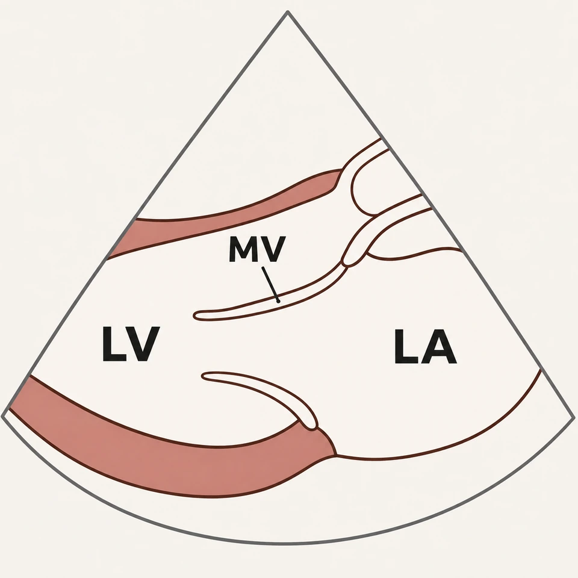
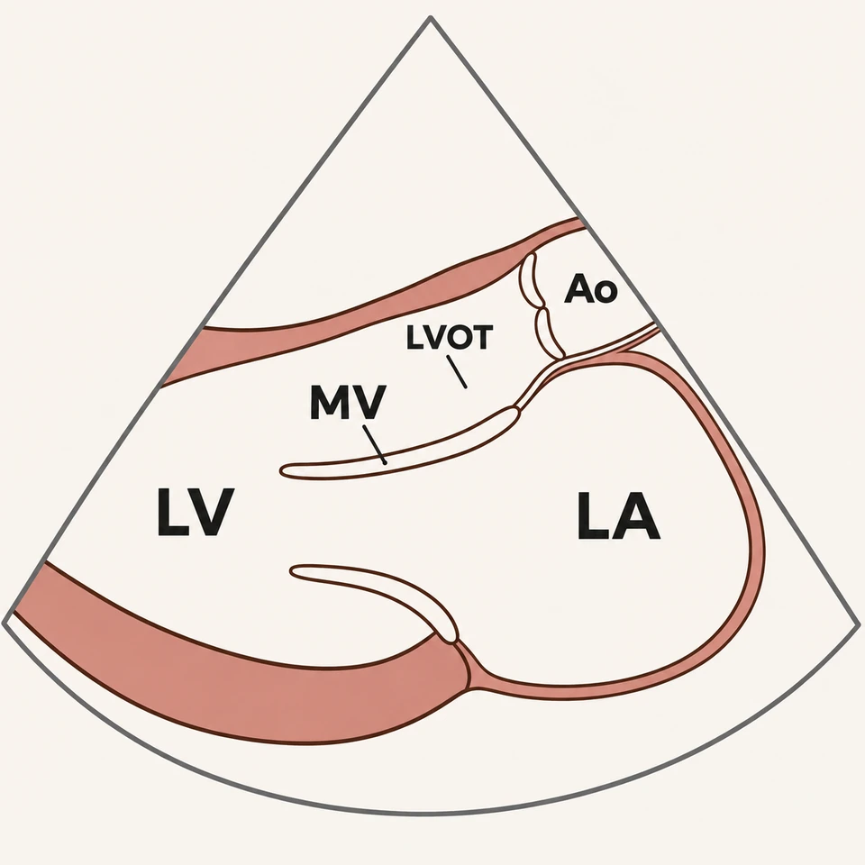

# PLAX mitral illustration: targeted review — v59

## Result

The replacement resolves the reported LA-wall and LVOT/root defects while preserving broad LA–LV inflow. Only `tte:plax_mv` received a new review; all other 55 entries are unchanged. The prior PLAX approval is superseded.

## Before and after

| Superseded v58 | Repaired v59 |
| --- | --- |
|  |  |

## Observed acceptance findings

| Gate | Finding |
| --- | --- |
| LA tissue | Continuous thin terracotta ribbon with inner and outer interfaces, thinner than LV myocardium |
| Sector | Rounded LA wall entirely inside the sector with a separate ivory margin |
| Mitral opening | Broad ivory LA–LV path between two separated leaflet tips; no annular tissue cap |
| Mitral hinges | Long AML joins fibrous region; shorter PML joins basal inferolateral annulus; neither floats |
| LVOT | One open part of LV between septum and AML/curtain; no extra tube, blind loop or spur |
| Fibrous continuity | Short segment between distinct AML and AV hinge levels; no fused free leaflet |
| Aortic valve/root | Two thin opposed cusp profiles meet centrally; one distal Ao lumen separate from LA |
| Phase | Coherent schematic open-MV/closed-AV diastole |
| Labels | All five identify intended anatomy; MV and LVOT leaders terminate correctly |
| Reduction | Atrial ribbon, annular opening, mitral tips and outflow remain discernible at 384px and 200px |

Root and two separate anatomy reviewers inspected the actual 1254px candidate and fresh 384px/200px resamples. Each found no blocking defect. Root and the TTE reviewer separately inspected the actual 960px/384px WebP exports and the 200px rendition after encoding.

One targeted generation was sufficient. No post-generation anatomical painting, compositing or extra image edit was applied. Uniform resampling and WebP encoding preserve the accepted drawing.

## Correction to earlier QC

The previous pass concentrated on removing the initial annular seal and septal spur. It accepted a single contour as a thin atrial wall without requiring tissue interfaces and described LVOT as patent without separately identifying both borders and the two valve hinge levels.

Earlier export checks established faithful encoding of that drawing. They did not establish adequacy of the anatomical representation. This follow-up traces the external atrial wall, mitral opening, outflow borders, fibrous curtain and valve states separately.

## Evidence and limitations

The [guidelines](GUIDELINES.md) identify exact primary references and distinguish PLAX plane evidence from supplementary CT/TEE attachment anatomy. The [prompt](PROMPT.md) is verbatim; the [manifest](asset-manifest.json) records input/master/export hashes and review findings.

This is a simplified MV-focused PLAX reference. Chordae and papillary support are not fully depicted; proportions are schematic. Fine cusp and hinge detail is clearer enlarged. Two cusp profiles in a longitudinal plane do not imply a bicuspid valve. No patient registration, measured valve function or independent clinician certification is asserted.

