# Heart Explorer: complete reference-illustration QC — v60

All **56** illustrations received a fresh review: **28 repaired**, **28 retained** after source and pixel inspection.

The eight-domain score is a schematic-QC aid, not a clinical accuracy percentage. No independent clinician certification, patient correspondence or valve-motion validation is claimed.

See [GUIDELINES.md](GUIDELINES.md) for the full detection and grading standard and [asset-manifest.json](asset-manifest.json) for exact provenance, attempts, reviews and hashes.

| View | Disposition | Current score |
| --- | --- | --- |
| TTE 2.1 — Parasternal long axis — increased depth | Retained after fresh review | 16/16 |
| TTE 2.2 — Parasternal long axis — left ventricle | Retained after fresh review | 16/16 |
| TTE 2.3 — Parasternal long axis — aortic valve zoom | Retained after fresh review | 16/16 |
| TTE 2.4 — Parasternal long axis — mitral valve zoom | Retained after fresh review | 16/16 |
| TTE 2.5 — Parasternal long axis — RV outflow | Repaired | 16/16 |
| TTE 2.6 — Parasternal long axis — RV inflow | Retained after fresh review | 16/16 |
| TTE 2.7 — Parasternal short axis — great vessels, pulmonary focus | Repaired | 16/16 |
| TTE 2.8 — Parasternal short axis — aortic valve level | Retained after fresh review | 16/16 |
| TTE 2.9 — Parasternal short axis — aortic valve zoom | Retained after fresh review | 16/16 |
| TTE 2.10a — Parasternal short axis — tricuspid valve focus | Repaired | 16/16 |
| TTE 2.10b — Parasternal short axis — pulmonary valve and artery focus | Repaired | 16/16 |
| TTE 2.11 — Parasternal short axis — mitral valve level | Retained after fresh review | 16/16 |
| TTE 2.12 — Parasternal short axis — papillary muscle level | Retained after fresh review | 16/16 |
| TTE 2.13 — Parasternal short axis — apical level | Retained after fresh review | 16/16 |
| TTE 2.14 — Apical four-chamber | Retained after fresh review | 16/16 |
| TTE 2.15 — Apical four-chamber — LV zoom | Retained after fresh review | 16/16 |
| TTE 2.16 — Apical four-chamber — RV focus | Repaired | 16/16 |
| TTE 2.17 — Apical five-chamber | Repaired | 16/16 |
| TTE 2.18 — Apical four-chamber — posterior angulation | Retained after fresh review | 16/16 |
| TTE 2.19 — Apical two-chamber | Retained after fresh review | 16/16 |
| TTE 2.20 — Apical two-chamber — LV zoom | Retained after fresh review | 16/16 |
| TTE 2.21 — Apical long axis — three-chamber | Repaired | 16/16 |
| TTE 2.22 — Apical long axis — LV zoom | Repaired | 16/16 |
| TTE 2.23 — Apical four-chamber — left atrial and pulmonary vein focus | Repaired | 16/16 |
| TTE 2.24 — Subcostal four-chamber | Retained after fresh review | 16/16 |
| TTE 2.25 — Subcostal long axis — inferior vena cava | Repaired | 16/16 |
| TTE 2.26 — Subcostal hepatic veins | Repaired | 16/16 |
| TTE 2.27 — Suprasternal notch — aortic arch | Retained after fresh review | 16/16 |
| TEE 1 — Midesophageal five-chamber | Repaired | 16/16 |
| TEE 2 — Midesophageal four-chamber | Repaired | 16/16 |
| TEE 3 — Midesophageal mitral commissural | Retained after fresh review | 16/16 |
| TEE 4 — Midesophageal two-chamber | Repaired | 16/16 |
| TEE 5 — Midesophageal long-axis | Repaired | 16/16 |
| TEE 6 — Midesophageal aortic valve long-axis | Repaired | 16/16 |
| TEE 7 — Midesophageal ascending aorta long-axis | Retained after fresh review | 16/16 |
| TEE 8 — Midesophageal ascending aorta short-axis | Retained after fresh review | 16/16 |
| TEE 9 — Midesophageal right pulmonary vein | Retained after fresh review | 16/16 |
| TEE 10 — Midesophageal aortic valve short-axis | Repaired | 16/16 |
| TEE 11 — Midesophageal RV inflow-outflow | Repaired | 16/16 |
| TEE 12 — Midesophageal modified bicaval tricuspid valve | Repaired | 16/16 |
| TEE 13 — Midesophageal bicaval | Retained after fresh review | 16/16 |
| TEE 14 — Midesophageal right and left pulmonary veins | Repaired | 16/16 |
| TEE 15 — Midesophageal left atrial appendage | Repaired | 16/16 |
| TEE 16 — Transgastric basal short-axis | Retained after fresh review | 16/16 |
| TEE 17 — Transgastric midpapillary short-axis | Retained after fresh review | 16/16 |
| TEE 18 — Transgastric apical short-axis | Retained after fresh review | 16/16 |
| TEE 19 — Transgastric RV basal | Repaired | 16/16 |
| TEE 20 — Transgastric RV inflow-outflow | Repaired | 16/16 |
| TEE 21 — Deep transgastric five-chamber | Repaired | 16/16 |
| TEE 22 — Transgastric two-chamber | Repaired | 16/16 |
| TEE 23 — Transgastric RV inflow | Repaired | 16/16 |
| TEE 24 — Transgastric long-axis | Repaired | 16/16 |
| TEE 25 — Descending aorta short-axis | Retained after fresh review | 16/16 |
| TEE 26 — Descending aorta long-axis | Retained after fresh review | 16/16 |
| TEE 27 — Upper esophageal aortic arch long-axis | Repaired | 16/16 |
| TEE 28 — Upper esophageal aortic arch short-axis | Retained after fresh review | 16/16 |

## Per-view findings

### TTE 2.1 — Parasternal long axis — increased depth

**Retained after fresh review.** Small long-axis heart with generous far-field space matches increased-depth row 2.1. RV lies near field, LV display left, Ao right, and LA posterior to root. LA has a continuous thin terracotta wall; the annulus is not sealed by muscle.

**Phase:** Early diastolic schematic: opposed aortic cusp profiles closed; mitral profiles beginning to separate.

| Before | Current |
| --- | --- |
| 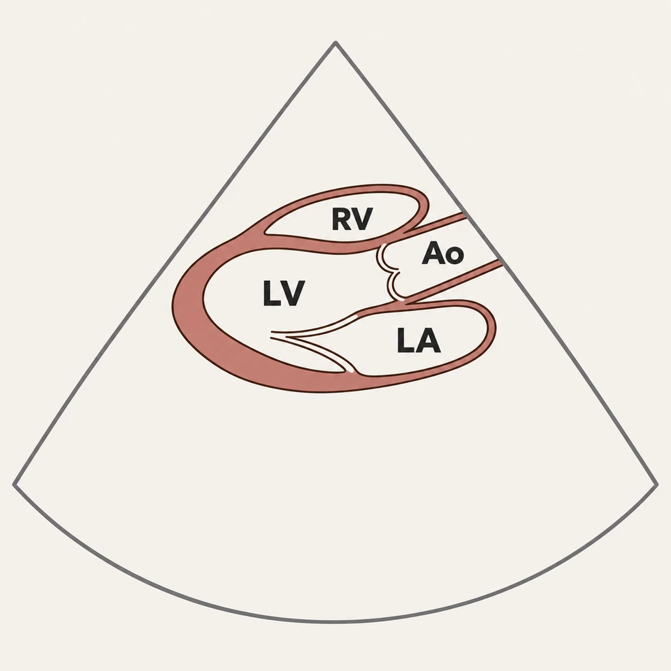 |  |

**Independent inspection:** The fresh primary reviewer inspected the original 960px image; root independently inspected the actual stored384 thumbnail and decoded200 rendition. Remaining retained images keep recognizable labels and finite tissue bands at200; legitimate fibrous/chordal contours remain thin. Existing zooms with tissue reaching true sector edges are intentional crops, not missing walls.

**Exported-pixel observations:** [
  "Small long-axis heart with generous far-field space matches increased-depth row 2.1. RV lies near field, LV display left, Ao right, and LA posterior to root. LA has a continuous thin terracotta wall; the annulus is not sealed by muscle.",
  "Remaining retained images keep recognizable labels and finite tissue bands at200; legitimate fibrous/chordal contours remain thin. Existing zooms with tissue reaching true sector edges are intentional crops, not missing walls."
]

**Sources:**

- [Mitchell et al., JASE 2019;32:1–64](https://www.asecho.org/wp-content/uploads/2025/04/2019_Comprehensive-TTE.pdf)

### TTE 2.2 — Parasternal long axis — left ventricle

**Retained after fresh review.** Normal PLAX organization and finite filled LA wall are preserved. LV–LVOT–AV–Ao and LA–MV–LV are distinguishable without following labels. RV/LV/Ao/LA labels are readable at 200px.

**Phase:** Early diastolic schematic: AV closed; MV beginning to open.

| Before | Current |
| --- | --- |
| 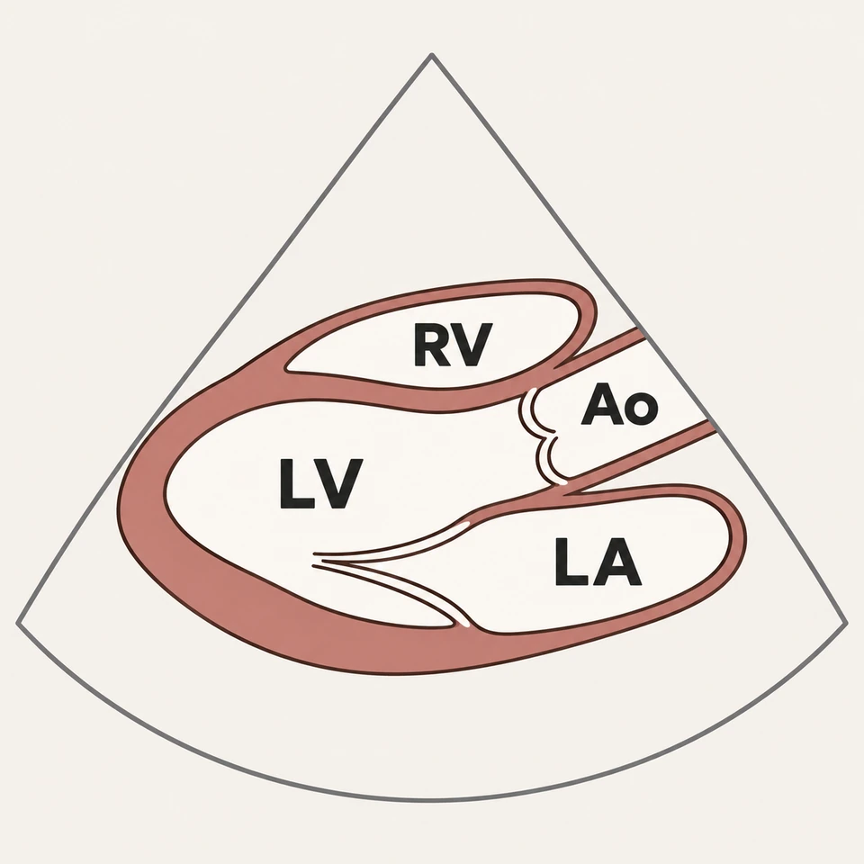 |  |

**Independent inspection:** The fresh primary reviewer inspected the original 960px image; root independently inspected the actual stored384 thumbnail and decoded200 rendition. Remaining retained images keep recognizable labels and finite tissue bands at200; legitimate fibrous/chordal contours remain thin. Existing zooms with tissue reaching true sector edges are intentional crops, not missing walls.

**Exported-pixel observations:** [
  "Normal PLAX organization and finite filled LA wall are preserved. LV–LVOT–AV–Ao and LA–MV–LV are distinguishable without following labels. RV/LV/Ao/LA labels are readable at 200px.",
  "Remaining retained images keep recognizable labels and finite tissue bands at200; legitimate fibrous/chordal contours remain thin. Existing zooms with tissue reaching true sector edges are intentional crops, not missing walls."
]

**Sources:**

- [Mitchell et al., JASE 2019;32:1–64](https://www.asecho.org/wp-content/uploads/2025/04/2019_Comprehensive-TTE.pdf)

### TTE 2.3 — Parasternal long axis — aortic valve zoom

**Retained after fresh review.** LVOT remains one lumen with Ao. The two thin AV profiles hinge on opposing root walls and leave a central gap. Cropped LA, RV and root context match row 2.3. No wall is drawn across the outflow.

**Phase:** Ejection schematic: AV open; MV is outside the displayed focus.

| Before | Current |
| --- | --- |
| 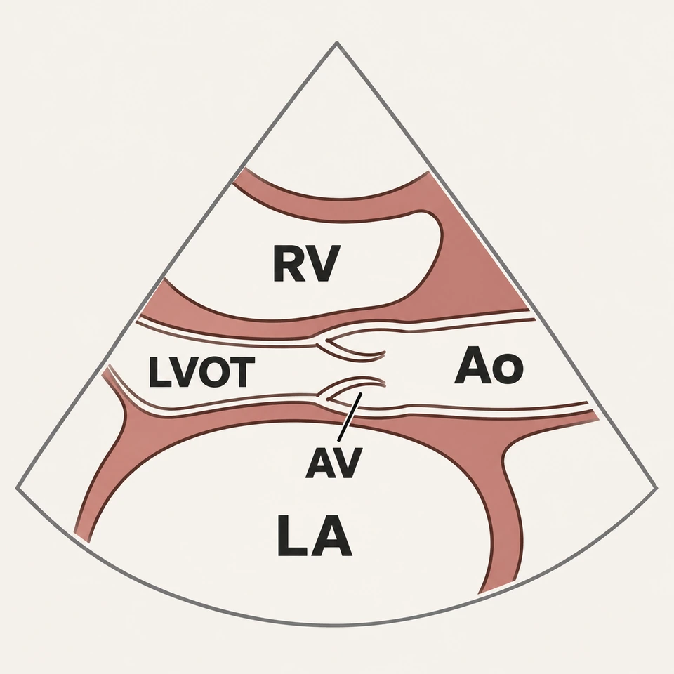 |  |

**Independent inspection:** The fresh primary reviewer inspected the original 960px image; root independently inspected the actual stored384 thumbnail and decoded200 rendition. Remaining retained images keep recognizable labels and finite tissue bands at200; legitimate fibrous/chordal contours remain thin. Existing zooms with tissue reaching true sector edges are intentional crops, not missing walls.

**Exported-pixel observations:** [
  "LVOT remains one lumen with Ao. The two thin AV profiles hinge on opposing root walls and leave a central gap. Cropped LA, RV and root context match row 2.3. No wall is drawn across the outflow.",
  "Remaining retained images keep recognizable labels and finite tissue bands at200; legitimate fibrous/chordal contours remain thin. Existing zooms with tissue reaching true sector edges are intentional crops, not missing walls."
]

**Sources:**

- [Mitchell et al., JASE 2019;32:1–64](https://www.asecho.org/wp-content/uploads/2025/04/2019_Comprehensive-TTE.pdf)

### TTE 2.4 — Parasternal long axis — mitral valve zoom

**Retained after fresh review.** The v59 asset now has a continuous thin terracotta LA wall with inner and outer contours and a broad true mitral opening. AML hinges below the aortic annulus via a short fibrous curtain, LVOT is unobstructed, and Ao is separate from LA.

**Phase:** Diastole: MV open; AV closed.

| Before | Current |
| --- | --- |
| 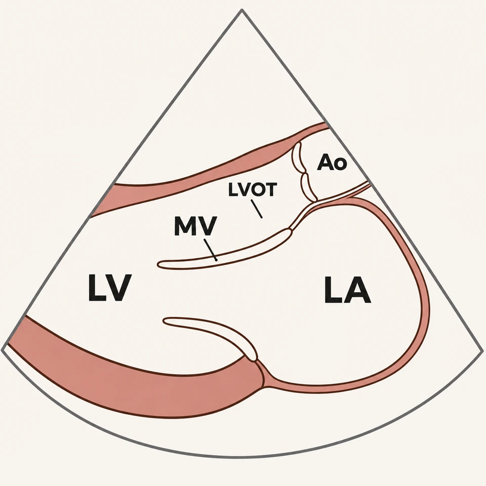 |  |

**Independent inspection:** The fresh primary reviewer inspected the original 960px image; root independently inspected the actual stored384 thumbnail and decoded200 rendition. Remaining retained images keep recognizable labels and finite tissue bands at200; legitimate fibrous/chordal contours remain thin. Existing zooms with tissue reaching true sector edges are intentional crops, not missing walls.

**Exported-pixel observations:** [
  "The v59 asset now has a continuous thin terracotta LA wall with inner and outer contours and a broad true mitral opening. AML hinges below the aortic annulus via a short fibrous curtain, LVOT is unobstructed, and Ao is separate from LA.",
  "Remaining retained images keep recognizable labels and finite tissue bands at200; legitimate fibrous/chordal contours remain thin. Existing zooms with tissue reaching true sector edges are intentional crops, not missing walls."
]

**Sources:**

- [Mitchell et al., JASE 2019;32:1–64](https://www.asecho.org/wp-content/uploads/2025/04/2019_Comprehensive-TTE.pdf)

### TTE 2.5 — Parasternal long axis — RV outflow

**Repaired.** Phantom LV strands removed; LV/LA labels identify the lower pools. The former LV–LA muscle seal is replaced by thin attached mitral apposition. PV profiles have fixed proximal attachments and distal tips toward PA, with broad central outflow. LA and PA have finite filled walls; all labels remain legible at200.

**Phase:** Qualitative systolic ejection: PV open, MV thinly coapted. Exact timing is not asserted.

| Before | Current |
| --- | --- |
| 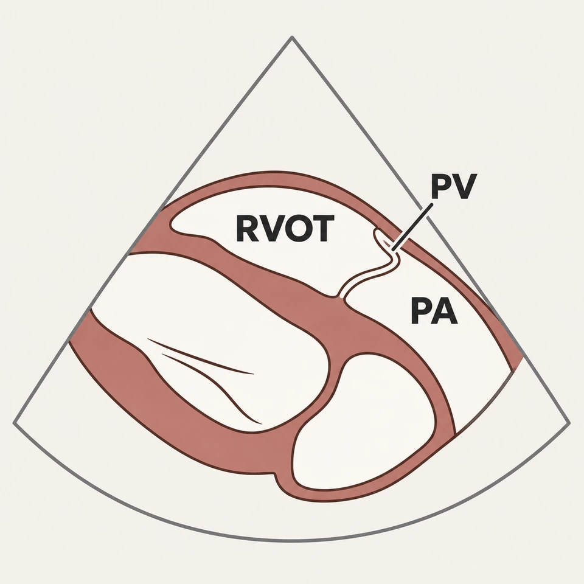 | 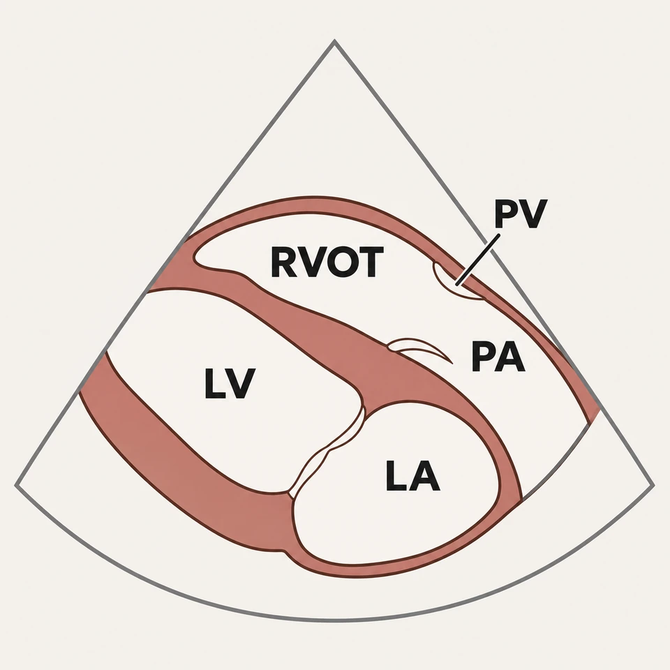 |

**Original findings:**

- A broad terracotta bridge seals the mitral annulus; thin valve tissue from ASE row 2.5 has been replaced by myocardium.
- Two freefloating brown strokes resemble chordae but have no demonstrated leaflet or papillary attachment.
- LV and LA are identifiable but unlabeled.
- The present almost-coapting S-shaped profiles do not clearly establish an ejection valve state.

**Independent inspection:** Independent root review of the exact exported960 image, stored384 thumbnail and decoded200 rendition: Floating LV strokes removed and LV/LA labels added. LV–LA tissue bridge replaced by thin mitral apposition; LA ribbon preserved. PV profiles attach proximally and point downstream toward PA, with clear central RVOT–PA opening. No chordal fragments remain. Actual384 and decoded200 inspected. Filled atrial ribbons remain visible; principal labels readable; intended open outflow versus coapted MV and open AV-valve gap in A4C remain distinguishable.

**Exported-pixel observations:** [
  "Phantom LV strands removed; LV/LA labels identify the lower pools.",
  "The former LV–LA muscle seal is replaced by thin attached mitral apposition.",
  "PV profiles have fixed proximal attachments and distal tips toward PA, with broad central outflow.",
  "LA and PA have finite filled walls; all labels remain legible at200.",
  "Actual384 and decoded200 inspected. Filled atrial ribbons remain visible; principal labels readable; intended open outflow versus coapted MV and open AV-valve gap in A4C remain distinguishable."
]

**Sources:**

- [Mitchell et al., JASE 2019;32:1–64](https://www.asecho.org/wp-content/uploads/2025/04/2019_Comprehensive-TTE.pdf)

### TTE 2.6 — Parasternal long axis — RV inflow

**Retained after fresh review.** RV lies above the RA and two attached TV profiles point into RV. RA has a continuous thin filled wall; the inferomedial atrial extension is compatible with the source section and is not labeled as a separate vessel.

**Phase:** Diastolic inflow: TV partly open.

| Before | Current |
| --- | --- |
| 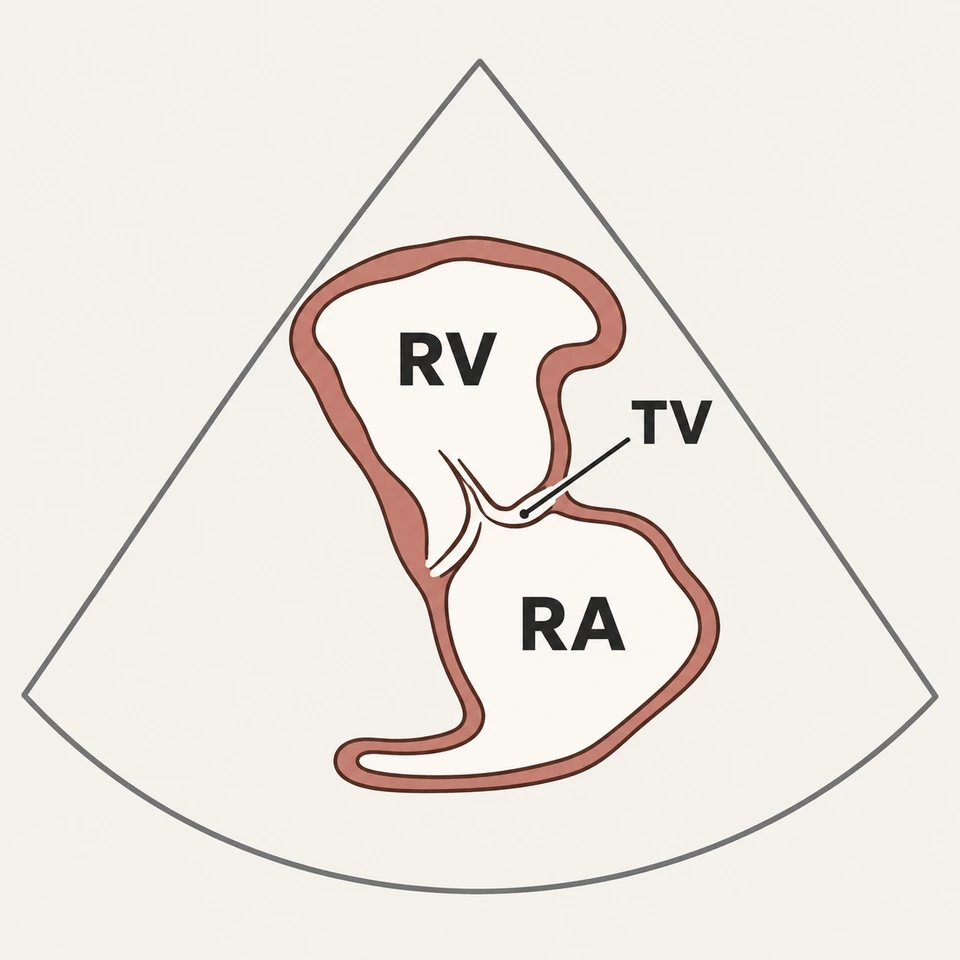 |  |

**Independent inspection:** The fresh primary reviewer inspected the original 960px image; root independently inspected the actual stored384 thumbnail and decoded200 rendition. Remaining retained images keep recognizable labels and finite tissue bands at200; legitimate fibrous/chordal contours remain thin. Existing zooms with tissue reaching true sector edges are intentional crops, not missing walls.

**Exported-pixel observations:** [
  "RV lies above the RA and two attached TV profiles point into RV. RA has a continuous thin filled wall; the inferomedial atrial extension is compatible with the source section and is not labeled as a separate vessel.",
  "Remaining retained images keep recognizable labels and finite tissue bands at200; legitimate fibrous/chordal contours remain thin. Existing zooms with tissue reaching true sector edges are intentional crops, not missing walls."
]

**Sources:**

- [Mitchell et al., JASE 2019;32:1–64](https://www.asecho.org/wp-content/uploads/2025/04/2019_Comprehensive-TTE.pdf)

### TTE 2.7 — Parasternal short axis — great vessels, pulmonary focus

**Repaired.** Only two true TV profiles remain; RA communicates with RVOT through the open central gap. PV is labeled, Ao remains a plain cross-section, and LA has one unambiguous leader. RPA/LPA walls are finite vascular ribbons. Their ivory ellipses are explicit oblique cut faces, not tissue caps. Required labels and connections remain clear at200.

**Phase:** Diastolic filling schematic: TV open, PV closed; Ao cut above AV.

| Before | Current |
| --- | --- |
| 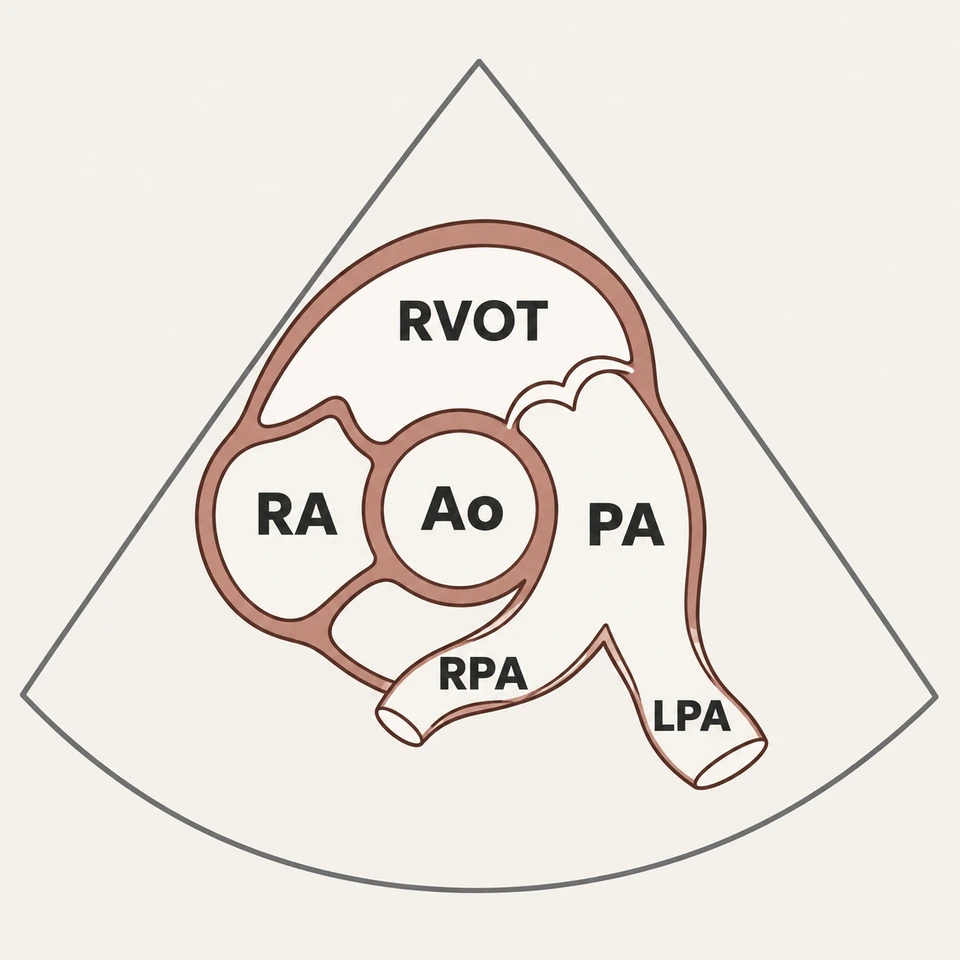 | 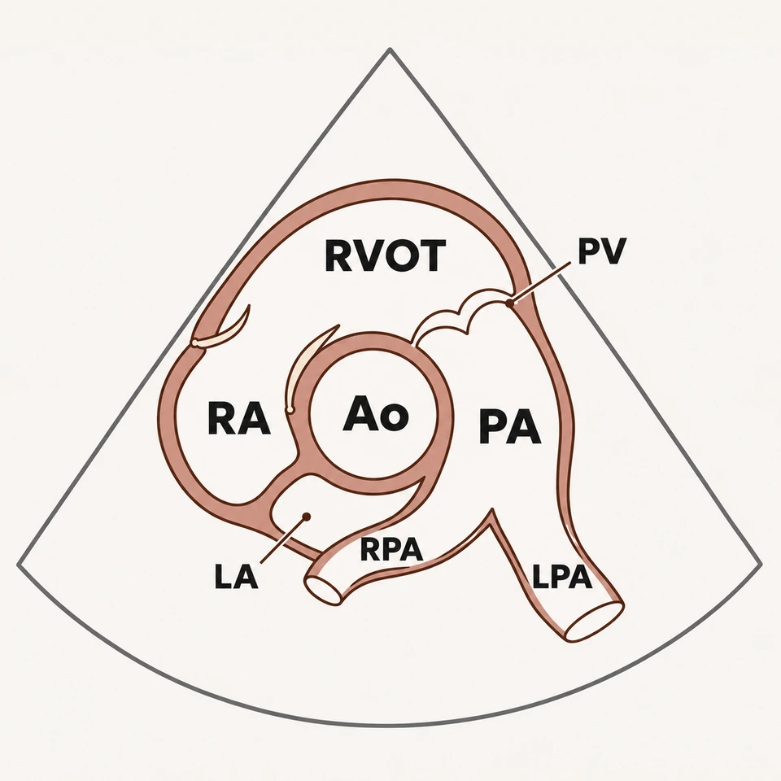 |

**Original findings:**

- A continuous terracotta bridge substitutes for the tricuspid valve.
- Identifiable LA context is unlabeled.
- Much of the branch wall is represented by unfilled double lines; tissue boundary becomes ambiguous at gallery size.
- Defining PV is drawn but unlabeled in this pulmonary-focused reference.

**Independent inspection:** Independent root review of the exact exported960 image, stored384 thumbnail and decoded200 rendition: The extra TV bridge is removed: two attached slender TV profiles leave a broad RA–RVOT aperture. One LA label identifies posterior chamber; finite chamber and vessel bands preserved. Closed PV profile is coherent with open TV. Distal RPA/LPA ellipses explicitly depict schematic cut faces rather than tissue caps. Major labels remain readable at200. Actual384 exported bytes and200 resampling of decoded384 inspected; findings above remain interpretable.

**Exported-pixel observations:** [
  "Only two true TV profiles remain; RA communicates with RVOT through the open central gap.",
  "PV is labeled, Ao remains a plain cross-section, and LA has one unambiguous leader.",
  "RPA/LPA walls are finite vascular ribbons. Their ivory ellipses are explicit oblique cut faces, not tissue caps.",
  "Required labels and connections remain clear at200.",
  "Actual384 exported bytes and200 resampling of decoded384 inspected; findings above remain interpretable."
]

**Sources:**

- [Mitchell et al., JASE 2019;32:1–64](https://www.asecho.org/wp-content/uploads/2025/04/2019_Comprehensive-TTE.pdf)

### TTE 2.8 — Parasternal short axis — aortic valve level

**Retained after fresh review.** The v58 image has intact filled RA/LA free walls, a true central three-cusp AV cross-section, an open TV, and PV in the expected right-side root context. Right-heart and atrial relationships match ASE row 2.8.

**Phase:** Diastole: AV and PV closed; TV open.

| Before | Current |
| --- | --- |
| 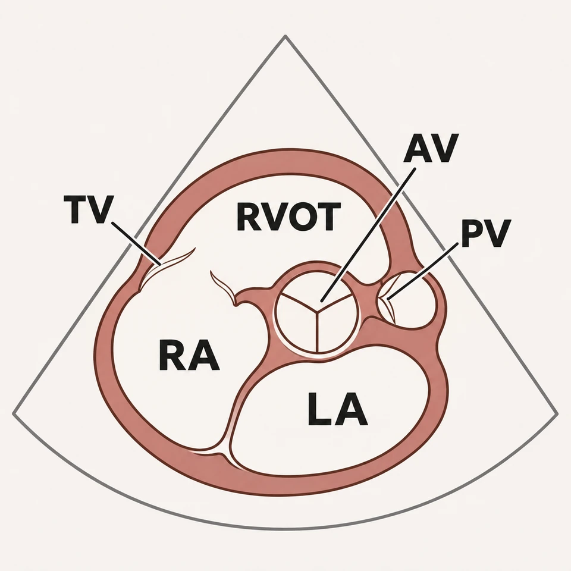 |  |

**Independent inspection:** The fresh primary reviewer inspected the original 960px image; root independently inspected the actual stored384 thumbnail and decoded200 rendition. Remaining retained images keep recognizable labels and finite tissue bands at200; legitimate fibrous/chordal contours remain thin. Existing zooms with tissue reaching true sector edges are intentional crops, not missing walls.

**Exported-pixel observations:** [
  "The v58 image has intact filled RA/LA free walls, a true central three-cusp AV cross-section, an open TV, and PV in the expected right-side root context. Right-heart and atrial relationships match ASE row 2.8.",
  "Remaining retained images keep recognizable labels and finite tissue bands at200; legitimate fibrous/chordal contours remain thin. Existing zooms with tissue reaching true sector edges are intentional crops, not missing walls."
]

**Sources:**

- [Mitchell et al., JASE 2019;32:1–64](https://www.asecho.org/wp-content/uploads/2025/04/2019_Comprehensive-TTE.pdf)

### TTE 2.9 — Parasternal short axis — aortic valve zoom

**Retained after fresh review.** RCC anterior/top-left, NCC posterior/lower-left and LCC display-right agree with ASE row 2.9. Three bounded cusp regions meet centrally; the aortic root has a finite filled circumference.

**Phase:** Diastolic en-face schematic: three aortic cusps closed.

| Before | Current |
| --- | --- |
| 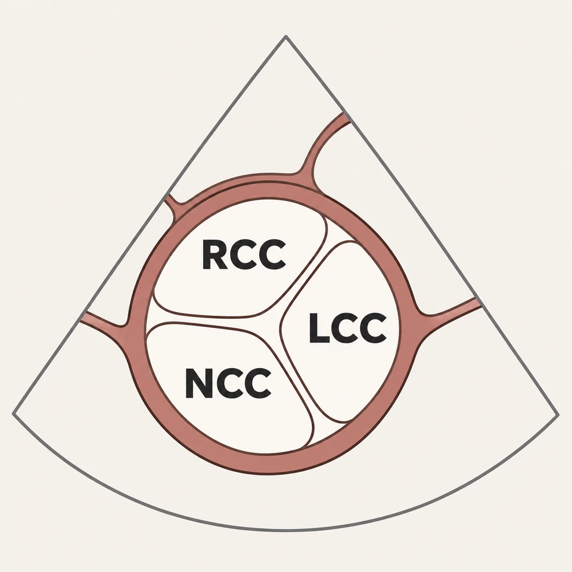 |  |

**Independent inspection:** The fresh primary reviewer inspected the original 960px image; root independently inspected the actual stored384 thumbnail and decoded200 rendition. Remaining retained images keep recognizable labels and finite tissue bands at200; legitimate fibrous/chordal contours remain thin. Existing zooms with tissue reaching true sector edges are intentional crops, not missing walls.

**Exported-pixel observations:** [
  "RCC anterior/top-left, NCC posterior/lower-left and LCC display-right agree with ASE row 2.9. Three bounded cusp regions meet centrally; the aortic root has a finite filled circumference.",
  "Remaining retained images keep recognizable labels and finite tissue bands at200; legitimate fibrous/chordal contours remain thin. Existing zooms with tissue reaching true sector edges are intentional crops, not missing walls."
]

**Sources:**

- [Mitchell et al., JASE 2019;32:1–64](https://www.asecho.org/wp-content/uploads/2025/04/2019_Comprehensive-TTE.pdf)

### TTE 2.10a — Parasternal short axis — tricuspid valve focus

**Repaired.** LA added to the previously empty posterior atrial pool. The original accepted valve, root and wall geometry is preserved; no new anatomical strokes. All principal pools are now named and readable at200.

**Phase:** Early diastolic TV opening; AV closed in short axis.

| Before | Current |
| --- | --- |
| 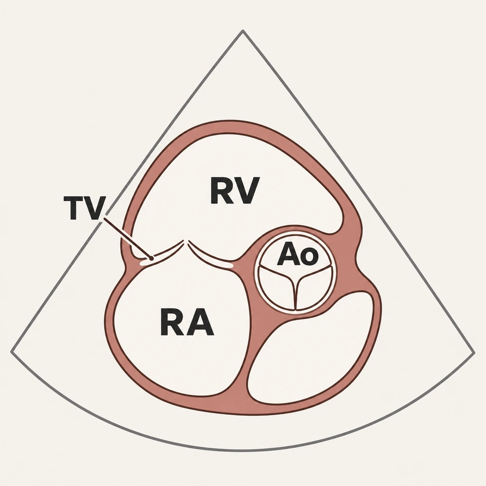 | 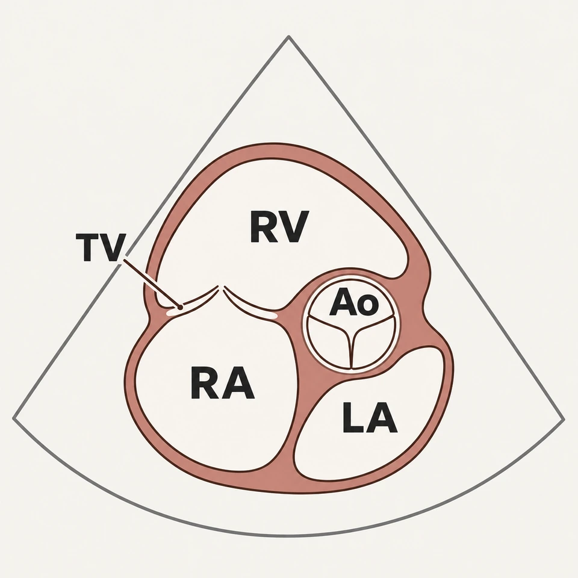 |

**Original findings:**

- LA is identifiable and unlabeled.

**Independent inspection:** Independent root review of the exact exported960 image, stored384 thumbnail and decoded200 rendition: LA label added inside the correct posterior atrial pool. Finite RA/LA and RV tissue preserved; thin attached TV profiles retain a small diastolic aperture, with closed three-region AV. Labels remain legible at384/200. Actual384 and decoded200 pixels inspected; interpretation recorded above.

**Exported-pixel observations:** [
  "LA added to the previously empty posterior atrial pool.",
  "The original accepted valve, root and wall geometry is preserved; no new anatomical strokes.",
  "All principal pools are now named and readable at200.",
  "Actual384 and decoded200 pixels inspected; interpretation recorded above."
]

**Sources:**

- [Mitchell et al., JASE 2019;32:1–64](https://www.asecho.org/wp-content/uploads/2025/04/2019_Comprehensive-TTE.pdf)

### TTE 2.10b — Parasternal short axis — pulmonary valve and artery focus

**Repaired.** The broad inferior tissue mass is replaced by a distinct thin-walled LA context. The PA lumen continues to the actual lower sector boundary without a transverse cap. A narrow curved myocardial boundary links the lower-left RVOT edge to the sector and root, preventing leakage into the background. Ao remains a separate finite ring, PV profiles are attached, and all five labels are clear.

**Phase:** Qualitative closed/near-coapted PV schematic; no other valve is shown and exact timing is not asserted.

| Before | Current |
| --- | --- |
| 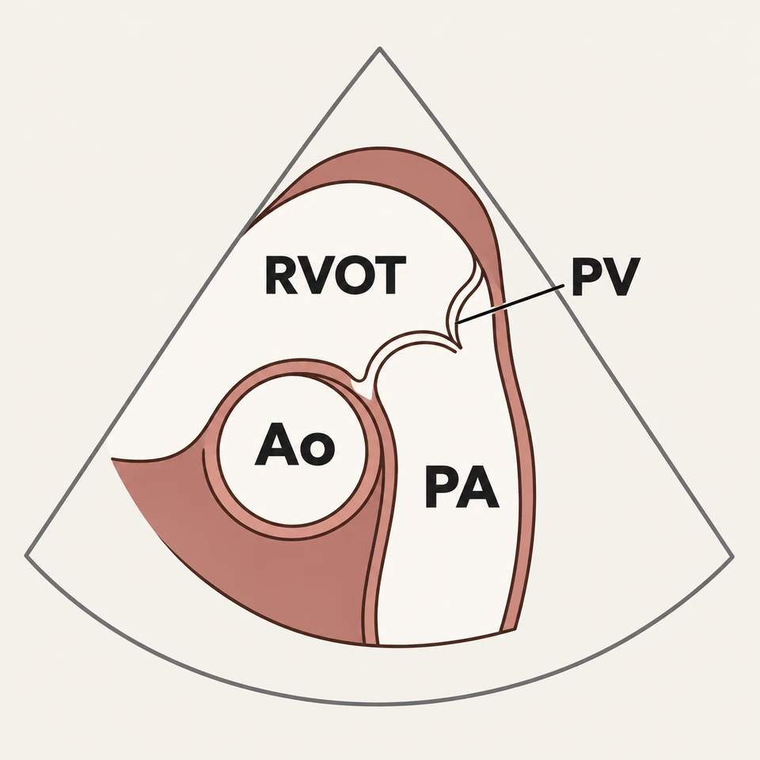 | 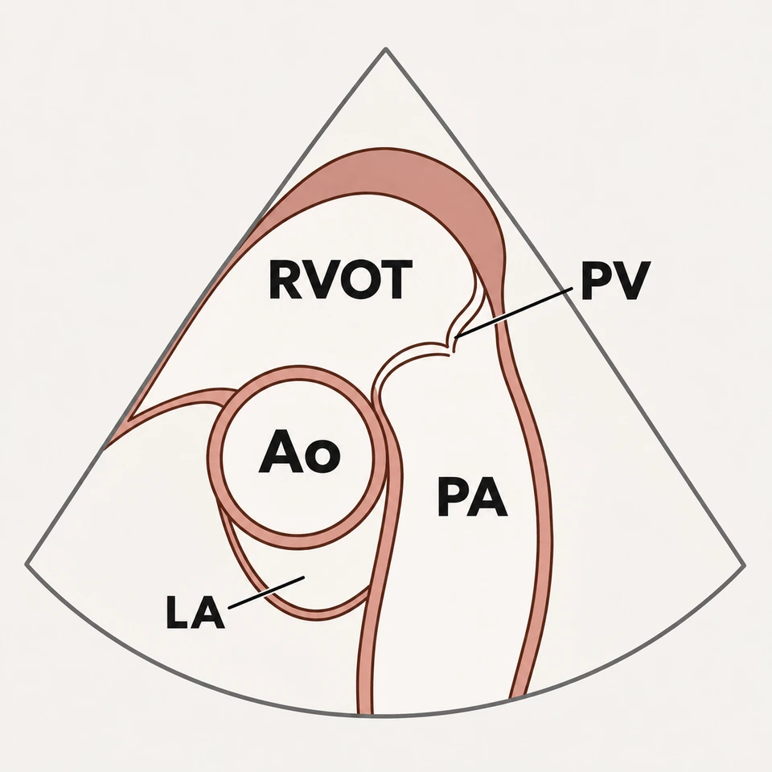 |

**Original findings:**

- Large uniform terracotta block replaces the small posterior atrial context visible in the source and suggests a broad myocardial mass.
- A dark contour traverses the arterial lumen inside the sector, reading as a false cap.

**Independent inspection:** Independent root review of the exact exported960 image, stored384 thumbnail and decoded200 rendition: Thin filled LA ribbon and delicate lower-left RVOT strip are continuous to the real sector boundary. PA lumen exits the sector without the old distal tissue cap. Opposed closed PV profiles join at a thin coaptation seam with proximal wall attachments. Labels and tissue bands remain visible at200. Actual384 exported bytes and200 resampling of decoded384 inspected; findings above remain interpretable.

**Exported-pixel observations:** [
  "The broad inferior tissue mass is replaced by a distinct thin-walled LA context.",
  "The PA lumen continues to the actual lower sector boundary without a transverse cap.",
  "A narrow curved myocardial boundary links the lower-left RVOT edge to the sector and root, preventing leakage into the background.",
  "Ao remains a separate finite ring, PV profiles are attached, and all five labels are clear.",
  "Actual384 exported bytes and200 resampling of decoded384 inspected; findings above remain interpretable."
]

**Sources:**

- [Mitchell et al., JASE 2019;32:1–64](https://www.asecho.org/wp-content/uploads/2025/04/2019_Comprehensive-TTE.pdf)

### TTE 2.11 — Parasternal short axis — mitral valve level

**Retained after fresh review.** Basal LV is approximately round with crescentic RV. Anterior and posterior MV contours bound an open central orifice within the LV; the lower LV label does not identify an extra chamber.

**Phase:** Diastole: mitral orifice open in basal short axis.

| Before | Current |
| --- | --- |
| 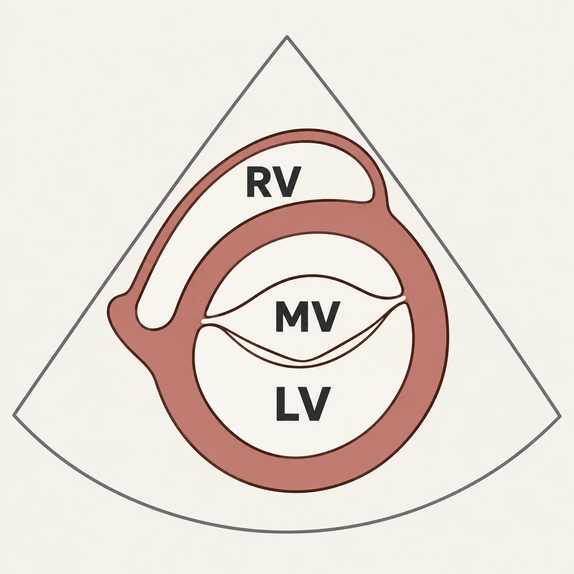 |  |

**Independent inspection:** The fresh primary reviewer inspected the original 960px image; root independently inspected the actual stored384 thumbnail and decoded200 rendition. Remaining retained images keep recognizable labels and finite tissue bands at200; legitimate fibrous/chordal contours remain thin. Existing zooms with tissue reaching true sector edges are intentional crops, not missing walls.

**Exported-pixel observations:** [
  "Basal LV is approximately round with crescentic RV. Anterior and posterior MV contours bound an open central orifice within the LV; the lower LV label does not identify an extra chamber.",
  "Remaining retained images keep recognizable labels and finite tissue bands at200; legitimate fibrous/chordal contours remain thin. Existing zooms with tissue reaching true sector edges are intentional crops, not missing walls."
]

**Sources:**

- [Mitchell et al., JASE 2019;32:1–64](https://www.asecho.org/wp-content/uploads/2025/04/2019_Comprehensive-TTE.pdf)

### TTE 2.12 — Parasternal short axis — papillary muscle level

**Retained after fresh review.** Two papillary profiles project from the LV wall at the expected posterior quadrants. There is no mitral opening, basal valve or extra chamber. RV remains a thin-walled anterior crescent.

**Phase:** Phase not diagnostic; short-axis papillary-level geometry.

| Before | Current |
| --- | --- |
| 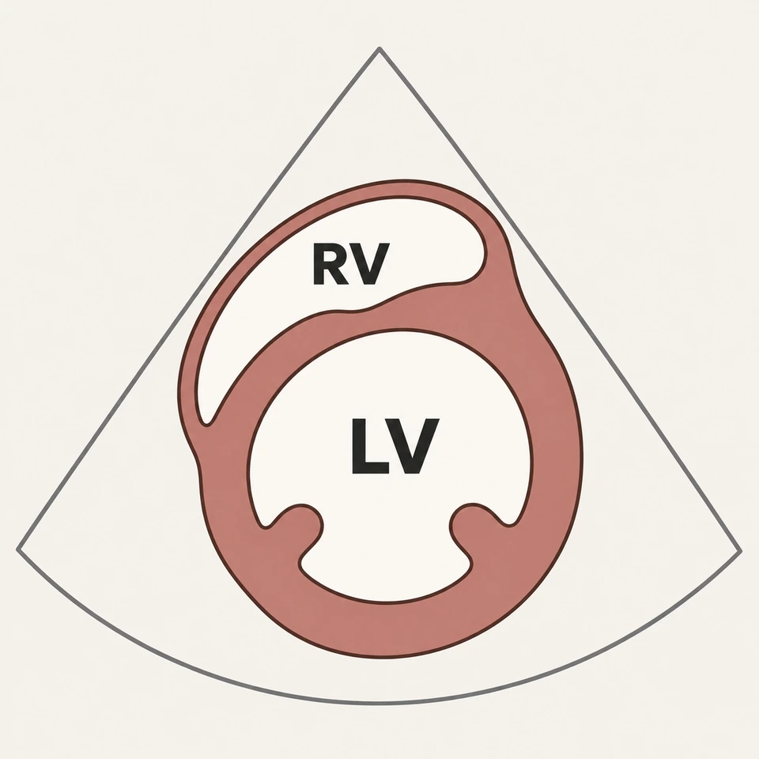 |  |

**Independent inspection:** The fresh primary reviewer inspected the original 960px image; root independently inspected the actual stored384 thumbnail and decoded200 rendition. Remaining retained images keep recognizable labels and finite tissue bands at200; legitimate fibrous/chordal contours remain thin. Existing zooms with tissue reaching true sector edges are intentional crops, not missing walls.

**Exported-pixel observations:** [
  "Two papillary profiles project from the LV wall at the expected posterior quadrants. There is no mitral opening, basal valve or extra chamber. RV remains a thin-walled anterior crescent.",
  "Remaining retained images keep recognizable labels and finite tissue bands at200; legitimate fibrous/chordal contours remain thin. Existing zooms with tissue reaching true sector edges are intentional crops, not missing walls."
]

**Sources:**

- [Mitchell et al., JASE 2019;32:1–64](https://www.asecho.org/wp-content/uploads/2025/04/2019_Comprehensive-TTE.pdf)

### TTE 2.13 — Parasternal short axis — apical level

**Retained after fresh review.** Small circular LV cavity, finite myocardial ring, no copied papillary muscles or basal valve. This matches the more apical level rather than midventricular SAX.

**Phase:** Phase not diagnostic; apical short-axis schematic.

| Before | Current |
| --- | --- |
| 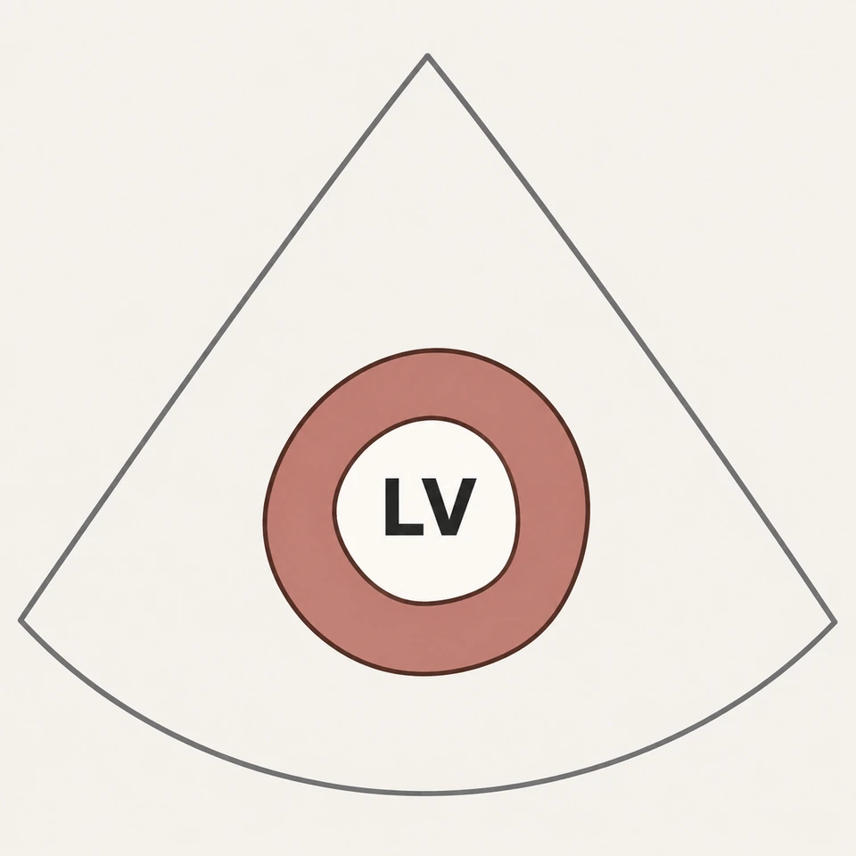 |  |

**Independent inspection:** The fresh primary reviewer inspected the original 960px image; root independently inspected the actual stored384 thumbnail and decoded200 rendition. Remaining retained images keep recognizable labels and finite tissue bands at200; legitimate fibrous/chordal contours remain thin. Existing zooms with tissue reaching true sector edges are intentional crops, not missing walls.

**Exported-pixel observations:** [
  "Small circular LV cavity, finite myocardial ring, no copied papillary muscles or basal valve. This matches the more apical level rather than midventricular SAX.",
  "Remaining retained images keep recognizable labels and finite tissue bands at200; legitimate fibrous/chordal contours remain thin. Existing zooms with tissue reaching true sector edges are intentional crops, not missing walls."
]

**Sources:**

- [Mitchell et al., JASE 2019;32:1–64](https://www.asecho.org/wp-content/uploads/2025/04/2019_Comprehensive-TTE.pdf)

### TTE 2.14 — Apical four-chamber

**Retained after fresh review.** All four blood pools are labeled. Both atrial free walls and IAS are filled, with LV wall thicker than RV and atria. TV insertion is apical to MV. No outflow tract or aorta is invented.

**Phase:** Early diastolic opening: MV and TV have small central separations.

| Before | Current |
| --- | --- |
| 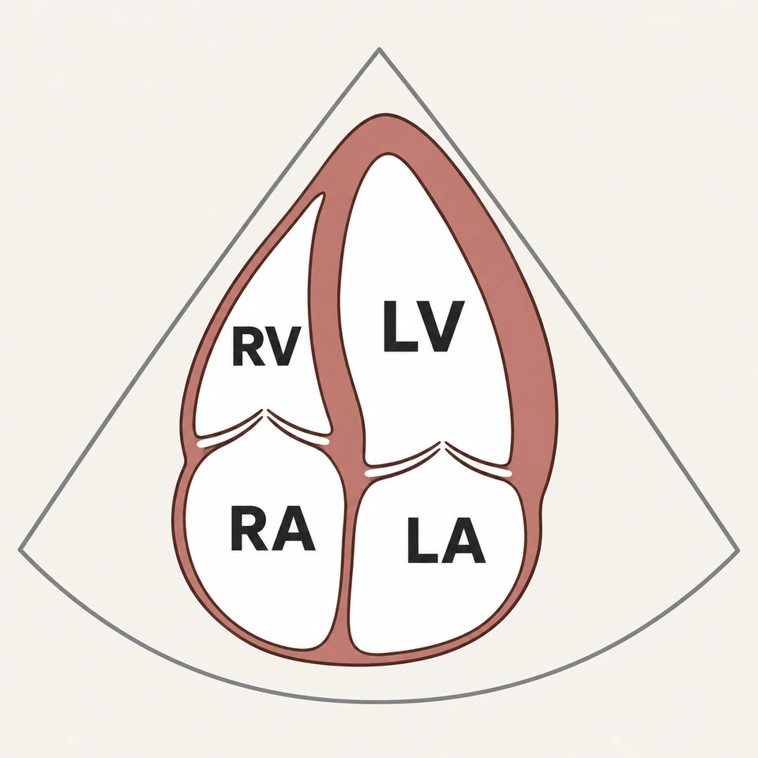 |  |

**Independent inspection:** The fresh primary reviewer inspected the original 960px image; root independently inspected the actual stored384 thumbnail and decoded200 rendition. Remaining retained images keep recognizable labels and finite tissue bands at200; legitimate fibrous/chordal contours remain thin. Existing zooms with tissue reaching true sector edges are intentional crops, not missing walls.

**Exported-pixel observations:** [
  "All four blood pools are labeled. Both atrial free walls and IAS are filled, with LV wall thicker than RV and atria. TV insertion is apical to MV. No outflow tract or aorta is invented.",
  "Remaining retained images keep recognizable labels and finite tissue bands at200; legitimate fibrous/chordal contours remain thin. Existing zooms with tissue reaching true sector edges are intentional crops, not missing walls."
]

**Sources:**

- [Mitchell et al., JASE 2019;32:1–64](https://www.asecho.org/wp-content/uploads/2025/04/2019_Comprehensive-TTE.pdf)

### TTE 2.15 — Apical four-chamber — LV zoom

**Retained after fresh review.** LV emphasis and full ventricular apex are preserved. RV remains visible and labeled. Atrial remnants are intentionally cropped at the lower sector border; the gray border is not mistaken for tissue.

**Phase:** Early diastolic AV-valve opening.

| Before | Current |
| --- | --- |
| 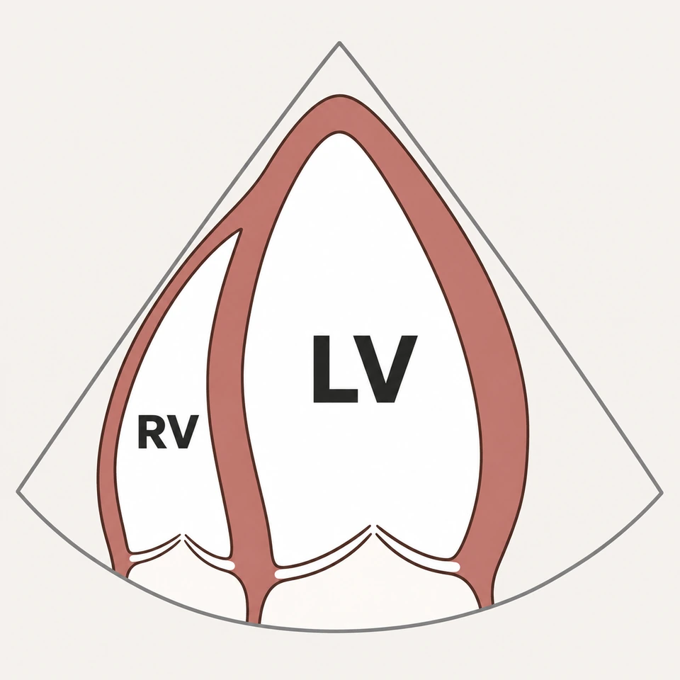 |  |

**Independent inspection:** The fresh primary reviewer inspected the original 960px image; root independently inspected the actual stored384 thumbnail and decoded200 rendition. Remaining retained images keep recognizable labels and finite tissue bands at200; legitimate fibrous/chordal contours remain thin. Existing zooms with tissue reaching true sector edges are intentional crops, not missing walls.

**Exported-pixel observations:** [
  "LV emphasis and full ventricular apex are preserved. RV remains visible and labeled. Atrial remnants are intentionally cropped at the lower sector border; the gray border is not mistaken for tissue.",
  "Remaining retained images keep recognizable labels and finite tissue bands at200; legitimate fibrous/chordal contours remain thin. Existing zooms with tissue reaching true sector edges are intentional crops, not missing walls."
]

**Sources:**

- [Mitchell et al., JASE 2019;32:1–64](https://www.asecho.org/wp-content/uploads/2025/04/2019_Comprehensive-TTE.pdf)

### TTE 2.16 — Apical four-chamber — RV focus

**Repaired.** Thin terracotta tissue now fills both atrial free-wall ribbons and IAS. Open AV apertures and their thin attached leaflets are preserved. LV still forms the apical tip; complete smaller RV remains in the intended focus. All four labels and the colored atrial bands remain clear at200.

**Phase:** Diastolic filling: MV and TV open.

| Before | Current |
| --- | --- |
| 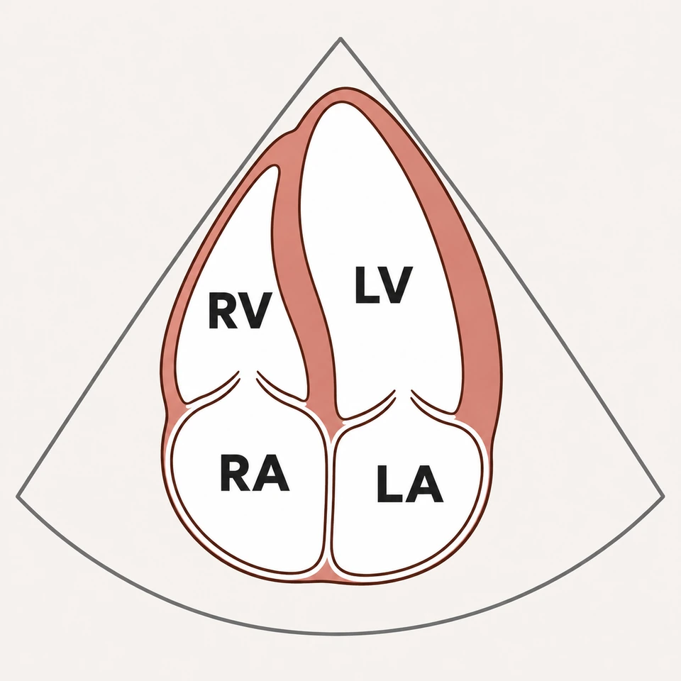 | 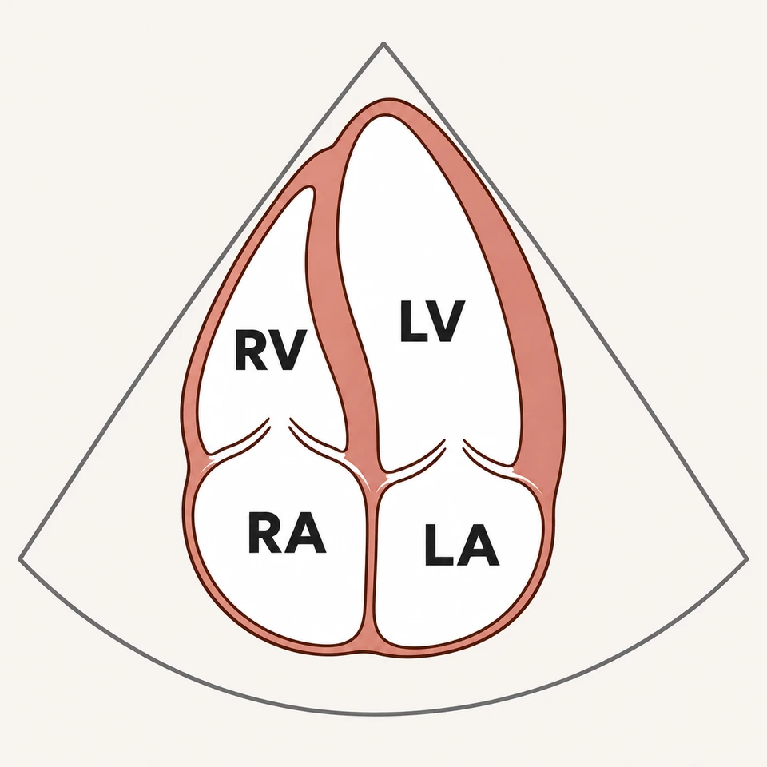 |

**Original findings:**

- The wall strips are ivory like the cavities and read as empty outlines at gallery size.

**Independent inspection:** Independent root review of the exact exported960 image, stored384 thumbnail and decoded200 rendition: LA/RA free walls and IAS now contain finite thin terracotta tissue. LV forms apex; right heart remains display left. Attached AV leaflet profiles have visible central openings into ventricles. Correct four labels and relative wall thickness retained. Actual384 and decoded200 inspected. Filled atrial ribbons remain visible; principal labels readable; intended open outflow versus coapted MV and open AV-valve gap in A4C remain distinguishable.

**Exported-pixel observations:** [
  "Thin terracotta tissue now fills both atrial free-wall ribbons and IAS.",
  "Open AV apertures and their thin attached leaflets are preserved.",
  "LV still forms the apical tip; complete smaller RV remains in the intended focus.",
  "All four labels and the colored atrial bands remain clear at200.",
  "Actual384 and decoded200 inspected. Filled atrial ribbons remain visible; principal labels readable; intended open outflow versus coapted MV and open AV-valve gap in A4C remain distinguishable."
]

**Sources:**

- [Mitchell et al., JASE 2019;32:1–64](https://www.asecho.org/wp-content/uploads/2025/04/2019_Comprehensive-TTE.pdf)

### TTE 2.17 — Apical five-chamber

**Repaired.** AV cusp profiles begin proximally at the root walls and have free tips downstream into Ao, leaving a clear outlet. MV reads as a thin coapted schematic at384/200, not a muscular seal. LA has a continuous narrow filled wall ribbon. AV label/leader is distinct from LVOT; a separate RA pool was not invented.

**Phase:** Qualitative systolic ejection: AV open and MV at thin central apposition; no exact timed subphase is claimed.

| Before | Current |
| --- | --- |
| 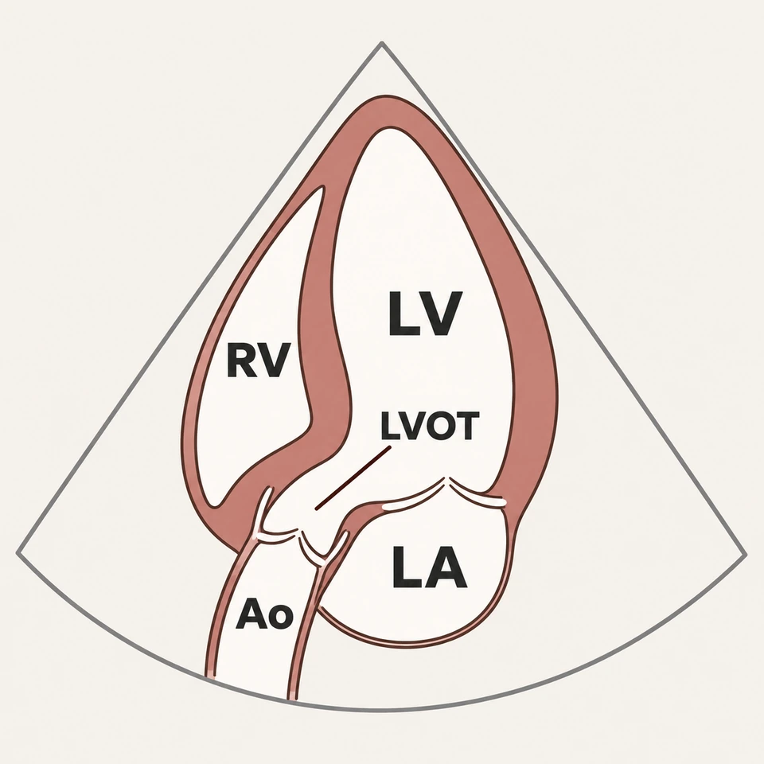 | 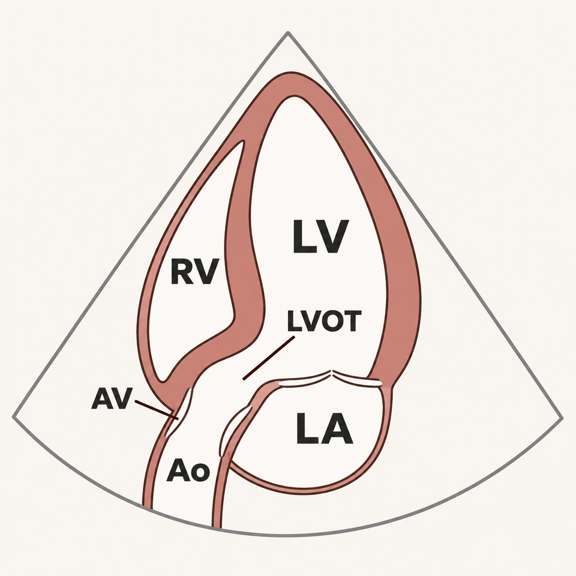 |

**Original findings:**

- Near-coapting profiles have free edges directed upstream toward LVOT while their bowed bellies project downstream toward Ao; this does not clearly represent a normal closed semilunar valve or an open ejection valve.
- The wall is a pale unfilled double contour, without the tissue hierarchy established elsewhere.

**Independent inspection:** Independent root review of the exact exported960 image, stored384 thumbnail and decoded200 rendition: Finite LA ribbon restored. LV–LVOT–Ao channel is open through AV, whose opposed profiles have proximal hinges and inferior downstream free tips. MV near-apposed in a qualitative ejection frame; no extra RA chamber invented. Actual384 and decoded200 inspected. Filled atrial ribbons remain visible; principal labels readable; intended open outflow versus coapted MV and open AV-valve gap in A4C remain distinguishable.

**Exported-pixel observations:** [
  "AV cusp profiles begin proximally at the root walls and have free tips downstream into Ao, leaving a clear outlet.",
  "MV reads as a thin coapted schematic at384/200, not a muscular seal.",
  "LA has a continuous narrow filled wall ribbon.",
  "AV label/leader is distinct from LVOT; a separate RA pool was not invented.",
  "Actual384 and decoded200 inspected. Filled atrial ribbons remain visible; principal labels readable; intended open outflow versus coapted MV and open AV-valve gap in A4C remain distinguishable."
]

**Sources:**

- [Mitchell et al., JASE 2019;32:1–64](https://www.asecho.org/wp-content/uploads/2025/04/2019_Comprehensive-TTE.pdf)

### TTE 2.18 — Apical four-chamber — posterior angulation

**Retained after fresh review.** CS is a thin-walled channel posterior to the LV base, continuous with RA. A small LA is separately enclosed below it. The muscular LV base is appropriate here because the posterior-angled section does not cut the mitral inflow plane.

**Phase:** Posterior plane; TV near opening, MV outside the intersected inflow plane.

| Before | Current |
| --- | --- |
| 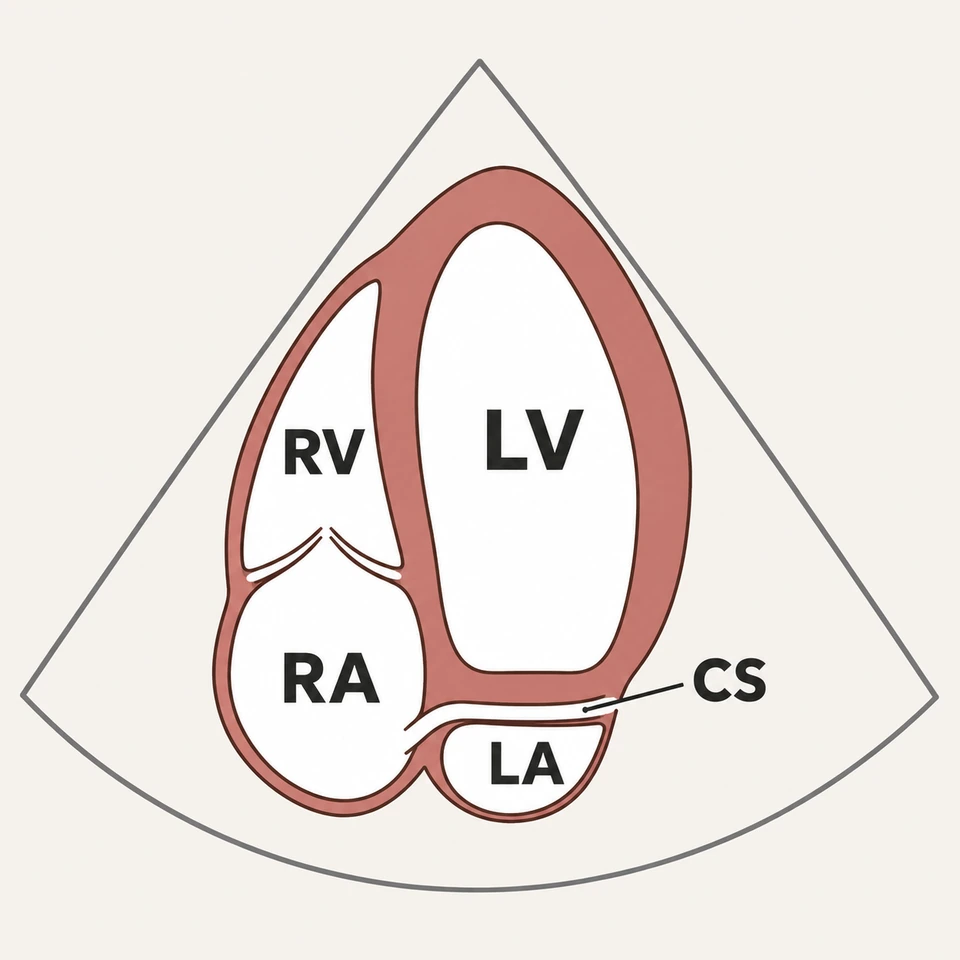 |  |

**Independent inspection:** The fresh primary reviewer inspected the original 960px image; root independently inspected the actual stored384 thumbnail and decoded200 rendition. Remaining retained images keep recognizable labels and finite tissue bands at200; legitimate fibrous/chordal contours remain thin. Existing zooms with tissue reaching true sector edges are intentional crops, not missing walls.

**Exported-pixel observations:** [
  "CS is a thin-walled channel posterior to the LV base, continuous with RA. A small LA is separately enclosed below it. The muscular LV base is appropriate here because the posterior-angled section does not cut the mitral inflow plane.",
  "Remaining retained images keep recognizable labels and finite tissue bands at200; legitimate fibrous/chordal contours remain thin. Existing zooms with tissue reaching true sector edges are intentional crops, not missing walls."
]

**Sources:**

- [Mitchell et al., JASE 2019;32:1–64](https://www.asecho.org/wp-content/uploads/2025/04/2019_Comprehensive-TTE.pdf)

### TTE 2.19 — Apical two-chamber

**Retained after fresh review.** LA and LV have appropriate finite wall hierarchy. MV is thin and attached at opposing annular rims. No RV or aortic compartment has been added to a two-chamber section.

**Phase:** Early diastolic MV opening.

| Before | Current |
| --- | --- |
| 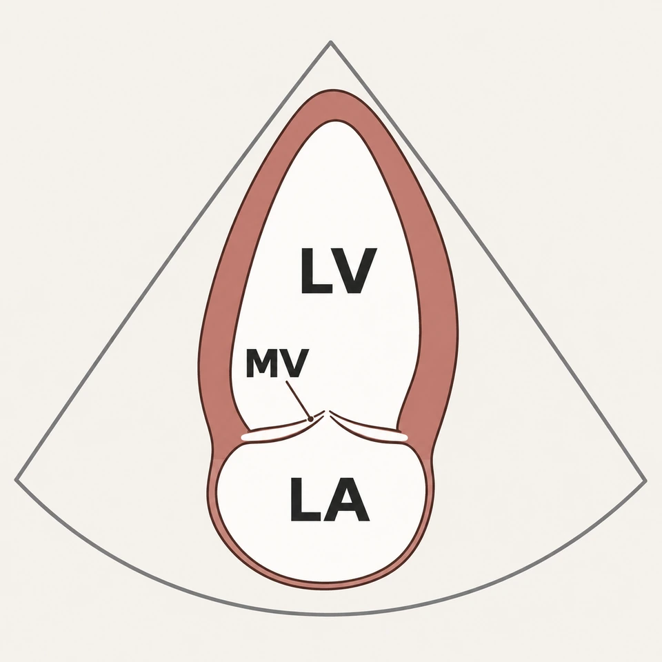 |  |

**Independent inspection:** The fresh primary reviewer inspected the original 960px image; root independently inspected the actual stored384 thumbnail and decoded200 rendition. Remaining retained images keep recognizable labels and finite tissue bands at200; legitimate fibrous/chordal contours remain thin. Existing zooms with tissue reaching true sector edges are intentional crops, not missing walls.

**Exported-pixel observations:** [
  "LA and LV have appropriate finite wall hierarchy. MV is thin and attached at opposing annular rims. No RV or aortic compartment has been added to a two-chamber section.",
  "Remaining retained images keep recognizable labels and finite tissue bands at200; legitimate fibrous/chordal contours remain thin. Existing zooms with tissue reaching true sector edges are intentional crops, not missing walls."
]

**Sources:**

- [Mitchell et al., JASE 2019;32:1–64](https://www.asecho.org/wp-content/uploads/2025/04/2019_Comprehensive-TTE.pdf)

### TTE 2.20 — Apical two-chamber — LV zoom

**Retained after fresh review.** LV-focused crop retains the full apex and wall continuity, with only a small atrial remnant at the lower sector edge. MV leader ends on a leaflet; it is annotation, not chordal support.

**Phase:** Diastolic MV opening.

| Before | Current |
| --- | --- |
| 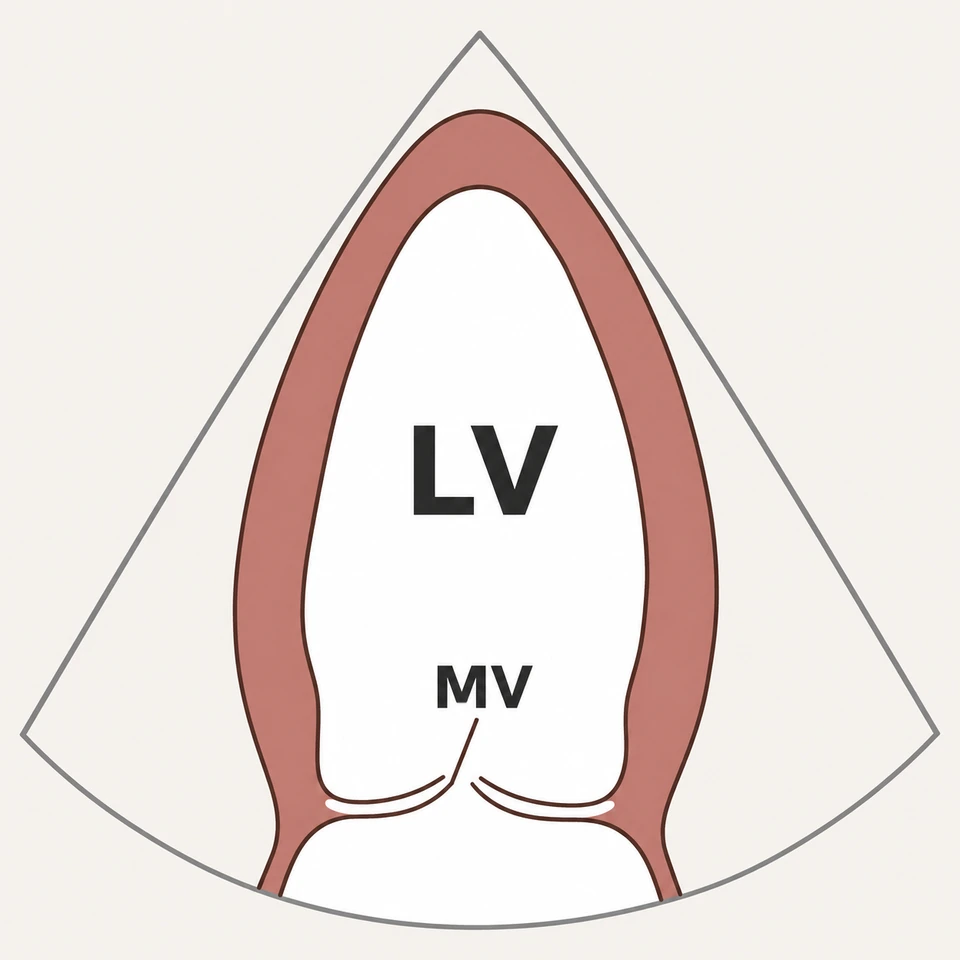 |  |

**Independent inspection:** The fresh primary reviewer inspected the original 960px image; root independently inspected the actual stored384 thumbnail and decoded200 rendition. Remaining retained images keep recognizable labels and finite tissue bands at200; legitimate fibrous/chordal contours remain thin. Existing zooms with tissue reaching true sector edges are intentional crops, not missing walls.

**Exported-pixel observations:** [
  "LV-focused crop retains the full apex and wall continuity, with only a small atrial remnant at the lower sector edge. MV leader ends on a leaflet; it is annotation, not chordal support.",
  "Remaining retained images keep recognizable labels and finite tissue bands at200; legitimate fibrous/chordal contours remain thin. Existing zooms with tissue reaching true sector edges are intentional crops, not missing walls."
]

**Sources:**

- [Mitchell et al., JASE 2019;32:1–64](https://www.asecho.org/wp-content/uploads/2025/04/2019_Comprehensive-TTE.pdf)

### TTE 2.21 — Apical long axis — three-chamber

**Repaired.** Open AV profiles have proximal fixed attachments and distal free tips toward Ao. The RV sliver and AV are labeled without enlarging the anatomy. LA wall and aortomitral continuity are preserved. At384/200 the thin MV apposition reads as closure, distinctly different from the broad A4C-RV open gap.

**Phase:** Qualitative systolic ejection: AV open and MV at thin central apposition; no exact timed subphase is claimed.

| Before | Current |
| --- | --- |
| 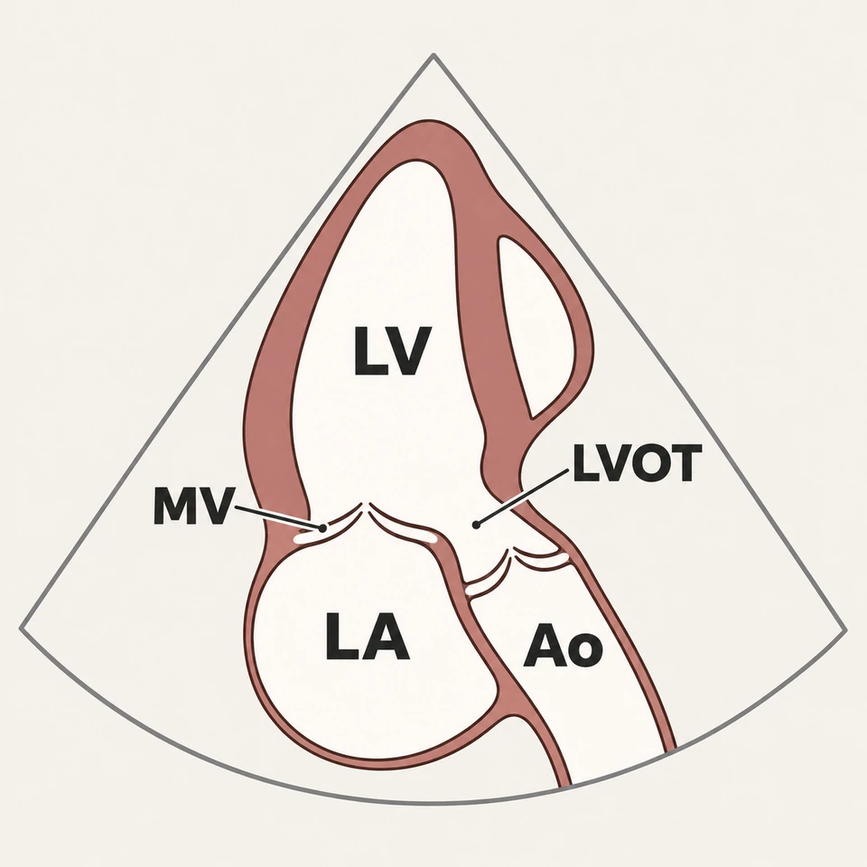 | 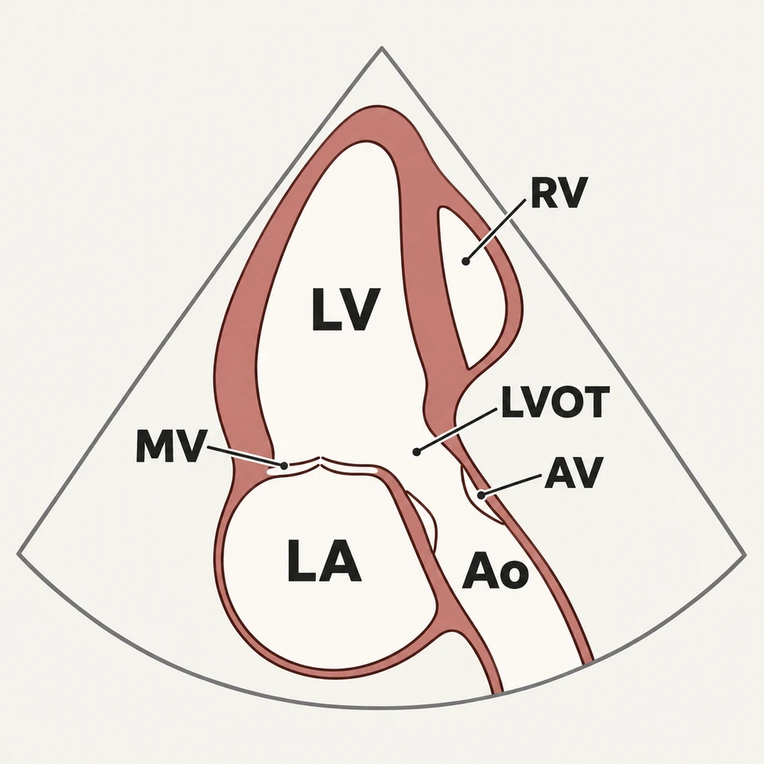 |

**Original findings:**

- Free edges converge toward LVOT while bowed leaflet bodies project toward Ao, leaving neither a clear normal closed semilunar pocket configuration nor an open ejection channel.
- Substantial RV context is unlabeled.

**Independent inspection:** Independent root review of the exact exported960 image, stored384 thumbnail and decoded200 rendition: AV hinges are proximal at LVOT and tips extend downstream into Ao beside opposite root walls. Central outflow open. Thin MV profiles near-apposed in ejection schematic; tiny stroke separation is not a claimed wide orifice. Added RV/AV context labels and finite LA band are clear. Actual384 and decoded200 inspected. Filled atrial ribbons remain visible; principal labels readable; intended open outflow versus coapted MV and open AV-valve gap in A4C remain distinguishable.

**Exported-pixel observations:** [
  "Open AV profiles have proximal fixed attachments and distal free tips toward Ao.",
  "The RV sliver and AV are labeled without enlarging the anatomy.",
  "LA wall and aortomitral continuity are preserved.",
  "At384/200 the thin MV apposition reads as closure, distinctly different from the broad A4C-RV open gap.",
  "Actual384 and decoded200 inspected. Filled atrial ribbons remain visible; principal labels readable; intended open outflow versus coapted MV and open AV-valve gap in A4C remain distinguishable."
]

**Sources:**

- [Mitchell et al., JASE 2019;32:1–64](https://www.asecho.org/wp-content/uploads/2025/04/2019_Comprehensive-TTE.pdf)

### TTE 2.22 — Apical long axis — LV zoom

**Repaired.** RV is identified with a short leader into its own sliver. The angular short mitral wedge has become a slender attached profile with one free tip and a clear opening to the long profile. Full LV apex and genuine lower LA/LVOT crops are retained; no AV was inserted.

**Phase:** Diastolic MV opening; AV is outside the LV-focused crop.

| Before | Current |
| --- | --- |
| 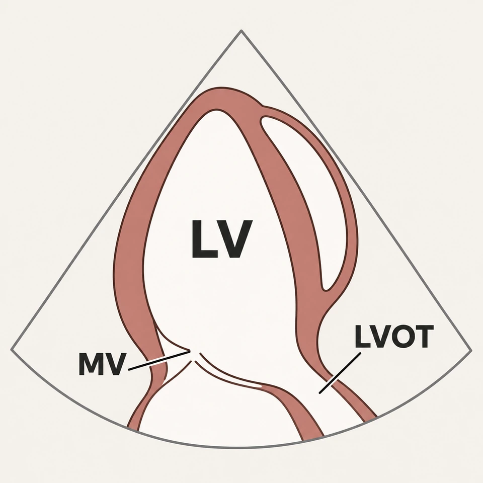 | 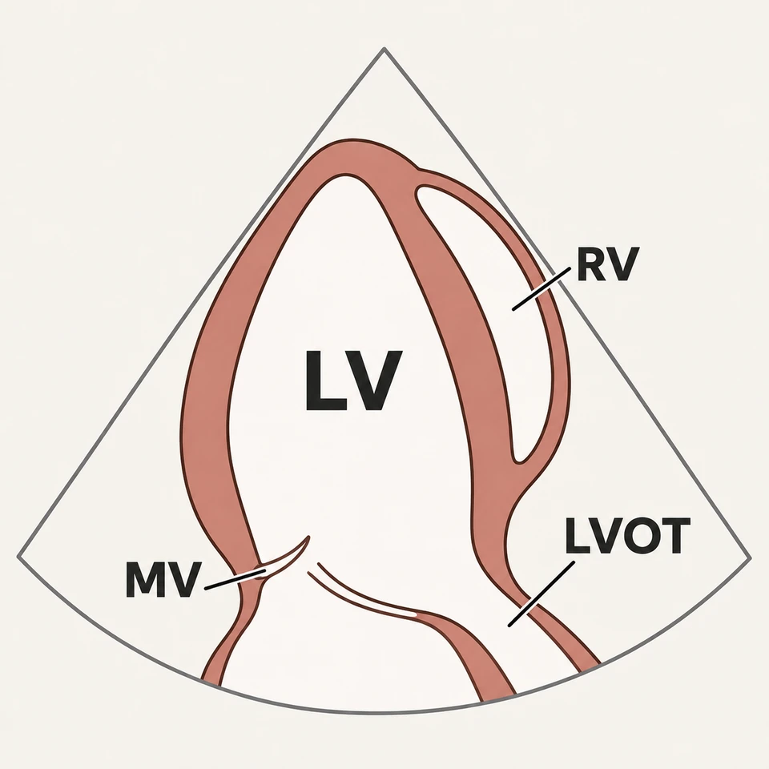 |

**Original findings:**

- A substantial complete RV sliver is identifiable but unlabeled.
- Triangular wedge shape is less clear than the established thin leaflet convention.

**Independent inspection:** Independent root review of the exact exported960 image, stored384 thumbnail and decoded200 rendition: RV label points to substantial context cavity. Short MV profile now slender with one visible annular attachment; central opening between leaflets remains clear. Full LV apex and source-appropriate LA/LVOT sector crops preserved. All labels and major boundaries remain legible at384/200. Actual384 and decoded200 pixels inspected; interpretation recorded above.

**Exported-pixel observations:** [
  "RV is identified with a short leader into its own sliver.",
  "The angular short mitral wedge has become a slender attached profile with one free tip and a clear opening to the long profile.",
  "Full LV apex and genuine lower LA/LVOT crops are retained; no AV was inserted.",
  "Actual384 and decoded200 pixels inspected; interpretation recorded above."
]

**Sources:**

- [Mitchell et al., JASE 2019;32:1–64](https://www.asecho.org/wp-content/uploads/2025/04/2019_Comprehensive-TTE.pdf)

### TTE 2.23 — Apical four-chamber — left atrial and pulmonary vein focus

**Repaired.** The focal crop now reaches actual image/sector boundaries: ventricular profiles continue through the top image edge and the virtual sector apex is outside the canvas. No ventricular apices were invented or foreshortened. Both PV channels have finite filled walls and reach the right sector edge; their separate LA ostia stay open. Atrial walls, IAS, four chamber labels and PVs leader remain clear at200.

**Phase:** AV valves at early opening in an atrial/PV-focused schematic; no semilunar valve in this section.

| Before | Current |
| --- | --- |
| 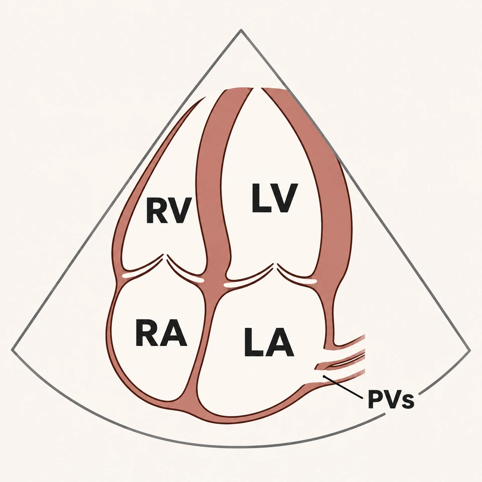 | 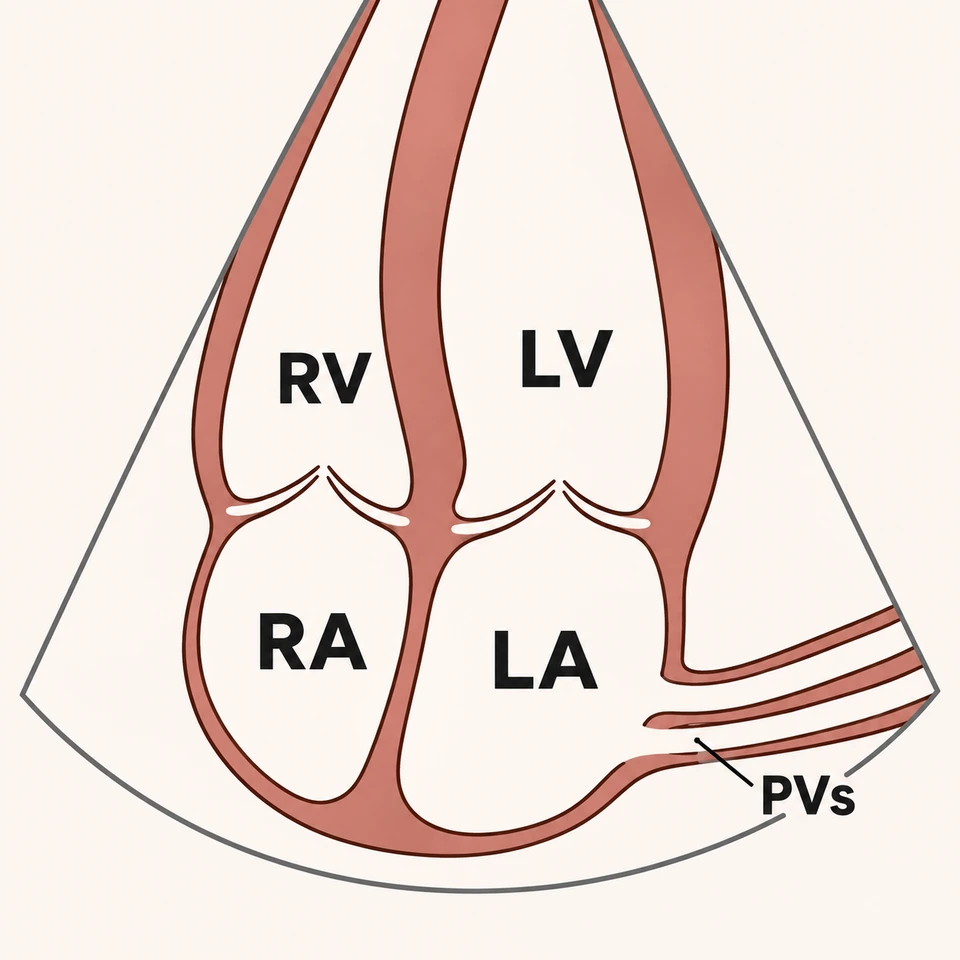 |

**Original findings:**

- Tissue and lumen stop at rectangular erasures inside the fan without a visible ROI boundary.

**Independent inspection:** Independent root review of the exact exported960 image, stored384 thumbnail and decoded200 rendition: Internal blank truncation removed. This magnified crop places virtual sector apex above canvas, with ventricular walls continuing through the actual top image boundary and both PV lumens reaching the right sector. Filled LA/RA walls, open venous ostia and all five labels retained; no invented ventricular apex. Actual384/200 preserve focal-crop reading. Actual384 exported bytes and200 resampling of decoded384 inspected; findings above remain interpretable.

**Exported-pixel observations:** [
  "The focal crop now reaches actual image/sector boundaries: ventricular profiles continue through the top image edge and the virtual sector apex is outside the canvas.",
  "No ventricular apices were invented or foreshortened.",
  "Both PV channels have finite filled walls and reach the right sector edge; their separate LA ostia stay open.",
  "Atrial walls, IAS, four chamber labels and PVs leader remain clear at200.",
  "Actual384 exported bytes and200 resampling of decoded384 inspected; findings above remain interpretable."
]

**Sources:**

- [Mitchell et al., JASE 2019;32:1–64](https://www.asecho.org/wp-content/uploads/2025/04/2019_Comprehensive-TTE.pdf)

### TTE 2.24 — Subcostal four-chamber

**Retained after fresh review.** Oblique four-chamber arrangement and near-field liver acoustic-window context distinguish this from a rotated apical icon. All chambers have filled free walls; the thin atrial septal/fossa strip remains bounded.

**Phase:** Early diastolic MV and TV opening.

| Before | Current |
| --- | --- |
| 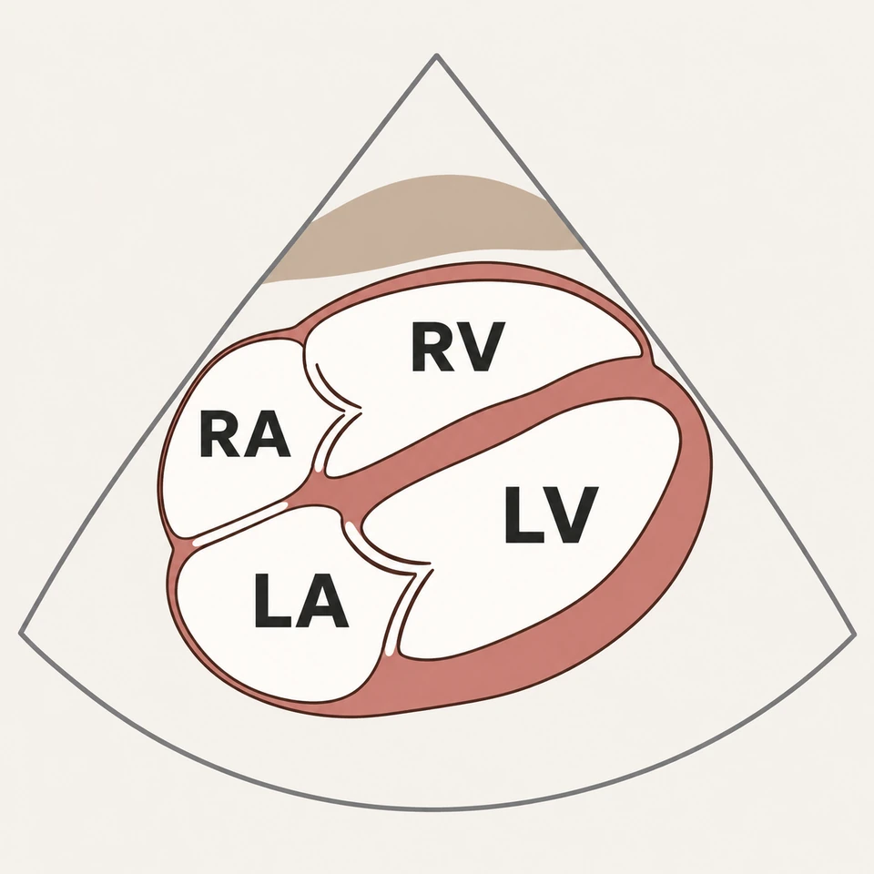 |  |

**Independent inspection:** The fresh primary reviewer inspected the original 960px image; root independently inspected the actual stored384 thumbnail and decoded200 rendition. Remaining retained images keep recognizable labels and finite tissue bands at200; legitimate fibrous/chordal contours remain thin. Existing zooms with tissue reaching true sector edges are intentional crops, not missing walls.

**Exported-pixel observations:** [
  "Oblique four-chamber arrangement and near-field liver acoustic-window context distinguish this from a rotated apical icon. All chambers have filled free walls; the thin atrial septal/fossa strip remains bounded.",
  "Remaining retained images keep recognizable labels and finite tissue bands at200; legitimate fibrous/chordal contours remain thin. Existing zooms with tissue reaching true sector edges are intentional crops, not missing walls."
]

**Sources:**

- [Mitchell et al., JASE 2019;32:1–64](https://www.asecho.org/wp-content/uploads/2025/04/2019_Comprehensive-TTE.pdf)

### TTE 2.25 — Subcostal long axis — inferior vena cava

**Repaired.** Finite delicate vascular bands define IVC separately from liver. RA has a continuous thin filled myocardial wall. Broad caval entry remains open with no invented valve or flap. Labels and tissue bands remain visible at200.

**Phase:** Not phase-specific: no valve in this section.

| Before | Current |
| --- | --- |
| 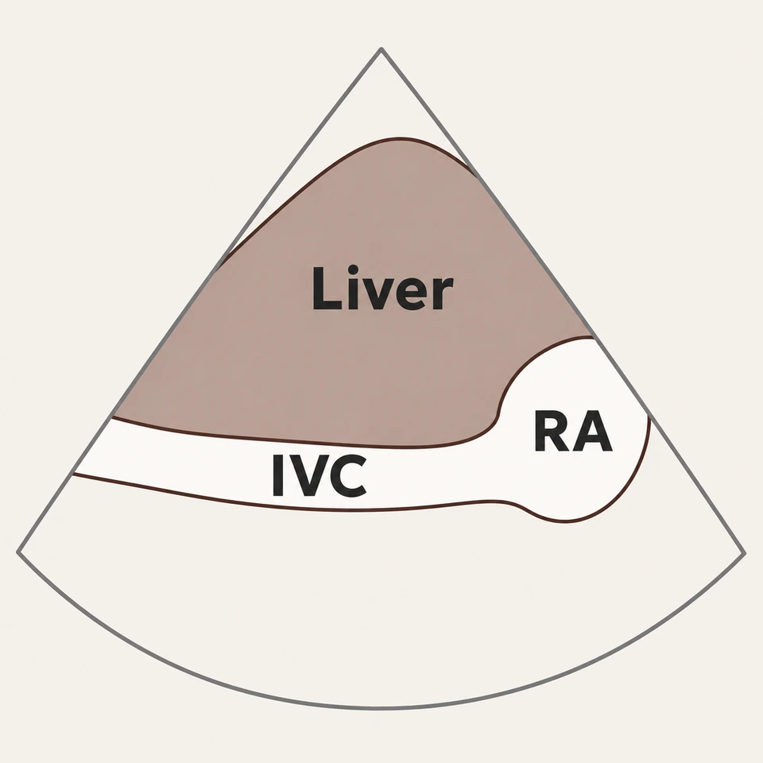 | 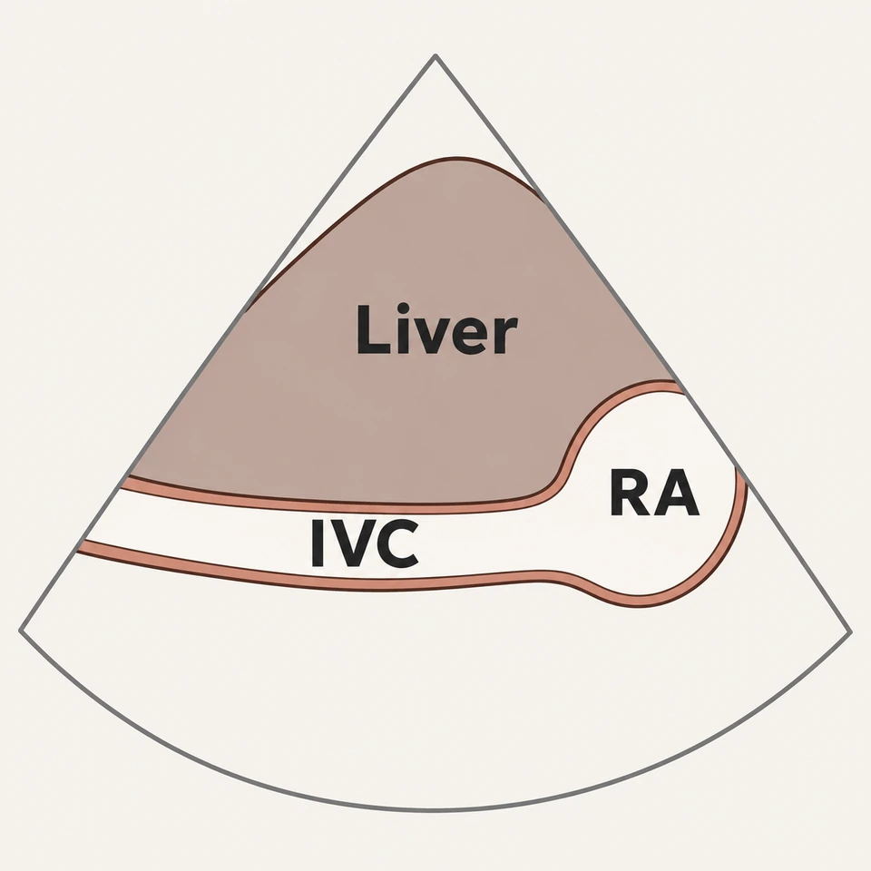 |

**Original findings:**

- Single contours define the lumen without a finite visible vessel or atrial wall.

**Independent inspection:** Independent root review of the exact exported960 image, stored384 thumbnail and decoded200 rendition: Continuous delicate filled IVC walls transition into a thin filled RA wall. IVC–RA lumen is broad and uninterrupted. Sector-edge vessel/atrium crops and liver relationship remain coherent; all three labels remain legible at200. Actual384 exported bytes and200 resampling of decoded384 inspected; findings above remain interpretable.

**Exported-pixel observations:** [
  "Finite delicate vascular bands define IVC separately from liver.",
  "RA has a continuous thin filled myocardial wall.",
  "Broad caval entry remains open with no invented valve or flap.",
  "Labels and tissue bands remain visible at200.",
  "Actual384 exported bytes and200 resampling of decoded384 inspected; findings above remain interpretable."
]

**Sources:**

- [Mitchell et al., JASE 2019;32:1–64](https://www.asecho.org/wp-content/uploads/2025/04/2019_Comprehensive-TTE.pdf)

### TTE 2.26 — Subcostal hepatic veins

**Repaired.** Thin filled HV and IVC vascular boundaries remain distinct from liver. RA has a finite thin wall. Opposed horn-like junction flaps are removed; HV–IVC and IVC–RA connections are broad and patent. Hepatic twigs taper naturally; they are not thick myocardial tubes, and all labels remain readable at200.

**Phase:** Not phase-specific: no valve in this section.

| Before | Current |
| --- | --- |
| 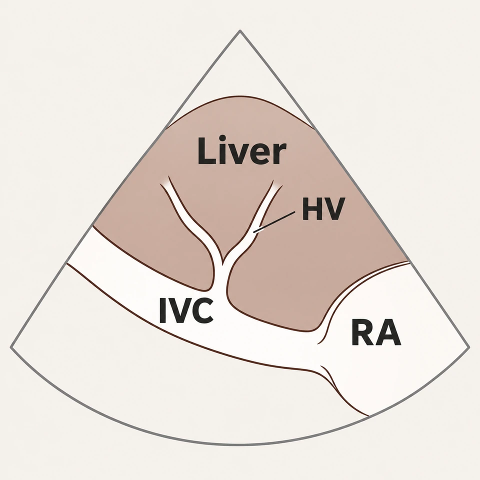 | 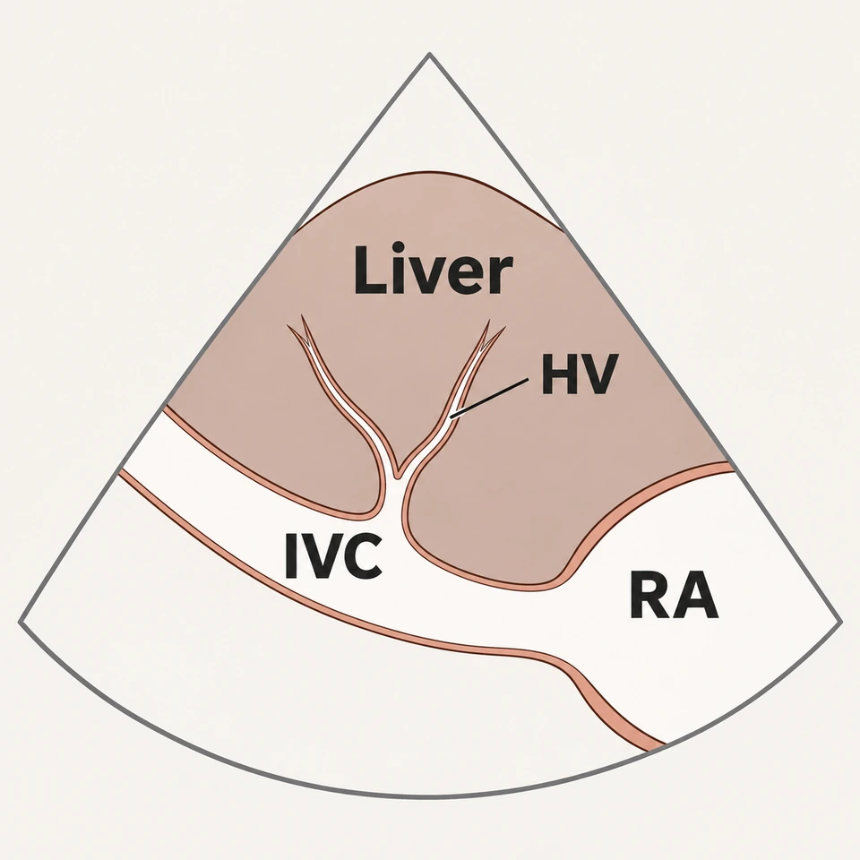 |

**Original findings:**

- Mostly single-line walls with no finite tissue bands.
- Two opposing unlabelled horn-like intraluminal projections resemble a paired valve and unnecessarily narrow the entry.

**Independent inspection:** Independent root review of the exact exported960 image, stored384 thumbnail and decoded200 rendition: Thin filled venous/RA bands replace contour-only walls, and no opposed flaps obstruct the hepatic/IVC/RA confluence. Both HV branches enter a common patent trunk; tapering small distal branches are schematic plane termination, not an invented valve. Labels/confluences remain clear at200. Actual384 exported bytes and200 resampling of decoded384 inspected; findings above remain interpretable.

**Exported-pixel observations:** [
  "Thin filled HV and IVC vascular boundaries remain distinct from liver.",
  "RA has a finite thin wall.",
  "Opposed horn-like junction flaps are removed; HV–IVC and IVC–RA connections are broad and patent.",
  "Hepatic twigs taper naturally; they are not thick myocardial tubes, and all labels remain readable at200.",
  "Actual384 exported bytes and200 resampling of decoded384 inspected; findings above remain interpretable."
]

**Sources:**

- [Mitchell et al., JASE 2019;32:1–64](https://www.asecho.org/wp-content/uploads/2025/04/2019_Comprehensive-TTE.pdf)

### TTE 2.27 — Suprasternal notch — aortic arch

**Retained after fresh review.** Continuous ascending, transverse and descending aortic lumen; branches arise in correct proximal-to-distal order BCA, LCCA, LSA. RPA is a distinct short-axis lumen inferior to the arch. All vascular walls have finite filled thickness and branch ostia remain open.

**Phase:** Phase not diagnostic; arch long-axis schematic.

| Before | Current |
| --- | --- |
| 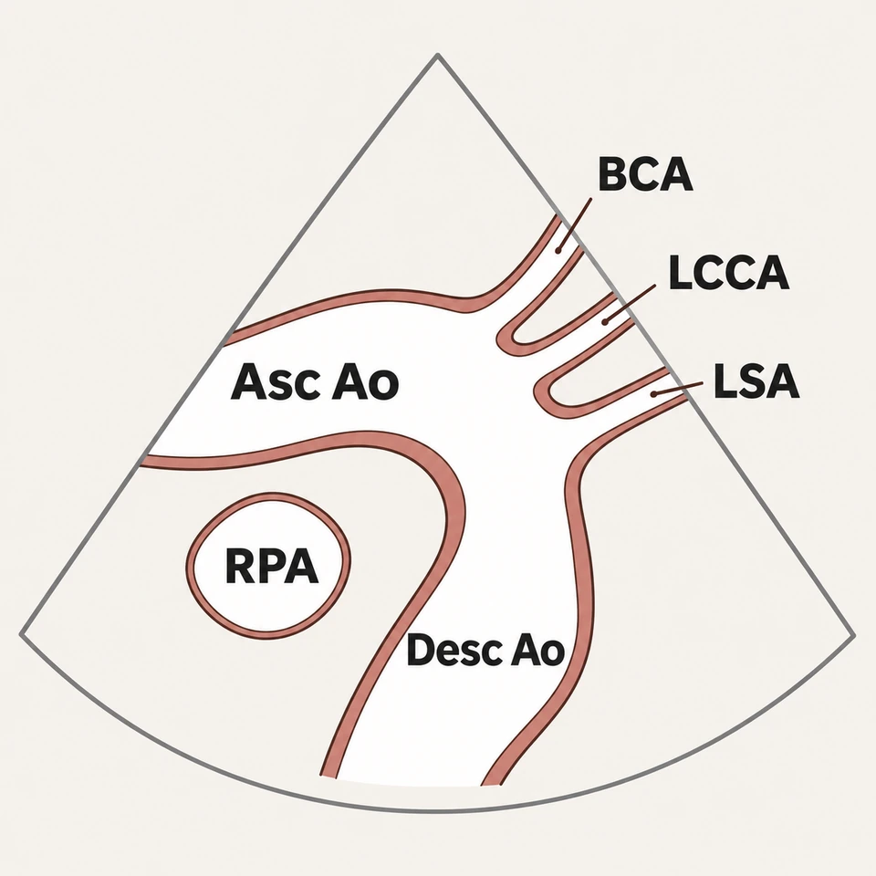 |  |

**Independent inspection:** The fresh primary reviewer inspected the original 960px image; root independently inspected the actual stored384 thumbnail and decoded200 rendition. Remaining retained images keep recognizable labels and finite tissue bands at200; legitimate fibrous/chordal contours remain thin. Existing zooms with tissue reaching true sector edges are intentional crops, not missing walls.

**Exported-pixel observations:** [
  "Continuous ascending, transverse and descending aortic lumen; branches arise in correct proximal-to-distal order BCA, LCCA, LSA. RPA is a distinct short-axis lumen inferior to the arch. All vascular walls have finite filled thickness and branch ostia remain open.",
  "Remaining retained images keep recognizable labels and finite tissue bands at200; legitimate fibrous/chordal contours remain thin. Existing zooms with tissue reaching true sector edges are intentional crops, not missing walls."
]

**Sources:**

- [Mitchell et al., JASE 2019;32:1–64](https://www.asecho.org/wp-content/uploads/2025/04/2019_Comprehensive-TTE.pdf)

### TEE 1 — Midesophageal five-chamber

**Repaired.** RA and LA retain continuous thin filled muscular wall ribbons through the near field. AV profiles are separated in normal ejection; MV and TV are coapted, with broad unobstructed LVOT. AV leader reaches the right leaflet; all principal visible chamber labels remain readable at384 and200. Short rounded superior aortic contour is a source-concordant out-of-plane section, not a blind-ended ascending aorta.

**Phase:** Normal ventricular ejection: MV/TV coapted, two longitudinal AV profiles clearly separated; the short aortic section remains source-concordant.

| Before | Current |
| --- | --- |
| 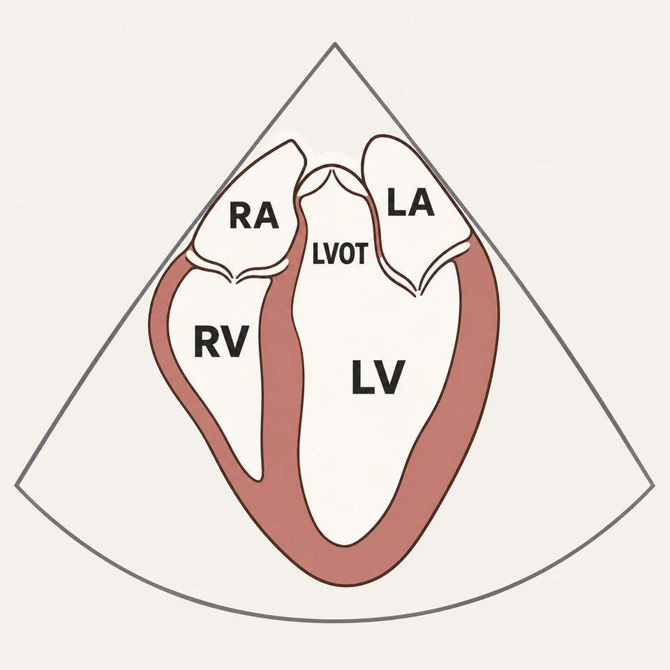 | 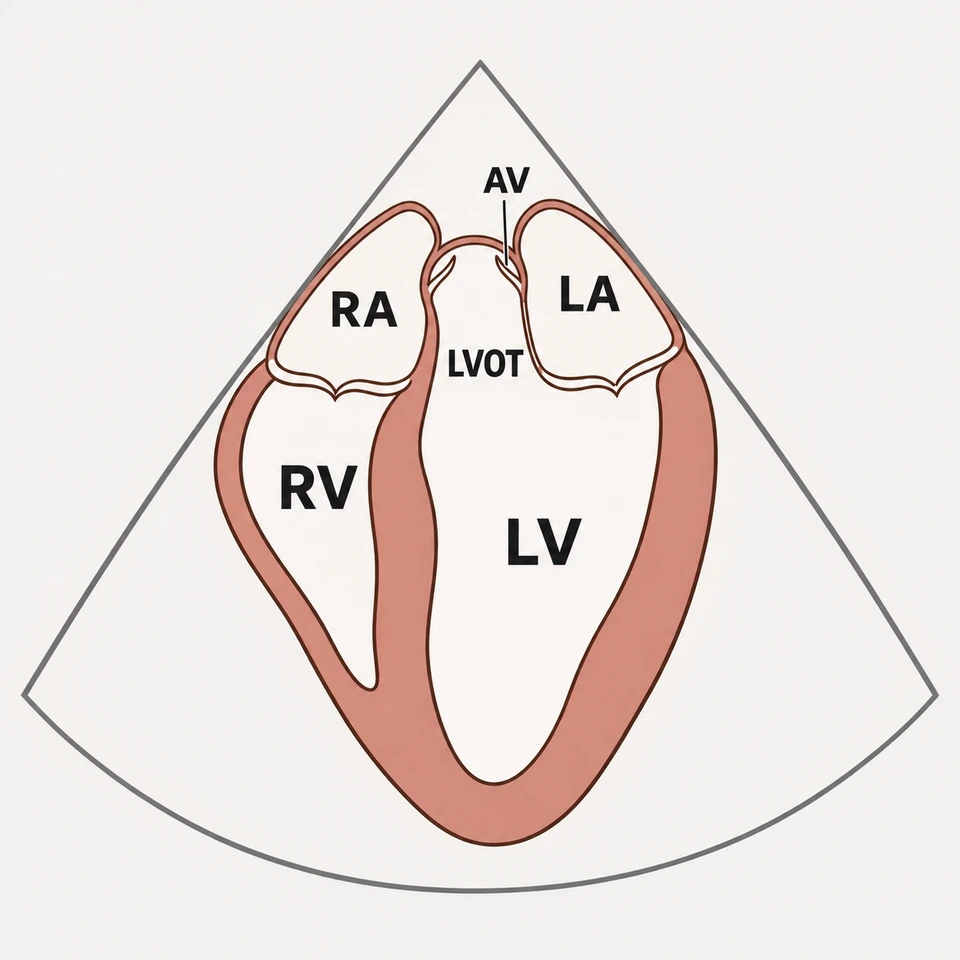 |

**Original findings:**

- RA and LA free walls at the near-field roof and outer contours are only single brown lines with ivory directly on each side; no muscular ribbon survives at 200px.
- Aortic leaflet/root region is not labeled and its closed-looking hood is not unambiguously distinguished from the short out-of-plane aortic profile. Old unspecified-phase approval is inadequate.

**Independent inspection:** Independent root review of the exact exported960 image, stored384 thumbnail and decoded200 rendition: Filled LA/RA ribbons and aortic root contour are continuous; AV leader reaches an actual cusp. Open cusps have proximal inferior hinges and superior downstream free tips; MV/TV coapt in ejection. Actual ASE Table10 row1 anatomy and echo pixels reviewed by root: rounded superior root is a short out-of-plane root section, not a complete ascending aortic tube with a blind cap. All required labels and wall bands remain visible at384/200. Actual384 encoded thumbnail and decoded200 inspected; repaired tissue bands, phase and labels remain interpretable.

**Exported-pixel observations:** [
  "RA and LA retain continuous thin filled muscular wall ribbons through the near field.",
  "AV profiles are separated in normal ejection; MV and TV are coapted, with broad unobstructed LVOT.",
  "AV leader reaches the right leaflet; all principal visible chamber labels remain readable at384 and200.",
  "Short rounded superior aortic contour is a source-concordant out-of-plane section, not a blind-ended ascending aorta.",
  "Actual384 encoded thumbnail and decoded200 inspected; repaired tissue bands, phase and labels remain interpretable."
]

**Sources:**

- [J Am Soc Echocardiogr. 2013;26:921–964. doi:10.1016/j.echo.2013.07.009](https://www.asecho.org/wp-content/uploads/2025/04/2013_Performing-Comprehensive-TEE.pdf)

### TEE 2 — Midesophageal four-chamber

**Repaired.** Finite LA/RA muscular ribbons visible at960,384and200. IAS preserved; no false septal gap; normal more-apical TV insertion. MV/TV read as coapted systolic; the very small tip-contour separation does not represent a claimed wide open orifice.

**Phase:** Ventricular systole; closed MV/TV with preserved normal apical TV offset.

| Before | Current |
| --- | --- |
| 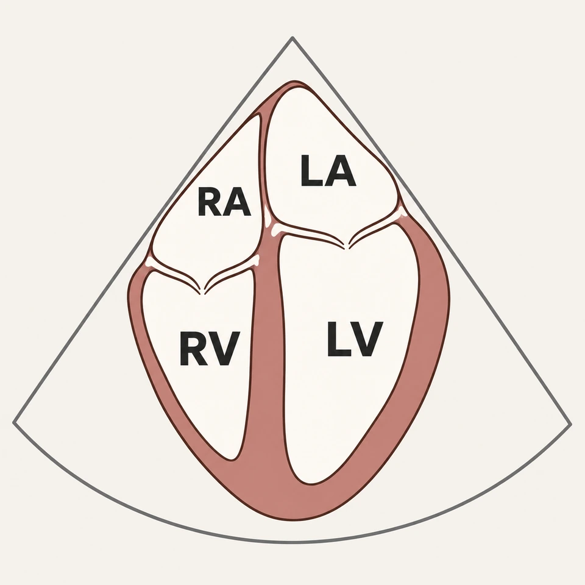 | 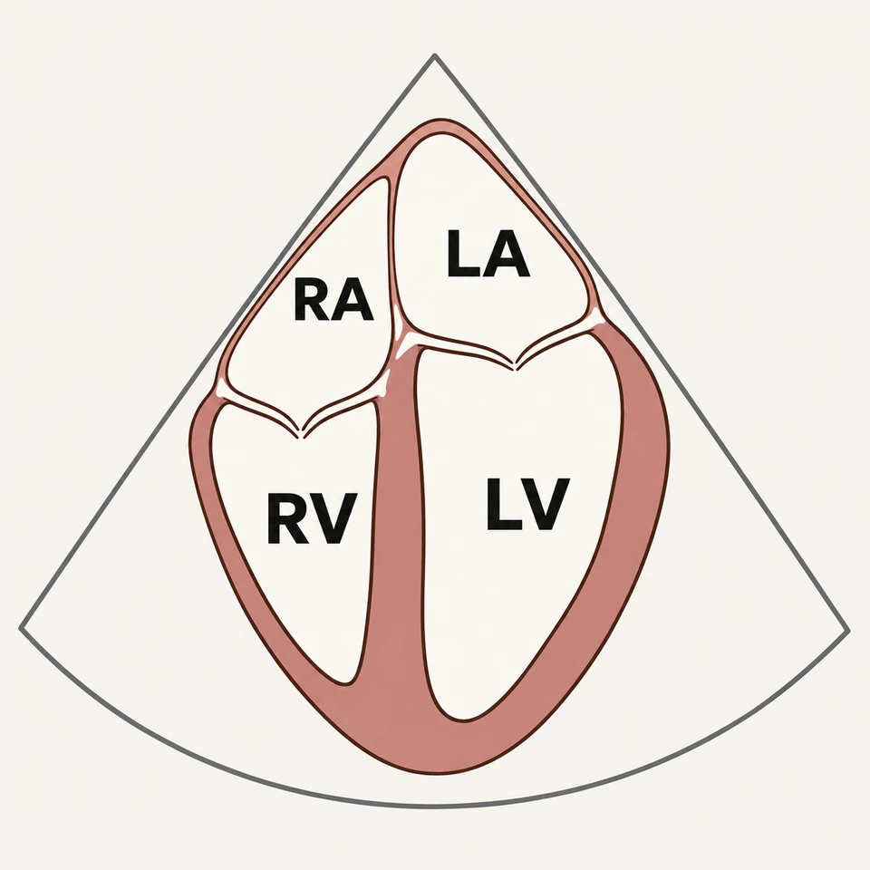 |

**Original findings:**

- Most RA and LA outer free-wall contours are single lines; finite tissue is present only in a short superior septal/roof region.
- At 200px both atria read as unbounded ivory cavities suspended above the muscular ventricles.

**Independent inspection:** Independent root review of the exact exported960 image, stored384 thumbnail and decoded200 rendition: LA/RA have finite thin filled walls; IAS intact; TV insertion apically displaced relative to MV; four chamber identities preserved. Interpret near-apposed leaflet tips as closed systolic schematic, not a wide open diastolic orifice. Actual384 encoded thumbnail and200 rendition from decoded384 inspected at native size. Required tissue bands remain visible, labels readable, and repaired junction remains interpretable. Fine valve detail remains an enlarged-view feature.

**Exported-pixel observations:** [
  "Finite LA/RA muscular ribbons visible at960,384and200.",
  "IAS preserved; no false septal gap; normal more-apical TV insertion.",
  "MV/TV read as coapted systolic; the very small tip-contour separation does not represent a claimed wide open orifice.",
  "Actual384 encoded thumbnail and200 rendition from decoded384 inspected at native size. Required tissue bands remain visible, labels readable, and repaired junction remains interpretable. Fine valve detail remains an enlarged-view feature."
]

**Sources:**

- [J Am Soc Echocardiogr. 2013;26:921–964. doi:10.1016/j.echo.2013.07.009](https://www.asecho.org/wp-content/uploads/2025/04/2013_Performing-Comprehensive-TEE.pdf)

### TEE 3 — Midesophageal mitral commissural

**Retained after fresh review.** Exact ASE view3 and Figure3 commissural plane support prominent paired papillary groups/chordae. Do not apply the PLAX RVOT chord-removal request here. Scallop names are intentionally not printed because individual segment intersections vary with rotation.

**Phase:** Systolic/coapted mitral schematic.

| Before | Current |
| --- | --- |
| 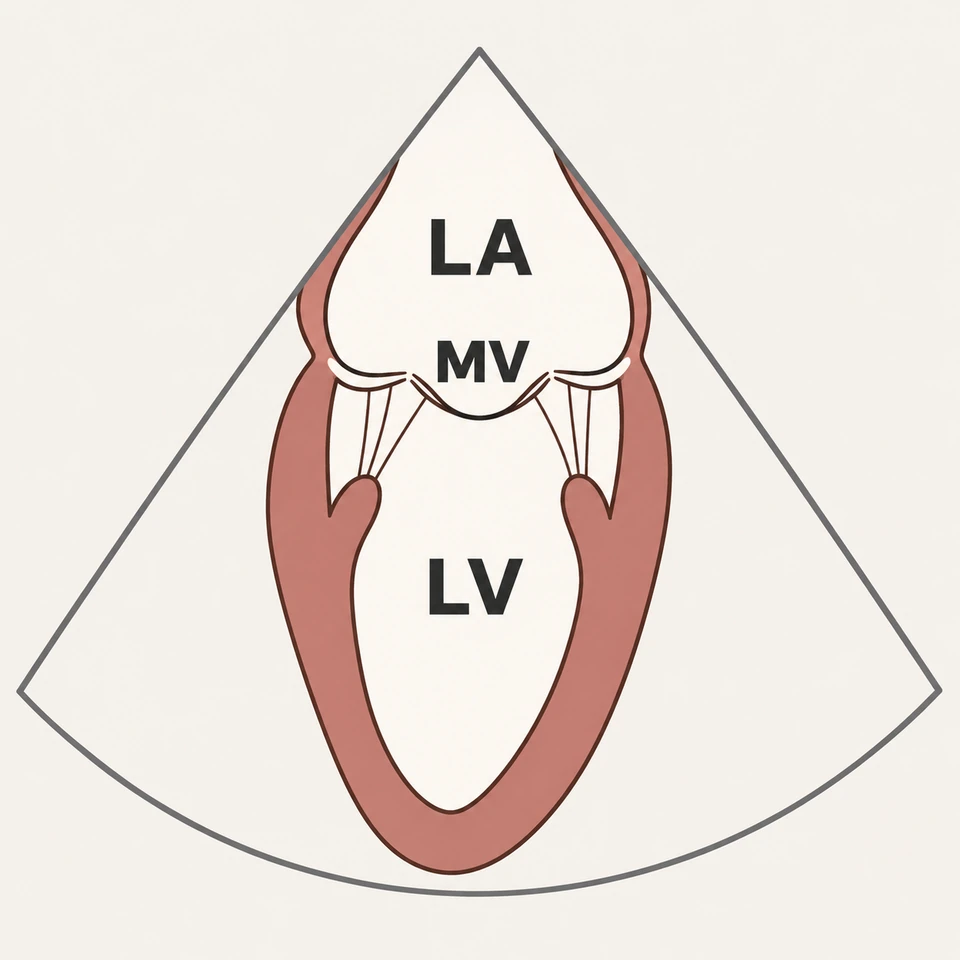 |  |

**Independent inspection:** The fresh primary reviewer inspected the original 960px image; root independently inspected the actual stored384 thumbnail and decoded200 rendition. Remaining retained images keep recognizable labels and finite tissue bands at200; legitimate fibrous/chordal contours remain thin. Existing zooms with tissue reaching true sector edges are intentional crops, not missing walls.

**Exported-pixel observations:** [
  "Exact ASE view3 and Figure3 commissural plane support prominent paired papillary groups/chordae. Do not apply the PLAX RVOT chord-removal request here.",
  "Scallop names are intentionally not printed because individual segment intersections vary with rotation.",
  "Remaining retained images keep recognizable labels and finite tissue bands at200; legitimate fibrous/chordal contours remain thin. Existing zooms with tissue reaching true sector edges are intentional crops, not missing walls."
]

**Sources:**

- [J Am Soc Echocardiogr. 2013;26:921–964. doi:10.1016/j.echo.2013.07.009](https://www.asecho.org/wp-content/uploads/2025/04/2013_Performing-Comprehensive-TEE.pdf)

### TEE 4 — Midesophageal two-chamber

**Repaired.** Thin LA roof muscle now continuous and perceptible at200. LAA pocket and its patent LA connection retained; new leader targets the pocket. MV remains closed; LV unchanged.

**Phase:** Ventricular systole; retain normal closed MV.

| Before | Current |
| --- | --- |
| 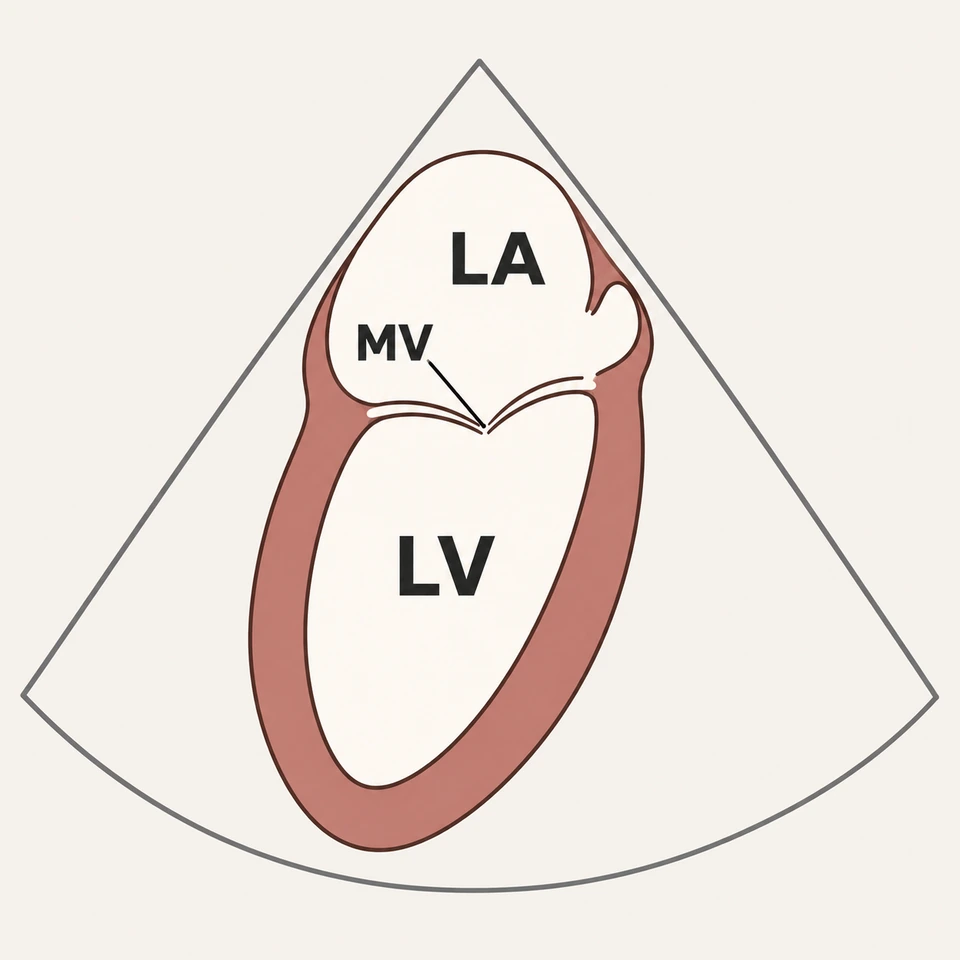 | 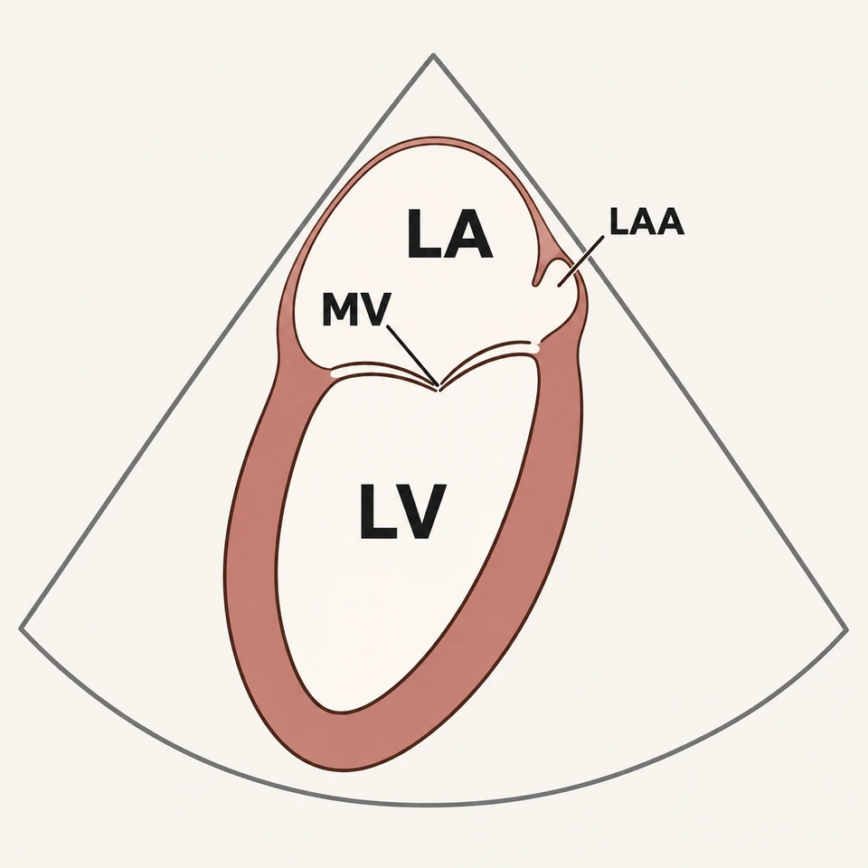 |

**Original findings:**

- LA roof is a single contour without a filled muscular band.
- A small visible LAA pocket on the upper-right atrial side is unlabeled.

**Independent inspection:** Independent root review of the exact exported960 image, stored384 thumbnail and decoded200 rendition: LA roof now has finite tissue band and appendage context is labeled; LV remains thicker; two thin MV profiles coapt on ventricular side and attach at annuli; no outflow or RV invented. Actual384 encoded thumbnail and200 rendition from decoded384 inspected at native size. Required tissue bands remain visible, labels readable, and repaired junction remains interpretable. Fine valve detail remains an enlarged-view feature.

**Exported-pixel observations:** [
  "Thin LA roof muscle now continuous and perceptible at200.",
  "LAA pocket and its patent LA connection retained; new leader targets the pocket.",
  "MV remains closed; LV unchanged.",
  "Actual384 encoded thumbnail and200 rendition from decoded384 inspected at native size. Required tissue bands remain visible, labels readable, and repaired junction remains interpretable. Fine valve detail remains an enlarged-view feature."
]

**Sources:**

- [J Am Soc Echocardiogr. 2013;26:921–964. doi:10.1016/j.echo.2013.07.009](https://www.asecho.org/wp-content/uploads/2025/04/2013_Performing-Comprehensive-TEE.pdf)

### TEE 5 — Midesophageal long-axis

**Repaired.** LA free-wall tissue is a continuous thin filled ribbon; fibrous mitral/aortic continuity remains thin. Both AV cusps attach only at proximal hinges and end freely to the right with clear blood-space gaps from the intact vascular walls. The lower aortic wall and entire RV roof are continuous; no Ao–RV communication or leak to background. Broad central LVOT–Ao lumen and all principal cavity labels remain clear at384 and200.

**Phase:** Normal ventricular ejection: closed MV; two separated AV profiles project downstream from screen-left LVOT toward screen-right Ao.

| Before | Current |
| --- | --- |
| 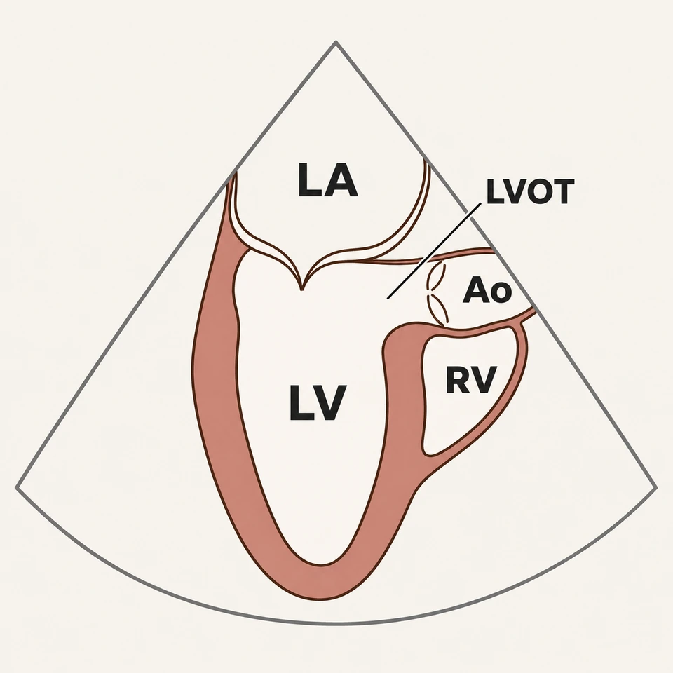 | 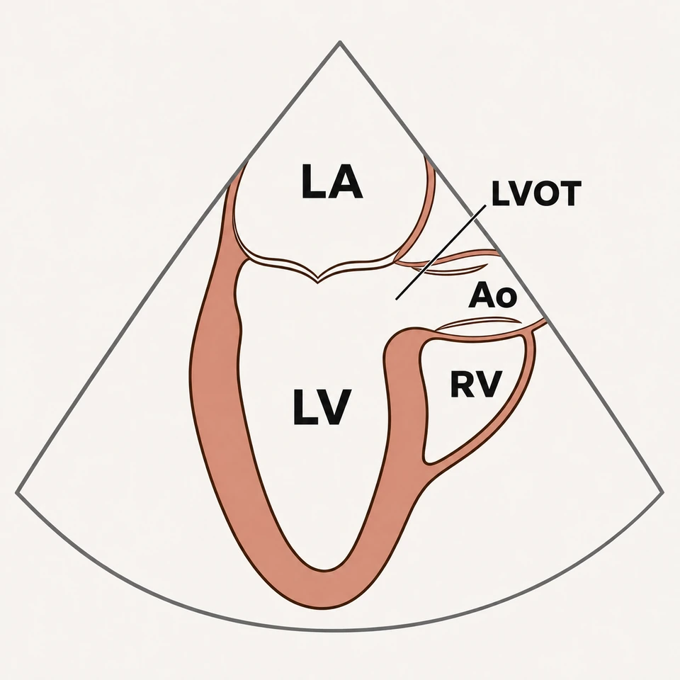 |

**Original findings:**

- LA side/free-wall boundary is a narrow ivory ribbon between brown outlines rather than visible terracotta muscular tissue.
- AV leaflets almost meet across the root despite the prior v58 claim of an open systolic valve; at 200px they appear as an obstructing closed profile.
- Cusp hinge attachment/orifice must be made clear rather than drawing two floating small crescents.

**Independent inspection:** Independent root review of the exact exported960 image, stored384 thumbnail and decoded200 rendition: Both AV cusps now have visibly free distal/right tips separated by blood space from intact root walls. Upper and lower wall ribbons continue behind those tips; the RV roof is intact, preventing false Ao–RV continuity. MV remains thin and coapted, LA band filled, and central LV–LVOT–Ao channel clear. At384/200 wall separation, labels and open outflow remain interpretable. Actual384 encoded thumbnail and decoded200 inspected in third-three-encoded-qc; findings above remain interpretable.

**Exported-pixel observations:** [
  "LA free-wall tissue is a continuous thin filled ribbon; fibrous mitral/aortic continuity remains thin.",
  "Both AV cusps attach only at proximal hinges and end freely to the right with clear blood-space gaps from the intact vascular walls.",
  "The lower aortic wall and entire RV roof are continuous; no Ao–RV communication or leak to background.",
  "Broad central LVOT–Ao lumen and all principal cavity labels remain clear at384 and200.",
  "Actual384 encoded thumbnail and decoded200 inspected in third-three-encoded-qc; findings above remain interpretable."
]

**Sources:**

- [J Am Soc Echocardiogr. 2013;26:921–964. doi:10.1016/j.echo.2013.07.009](https://www.asecho.org/wp-content/uploads/2025/04/2013_Performing-Comprehensive-TEE.pdf)

### TEE 6 — Midesophageal aortic valve long-axis

**Repaired.** AV has exactly two longitudinal profiles with rightward free tips and visible blood-space clearance from continuous aortic walls. No false transverse line obstructs the LVOT–Ao passage. Finite LA free-wall ribbon and labeled RVOT context remain; AV leader targets the valve complex. The open outflow and labels remain distinct in actual384 and decoded200 exports.

**Phase:** Normal ventricular ejection with broad AV opening.

| Before | Current |
| --- | --- |
| 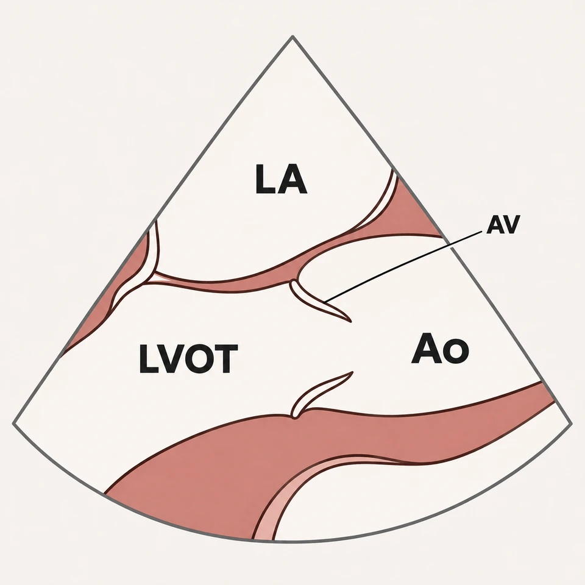 | 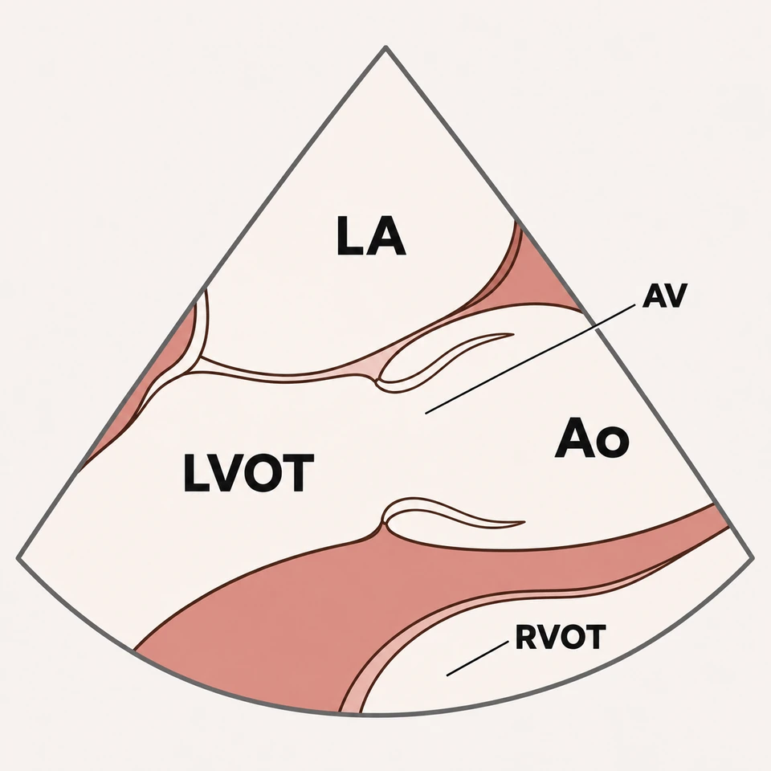 |

**Original findings:**

- Recognizable source RVOT context has been compressed to an unlabeled inferior white sliver; a learner cannot identify it.
- The two AV cusps point substantially into the central lumen, leaving a relatively narrow aperture for a normal ejection reference; make normal opening unambiguous.
- Some cropped LA muscular side-wall segments remain ivory ribbons; the aorto-mitral fibrous tissue must not be thickened indiscriminately.

**Independent inspection:** Independent root review of the exact exported960 image, stored384 thumbnail and decoded200 rendition: Both AV profiles have distinct proximal left hinges and rightward downstream free tips with clear luminal separation from continuous root walls. False transverse stroke removed; outflow is broadly open. LA muscular ribbon filled while thin aortomitral continuity preserved; RVOT context labeled. AV leader ends within valve complex/orifice rather than on wall. At384/200 labels, bands and open valve remain recognizable. Actual384 exported bytes and decoded200 pixels inspected, including two separated AV profiles and their central open lumen.

**Exported-pixel observations:** [
  "AV has exactly two longitudinal profiles with rightward free tips and visible blood-space clearance from continuous aortic walls.",
  "No false transverse line obstructs the LVOT–Ao passage.",
  "Finite LA free-wall ribbon and labeled RVOT context remain; AV leader targets the valve complex.",
  "The open outflow and labels remain distinct in actual384 and decoded200 exports.",
  "Actual384 exported bytes and decoded200 pixels inspected, including two separated AV profiles and their central open lumen."
]

**Sources:**

- [J Am Soc Echocardiogr. 2013;26:921–964. doi:10.1016/j.echo.2013.07.009](https://www.asecho.org/wp-content/uploads/2025/04/2013_Performing-Comprehensive-TEE.pdf)

### TEE 7 — Midesophageal ascending aorta long-axis

**Retained after fresh review.** Labels Ao and RPA are readable at 200px and match the exact Table10 row7 cross/long-axis relationship.

**Phase:** Vascular section; no valve or phase-dependent geometry included.

| Before | Current |
| --- | --- |
|  |  |

**Independent inspection:** The fresh primary reviewer inspected the original 960px image; root independently inspected the actual stored384 thumbnail and decoded200 rendition. Remaining retained images keep recognizable labels and finite tissue bands at200; legitimate fibrous/chordal contours remain thin. Existing zooms with tissue reaching true sector edges are intentional crops, not missing walls.

**Exported-pixel observations:** [
  "Labels Ao and RPA are readable at 200px and match the exact Table10 row7 cross/long-axis relationship.",
  "Remaining retained images keep recognizable labels and finite tissue bands at200; legitimate fibrous/chordal contours remain thin. Existing zooms with tissue reaching true sector edges are intentional crops, not missing walls."
]

**Sources:**

- [J Am Soc Echocardiogr. 2013;26:921–964. doi:10.1016/j.echo.2013.07.009](https://www.asecho.org/wp-content/uploads/2025/04/2013_Performing-Comprehensive-TEE.pdf)

### TEE 8 — Midesophageal ascending aorta short-axis

**Retained after fresh review.** Do not add AV leaflets to a mid-ascending Ao short-axis section. Source Table10 row8 includes PA/main bifurcation and SVC; all principal lumens labeled.

**Phase:** Vascular section with no semilunar valve shown.

| Before | Current |
| --- | --- |
|  |  |

**Independent inspection:** The fresh primary reviewer inspected the original 960px image; root independently inspected the actual stored384 thumbnail and decoded200 rendition. Remaining retained images keep recognizable labels and finite tissue bands at200; legitimate fibrous/chordal contours remain thin. Existing zooms with tissue reaching true sector edges are intentional crops, not missing walls.

**Exported-pixel observations:** [
  "Do not add AV leaflets to a mid-ascending Ao short-axis section.",
  "Source Table10 row8 includes PA/main bifurcation and SVC; all principal lumens labeled.",
  "Remaining retained images keep recognizable labels and finite tissue bands at200; legitimate fibrous/chordal contours remain thin. Existing zooms with tissue reaching true sector edges are intentional crops, not missing walls."
]

**Sources:**

- [J Am Soc Echocardiogr. 2013;26:921–964. doi:10.1016/j.echo.2013.07.009](https://www.asecho.org/wp-content/uploads/2025/04/2013_Performing-Comprehensive-TEE.pdf)

### TEE 9 — Midesophageal right pulmonary vein

**Retained after fresh review.** PV is contextually pulmonary vein here, consistent with the title and direct LA continuity. RPV would improve unambiguous abbreviation but this alone is not an anatomical failure warranting regeneration. Do not replace the source-concordant bounded vein section with an invented open-ended tube.

**Phase:** Pulmonary-venous acquisition plane, no valve/flow phase encoded.

| Before | Current |
| --- | --- |
|  |  |

**Independent inspection:** The fresh primary reviewer inspected the original 960px image; root independently inspected the actual stored384 thumbnail and decoded200 rendition. Remaining retained images keep recognizable labels and finite tissue bands at200; legitimate fibrous/chordal contours remain thin. Existing zooms with tissue reaching true sector edges are intentional crops, not missing walls.

**Exported-pixel observations:** [
  "PV is contextually pulmonary vein here, consistent with the title and direct LA continuity. RPV would improve unambiguous abbreviation but this alone is not an anatomical failure warranting regeneration.",
  "Do not replace the source-concordant bounded vein section with an invented open-ended tube.",
  "Remaining retained images keep recognizable labels and finite tissue bands at200; legitimate fibrous/chordal contours remain thin. Existing zooms with tissue reaching true sector edges are intentional crops, not missing walls."
]

**Sources:**

- [J Am Soc Echocardiogr. 2013;26:921–964. doi:10.1016/j.echo.2013.07.009](https://www.asecho.org/wp-content/uploads/2025/04/2013_Performing-Comprehensive-TEE.pdf)

### TEE 10 — Midesophageal aortic valve short-axis

**Repaired.** Three closed AV cusps are preserved; LA/RA/RVOT walls and finite vascular ring remain. PV now has two short thin attached closed profiles: shallow bellies toward RVOT, arterial-facing pocket sides, and central edge apposition. Right PV leaflet no longer has the long distal-wall diagonal or second apparent attachment; separate PA wall stays continuous. PA/PV labels identify the local arterial direction; principal labels and wall bands remain readable at384 and200.

**Phase:** Ventricular diastolic schematic with closed AV and closed PV; no AV inflow valve state is claimed in this plane.

| Before | Current |
| --- | --- |
|  |  |

**Original findings:**

- Pulmonary-valve region is rendered as one irregular serpentine boundary instead of clearly attached opposed semilunar profiles.
- Small arterial-side pocket beyond that boundary is unlabeled; PV itself is not labeled.
- Short LA muscular side-wall segment at right is an ivory outlined ribbon; distinguish atrial muscle from true thin septal/fibrous tissue.

**Independent inspection:** Independent root review of the exact exported960 image, stored384 thumbnail and decoded200 rendition: Right PV cusp is now short with one proximal annular attachment; the old distal PA-wall attachment and long wedge are removed. Both closed PV profiles coapt centrally with upstream pocket bellies; PA wall remains continuous. Three-region closed short-axis AV, chamber walls, labels, and source plane are preserved. At384/200 closed PV pair remains distinct from open outflow alternatives. Actual384 encoded thumbnail and decoded200 inspected in third-three-encoded-qc; findings above remain interpretable.

**Exported-pixel observations:** [
  "Three closed AV cusps are preserved; LA/RA/RVOT walls and finite vascular ring remain.",
  "PV now has two short thin attached closed profiles: shallow bellies toward RVOT, arterial-facing pocket sides, and central edge apposition.",
  "Right PV leaflet no longer has the long distal-wall diagonal or second apparent attachment; separate PA wall stays continuous.",
  "PA/PV labels identify the local arterial direction; principal labels and wall bands remain readable at384 and200.",
  "Actual384 encoded thumbnail and decoded200 inspected in third-three-encoded-qc; findings above remain interpretable."
]

**Sources:**

- [J Am Soc Echocardiogr. 2013;26:921–964. doi:10.1016/j.echo.2013.07.009](https://www.asecho.org/wp-content/uploads/2025/04/2013_Performing-Comprehensive-TEE.pdf)

### TEE 11 — Midesophageal RV inflow-outflow

**Repaired.** LA/RA visible muscular walls have finite filled ribbons; RV and RVOT remain one cavity. Aortic root is a thin colored vascular ring with exactly three open fibrous cusp regions and a central rounded-triangle orifice. TV coapts toward RV rather than protruding into RA. Two PV profiles attach upstream and end freely upper-right toward PA, with blood-space clearance from continuous walls. The erroneous hinge-to-hinge transverse stroke is absent, leaving a broad unobstructed RVOT–PA channel. All principal chamber, artery and valve labels remain readable at384 and200.

**Phase:** Normal ventricular ejection: three-cusp AV short-axis opening, two separated PV longitudinal profiles, and closed ventricularly coapted TV.

| Before | Current |
| --- | --- |
|  |  |

**Original findings:**

- LA near-field roof is only one brown line; RA upper free-wall portion also lacks a finite muscular band.
- Aortic SAX region shows two curved leaflet portions but no complete third cusp partition; Ao label masks the upper field.
- TV coaptation projects toward RA relative to the two hinges, giving an inappropriate pointed atrial tent for a normal closed-valve reference.
- Valve states are not coherently declared; repair as normal ejection with recognizable open AV/PV and closed TV.

**Independent inspection:** Independent root review of the exact exported960 image, stored384 thumbnail and decoded200 rendition: Unsupported transverse PV stroke removed. Both PV cusps have proximal hinges toward RVOT and downstream free tips toward upper-right PA, separated from continuous arterial walls. Broad central RVOT–PA path is clear. Open short-axis AV has exactly three cusp arcs with finite root ring; TV coapts toward RV in the same ejection schematic. LA/RA/RV walls, cavity connections and all seven labels remain clear. Actual384/decoded200 preserve tissue, openoutflow, valve states and labels. Inspected native384 and200 derived from decoded384 in final-three-encoded-qc; no cross-lumen partition remains.

**Exported-pixel observations:** [
  "LA/RA visible muscular walls have finite filled ribbons; RV and RVOT remain one cavity.",
  "Aortic root is a thin colored vascular ring with exactly three open fibrous cusp regions and a central rounded-triangle orifice.",
  "TV coapts toward RV rather than protruding into RA.",
  "Two PV profiles attach upstream and end freely upper-right toward PA, with blood-space clearance from continuous walls.",
  "The erroneous hinge-to-hinge transverse stroke is absent, leaving a broad unobstructed RVOT–PA channel.",
  "All principal chamber, artery and valve labels remain readable at384 and200.",
  "Inspected native384 and200 derived from decoded384 in final-three-encoded-qc; no cross-lumen partition remains."
]

**Sources:**

- [J Am Soc Echocardiogr. 2013;26:921–964. doi:10.1016/j.echo.2013.07.009](https://www.asecho.org/wp-content/uploads/2025/04/2013_Performing-Comprehensive-TEE.pdf)

### TEE 12 — Midesophageal modified bicaval tricuspid valve

**Repaired.** Both visible RA lateral muscular walls are finite terracotta ribbons. Thin LA–RA separator is retained as source-concordant mid-IAS/fossa interface with muscular rims, not recolored as a full myocardial free wall. SVC ring is finite, filled and labeled; TV is coapted toward RV; no unsupported ventricular strands remain.

**Phase:** Ventricular systole; retain delicate closed TV.

| Before | Current |
| --- | --- |
|  |  |

**Original findings:**

- RA outer free wall is predominantly a double brown outline filled ivory, so it still lacks visible muscular tissue.
- Round upper-right SVC profile is unlabeled and its wall is an ivory ribbon.
- LA-RA central septal band should be explicitly retained as slender septal/fibrous tissue, rather than thickened indiscriminately.

**Independent inspection:** Independent root review of the exact exported960 image, stored384 thumbnail and decoded200 rendition: Small right RA free-wall ribbon is now filled, and RV cavity is smooth without the invented papillary/chordal apparatus. Closed TV profiles meet ventricularly. Actual ASE Table10 row12 anatomy/echo reviewed by root: slender LA–RA separator represents mid-atrial septal interface/fossa membrane with muscular rims at its ends, not an atrial free wall or a claim the entire IAS is fibrous. SVC has a finite vascular wall and all labels remain clear at384/200. Actual384 encoded thumbnail and decoded200 inspected; repaired tissue bands, phase and labels remain interpretable.

**Exported-pixel observations:** [
  "Both visible RA lateral muscular walls are finite terracotta ribbons.",
  "Thin LA–RA separator is retained as source-concordant mid-IAS/fossa interface with muscular rims, not recolored as a full myocardial free wall.",
  "SVC ring is finite, filled and labeled; TV is coapted toward RV; no unsupported ventricular strands remain.",
  "Actual384 encoded thumbnail and decoded200 inspected; repaired tissue bands, phase and labels remain interpretable."
]

**Sources:**

- [J Am Soc Echocardiogr. 2013;26:921–964. doi:10.1016/j.echo.2013.07.009](https://www.asecho.org/wp-content/uploads/2025/04/2013_Performing-Comprehensive-TEE.pdf)

### TEE 13 — Midesophageal bicaval

**Retained after fresh review.** IVC at screen left and SVC at screen right match exact Table10 row13 orientation. Do not add valve membranes across the SVC or IVC mouths.

**Phase:** Atrial/venous section; no valve-phase state encoded.

| Before | Current |
| --- | --- |
|  |  |

**Independent inspection:** The fresh primary reviewer inspected the original 960px image; root independently inspected the actual stored384 thumbnail and decoded200 rendition. Remaining retained images keep recognizable labels and finite tissue bands at200; legitimate fibrous/chordal contours remain thin. Existing zooms with tissue reaching true sector edges are intentional crops, not missing walls.

**Exported-pixel observations:** [
  "IVC at screen left and SVC at screen right match exact Table10 row13 orientation.",
  "Do not add valve membranes across the SVC or IVC mouths.",
  "Remaining retained images keep recognizable labels and finite tissue bands at200; legitimate fibrous/chordal contours remain thin. Existing zooms with tissue reaching true sector edges are intentional crops, not missing walls."
]

**Sources:**

- [J Am Soc Echocardiogr. 2013;26:921–964. doi:10.1016/j.echo.2013.07.009](https://www.asecho.org/wp-content/uploads/2025/04/2013_Performing-Comprehensive-TEE.pdf)

### TEE 14 — Midesophageal right and left pulmonary veins

**Repaired.** PA label centered in correct separate arterial ring. Original venous/atrial and arterial topology, wall bands and crop preserved.

**Phase:** Unchanged, no valve state encoded.

| Before | Current |
| --- | --- |
|  |  |

**Original findings:**

- The large circular pulmonary artery profile on the right is completely unlabeled, although it is one of the principal structures of exact ASE view14.

**Independent inspection:** Independent root review of the exact exported960 image, stored384 thumbnail and decoded200 rendition: New PA label identifies the adjacent finite-walled vessel cross-section. PV–LA connection and finite vascular walls retained; no valve invented. Preserve ME terminology following dedicated section14 despite Table10 caption inconsistency. Actual384 encoded thumbnail and200 rendition from decoded384 inspected at native size. Required tissue bands remain visible, labels readable, and repaired junction remains interpretable. Fine valve detail remains an enlarged-view feature.

**Exported-pixel observations:** [
  "PA label centered in correct separate arterial ring.",
  "Original venous/atrial and arterial topology, wall bands and crop preserved.",
  "Actual384 encoded thumbnail and200 rendition from decoded384 inspected at native size. Required tissue bands remain visible, labels readable, and repaired junction remains interpretable. Fine valve detail remains an enlarged-view feature."
]

**Sources:**

- [J Am Soc Echocardiogr. 2013;26:921–964. doi:10.1016/j.echo.2013.07.009](https://www.asecho.org/wp-content/uploads/2025/04/2013_Performing-Comprehensive-TEE.pdf)

### TEE 15 — Midesophageal left atrial appendage

**Repaired.** LUPV leader targets the venous side of the existing ridge. Open LAA neck, closed appendage tip and finite walls preserved with no new nodules or topology changes.

**Phase:** Unchanged static anatomy; no blood-flow or emptying inference.

| Before | Current |
| --- | --- |
|  |  |

**Original findings:**

- The small upper-right left superior/upper pulmonary vein context and its atrial ridge are present but unlabeled, leaving an important structure of ASE view15 unexplained.

**Independent inspection:** Independent root review of the exact exported960 image, stored384 thumbnail and decoded200 rendition: LUPV label points to lumen on pulmonary-vein side of the ridge; LA and LAA labels remain correct; finite LAA wall and open appendage neck retained; no topology change seen. Actual384 encoded thumbnail and200 rendition from decoded384 inspected at native size. Required tissue bands remain visible, labels readable, and repaired junction remains interpretable. Fine valve detail remains an enlarged-view feature.

**Exported-pixel observations:** [
  "LUPV leader targets the venous side of the existing ridge.",
  "Open LAA neck, closed appendage tip and finite walls preserved with no new nodules or topology changes.",
  "Actual384 encoded thumbnail and200 rendition from decoded384 inspected at native size. Required tissue bands remain visible, labels readable, and repaired junction remains interpretable. Fine valve detail remains an enlarged-view feature."
]

**Sources:**

- [J Am Soc Echocardiogr. 2013;26:921–964. doi:10.1016/j.echo.2013.07.009](https://www.asecho.org/wp-content/uploads/2025/04/2013_Performing-Comprehensive-TEE.pdf)

### TEE 16 — Transgastric basal short-axis

**Retained after fresh review.** Retain the compact short-axis simplification; do not thicken valve/fibrous outlines merely because chamber walls require a fill. The TV is not separately rendered in this LV-focused schematic. Do not infer a missing muscular wall from omitted out-of-plane anatomy. Focused reinspection: the thin en-face mitral contour closes at both upper and lower commissural ends; paired right-sided leaflet contours share those joins, with no isolated cord or detached linear segment. Long-axis hinge insertions are not claimed by this short-axis orifice-level schematic. The initial1 recorded simplification rather than unresolved ambiguity; under the clarified rubric the visible commissural closure supports2 for this schematic purpose.

**Phase:** Representative open mitral short-axis configuration; no second valve state is imposed.

| Before | Current |
| --- | --- |
|  |  |

**Independent inspection:** The fresh primary reviewer inspected the original 960px image; root independently inspected the actual stored384 thumbnail and decoded200 rendition. Remaining retained images keep recognizable labels and finite tissue bands at200; legitimate fibrous/chordal contours remain thin. Existing zooms with tissue reaching true sector edges are intentional crops, not missing walls.

**Exported-pixel observations:** [
  "Retain the compact short-axis simplification; do not thicken valve/fibrous outlines merely because chamber walls require a fill.",
  "The TV is not separately rendered in this LV-focused schematic. Do not infer a missing muscular wall from omitted out-of-plane anatomy.",
  "Focused reinspection: the thin en-face mitral contour closes at both upper and lower commissural ends; paired right-sided leaflet contours share those joins, with no isolated cord or detached linear segment. Long-axis hinge insertions are not claimed by this short-axis orifice-level schematic. The initial1 recorded simplification rather than unresolved ambiguity; under the clarified rubric the visible commissural closure supports2 for this schematic purpose.",
  "Remaining retained images keep recognizable labels and finite tissue bands at200; legitimate fibrous/chordal contours remain thin. Existing zooms with tissue reaching true sector edges are intentional crops, not missing walls."
]

**Sources:**

- [ASE2013](https://www.asecho.org/wp-content/uploads/2025/04/2013_Performing-Comprehensive-TEE.pdf)

### TEE 17 — Transgastric midpapillary short-axis

**Retained after fresh review.** Papillary projections are deliberately schematic; no quantitative wall thickness or papillary size is inferred.

**Phase:** Phase unspecified; acceptable for a valve-free qualitative ventricular cross-section.

| Before | Current |
| --- | --- |
|  |  |

**Independent inspection:** The fresh primary reviewer inspected the original 960px image; root independently inspected the actual stored384 thumbnail and decoded200 rendition. Remaining retained images keep recognizable labels and finite tissue bands at200; legitimate fibrous/chordal contours remain thin. Existing zooms with tissue reaching true sector edges are intentional crops, not missing walls.

**Exported-pixel observations:** [
  "Papillary projections are deliberately schematic; no quantitative wall thickness or papillary size is inferred.",
  "Remaining retained images keep recognizable labels and finite tissue bands at200; legitimate fibrous/chordal contours remain thin. Existing zooms with tissue reaching true sector edges are intentional crops, not missing walls."
]

**Sources:**

- [ASE2013](https://www.asecho.org/wp-content/uploads/2025/04/2013_Performing-Comprehensive-TEE.pdf)

### TEE 18 — Transgastric apical short-axis

**Retained after fresh review.** Continuous finite salmon ring around the LV cavity. Thin complete salmon crescent around the small RV lumen. Leader correctly terminates inside the small RV lumen; it is not a tendon.

**Phase:** Phase unspecified; acceptable for the valve-free apical cross-section.

| Before | Current |
| --- | --- |
|  |  |

**Independent inspection:** The fresh primary reviewer inspected the original 960px image; root independently inspected the actual stored384 thumbnail and decoded200 rendition. Remaining retained images keep recognizable labels and finite tissue bands at200; legitimate fibrous/chordal contours remain thin. Existing zooms with tissue reaching true sector edges are intentional crops, not missing walls.

**Exported-pixel observations:** [
  "Continuous finite salmon ring around the LV cavity.",
  "Thin complete salmon crescent around the small RV lumen.",
  "Leader correctly terminates inside the small RV lumen; it is not a tendon.",
  "Remaining retained images keep recognizable labels and finite tissue bands at200; legitimate fibrous/chordal contours remain thin. Existing zooms with tissue reaching true sector edges are intentional crops, not missing walls."
]

**Sources:**

- [ASE2013](https://www.asecho.org/wp-content/uploads/2025/04/2013_Performing-Comprehensive-TEE.pdf)

### TEE 19 — Transgastric RV basal

**Repaired.** TV remains short-axis beside the LV cross-section; RVOT and PV remain longitudinal. No longitudinal TV pair was substituted. RV connects continuously to RVOT; open PV leads to a labeled PA segment with legitimate lower fan continuation. LV remains separate. LV/IVS thicker than RV free wall; both distal arterial bands are finite salmon. Native PV crop shows tissue bands remain present beside the small free-tip clearances. Attempt3 TV has one off-center triple junction and three unequal leaflet regions, with closed coaptation; open PV has proximal/superior hinges and downstream/inferior free tips. Both fit ejection. Three TV coaptation seam endpoints meet the annular perimeter. The surplus attempt2 seam was removed. PV distal tips terminate inside the lumen instead of forming up-pointing hooks or closed lenses. RV,LV,RVOT,TV,PV,PA all remain readable and correctly targeted; PA is explicitly distal to PV. Asymmetric D-shaped TV, finite bands and sparse original style are retained without an equal three-spoke badge, copied source icon or title. At384/200, short-axis TV remains distinct from longitudinal PV; the central RVOT–PA opening stays broad, all6labels remain readable, and tissue bands remain visible.

**Phase:** normal ventricular ejection

| Before | Current |
| --- | --- |
|  |  |

**Original findings:**

- Three equal radial strokes inside a near-circle resemble a generic semilunar Mercedes symbol and do not teach an asymmetric tricuspid AV valve.
- Current central curvature points toward RVOT with belly on the inferred arterial side; phase and local arterial/ventricular orientation cannot pass confidently.
- Visible outflow terminates in a rounded pouch without a recognizable PA continuation or crop.

**Independent inspection:** Independent root review of the exact exported960 image, stored384 thumbnail and decoded200 rendition: TV now has exactly three unequal leaflet regions, one three-way coaptation junction and three annular seam endpoints. Open PV hinges superiorly; distal free tips terminate inferiorly in lumen. Enlarged exact-pixel PV crop confirms small free-tip clearance and a continuous filled arterial wall. PA continuation, LV/RV separation and all six labels remain clear at384/200. Actual384 and200 from decoded384 inspected; labels, tissue bands and repaired valve state remain interpretable.

**Exported-pixel observations:** [
  "TV remains short-axis beside the LV cross-section; RVOT and PV remain longitudinal. No longitudinal TV pair was substituted.",
  "RV connects continuously to RVOT; open PV leads to a labeled PA segment with legitimate lower fan continuation. LV remains separate.",
  "LV/IVS thicker than RV free wall; both distal arterial bands are finite salmon. Native PV crop shows tissue bands remain present beside the small free-tip clearances.",
  "Attempt3 TV has one off-center triple junction and three unequal leaflet regions, with closed coaptation; open PV has proximal/superior hinges and downstream/inferior free tips. Both fit ejection.",
  "Three TV coaptation seam endpoints meet the annular perimeter. The surplus attempt2 seam was removed. PV distal tips terminate inside the lumen instead of forming up-pointing hooks or closed lenses.",
  "RV,LV,RVOT,TV,PV,PA all remain readable and correctly targeted; PA is explicitly distal to PV.",
  "Asymmetric D-shaped TV, finite bands and sparse original style are retained without an equal three-spoke badge, copied source icon or title.",
  "At384/200, short-axis TV remains distinct from longitudinal PV; the central RVOT–PA opening stays broad, all6labels remain readable, and tissue bands remain visible.",
  "Actual384 and200 from decoded384 inspected; labels, tissue bands and repaired valve state remain interpretable."
]

**Sources:**

- [ASE2013](https://www.asecho.org/wp-content/uploads/2025/04/2013_Performing-Comprehensive-TEE.pdf)
- [BSE2021](https://link.springer.com/content/pdf/10.1530/ERP-20-0033.pdf)
- [Tan2016](https://journals.sagepub.com/doi/pdf/10.1177/0310057X1604400504)

### TEE 20 — Transgastric RV inflow-outflow

**Repaired.** RA left, RV above and a continuous descending RVOT/PA remain the exact inflow/outflow organization. RA–TV–RV and RV–RVOT–PV–PA routes are distinct; the lower PA continues through the fan crop. RA has a complete thin salmon band. RVOT muscle transitions into thinner distal arterial bands with no line-only section or blind cap. Attempt2 reverses the failed PV hooks: hinges are proximal/superior, free tips extend downstream/inferior beside PA walls, and the central outlet is broad. TV is closed. Two TV profiles coapt at the center and attach at opposed annular shoulders. Two PV slivers are fixed at upper hinges and end distally; no detached stroke. RA,RV,RVOT,TV,PV,PA all identify their corresponding chamber, route or valve; distal PA is no longer anonymous. Original palette and sector preserved; narrow valve tissue remains pale rather than muscular. Actual384/decoded200 preserve the PA label, complete atrial ribbon, closed TV and clear open outflow. Distal tips are reviewed enlarged rather than inferred only from the thumbnail.

**Phase:** normal ventricular ejection

| Before | Current |
| --- | --- |
|  |  |

**Original findings:**

- Current closed-looking chevron gives an uncertain/reversed ventricle-to-artery leaflet relation; replacement must explicitly show open systolic cusps.
- Current TV reads as one hook plus a muscular stub, not two opposed leaflet profiles with a defined coaptation.
- A readily visible distal PA segment lacks a PA label.

**Independent inspection:** Independent root review of the exact exported960 image, stored384 thumbnail and decoded200 rendition: PV profiles now hinge superiorly/proximally and terminate inferiorly beside PA walls, with broad central ejection channel; TV thin apposition and RA wall preserved. Actual384/200 retain labels, visible arterial bands and open outlet. Actual384 and200 from decoded384 inspected; labels, tissue bands and repaired valve state remain interpretable.

**Exported-pixel observations:** [
  "RA left, RV above and a continuous descending RVOT/PA remain the exact inflow/outflow organization.",
  "RA–TV–RV and RV–RVOT–PV–PA routes are distinct; the lower PA continues through the fan crop.",
  "RA has a complete thin salmon band. RVOT muscle transitions into thinner distal arterial bands with no line-only section or blind cap.",
  "Attempt2 reverses the failed PV hooks: hinges are proximal/superior, free tips extend downstream/inferior beside PA walls, and the central outlet is broad. TV is closed.",
  "Two TV profiles coapt at the center and attach at opposed annular shoulders. Two PV slivers are fixed at upper hinges and end distally; no detached stroke.",
  "RA,RV,RVOT,TV,PV,PA all identify their corresponding chamber, route or valve; distal PA is no longer anonymous.",
  "Original palette and sector preserved; narrow valve tissue remains pale rather than muscular.",
  "Actual384/decoded200 preserve the PA label, complete atrial ribbon, closed TV and clear open outflow. Distal tips are reviewed enlarged rather than inferred only from the thumbnail.",
  "Actual384 and200 from decoded384 inspected; labels, tissue bands and repaired valve state remain interpretable."
]

**Sources:**

- [ASE2013](https://www.asecho.org/wp-content/uploads/2025/04/2013_Performing-Comprehensive-TEE.pdf)
- [BSE2021](https://link.springer.com/content/pdf/10.1530/ERP-20-0033.pdf)

### TEE 21 — Deep transgastric five-chamber

**Repaired.** LV central with apex near the probe, crescent RV left, RA left far field, LA right, Ao central far field remains the deep TG5C relationship. LV→LVOT→Ao is visibly continuous through the broad open AV center. Atria remain separate with correct ventricular junctions. Finite LA/RA, RV and aortic wall ribbons persist; LV and ventricular septum remain thicker. No muscular plug was added to the fibrous side of LVOT. AV cusps are open with upper/proximal hinges and lower/downstream tips into Ao. MV and TV are thin and closed, giving one coherent ejection snapshot. Both AV profiles originate at opposite root sides and have distinct distal tips; MV/TV profiles remain at their annuli. LV/RV/LA/RA/Ao preserved; LVOT added with a short correctly terminating leader; AV leader touches the cusp region. Fan, flat salmon walls and ivory negative space match the collection. No duplicated chamber or unwanted text. At384 and200, LVOT remains an open route, AV remains separated into two wall-side profiles, thin atrial bands persist, and all labels are readable.

**Phase:** normal ventricular ejection

| Before | Current |
| --- | --- |
|  |  |

**Original findings:**

- The repeated double-chevron central peak faces LVOT and its belly faces Ao; cannot approve it as a reliable closed semilunar reference.
- LVOT is an important visible route but is not labeled.

**Independent inspection:** Independent root review of the exact exported960 image, stored384 thumbnail and decoded200 rendition: Atrial bands remain thinner than LV; LVOT has broad central continuity into Ao; two AV profiles hinge proximally with tips directed inferiorly downstream; AV valves represented coapted, with no muscle obstruction. Actual384 encoded thumbnail and200 rendition from decoded384 inspected at native size. Required tissue bands remain visible, labels readable, and repaired junction remains interpretable. Fine valve detail remains an enlarged-view feature.

**Exported-pixel observations:** [
  "LV central with apex near the probe, crescent RV left, RA left far field, LA right, Ao central far field remains the deep TG5C relationship.",
  "LV→LVOT→Ao is visibly continuous through the broad open AV center. Atria remain separate with correct ventricular junctions.",
  "Finite LA/RA, RV and aortic wall ribbons persist; LV and ventricular septum remain thicker. No muscular plug was added to the fibrous side of LVOT.",
  "AV cusps are open with upper/proximal hinges and lower/downstream tips into Ao. MV and TV are thin and closed, giving one coherent ejection snapshot.",
  "Both AV profiles originate at opposite root sides and have distinct distal tips; MV/TV profiles remain at their annuli.",
  "LV/RV/LA/RA/Ao preserved; LVOT added with a short correctly terminating leader; AV leader touches the cusp region.",
  "Fan, flat salmon walls and ivory negative space match the collection. No duplicated chamber or unwanted text.",
  "At384 and200, LVOT remains an open route, AV remains separated into two wall-side profiles, thin atrial bands persist, and all labels are readable.",
  "Actual384 encoded thumbnail and200 rendition from decoded384 inspected at native size. Required tissue bands remain visible, labels readable, and repaired junction remains interpretable. Fine valve detail remains an enlarged-view feature."
]

**Sources:**

- [ASE2013](https://www.asecho.org/wp-content/uploads/2025/04/2013_Performing-Comprehensive-TEE.pdf)
- [AVA2024](https://pmc.ncbi.nlm.nih.gov/articles/PMC11495199/)

### TEE 22 — Transgastric two-chamber

**Repaired.** LV remains left and LA in the right far field; the image remains a TG two-chamber plane with no invented LVOT or third chamber. Broad LA–LV opening remains between the two separated mitral leaflet tips; atrial-wall restoration did not insert a muscle bridge. LA right/inferior visible circumference now has a continuous thin salmon band with distinct inner/outer borders, connected at both annular shoulders. LV band remains thicker. Open MV fits the specified diastolic snapshot; the superior leaflet is longer and the inferior one shorter, both extending leftward into LV. Each leaflet is continuous with its own opposite annular hinge; no third strand or dangling chord remains. LV,LA,MV are correctly placed; MV leader ends on superior leaflet. Fan geometry and flat ivory/salmon/brown appearance preserved; no added angle icon or title. At encoded384 and decoded200, the colored atrial band remains visible and the gap between leaflet tips remains wide; all3labels stay legible.

**Phase:** diastolic filling

| Before | Current |
| --- | --- |
|  |  |

**Original findings:**

- Single stroke substitutes for the atrial muscular wall.
- Overlapping lower curves resemble a detached cord or third leaflet and do not clearly establish two free leaflet tips.

**Independent inspection:** Independent root review of the exact exported960 image, stored384 thumbnail and decoded200 rendition: Finite thin LA ribbon around roof, right and inferior perimeter; LA–LV opening remains broad; two attached MV profiles open toward LV; principal labels clear. Actual384 encoded thumbnail and200 rendition from decoded384 inspected at native size. Required tissue bands remain visible, labels readable, and repaired junction remains interpretable. Fine valve detail remains an enlarged-view feature.

**Exported-pixel observations:** [
  "LV remains left and LA in the right far field; the image remains a TG two-chamber plane with no invented LVOT or third chamber.",
  "Broad LA–LV opening remains between the two separated mitral leaflet tips; atrial-wall restoration did not insert a muscle bridge.",
  "LA right/inferior visible circumference now has a continuous thin salmon band with distinct inner/outer borders, connected at both annular shoulders. LV band remains thicker.",
  "Open MV fits the specified diastolic snapshot; the superior leaflet is longer and the inferior one shorter, both extending leftward into LV.",
  "Each leaflet is continuous with its own opposite annular hinge; no third strand or dangling chord remains.",
  "LV,LA,MV are correctly placed; MV leader ends on superior leaflet.",
  "Fan geometry and flat ivory/salmon/brown appearance preserved; no added angle icon or title.",
  "At encoded384 and decoded200, the colored atrial band remains visible and the gap between leaflet tips remains wide; all3labels stay legible.",
  "Actual384 encoded thumbnail and200 rendition from decoded384 inspected at native size. Required tissue bands remain visible, labels readable, and repaired junction remains interpretable. Fine valve detail remains an enlarged-view feature."
]

**Sources:**

- [ASE2013](https://www.asecho.org/wp-content/uploads/2025/04/2013_Performing-Comprehensive-TEE.pdf)

### TEE 23 — Transgastric RV inflow

**Repaired.** RV elongated left and RA right remains the dedicated TG RV inflow plane. RA and RV retain a single annular junction with a thin closed valvular partition; no extra cavity or outflow added. New continuous thin salmon RA band surrounds the previously line-only right/inferior circumference. RV free wall remains finite and thicker than RA. TV now has clear thin apposition on the ventricular side consistent with systole. Two longitudinal profiles trace to opposite annular shoulders and meet; no phantom cord or free wall tear. RV/RA remain in their cavities, and the TV leader touches a leaflet contour. Original sector, shapes, restraint and palette remain recognizable; no over-thickened leaflet. The RA wall remains a colored tissue ribbon at384 and200. TV apposition still reads as thin valve tissue, with clear RV/RA labeling.

**Phase:** ventricular systole

| Before | Current |
| --- | --- |
|  |  |

**Original findings:**

- A single contour replaces the atrial tissue band.

**Independent inspection:** Independent root review of the exact exported960 image, stored384 thumbnail and decoded200 rendition: RA now has a continuous finite thin ribbon; RV wall thicker; thin TV apposition connects the annular regions without a muscle seal; labels remain in correct cavities. Actual384 encoded thumbnail and200 rendition from decoded384 inspected at native size. Required tissue bands remain visible, labels readable, and repaired junction remains interpretable. Fine valve detail remains an enlarged-view feature.

**Exported-pixel observations:** [
  "RV elongated left and RA right remains the dedicated TG RV inflow plane.",
  "RA and RV retain a single annular junction with a thin closed valvular partition; no extra cavity or outflow added.",
  "New continuous thin salmon RA band surrounds the previously line-only right/inferior circumference. RV free wall remains finite and thicker than RA.",
  "TV now has clear thin apposition on the ventricular side consistent with systole.",
  "Two longitudinal profiles trace to opposite annular shoulders and meet; no phantom cord or free wall tear.",
  "RV/RA remain in their cavities, and the TV leader touches a leaflet contour.",
  "Original sector, shapes, restraint and palette remain recognizable; no over-thickened leaflet.",
  "The RA wall remains a colored tissue ribbon at384 and200. TV apposition still reads as thin valve tissue, with clear RV/RA labeling.",
  "Actual384 encoded thumbnail and200 rendition from decoded384 inspected at native size. Required tissue bands remain visible, labels readable, and repaired junction remains interpretable. Fine valve detail remains an enlarged-view feature."
]

**Sources:**

- [ASE2013](https://www.asecho.org/wp-content/uploads/2025/04/2013_Performing-Comprehensive-TEE.pdf)

### TEE 24 — Transgastric long-axis

**Repaired.** Preserves TG long-axis LV at left, LA upper right, LVOT/Ao right far field and partial RV beneath the septum. LV–LVOT–Ao remains broadly open; LA is separated from Ao by the thin mitral/fibrous region rather than a shared hole. Previously line-only LA and Ao now have finite thin salmon bands. Thick LV/IVS and thin RV free wall remain distinct. Attempt2 shows two thin MV profiles meeting at a ventricular coaptation point, while the AV has two separate open profiles directed downstream into Ao. This resolves attempt1 phase ambiguity. MV has opposite hinge regions and a visible thin coaptation. Lower AV arc now ends freely downstream rather than attaching to the wall at both ends; upper AV profile has the same local direction. RV and AV are added accurately; existing LV,LA,LVOT,Ao,MV remain legible and leaders avoid closing the central outflow. New wall ribbons follow existing contours and palette, with no decorative fibers or new chamber. At384/200, finite LA/Ao boundaries survive, RV is no longer an unnamed sliver, LVOT–Ao remains continuous and the open semilunar/closed MV distinction is visible.

**Phase:** normal ventricular ejection

| Before | Current |
| --- | --- |
|  |  |

**Original findings:**

- Atrial musculature is represented by a lone brown contour.
- Aortic vessel tissue is represented by two unfilled strokes.
- Two almond/lens loops produce an uncertain closed/open valve configuration and obscure cusp attachment/direction.
- RV segment looks like an unexplained slit because it is unlabeled.

**Independent inspection:** Independent root review of the exact exported960 image, stored384 thumbnail and decoded200 rendition: MV profiles now meet at a ventricular coaptation point; distinct thin fibrous continuation leads toward the aortic hinge. Both AV profiles attach proximally and end downstream toward Ao, leaving a clear central channel. LA band and RV label preserved. Actual384/200 retain key junctions and labels. Actual384 and200 from decoded384 inspected; labels, tissue bands and repaired valve state remain interpretable.

**Exported-pixel observations:** [
  "Preserves TG long-axis LV at left, LA upper right, LVOT/Ao right far field and partial RV beneath the septum.",
  "LV–LVOT–Ao remains broadly open; LA is separated from Ao by the thin mitral/fibrous region rather than a shared hole.",
  "Previously line-only LA and Ao now have finite thin salmon bands. Thick LV/IVS and thin RV free wall remain distinct.",
  "Attempt2 shows two thin MV profiles meeting at a ventricular coaptation point, while the AV has two separate open profiles directed downstream into Ao. This resolves attempt1 phase ambiguity.",
  "MV has opposite hinge regions and a visible thin coaptation. Lower AV arc now ends freely downstream rather than attaching to the wall at both ends; upper AV profile has the same local direction.",
  "RV and AV are added accurately; existing LV,LA,LVOT,Ao,MV remain legible and leaders avoid closing the central outflow.",
  "New wall ribbons follow existing contours and palette, with no decorative fibers or new chamber.",
  "At384/200, finite LA/Ao boundaries survive, RV is no longer an unnamed sliver, LVOT–Ao remains continuous and the open semilunar/closed MV distinction is visible.",
  "Actual384 and200 from decoded384 inspected; labels, tissue bands and repaired valve state remain interpretable."
]

**Sources:**

- [ASE2013](https://www.asecho.org/wp-content/uploads/2025/04/2013_Performing-Comprehensive-TEE.pdf)

### TEE 25 — Descending aorta short-axis

**Retained after fresh review.** Complete thin filled salmon ring separates lumen from background; not a myocardial wall. Single clean circular cavity, with no flap or false septum.

**Phase:** No valve phase encoded; isolated vessel cross-section.

| Before | Current |
| --- | --- |
|  |  |

**Independent inspection:** The fresh primary reviewer inspected the original 960px image; root independently inspected the actual stored384 thumbnail and decoded200 rendition. Remaining retained images keep recognizable labels and finite tissue bands at200; legitimate fibrous/chordal contours remain thin. Existing zooms with tissue reaching true sector edges are intentional crops, not missing walls.

**Exported-pixel observations:** [
  "Complete thin filled salmon ring separates lumen from background; not a myocardial wall.",
  "Single clean circular cavity, with no flap or false septum.",
  "Remaining retained images keep recognizable labels and finite tissue bands at200; legitimate fibrous/chordal contours remain thin. Existing zooms with tissue reaching true sector edges are intentional crops, not missing walls."
]

**Sources:**

- [ASE2013](https://www.asecho.org/wp-content/uploads/2025/04/2013_Performing-Comprehensive-TEE.pdf)

### TEE 26 — Descending aorta long-axis

**Retained after fresh review.** Two continuous finite salmon bands with paired contours. Vessel lumen and both walls continue to both sector sides; no false cap.

**Phase:** No valve phase encoded; isolated longitudinal vessel.

| Before | Current |
| --- | --- |
|  |  |

**Independent inspection:** The fresh primary reviewer inspected the original 960px image; root independently inspected the actual stored384 thumbnail and decoded200 rendition. Remaining retained images keep recognizable labels and finite tissue bands at200; legitimate fibrous/chordal contours remain thin. Existing zooms with tissue reaching true sector edges are intentional crops, not missing walls.

**Exported-pixel observations:** [
  "Two continuous finite salmon bands with paired contours.",
  "Vessel lumen and both walls continue to both sector sides; no false cap.",
  "Remaining retained images keep recognizable labels and finite tissue bands at200; legitimate fibrous/chordal contours remain thin. Existing zooms with tissue reaching true sector edges are intentional crops, not missing walls."
]

**Sources:**

- [ASE2013](https://www.asecho.org/wp-content/uploads/2025/04/2013_Performing-Comprehensive-TEE.pdf)

### TEE 27 — Upper esophageal aortic arch long-axis

**Repaired.** Preserved oblique longitudinal arch segment, including the round in-plane left bend and upper-right cropped continuation. Lumen is bounded around the visible left bend and continues through the genuine right crop; no white spill into background or new branch. The left erased wedge is replaced by a continuous finite salmon vessel band joining both long walls. Inner and outer curves are smooth. Not applicable: isolated aorta contains no valve, and none has been invented. Not applicable: no subvalvular structures; continuous vessel contour is the relevant attachment check. Arch remains centered in the correct lumen and unobscured. Thin brown/terracotta band, gray sector and original sparse framing preserved. The repaired round wall stays continuous at384 and200; no erased seam reappears after WebP encoding.

**Phase:** phase not material: isolated aorta

| Before | Current |
| --- | --- |
|  |  |

**Original findings:**

- Both vessel contours disappear into a white wedge within the image. This is not an actual fan crop and fails the continuous-wall gate.

**Independent inspection:** Independent root review of the exact exported960 image, stored384 thumbnail and decoded200 rendition: Previously erased left contour is a continuous filled in-plane bend; longitudinal lumen remains continuous to the right sector crop; no unexplained internal leak. Actual384 encoded thumbnail and200 rendition from decoded384 inspected at native size. Required tissue bands remain visible, labels readable, and repaired junction remains interpretable. Fine valve detail remains an enlarged-view feature.

**Exported-pixel observations:** [
  "Preserved oblique longitudinal arch segment, including the round in-plane left bend and upper-right cropped continuation.",
  "Lumen is bounded around the visible left bend and continues through the genuine right crop; no white spill into background or new branch.",
  "The left erased wedge is replaced by a continuous finite salmon vessel band joining both long walls. Inner and outer curves are smooth.",
  "Not applicable: isolated aorta contains no valve, and none has been invented.",
  "Not applicable: no subvalvular structures; continuous vessel contour is the relevant attachment check.",
  "Arch remains centered in the correct lumen and unobscured.",
  "Thin brown/terracotta band, gray sector and original sparse framing preserved.",
  "The repaired round wall stays continuous at384 and200; no erased seam reappears after WebP encoding.",
  "Actual384 encoded thumbnail and200 rendition from decoded384 inspected at native size. Required tissue bands remain visible, labels readable, and repaired junction remains interpretable. Fine valve detail remains an enlarged-view feature."
]

**Sources:**

- [ASE2013](https://www.asecho.org/wp-content/uploads/2025/04/2013_Performing-Comprehensive-TEE.pdf)

### TEE 28 — Upper esophageal aortic arch short-axis

**Retained after fresh review.** Do not flip PV based on screen-up/down. This view’s arterial side is opposite that in the TG RVOT views. The tiny proximal continuation is sufficiently defined by PV and sector crop; a separate RVOT label is optional, not a false missing-chamber failure.

**Phase:** Representative closed PV/diastolic state. PA is superior to PV and ventricular continuation inferior; cusp coaptation faces the arterial side with belly on the ventricular side.

| Before | Current |
| --- | --- |
|  |  |

**Independent inspection:** The fresh primary reviewer inspected the original 960px image; root independently inspected the actual stored384 thumbnail and decoded200 rendition. Remaining retained images keep recognizable labels and finite tissue bands at200; legitimate fibrous/chordal contours remain thin. Existing zooms with tissue reaching true sector edges are intentional crops, not missing walls.

**Exported-pixel observations:** [
  "Do not flip PV based on screen-up/down. This view’s arterial side is opposite that in the TG RVOT views.",
  "The tiny proximal continuation is sufficiently defined by PV and sector crop; a separate RVOT label is optional, not a false missing-chamber failure.",
  "Remaining retained images keep recognizable labels and finite tissue bands at200; legitimate fibrous/chordal contours remain thin. Existing zooms with tissue reaching true sector edges are intentional crops, not missing walls."
]

**Sources:**

- [ASE2013](https://www.asecho.org/wp-content/uploads/2025/04/2013_Performing-Comprehensive-TEE.pdf)

